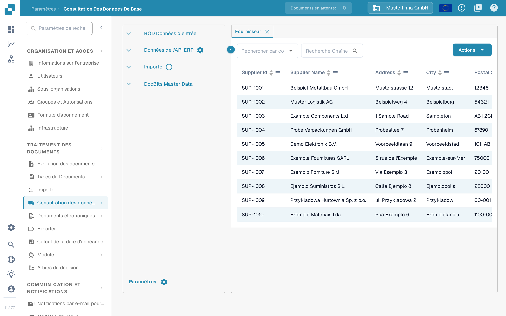
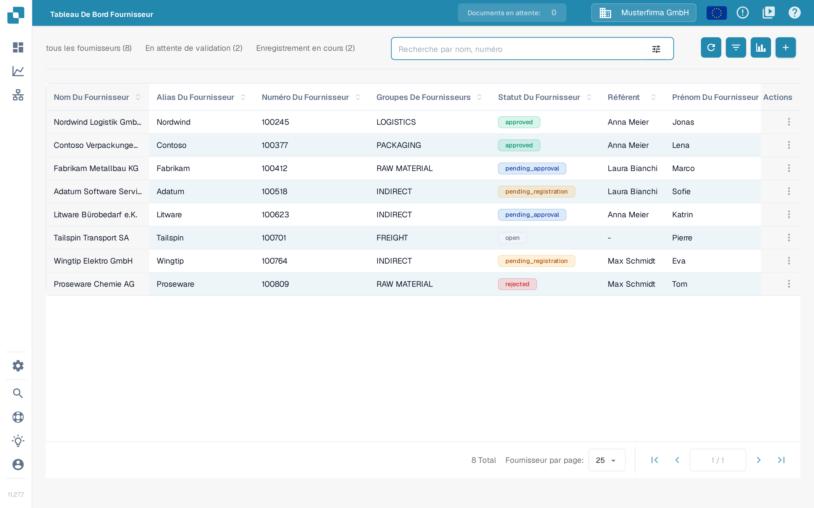

# Démarrer un chargement initial de fournisseurs depuis Infor M3

N'utilisez cette procédure qu'après que votre administrateur Infor a confirmé la société, la division, le BOD `SupplierPartyMaster` et la route ION DocBits. Un chargement initial sans restriction peut envoyer chaque fournisseur éligible ; convenez donc d'abord d'une petite sélection. Les onze captures d'écran Infor M3 ci-dessous sont des exemples historiques ; comparez-les avec votre locataire avant de lancer une tâche. Cette mise à jour de la page n'a exécuté aucune tâche M3 et n'a importé aucun fournisseur dans DocBits.

Infor décrit la [procédure de chargement initial EVS006](https://docs.infor.com/m3core/latest/en-us/useradminlib_cloud/m3cecoreag_cloud/hmo1553266924239.html) et les [options de sélection et d'exécution EVS007](https://docs.infor.com/m3udi/16.x/en-us/m3beud/appfoundhs/spl1567531742751.html). Si les libellés diffèrent, suivez la procédure approuvée de votre locataire.

* [ ] Ouvrez Infor OS et l'application M3 avec un compte autorisé aux chargements initiaux. Confirmez la société et la division prévues avant de continuer.

<figure><figcaption>
Écran de démarrage Infor M3 historique avec EVS006 Initial Load et BOD Processor Administration dans la liste Recent.
</figcaption></figure>

* [ ] Ouvrez **Initial Load. Open (EVS006)** à l'aide de la recherche de programmes de votre locataire.

<figure><figcaption>
Boîte de dialogue Search and Start d'Infor M3 historique avec son champ de saisie et le bouton OK.
</figcaption></figure>

* [ ] Dans EVS006, créez une définition de chargement initial pour **SupplierPartyMaster**. L'exemple historique utilise **CIDMAS** comme table. Demandez à l'administrateur M3 de confirmer que cette combinaison de BOD et de table est valide dans votre version et votre intégration.

<figure><figcaption>
Exemple historique de Search and Start avec EVS006 saisi dans le champ de saisie.
</figcaption></figure>

<figure><figcaption>
Liste de chargement initial EVS006 historique avec SupplierPartyMaster comme BOD noun et CIDMAS comme table.
</figcaption></figure>

* [ ] Sélectionnez **Create** et vérifiez la définition avant de poursuivre.

<figure><figcaption>
Liste EVS006 historique avec le bouton Create de la barre d'outils mis en évidence.
</figcaption></figure>

<figure><figcaption>
Panneau de création EVS006 historique pour CIDMAS avec le champ BOD Description encore vide.
</figcaption></figure>

* [ ] Saisissez une **BOD Description** explicite, par exemple **SupplierPartyMaster initial load for DocBits**.

<figure><figcaption>
Panneau de création EVS006 historique avec SupplierPartyMaster saisi comme BOD Description.
</figcaption></figure>

* [ ] Sélectionnez **Next** et définissez, lorsque cela est possible, une sélection convenue. Infor recommande des critères de sélection pour éviter de déclencher trop d'événements.

<figure><figcaption>
Panneau de création EVS006 historique avec le bouton Next mis en évidence.
</figcaption></figure>

* [ ] Poursuivez avec les paramètres d'exécution. Vérifiez à nouveau la société, la division et la sélection.

<figure><figcaption>
Boîte de dialogue Text d'EVS006 historique avec des champs de bloc de texte et un bouton Next.
</figcaption></figure>

* [ ] Dans la définition SupplierPartyMaster, choisissez **Related → Run**. Cela ouvre **Initial Load Job. Open (EVS007)** ; cela ne prouve pas encore que DocBits a reçu les données.

<figure><figcaption>
Liste EVS006 historique avec le menu Related → Run ouvert sur la ligne SupplierPartyMaster.
</figcaption></figure>

* [ ] Choisissez **Sync** uniquement si le flux ION récepteur attend Sync.SupplierPartyMaster. Confirmez les filtres et la cible avant de soumettre EVS007. Un chargement initial complet peut générer de nombreux événements.

<figure><figcaption>
Tâche de chargement initial EVS007 historique avec CIDMAS, SupplierPartyMaster, Sync et le statut 1-Pending. L'identifiant de la tâche est masqué ; le statut Pending ne prouve pas un import terminé.
</figcaption></figure>

## Vérifier le résultat

Après une exécution autorisée, vérifiez sous **Related → History** dans EVS006 le nombre traité et les éventuelles erreurs. Vérifiez ensuite le message SupplierPartyMaster dans Infor ION et confirmez qu'il a atteint l'organisation DocBits configurée. Cherchez seulement ensuite un fournisseur attendu dans DocBits sous **Paramètres → Consultation des données de base**, onglet **Fournisseur**. Utilisez la recherche avec le numéro ou le nom du fournisseur ; ne partez pas du principe que tous les fournisseurs M3 sont arrivés simplement parce que la tâche a été soumise.

<figure><figcaption>
DocBits Sandbox 11.27.7 : <strong>Paramètres → Consultation des données de base</strong>, onglet <strong>Fournisseur</strong>, avec le filtre <strong>Rechercher par colonne</strong> et le champ <strong>Recherche Chaîne</strong>. Les lignes SUP-1001 à SUP-1010 sont des données d'exemple inventées et ne prouvent pas un import M3 ; les en-têtes de colonnes de cette vue restent en anglais dans cette version de l'interface.
</figcaption></figure>

La capture montre des données de Sandbox inventées, déjà présentes dans l'organisation de test. Aucun locataire M3 n'était connecté lors de cette mise à jour de la documentation. Si le fournisseur attendu manque, comparez l'historique EVS006, le routage ION et l'organisation DocBits avant de relancer le chargement.

### Alternative : Tableau de Bord Fournisseur

Si le portail fournisseurs est utilisé et que l'entrée **Tableau De Bord Fournisseur** apparaît dans le menu principal, les fournisseurs importés y apparaissent aussi, car les deux vues lisent les mêmes données de base fournisseurs. Recherchez par nom ou par numéro de fournisseur avec le champ **Recherche par nom, numéro**. Le fonctionnement de cette vue est décrit dans le guide du [portail fournisseurs](../../../administration-and-setup/setup/supplier-portal/README.md).

<figure><figcaption>
DocBits Sandbox 11.27.7 : <strong>Tableau De Bord Fournisseur</strong> avec le champ <strong>Recherche par nom, numéro</strong> et les onglets <strong>tous les fournisseurs</strong>, <strong>En attente de validation</strong> et <strong>Enregistrement en cours</strong>. Les huit lignes sont des données d'exemple inventées et ne prouvent pas un import M3.
</figcaption></figure>
