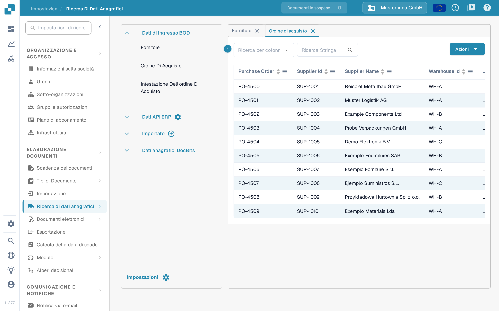

# Fornitori e ordini di acquisto da Infor M3

Questo esempio collega i BOD dei fornitori e degli ordini di acquisto di M3 a DocBits tramite Infor ION. Le quindici immagini Infor riportate di seguito sono esempi storici di un ambiente cliente e non dimostrano che la tua configurazione M3 funzioni attualmente. Il tuo amministratore Infor deve confermare i nomi dei BOD, le tabelle di origine, la società, la divisione, i nomi delle chiamate API e l'ambiente di destinazione prima di avviare un job. Per questo aggiornamento non è stato eseguito alcun caricamento iniziale M3 e nessun import in DocBits.

La [guida al caricamento iniziale di Infor](https://docs.infor.com/m3udi/16.x/en-us/m3beud/appfoundhs/spl1567531742751.html) spiega le definizioni in EVS006, il verbo e la selezione in EVS007, l'invio e il registro storico. Iniziare con una selezione limitata; un'esecuzione senza restrizioni può generare molti eventi.

## **Punto di connessione**

Per creare in seguito il flusso di dati è necessario creare il punto di connessione DocBits API.

In InforOS, andare su ION Desk → Connect → Connection Points

<figure><figcaption>
Navigazione storica: ION Desk → Connect → Connection Points.
</figcaption></figure>

Una volta arrivati qui, occorre creare un nuovo punto di connessione.

<figure><figcaption>
Azione Add storica per creare un punto di connessione.
</figcaption></figure>

**Selezionare API**

Assegnare al punto di connessione un nome e una descrizione che ne descrivano la natura e l'ambiente. Nella scheda Connection, importare l'account di servizio creato per l'ambiente con cui si sta lavorando.

<figure><figcaption>
Scheda Connection storica. I nomi mostrati si riferiscono all'ambiente di esempio; usare il proprio account di servizio.
</figcaption></figure>

Passare quindi alla scheda Documents. Al punto di connessione vanno aggiunti i seguenti BOD: non tutti servono per i dati anagrafici di fornitori e ordini di acquisto, ma saranno utili quando si implementano altre funzioni come la contabilità automatica.

<figure><figcaption>
Elenco storico dei documenti ricevuti. Il BOD fornitore mostrato è Sync.RemitToPartyMaster, senza il suffisso Data.
</figcaption></figure>

Questa configurazione storica usa Sync.RemitToPartyMaster, Sync.SupplierPartyMaster e Sync.PurchaseOrder. Confermare quali BOD richiede la mappatura DocBits; la configurazione può variare in base all'ambiente e alla funzione.

* Sync.RemitToPartyMaster e Sync.SupplierPartyMaster

L'immagine storica seguente mostra Sync.SupplierPartyMaster. Configurare ogni BOD fornitore necessario con il nome della chiamata API e l'operazione di ricezione confermati per il proprio ambiente; la seconda rotta fornitore non è raffigurata.

<figure><figcaption>
Rotta SupplierPartyMaster storica. L'immagine mostra una rotta fornitore; confermare separatamente l'operazione di ricezione per ogni BOD richiesto.
</figcaption></figure>

* Sync.PurchaseOrder

L'immagine storica seguente mostra un'operazione di ricezione degli ordini di acquisto. Confermare l'endpoint attuale e il formato della richiesta per il proprio ambiente.

<figure><figcaption>
Rotta PurchaseOrder storica. Il vecchio percorso del proxy API Gateway è un esempio, non un indirizzo DocBits universale.
</figcaption></figure>

Una volta configurati questi BOD, salvare il punto di connessione con l'icona situata a destra del pulsante Indietro.

## **Flusso di dati**

Questo flusso di dati storico è una possibile struttura; verificarne le rotte e l'organizzazione di ricezione nel proprio ambiente.

<figure><figcaption>
Flusso storico. Il ramo No termina prima dei nodi API; il ramo Sì raggiunge i quattro ambienti di esempio.
</figcaption></figure>

I diversi nodi API DocBits rappresentano ambienti separati in questo esempio. La tua struttura può essere diversa; assicurarsi che i messaggi di test non raggiungano la produzione.

I quattro ambienti sono mostrati solo come esempio.

### **M3**

L'inizio del flusso di dati è costituito dalla tua applicazione M3

### **Filtro**

La configurazione del filtro è la seguente

<figure><figcaption>
Nome e descrizione del filtro storici. Il solo nome Division non stabilisce quali record vengono filtrati.
</figcaption></figure>

<figure><figcaption>
Attributi storici: ogni BOD ha un percorso AccountingEntityID. Verificare il percorso di ogni documento nel proprio ambiente.
</figcaption></figure>

<figure><figcaption>
Esempio storico di Conditions. Used Condition indica Not Filtered anche quando è presente un'espressione; verificare la condizione selezionata e il suo effetto invece di presumere che l'espressione sia attiva.
</figcaption></figure>

(L'ID entità contabile è naturalmente univoco per la tua organizzazione)

### **API DocBits**

Qui si aggiunge un'applicazione e si selezionano le API DocBits create in precedenza

### **Documenti**

Selezionare i documenti assegnati al nodo di origine M3 e ai nodi di ricezione. Verificare che gli attributi del filtro e le rotte di ricezione coprano ogni documento richiesto.

<figure><figcaption>
Selezione storica dei documenti per il flusso M3. Si tratta di un elenco di documenti BOD, non della configurazione di un nodo file.
</figcaption></figure>

## **Attivazione dei BOD M3**

Aprire l'applicazione Infor M3

In M3 aprire il controllo **Search and Start**, inserire **EVS006** e confermare il programma. Usare la navigazione supportata dal proprio client M3.

<figure><figcaption>
Ricerca programma storica: inserire EVS006 in Search and Start.
</figcaption></figure>

In EVS006 definire i BOD noun richiesti dalla mappatura approvata. L'esempio storico usa SupplierPartyMaster, RemitToPartyMaster e PurchaseOrder. Confermare i nomi delle tabelle M3 nella propria versione prima di creare una definizione di caricamento iniziale.

BOD noun: SupplierPartyMaster

Table: CIDMAS

BOD noun: RemitToPartyMaster

Table: CIDMAS

BOD noun: PurchaseOrder

Table: MPHEAD

Usare l'azione di aggiunta per ogni definizione approvata. Controllare società e divisione prima di proseguire.

<figure><figcaption>
Azione Add storica in EVS006. Questo ritaglio non mostra definizioni di caricamento iniziale compilate.
</figcaption></figure>

Dopo aver aggiunto tutti i BOD, fare clic con il tasto destro sul BOD noun del BOD e selezionare Related → Run

<figure><figcaption>
Azione storica Related → Run. Con History si controlla in seguito il risultato del caricamento iniziale.
</figcaption></figure>

L'azione collegata **Run** apre EVS007. Scegliere **Sync** solo se il flusso ION di ricezione lo prevede. Verificare la selezione e i filtri prima dell'invio definitivo; passare alla schermata successiva non dimostra la consegna.

<figure><figcaption>
Selezione storica del verbo in EVS007 prima dell'esecuzione. L'immagine mostra un job in attesa e un'opzione Sync annotata; non dimostra che Sync sia stato scelto o che i dati siano stati importati.
</figcaption></figure>

Una notifica di invio conferma che il job è stato richiesto. In EVS006, in **History**, controllare il numero di record elaborati e gli errori. Verificare poi il messaggio e la destinazione in Infor ION.

## Verifica in DocBits

Nell'organizzazione DocBits prevista aprire **Impostazioni → Elaborazione documenti → Ricerca di dati anagrafici → Dati di ingresso BOD → Fornitore**. Selezionare il campo identificativo in **Ricerca per colonna**, inserire in **Ricerca Stringa** un numero o un nome di fornitore noto e avviare la ricerca con la lente. Aprire poi **Ordine di acquisto** e cercare un numero d'ordine noto; se la mappatura separa intestazione e righe, controllare anche **Intestazione Dell'ordine Di Acquisto**. Confrontare identificativi e società con l'origine M3. Una richiesta EVS007 riuscita, da sola, non dimostra che tutti i record siano arrivati.

<figure><figcaption>
Vista Fornitore nella versione sandbox 11.27.7 con dati di esempio inventati. Cercare un identificativo di test noto e confrontarlo con M3 e ION.
</figcaption></figure>

<figure><figcaption>
Vista Ordine di acquisto nella versione sandbox 11.27.7 con dati di esempio inventati. Le righe non dimostrano un import M3.
</figcaption></figure>

Le immagini di questa sezione provengono dall'interfaccia sandbox distribuita (versione 11.27.7) con dati di esempio inventati. Non è stato avviato alcun job M3, non è stato importato alcun file e non è stato modificato alcun dato anagrafico; le immagini mostrano dove verificare, non un trasferimento completato. Se manca un record previsto, controllare il registro storico EVS006, il routing ION, la mappatura BOD e l'organizzazione DocBits prima di riprovare.
