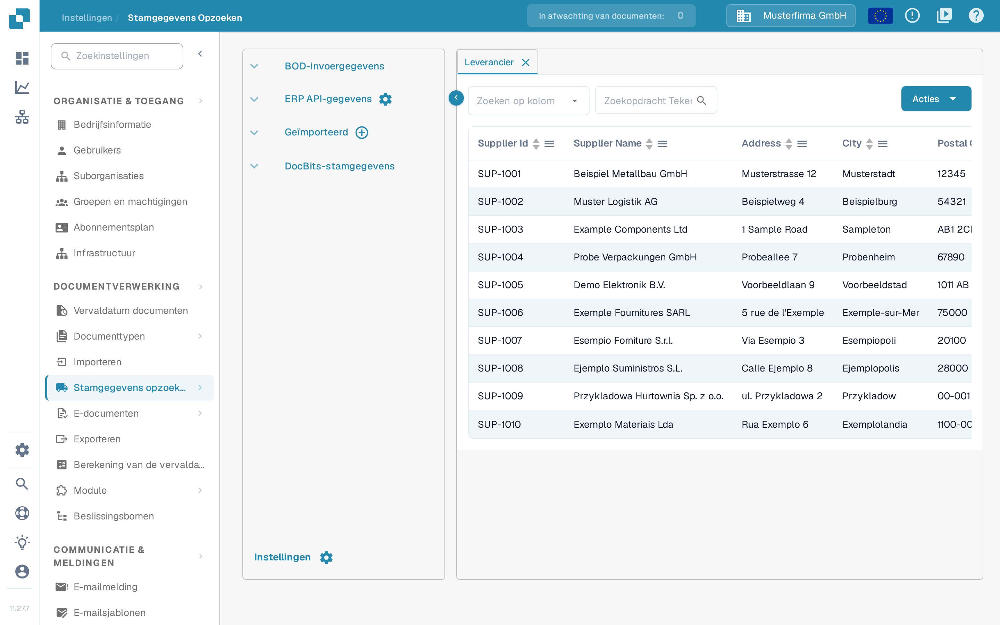
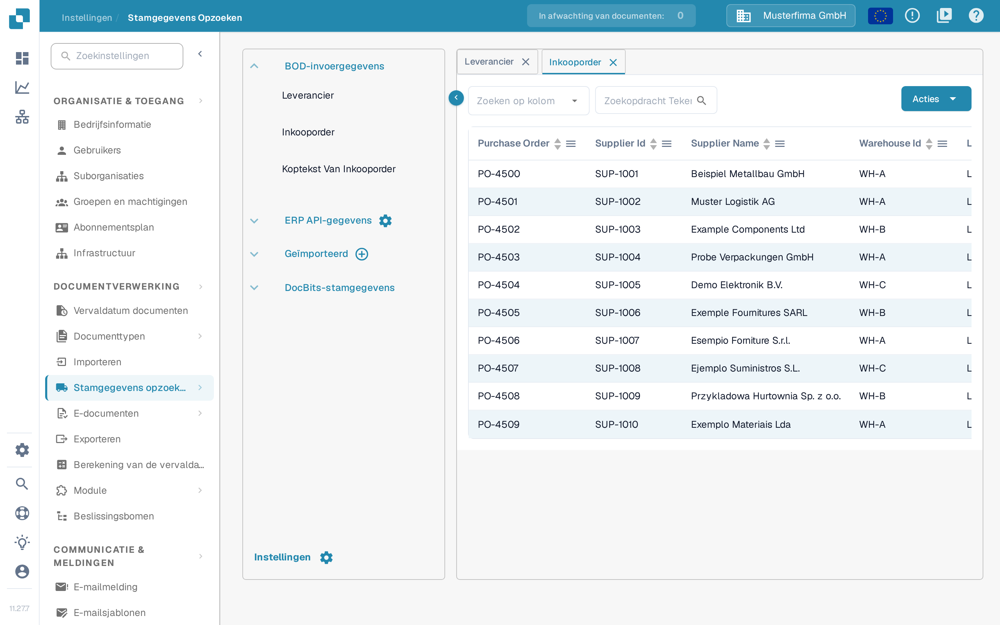

# Leveranciers en inkooporders uit Infor M3

Dit voorbeeld koppelt de BOD's voor leveranciers en inkooporders uit M3 via Infor ION aan DocBits. De vijftien Infor-afbeeldingen hieronder zijn historische voorbeelden uit een tenant en vormen geen actuele controle van uw M3-installatie. Vraag de Infor-beheerder de BOD-namen, brontabellen, het bedrijf, de divisie, de namen van de API-aanroepen en de doelomgeving te bevestigen voordat u een taak uitvoert. Voor deze update zijn geen M3-initial-load en geen DocBits-import uitgevoerd.

De [handleiding voor de initial load](https://docs.infor.com/m3udi/16.x/en-us/m3beud/appfoundhs/spl1567531742751.html) van Infor legt de definities in EVS006 uit, evenals het werkwoord en de selectie in EVS007, het indienen en de geschiedenis. Gebruik eerst een beperkte selectie; een onbeperkte uitvoering kan veel gebeurtenissen opleveren.

## **Verbindingspunt**

U moet het verbindingspunt van de DocBits-API maken om later de gegevensstroom te kunnen aanmaken.

Navigeer in InforOS naar ION Desk → Connect → Connection Points

<figure><figcaption>
Historische navigatie: ION Desk → Connect → Connection Points.
</figcaption></figure>

Eenmaal hier moet u een nieuw verbindingspunt aanmaken.

<figure><figcaption>
Historische actie Add om een verbindingspunt aan te maken.
</figcaption></figure>

**Select API**

Geef het verbindingspunt een naam en een beschrijving die de aard en de omgeving ervan aangeeft. Importeer op het tabblad Connection het serviceaccount dat u hebt aangemaakt voor de omgeving waarmee u werkt.

<figure><figcaption>
Historisch tabblad Connection. De getoonde namen horen bij de voorbeeldomgeving; gebruik uw eigen serviceaccount.
</figcaption></figure>

Ga vervolgens naar het tabblad Documents. U moet de volgende BOD's aan het verbindingspunt toevoegen; niet allemaal zijn ze nodig voor de stamgegevens van leveranciers en inkooporders, maar ze zijn wel nuttig wanneer andere functies zoals Automatic Accounting moeten worden ingevoerd.

<figure><figcaption>
Historische lijst met ontvangen documenten. De getoonde leveranciers-BOD is Sync.RemitToPartyMaster, zonder het achtervoegsel Data.
</figcaption></figure>

Deze historische opzet gebruikt Sync.RemitToPartyMaster, Sync.SupplierPartyMaster en Sync.PurchaseOrder. Bevestig welke BOD's uw DocBits-mapping nodig heeft; de opzet kan per tenant en per functie verschillen.

* Sync.RemitToPartyMaster en Sync.SupplierPartyMaster

De volgende historische afbeelding toont Sync.SupplierPartyMaster. Richt elke vereiste leveranciers-BOD in met de API-aanroepnaam en de ontvangende bewerking die voor uw omgeving zijn bevestigd; de tweede leveranciersroute staat niet op de afbeelding.

<figure><figcaption>
Historische route SupplierPartyMaster. De afbeelding toont één leveranciersroute; bevestig de ontvangende bewerking apart voor elke vereiste BOD.
</figcaption></figure>

* Sync.PurchaseOrder

De volgende historische afbeelding toont één ontvangende bewerking voor inkooporders. Bevestig het actuele eindpunt en het aanvraagformaat voor uw omgeving.

<figure><figcaption>
Historische route PurchaseOrder. Het oude proxypad van de API Gateway is een voorbeeld, geen universeel DocBits-adres.
</figcaption></figure>

Zodra deze BOD's zijn geconfigureerd, kunt u het verbindingspunt opslaan met het pictogram rechts van de terugknop.

## **Gegevensstroom**

Deze historische gegevensstroom is één mogelijke opzet; controleer de routes en de ontvangende organisatie in uw eigen tenant.

<figure><figcaption>
Historische gegevensstroom. De tak No eindigt vóór de API-knooppunten; de tak Yes bereikt de vier voorbeeldomgevingen.
</figcaption></figure>

De meerdere DocBits-API-knooppunten staan in dit voorbeeld voor afzonderlijke omgevingen. Uw opzet kan afwijken; controleer dat testberichten de productieomgeving niet kunnen bereiken.

De vier omgevingen dienen alleen als voorbeeld.

### **M3**

Het begin van de gegevensstroom bestaat uit uw M3-toepassing

### **Filter**

De configuratie van het filter ziet er als volgt uit

<figure><figcaption>
Historische filternaam en -beschrijving. De naam Division alleen bepaalt niet welke records worden gefilterd.
</figcaption></figure>

<figure><figcaption>
Historische attributen: elke BOD heeft een AccountingEntityID-pad. Controleer het pad voor elk document in uw tenant.
</figcaption></figure>

<figure><figcaption>
Historisch voorbeeld van Conditions. Used Condition staat op Not Filtered terwijl er wel een uitdrukking staat; controleer de geselecteerde voorwaarde en het effect ervan in plaats van aan te nemen dat de uitdrukking actief is.
</figcaption></figure>

(De boekhoudkundige entiteit-ID is uiteraard uniek voor uw organisatie)

### **DocBits-API**

Hier voegt u een toepassing toe en selecteert u de DocBits-API('s) die u eerder hebt aangemaakt

### **Documenten**

Selecteer de documenten die aan de M3-bron en aan de ontvangende knooppunten zijn toegewezen. Controleer dat de filterattributen en de ontvangende routes elk vereist document dekken.

<figure><figcaption>
Historische documentselectie voor de M3-stroom. Dit is een BOD-documentlijst, geen configuratie van een bestandsknooppunt.
</figcaption></figure>

## **BOD's activeren in M3**

Navigeer naar de Infor M3-toepassing

Open het besturingselement **Search and Start** van M3, voer **EVS006** in en bevestig het programma. Gebruik de navigatie die uw M3-client ondersteunt.

<figure><figcaption>
Historisch zoeken naar een programma: voer EVS006 in bij Search and Start.
</figcaption></figure>

Definieer in EVS006 de BOD-namen die voor uw goedgekeurde mapping nodig zijn. Het historische voorbeeld gebruikt SupplierPartyMaster, RemitToPartyMaster en PurchaseOrder. Controleer de bijbehorende M3-tabelnamen in uw versie voordat u een initial-loaddefinitie aanmaakt.

BOD noun: SupplierPartyMaster

Table: CIDMAS

BOD noun: RemitToPartyMaster

Table: CIDMAS

BOD noun: PurchaseOrder

Table: MPHEAD

Gebruik per goedgekeurde definitie de actie voor toevoegen. Controleer bedrijf en divisie voordat u verdergaat.

<figure><figcaption>
Historische actie Add in EVS006. Deze uitsnede toont geen ingevulde initial-loaddefinities.
</figcaption></figure>

Nadat u elk van de BOD's hebt toegevoegd, klikt u met de rechtermuisknop op de BOD-naam van de BOD en selecteert u Related → Run

<figure><figcaption>
Historische actie Related → Run. Gebruik later History om het resultaat van de initial load te controleren.
</figcaption></figure>

De gerelateerde actie **Run** opent EVS007. Kies **Sync** alleen wanneer de ontvangende ION-stroom dat verwacht. Controleer de selectie en de filters vóór de definitieve indiening; doorgaan naar het volgende scherm bewijst niet dat de gegevens zijn afgeleverd.

<figure><figcaption>
Historische keuze van het werkwoord in EVS007 vóór uitvoering. De afbeelding toont een openstaande taak en een aangetekende optie Sync; ze bewijst niet dat Sync is gekozen of dat gegevens zijn geïmporteerd.
</figcaption></figure>

Een melding bij de indiening bevestigt dat de taak is aangevraagd. Controleer in **History** van EVS006 het aantal verwerkte records en de fouten. Controleer daarna het bericht en de bestemming in Infor ION.

## Controleren in DocBits

Open in de bedoelde DocBits-organisatie **Instellingen → Documentverwerking → Stamgegevens opzoeken → BOD-invoergegevens → Leverancier**. Kies het identificatieveld in **Zoeken op kolom**, voer een bekend leveranciersnummer of een bekende naam in bij **Zoekopdracht Tekenreeks** en gebruik het vergrootglas om te zoeken. Open daarna **Inkooporder** en zoek een bekend inkoopordernummer; controleer **Koptekst Van Inkooporder** als uw mapping kop- en regelgegevens scheidt. Vergelijk de identificaties en het bedrijf met de M3-bron. Een geslaagd EVS007-verzoek alleen bewijst niet dat alle gegevens zijn aangekomen.

<figure><figcaption>
Leveranciersweergave in sandboxversie 11.27.7 met verzonnen voorbeeldgegevens. Zoek een bekende testidentificatie en vergelijk die met M3 en ION.
</figcaption></figure>

<figure><figcaption>
Inkooporderweergave in sandboxversie 11.27.7 met verzonnen voorbeeldgegevens. De regels bewijzen geen M3-import.
</figcaption></figure>

De Engelstalige Dev-weergaven zijn op 29 oktober 2026 gecontroleerd zonder een M3-taak uit te voeren, een bestand te importeren of stamgegevens te wijzigen; daar zijn de recordrijen weggelaten. De twee Nederlandse afbeeldingen komen uit sandboxversie 11.27.7 en tonen verzonnen voorbeeldrijen in plaats van echte stamgegevens; ze laten zien waar u controleert, niet dat een overdracht is voltooid. Ontbreekt een verwachte record, controleer dan de geschiedenis in EVS006, de routering in ION, de BOD-mapping en de DocBits-organisatie voordat u opnieuw uitvoert.
