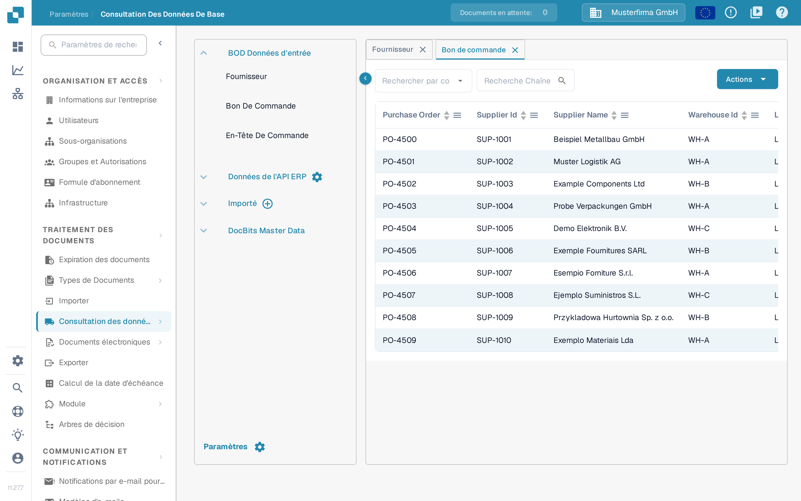

# Fournisseurs et commandes fournisseur depuis Infor M3

Cet exemple relie les BOD fournisseur et commande fournisseur de M3 à DocBits via Infor ION. Les quinze images Infor ci-dessous sont des exemples historiques d'un tenant ; elles ne valident pas votre configuration M3 actuelle. Demandez à l'administrateur Infor de confirmer les noms de BOD, les tables source, la société, la division, les noms d'appel API et l'environnement cible avant de lancer un job. Aucun chargement initial M3 ni import DocBits n'a été exécuté pour cette mise à jour.

Le [guide de chargement initial](https://docs.infor.com/m3udi/16.x/en-us/m3beud/appfoundhs/spl1567531742751.html) d'Infor décrit les définitions dans EVS006, le verbe et la sélection dans EVS007, la soumission et l'historique. Commencez par une sélection limitée ; une exécution sans restriction peut générer beaucoup d'événements.

## **Point de connexion**

Vous devez créer le point de connexion de l'API DocBits pour pouvoir construire ensuite le flux de données.

Dans InforOS, ouvrez ION Desk → Connect → Connection Points.

<figure><figcaption>
Navigation historique : ION Desk → Connect → Connection Points.
</figcaption></figure>

Une fois sur cette page, vous devez créer un nouveau point de connexion.

<figure><figcaption>
Action historique Add pour créer un point de connexion.
</figcaption></figure>

**Sélectionnez API**

Donnez au point de connexion un nom et une description qui décrivent sa nature et son environnement. Sous l'onglet Connection, importez le compte de service que vous avez créé pour l'environnement utilisé.

<figure><figcaption>
Onglet historique Connection. Les noms affichés renvoient à l'environnement d'exemple ; utilisez votre propre compte de service.
</figcaption></figure>

Passez ensuite à l'onglet Documents. Vous devez ajouter les BOD suivants au point de connexion. Tous ne sont pas nécessaires aux données de base des fournisseurs et des commandes fournisseur, mais ils seront utiles lorsque d'autres fonctions, comme la comptabilisation automatique, devront être mises en place.

<figure><figcaption>
Liste historique des documents reçus. Le BOD fournisseur affiché est Sync.RemitToPartyMaster, sans suffixe Data.
</figcaption></figure>

Cette configuration historique utilise Sync.RemitToPartyMaster, Sync.SupplierPartyMaster et Sync.PurchaseOrder. Confirmez les BOD nécessaires à votre mapping DocBits ; la configuration peut varier selon le tenant et la fonction.

* Sync.RemitToPartyMaster et Sync.SupplierPartyMaster

L'image historique suivante montre Sync.SupplierPartyMaster. Configurez chaque BOD fournisseur requis avec le nom d'appel API et l'opération de réception confirmés pour votre environnement ; la seconde route fournisseur n'est pas représentée.

<figure><figcaption>
Route historique SupplierPartyMaster. L'image ne montre qu'une route fournisseur ; confirmez séparément l'opération de réception de chaque BOD requis.
</figcaption></figure>

* Sync.PurchaseOrder

L'image historique suivante montre une opération de réception de commande fournisseur. Confirmez son point de terminaison actuel et le format de requête pour votre environnement.

<figure><figcaption>
Route historique PurchaseOrder. L'ancien chemin du proxy API Gateway est un exemple, pas une adresse DocBits universelle.
</figcaption></figure>

Une fois ces BOD configurés, vous pouvez enregistrer le point de connexion en actionnant l'icône située à droite du bouton de retour.

## **Flux de données**

Ce flux de données historique est une conception possible ; vérifiez ses routes et son organisation de réception dans votre propre tenant.

<figure><figcaption>
Flux historique. La branche No se termine avant les nœuds d'API ; la branche Yes atteint les quatre environnements d'exemple.
</figcaption></figure>

Les multiples nœuds d'API DocBits représentent des environnements distincts dans cet exemple. Votre conception peut différer ; vérifiez que des messages de test ne peuvent pas atteindre la production.

Quatre environnements ne sont affichés qu'à titre d'exemple.

### **M3**

Le début du flux de données est constitué par votre application M3.

### **Filtre**

La configuration du filtre se présente comme suit.

<figure><figcaption>
Nom et description historiques du filtre. Le seul nom Division n'établit pas quels enregistrements sont filtrés.
</figcaption></figure>

<figure><figcaption>
Attributs historiques : chaque BOD possède un chemin AccountingEntityID. Vérifiez le chemin de chaque document dans votre tenant.
</figcaption></figure>

<figure><figcaption>
Exemple historique de conditions. Used Condition affiche Not Filtered alors qu'une expression est listée ; vérifiez la condition sélectionnée et son effet au lieu de supposer que l'expression est active.
</figcaption></figure>

(L'identifiant d'entité comptable est bien entendu propre à votre organisation.)

### **API DocBits**

Ici, vous ajoutez une application et sélectionnez la ou les API DocBits créées précédemment.

### **Documents**

Sélectionnez les documents affectés au nœud source M3 et aux nœuds de réception. Vérifiez que les attributs du filtre et les routes de réception couvrent chaque document requis.

<figure><figcaption>
Sélection historique des documents du flux M3. Il s'agit d'une liste de documents BOD, pas d'une configuration de nœud de fichier.
</figcaption></figure>

## **Déclenchement des BOD M3**

Accédez à l'application Infor M3.

Ouvrez le contrôle **Search and Start** de M3, saisissez **EVS006** et confirmez le programme. Utilisez la navigation prise en charge par votre client M3.

<figure><figcaption>
Recherche historique de programme : saisissez EVS006 dans Search and Start.
</figcaption></figure>

Dans EVS006, définissez les noms de BOD requis pour votre mapping validé. L'exemple historique utilise SupplierPartyMaster, RemitToPartyMaster et PurchaseOrder. Confirmez leurs noms de table M3 dans votre version avant de créer une définition de chargement initial.

BOD noun: SupplierPartyMaster

Table: CIDMAS

BOD noun: RemitToPartyMaster

Table: CIDMAS

BOD noun: PurchaseOrder

Table: MPHEAD

Utilisez l'action d'ajout pour chaque définition validée. Vérifiez la société et la division avant de continuer.

<figure><figcaption>
Action historique Add dans EVS006. Cette capture ne montre pas de définitions de chargement initial renseignées.
</figcaption></figure>

Après avoir ajouté chacun des BOD, faites un clic droit sur le nom de BOD et sélectionnez Related → Run.

<figure><figcaption>
Action historique Related → Run. Utilisez ensuite History pour examiner le résultat du chargement initial.
</figcaption></figure>

L'action associée **Run** ouvre EVS007. Ne choisissez **Sync** que si le flux ION de réception l'attend. Vérifiez la sélection et les filtres avant la soumission finale ; le passage à l'écran suivant ne prouve pas la livraison.

<figure><figcaption>
Sélection historique du verbe dans EVS007 avant l'exécution. L'image montre un job en attente et une option Sync annotée ; elle ne prouve pas que Sync a été sélectionné ni que des données ont été importées.
</figcaption></figure>

Une notification de soumission confirme que le job a été demandé. Dans **History** d'EVS006, vérifiez le nombre d'éléments traités et les erreurs. Contrôlez ensuite le message et la cible dans Infor ION.

## Vérification dans DocBits

Ouvrez **Paramètres → Traitement des documents → Consultation des données de base → BOD Données d'entrée → Fournisseur** dans l'organisation DocBits visée. Choisissez le champ identifiant dans **Rechercher par colonne**, saisissez un numéro ou un nom de fournisseur connu dans **Recherche Chaîne** et lancez la recherche avec la loupe. Le bouton **Actions** propose **Télécharger en CSV**, **Mettre à jour l'alias** et **Masquer les colonnes vides**. Ouvrez ensuite **Bon de commande** et recherchez un numéro de commande connu ; vérifiez **En-Tête De Commande** si votre mapping sépare les données d'en-tête et de ligne. Comparez les identifiants et la société avec la source M3. Une requête EVS007 réussie ne prouve pas à elle seule que tous les enregistrements sont arrivés.

<figure><figcaption>
Vue Fournisseur de DocBits en français (version Sandbox 11.27.7). Les lignes affichées sont des données d'exemple inventées : recherchez un identifiant de test connu et comparez-le avec M3 et ION.
</figcaption></figure>

<figure><figcaption>
Vue Bon de commande de DocBits en français (version Sandbox 11.27.7). Les lignes sont des données d'exemple inventées et ne prouvent pas un import M3.
</figcaption></figure>

Les deux vues françaises ont été capturées le 12 novembre 2026 sur la version Sandbox 11.27.7, sans lancer de job M3, importer de fichier ni modifier de données de base. Les lignes visibles sont des données d'exemple inventées : ces images indiquent où vérifier, pas un transfert abouti. Si un enregistrement attendu manque, vérifiez l'historique EVS006, le routage ION, le mapping des BOD et l'organisation DocBits avant de relancer.
