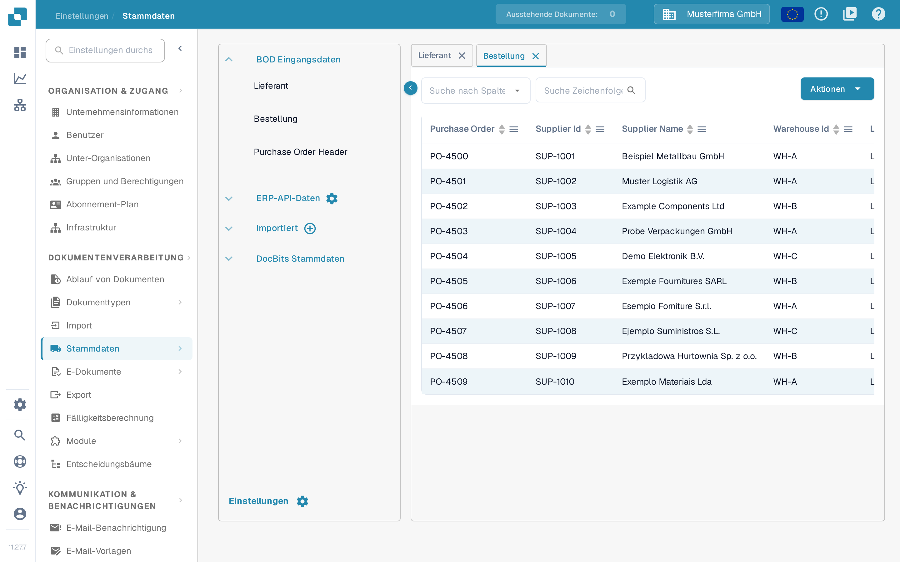

# Lieferanten und Bestellungen aus Infor M3

Dieses Beispiel verbindet die BODs für Lieferanten und Bestellungen aus M3 über Infor ION mit DocBits. Die fünfzehn Infor-Bilder auf dieser Seite sind historische Beispiele aus einem Kundenmandanten und belegen nicht, dass Ihre M3-Einrichtung aktuell funktioniert. Lassen Sie vom Infor-Administrator die BOD-Namen, Quelltabellen, Firma, Division, API-Call-Namen und das Zielsystem bestätigen, bevor Sie einen Job starten. Für diese Überarbeitung wurde kein M3-Initial-Load und kein DocBits-Import ausgeführt.

Der [Initial-Load-Leitfaden von Infor](https://docs.infor.com/m3udi/16.x/en-us/m3beud/appfoundhs/spl1567531742751.html) erklärt die Definitionen in EVS006, den BOD-Verb mit der Auswahl, das Absenden und den Verlauf. Wählen Sie zuerst eine kleine Auswahl; ein uneingeschränkter Lauf kann sehr viele Ereignisse erzeugen.

## **Verbindungspunkt**

Sie müssen den DocBits-API-Verbindungspunkt anlegen, um später den Datenfluss erstellen zu können.

Navigieren Sie in InforOS zu ION Desk → Connect → Connection Points

<figure><figcaption>
Historische Navigation: ION Desk → Connect → Connection Points.
</figcaption></figure>

Dort angekommen legen Sie einen neuen Verbindungspunkt an.

<figure><figcaption>
Historische Aktion Add zum Anlegen eines Verbindungspunkts.
</figcaption></figure>

**Wählen Sie API**

Geben Sie dem Verbindungspunkt einen Namen und eine Beschreibung, die seinen Zweck und seine Umgebung wiedergeben. Importieren Sie unter dem Reiter „Connection" das Service-Konto, das Sie für die Umgebung angelegt haben, mit der Sie arbeiten.

<figure><figcaption>
Historischer Reiter Connection. Die gezeigten Namen gehören zur Beispielumgebung; verwenden Sie Ihr eigenes Service-Konto.
</figcaption></figure>

Wechseln Sie anschließend zum Reiter „Documents". Fügen Sie dem Verbindungspunkt die folgenden BODs hinzu. Nicht alle sind für die Stammdaten zu Lieferanten und Bestellungen nötig, sie werden aber gebraucht, wenn weitere Funktionen wie Auto Accounting eingerichtet werden.

<figure><figcaption>
Historische Liste der empfangenen Dokumente. Der gezeigte Lieferanten-BOD heißt Sync.RemitToPartyMaster, ohne das Suffix Data.
</figcaption></figure>

Diese historische Einrichtung verwendet Sync.RemitToPartyMaster, Sync.SupplierPartyMaster und Sync.PurchaseOrder. Bestätigen Sie, welche BODs Ihr DocBits-Mapping benötigt; die Einrichtung kann je nach Mandant und Funktion abweichen.

* Sync.RemitToPartyMaster und Sync.SupplierPartyMaster

Das folgende historische Bild zeigt Sync.SupplierPartyMaster. Konfigurieren Sie jeden benötigten Lieferanten-BOD mit dem API-Call-Namen und der empfangenden Operation, die für Ihre Umgebung bestätigt wurden; die zweite Lieferantenroute ist nicht abgebildet.

<figure><figcaption>
Historische Route SupplierPartyMaster. Das Bild zeigt eine Lieferantenroute; bestätigen Sie die empfangende Operation für jeden benötigten BOD separat.
</figcaption></figure>

* Sync.PurchaseOrder

Das folgende historische Bild zeigt eine empfangende Operation für Bestellungen. Bestätigen Sie den aktuellen Endpunkt und das Anforderungsformat für Ihre Umgebung.

<figure><figcaption>
Historische Route PurchaseOrder. Der gezeigte alte API-Gateway-Pfad ist ein Beispiel und keine allgemeingültige DocBits-Adresse.
</figcaption></figure>

Sind diese BODs konfiguriert, speichern Sie den Verbindungspunkt über das Symbol direkt rechts neben der Zurück-Schaltfläche.

## **Datenfluss**

Dieser historische Datenfluss ist ein möglicher Aufbau; prüfen Sie Routen und empfangende Organisation in Ihrem eigenen Mandanten.

<figure><figcaption>
Historischer Ablauf. Der Nein-Zweig endet vor den API-Knoten; der Ja-Zweig erreicht die vier Beispielumgebungen.
</figcaption></figure>

Die mehreren DocBits-API-Knoten stehen in diesem Beispiel für getrennte Umgebungen. Ihr Aufbau kann abweichen; stellen Sie sicher, dass Testnachrichten die Produktion nicht erreichen.

Die vier Umgebungen sind nur ein Beispiel.

### **M3**

Der Beginn des Datenflusses ist Ihre M3-Anwendung

### **Filter**

Die Konfiguration des Filters sieht wie folgt aus

<figure><figcaption>
Historischer Filtername und Beschreibung. Der Name Division allein sagt nicht, welche Datensätze gefiltert werden.
</figcaption></figure>

<figure><figcaption>
Historische Attribute: Jeder BOD hat einen Pfad AccountingEntityID. Prüfen Sie den Pfad für jedes Dokument in Ihrem Mandanten.
</figcaption></figure>

<figure><figcaption>
Historisches Beispiel für Conditions. Used Condition zeigt Not Filtered, obwohl ein Ausdruck eingetragen ist; prüfen Sie die gewählte Bedingung und ihre Wirkung, statt von einem aktiven Ausdruck auszugehen.
</figcaption></figure>

(Die Buchungskreis-ID (Accounting Entity ID) ist selbstverständlich für Ihre Organisation einzigartig.)

### **DocBits-API**

Hier fügen Sie eine Anwendung hinzu und wählen die zuvor angelegte(n) DocBits-API(s) aus

### **Dokumente**

Wählen Sie die Dokumente aus, die dem M3-Quellknoten und den empfangenden Knoten zugeordnet sind. Prüfen Sie, dass die Filterattribute und die empfangenden Routen jedes benötigte Dokument abdecken.

<figure><figcaption>
Historische Dokumentauswahl für den M3-Ablauf. Das ist eine BOD-Dokumentliste, keine Konfiguration eines Datei-Knotens.
</figcaption></figure>

## **M3-BODs auslösen**

Öffnen Sie die Infor-M3-Anwendung

Öffnen Sie in M3 das Steuerelement **Search and Start**, geben Sie **EVS006** ein und bestätigen Sie das Programm. Verwenden Sie die Navigation, die Ihr M3-Client unterstützt.

<figure><figcaption>
Historische Programmsuche: EVS006 in Search and Start eingeben.
</figcaption></figure>

Legen Sie in EVS006 die BOD-Nouns an, die Ihr freigegebenes Mapping benötigt. Das historische Beispiel verwendet SupplierPartyMaster, RemitToPartyMaster und PurchaseOrder. Bestätigen Sie deren M3-Tabellennamen in Ihrer Version, bevor Sie eine Initial-Load-Definition anlegen.

BOD Noun: SupplierPartyMaster

Table: CIDMAS

BOD Noun: RemitToPartyMaster

Table: CIDMAS

BOD Noun: PurchaseOrder

Table: MPHEAD

Verwenden Sie für jede freigegebene Definition die Aktion zum Hinzufügen. Prüfen Sie Firma und Division, bevor Sie fortfahren.

<figure><figcaption>
Historische Aktion Add in EVS006. Dieser Ausschnitt zeigt keine ausgefüllten Initial-Load-Definitionen.
</figcaption></figure>

Nachdem Sie alle BODs hinzugefügt haben, klicken Sie mit der rechten Maustaste auf das BOD Noun des BOD und wählen Sie Related → Run

<figure><figcaption>
Historische Aktion Related → Run. Mit History prüfen Sie später das Ergebnis des Initial Load.
</figcaption></figure>

Die verknüpfte Aktion **Run** öffnet EVS007. Wählen Sie **Sync** nur, wenn der empfangende ION-Ablauf es erwartet. Prüfen Sie Auswahl und Filter vor dem endgültigen Absenden; das Wechseln zum nächsten Bildschirm ist kein Beleg für eine Zustellung.

<figure><figcaption>
Historische Verb-Auswahl in EVS007 vor der Ausführung. Das Bild zeigt einen wartenden Job und eine markierte Sync-Option; es belegt nicht, dass Sync gewählt oder Daten importiert wurden.
</figcaption></figure>

Eine Absendebestätigung zeigt, dass der Job angefordert wurde. Prüfen Sie in EVS006 unter **History** die verarbeitete Anzahl und die Fehler. Kontrollieren Sie anschließend Nachricht und Ziel in Infor ION.

## Prüfung in DocBits

Öffnen Sie in der vorgesehenen DocBits-Organisation **Einstellungen → Dokumentenverarbeitung → Stammdaten → BOD Eingangsdaten → Lieferant**. Wählen Sie im Feld **Suche nach Spalten** das Feld für die Kennung, geben Sie in **Suche Zeichenfolge** eine bekannte Lieferantennummer oder einen Namen ein und starten Sie die Suche mit dem Lupensymbol. Öffnen Sie danach **Bestellung** und suchen Sie eine bekannte Bestellnummer; prüfen Sie bei getrennten Kopf- und Positionsdaten zusätzlich **Purchase Order Header** (dieser Eintrag wird auch in der deutschen Oberfläche englisch angezeigt). Vergleichen Sie Kennungen und Firma mit der M3-Quelle. Eine erfolgreiche EVS007-Anforderung allein belegt nicht, dass alle Datensätze angekommen sind.

<figure><figcaption>
Lieferantenansicht in der Sandbox-Version 11.27.7 mit erfundenen Beispieldaten. Suchen Sie eine bekannte Testkennung und vergleichen Sie sie mit M3 und ION.
</figcaption></figure>

<figure><figcaption>
Bestellansicht in der Sandbox-Version 11.27.7 mit erfundenen Beispieldaten. Die Zeilen belegen keinen M3-Import.
</figcaption></figure>

Die Bilder in diesem Abschnitt stammen aus der ausgelieferten Sandbox-Oberfläche (Version 11.27.7) mit erfundenen Beispieldaten. Es wurde kein M3-Job gestartet, keine Datei importiert und kein Stammdatum geändert; die Bilder zeigen, wo Sie prüfen, nicht einen abgeschlossenen Transfer. Fehlt ein erwarteter Datensatz, prüfen Sie den EVS006-Verlauf, das ION-Routing, das BOD-Mapping und die DocBits-Organisation, bevor Sie erneut starten.
