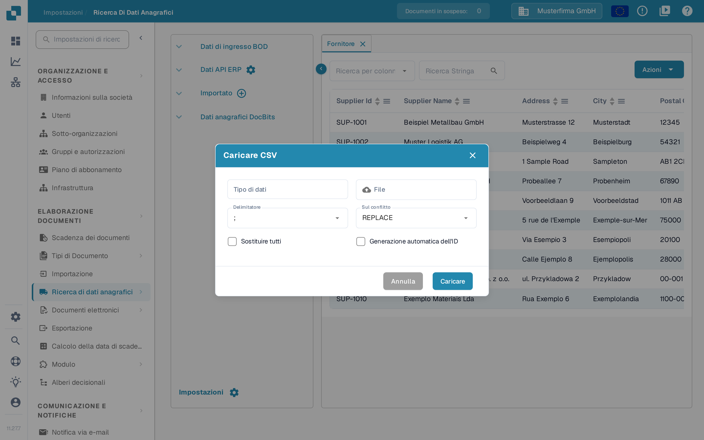
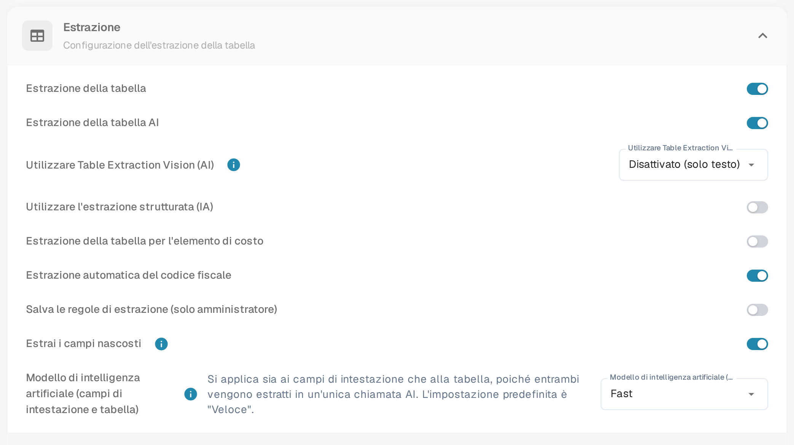

# Importare gli elementi di costo M3 per l'estrazione delle tabelle

Quando DocBits segnala, all'apertura di un documento, che gli elementi di costo non sono configurati correttamente, controlla sia i dati importati degli elementi di costo sia l'impostazione dell'estrazione delle tabelle. Questa guida mostra dove preparare i dati e dove verificarli in DocBits. Il significato del messaggio è descritto in [Elementi di costo non configurati correttamente](../../../overview-and-basics/faq/infor-m3-m3-integration/costing-elements-are-not-properly-configured.-please-ask-your-admin-to-configure-it..md).

## 1. Preparare l'esportazione M3

1. Nel tuo ambiente M3 apri **PPS280** e seleziona le righe degli elementi di costo necessarie alla tua organizzazione. I menu e le righe disponibili dipendono dal tuo tenant M3 e dalle tue autorizzazioni.
2. Se la schermata M3 offre **Tools → Export to Excel**, esporta le righe selezionate o tutte le righe necessarie. Controlla l'ambito prima di esportare: la finestra storica mostrata sotto ha un numero massimo di righe.
3. Conserva l'esportazione originale. Lavora su una copia, così puoi confrontare ogni colonna mappata con la sua origine M3.

<figure><figcaption>
Esempio M3 storico: individua l'azione di esportazione nel tuo tenant.
</figcaption></figure>

<figure><figcaption>
Esempio M3 storico: scegli righe e formato consapevolmente.
</figcaption></figure>

## 2. Preparare un file CSV per DocBits

Mappa l'esportazione su questi nomi di colonna prima di salvarla come file CSV. Fai verificare a chi amministra M3 il significato di ogni colonna di origine: le posizioni delle lettere in un'esportazione Excel non sono un'interfaccia stabile.

| Colonna DocBits | Valore da controllare nell'esportazione M3 |
| --- | --- |
| `costing_element` | Codice dell'elemento di costo |
| `description` | Nome leggibile dell'elemento |
| `charge_operator` | Operatore di addebito |
| `charge_type` | Tipo di addebito |
| `distribution_method` | Metodo di distribuzione |
| `distribution_type` | Tipo di distribuzione |
| `charge_sequence_number` | Numero di sequenza, se la tua configurazione lo fornisce |

Rimuovi dalla copia CSV le colonne non pertinenti. Prima dell'importazione controlla alcune righe, compresi i caratteri speciali e i valori vuoti. L'immagine seguente è un **esempio di foglio di calcolo M3 più vecchio**, non un modello di importazione DocBits.

<figure><figcaption>
Usa il foglio di calcolo solo per riconoscere i dati di origine; mappa le sue colonne in base al significato.
</figcaption></figure>

## 3. Importare in DocBits

1. Apri **Impostazioni → Elaborazione dei documenti → Ricerca di dati anagrafici**. Questa pagina è descritta in [Ricerca dei dati anagrafici](../../../administration-and-setup/settings/document-processing/master-data-lookup.md).
2. Nel gruppo **Importato** seleziona l'icona con il segno più. Si apre la finestra **Caricare CSV**.
3. Inserisci `costing_element` in **Tipo di dati** e seleziona il tuo file CSV in **File**.
4. Imposta **Delimitatore** sul separatore usato dal tuo file. La finestra attuale mostra all'inizio il punto e virgola: non dare per scontato che il tuo file usi la virgola.
5. Prima di caricare, verifica con chi amministra DocBits le opzioni **Sul conflitto**, **Sostituire tutti** e **Generazione automatica dell'ID**. Queste scelte possono modificare dati già importati. **Annulla** chiude la finestra senza importare; **Caricare** avvia l'importazione dopo che file e opzioni sono stati controllati.
6. Dopo l'importazione apri la nuova voce sotto **Importato** e controlla che i codici e i nomi attesi degli elementi di costo siano visibili.

<figure><figcaption>
L'icona con il segno più accanto a Importato apre la finestra per caricare un file CSV.
</figcaption></figure>

<figure><figcaption>
Tipo di dati e File sono ancora vuoti in questo esempio; il Delimitatore mostra il valore predefinito. Controlla le opzioni di sostituzione prima di caricare.
</figcaption></figure>

## 4. Controllare l'impostazione dell'estrazione

Apri **Impostazioni → Elaborazione dei documenti → Classificazione ed Estrazione → Estrazione** e cerca l'interruttore **Estrazione della tabella per l'elemento di costo**. Verifica che l'interruttore sia attivo per i tipi di documento che stai provando. Una panoramica delle impostazioni di questa pagina è in [Classificazione ed estrazione](../../../administration-and-setup/settings/document-processing/classification-and-extraction/README.md). Riapri poi un documento adatto e controlla che il messaggio originale non compaia più. Se il messaggio rimane, comunica a chi amministra DocBits il tipo di documento, il codice dell'elemento di costo e il testo esatto del messaggio.

<figure><figcaption>
L'interruttore Estrazione della tabella per l'elemento di costo si trova nella sezione Estrazione.
</figcaption></figure>

Le schermate DocBits attuali in questa guida provengono da un ambiente di test con dati di esempio inventati. Durante la preparazione della guida non sono state importate esportazioni M3 né file CSV: controlla quindi il risultato dell'importazione nel tuo ambiente. Gli esempi M3 più vecchi mostrano schermate di un sistema di terzi e restano indipendenti dalla lingua dell'interfaccia DocBits.
