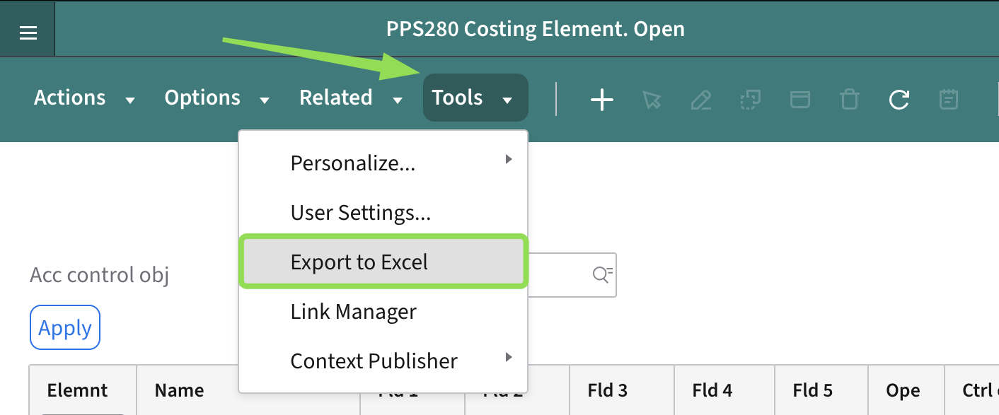
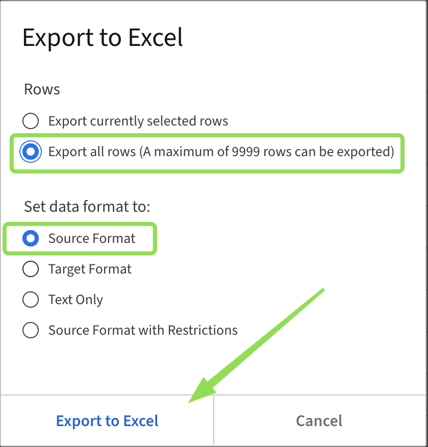
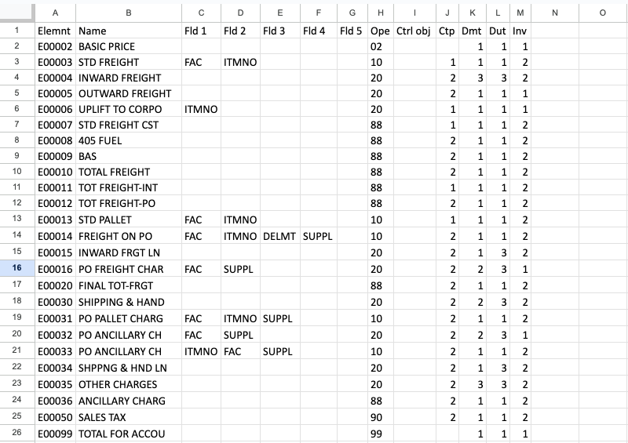
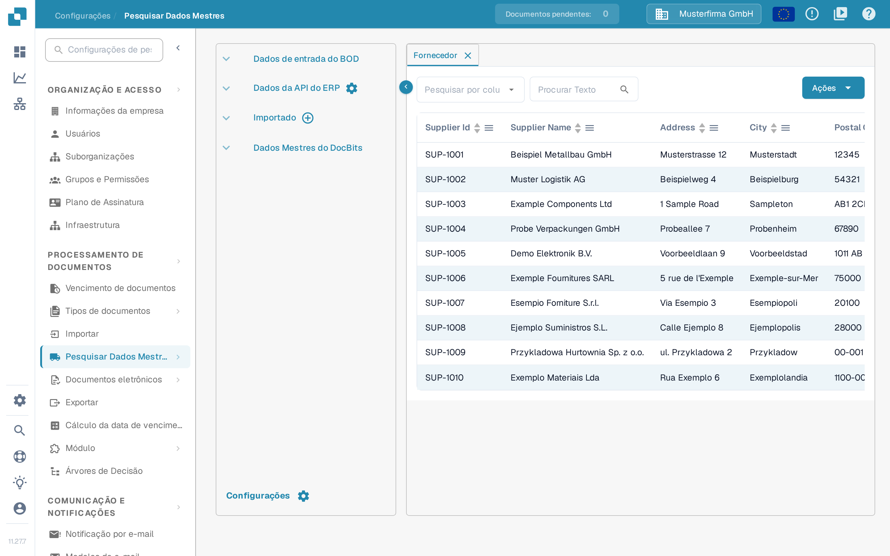
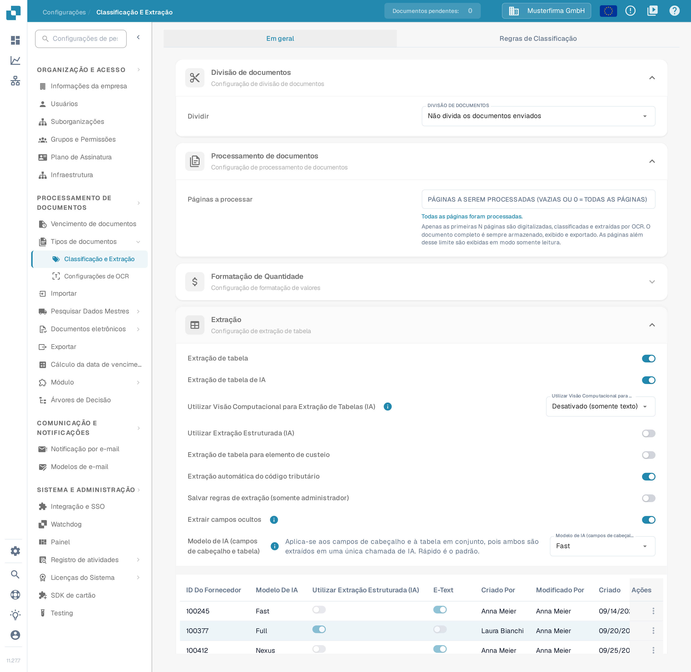

# Importar elementos de custeio M3 para a extração de tabelas

Se o DocBits indicar, ao abrir um documento, que os elementos de custeio não estão configurados corretamente, peça a um administrador que verifique tanto os dados importados dos elementos de custeio como a configuração da extração de tabelas. Este guia mostra onde preparar os dados e onde os confirmar no DocBits. O significado da mensagem está explicado em [Elementos de custo não configurados (FAQ)](../../../overview-and-basics/faq/infor-m3-m3-integration/costing-elements-are-not-properly-configured.-please-ask-your-admin-to-configure-it..md).

## 1. Preparar a exportação do M3

1. No seu ambiente M3, abra **PPS280** e selecione as linhas de elementos de custeio de que a sua organização necessita. Os menus e as linhas disponíveis dependem do seu tenant M3 e das suas permissões.
2. Se o seu ecrã do M3 oferecer **Tools → Export to Excel**, exporte as linhas selecionadas ou todas as linhas necessárias. Verifique o âmbito antes de exportar: a janela histórica mostrada abaixo tem um número máximo de linhas.
3. Guarde a exportação original. Trabalhe sobre uma cópia, para poder comparar cada coluna mapeada com a origem no M3.

<figure><figcaption>
Exemplo histórico do M3: o menu <strong>Tools</strong> com a opção <strong>Export to Excel</strong> realçada. A localização exata do comando depende do seu tenant M3.
</figcaption></figure>

<figure><figcaption>
Exemplo histórico do M3: escolha deliberadamente as linhas e o formato. A opção de todas as linhas está limitada a 9999 linhas nesta janela.
</figcaption></figure>

## 2. Preparar um CSV para o DocBits

Mapeie a exportação para estes nomes de coluna antes de a guardar como CSV. Confirme o significado de cada coluna de origem com o administrador do M3; a posição das letras numa exportação do Excel não é uma interface estável.

| Coluna do DocBits | Valor a verificar na exportação do M3 |
| --- | --- |
| `costing_element` | Código do elemento de custeio |
| `description` | Nome legível do elemento |
| `charge_operator` | Operador de encargo |
| `charge_type` | Tipo de encargo |
| `distribution_method` | Método de distribuição |
| `distribution_type` | Tipo de distribuição |
| `charge_sequence_number` | Número de sequência, quando fornecido pela sua configuração |

Remova da cópia CSV as colunas que não são necessárias. Reveja algumas linhas, incluindo caracteres especiais e valores vazios, antes de importar. A imagem abaixo é um **exemplo mais antigo de uma folha de cálculo do M3**, não um modelo de importação do DocBits.

<figure><figcaption>
Exemplo histórico do M3: utilize a folha de cálculo apenas para identificar os dados de origem e mapeie as colunas pelo significado.
</figcaption></figure>

## 3. Importar no DocBits

1. Abra **Configurações → Processamento de documentos → Pesquisar Dados Mestres**. Esta página está descrita em [Pesquisa de dados mestre](../../../administration-and-setup/settings/document-processing/master-data-lookup.md).
2. No grupo **Importado**, selecione o ícone com o sinal de mais. Abre-se a janela **Carregar CSV**.
3. Introduza `costing_element` em **Tipo de dados** e selecione o seu ficheiro CSV em **Arquivo**.
4. Defina **Delimitador** com o separador usado pelo seu ficheiro. A janela atual mostra inicialmente `;`; não parta do princípio de que o seu ficheiro usa uma vírgula.
5. Reveja **Sobre Conflito** (na captura, `REPLACE`), **Substituir tudo** e **Gerar ID automaticamente** com o seu administrador antes de carregar. Estas escolhas podem alterar dados já importados. **Cancelar** fecha a janela sem importar; **Carregar** inicia a importação depois de o ficheiro e as opções estarem verificados.
6. Após a importação, abra a nova entrada em **Importado** e confirme que os códigos e as descrições esperados dos elementos de custeio estão visíveis.

<figure><figcaption>
A página <strong>Pesquisar Dados Mestres</strong> em português. O ícone com o sinal de mais junto a <strong>Importado</strong> abre a importação. Os dados visíveis são exemplos inventados.
</figcaption></figure>

<figure><figcaption>
A janela <strong>Carregar CSV</strong>. Nesta captura, <strong>Tipo de dados</strong> e <strong>Arquivo</strong> ainda estão vazios e <strong>Delimitador</strong> mostra o valor predefinido. Ajuste o delimitador ao seu ficheiro e reveja as opções de substituição antes de carregar.
</figcaption></figure>

## 4. Verificar a configuração da extração

Abra **Configurações → Processamento de documentos → Classificação e Extração**, mantenha-se em **Em geral** e procure em **Extração** o interruptor **Extração de tabela para elemento de custeio**. Verifique se o interruptor está ativo para o tipo de documento que está a testar. Em seguida, reabra um documento adequado e confirme que a mensagem original desapareceu. Se a mensagem persistir, indique ao seu administrador o tipo de documento, o código do elemento de custeio e o texto exato da mensagem.

<figure><figcaption>
O interruptor <strong>Extração de tabela para elemento de custeio</strong>, aqui desativado, no cartão <strong>Extração</strong>. O estado foi fotografado como estava e não foi alterado para este guia.
</figcaption></figure>

O interruptor e a classificação das linhas estão descritos em [Extração de tabela para elemento de custeio](../../../administration-and-setup/settings/document-processing/classification-and-extraction/table-extraction-for-costing-element.md). Os restantes interruptores desta página estão explicados em [Classificação e extração](../../../administration-and-setup/settings/document-processing/classification-and-extraction/README.md).

As capturas atuais do DocBits neste guia foram feitas no ambiente Sandbox, na versão 11.27.7, com um início de sessão sintético e dados de exemplo inventados na organização **Musterfirma GmbH**. Não foi importada nenhuma exportação M3 nem nenhum ficheiro CSV durante a preparação deste guia, pelo que o resultado da importação tem de ser verificado no seu próprio ambiente. Os exemplos mais antigos do M3 mostram ecrãs de um sistema externo com a interface em inglês e são independentes do idioma do DocBits.
