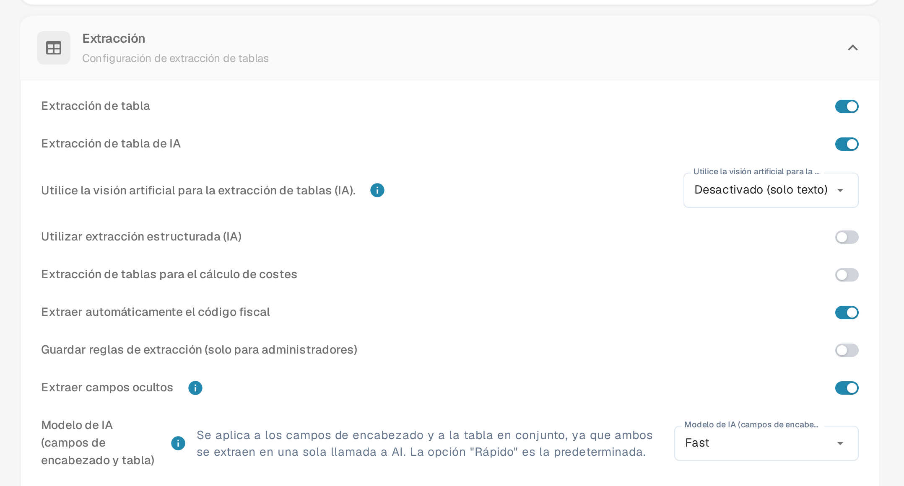

# Importar elementos de coste de M3 para la extracción de tablas

Si DocBits muestra el mensaje **«Los elementos de costeo no están configurados correctamente. Por favor, pida a su administrador que lo configure»** al abrir un documento, pida a una persona administradora que revise tanto los datos de elementos de coste importados como el ajuste de extracción de tablas. Esta guía muestra dónde preparar los datos y dónde comprobarlos en DocBits. Qué significa el mensaje exactamente lo encontrará en [Los elementos de costeo no están configurados correctamente](../../../overview-and-basics/faq/infor-m3-m3-integration/costing-elements-are-not-properly-configured.-please-ask-your-admin-to-configure-it..md).

## 1. Preparar la exportación de M3

1. En su entorno de M3, abra **PPS280** y seleccione las líneas de elemento de coste que necesita su organización. Los menús y las líneas disponibles dependen de su tenant de M3 y de sus permisos.
2. Si su pantalla de M3 ofrece **Herramientas → Exportar a Excel** (en la interfaz inglesa **Tools → Export to Excel**), exporte las líneas seleccionadas o todas las líneas necesarias. Compruebe el alcance antes de exportar: el diálogo histórico que se muestra más abajo tiene un número máximo de líneas.
3. Guarde la exportación original. Trabaje sobre una copia para poder comparar cada columna asignada con su origen en M3.

<figure><figcaption>
Ejemplo histórico de M3: localice la acción de exportación en su propio tenant.
</figcaption></figure>

<figure><figcaption>
Ejemplo histórico de M3: elija las líneas y el formato de forma consciente.
</figcaption></figure>

## 2. Preparar un CSV para DocBits

Asigne la exportación a estos nombres de columna antes de guardarla como CSV. Confirme el significado de cada columna de origen con su administración de M3; las posiciones de las letras en una exportación de Excel no son una interfaz estable.

| Columna de DocBits | Valor que debe comprobar en la exportación de M3 |
| --- | --- |
| `costing_element` | Código del elemento de coste |
| `description` | Nombre legible del elemento |
| `charge_operator` | Operador de cargo |
| `charge_type` | Tipo de cargo |
| `distribution_method` | Método de distribución |
| `distribution_type` | Tipo de distribución |
| `charge_sequence_number` | Número de secuencia, si su configuración lo proporciona |

Elimine las columnas que no necesite de la copia del CSV. Revise algunas líneas, también los caracteres especiales y los valores vacíos, antes de importar. La siguiente imagen es un **ejemplo antiguo de hoja de cálculo de M3**, no una plantilla de importación de DocBits.

<figure><figcaption>
Utilice la hoja de cálculo solo para reconocer los datos de origen; asigne sus columnas según su significado.
</figcaption></figure>

## 3. Importar en DocBits

1. Abra **Ajustes → Procesamiento de documentos → Búsqueda de datos maestros**. La página se describe en [Búsqueda de datos maestros](../../../administration-and-setup/settings/document-processing/master-data-lookup.md).
2. En **Importado**, seleccione el botón **más**. Se abre el diálogo **Cargar CSV**.
3. Escriba `costing_element` en **Tipo de datos** y seleccione su archivo CSV en **Archivo**.
4. Ajuste **Delimitador** al separador que utiliza su archivo. El diálogo actual muestra inicialmente `;`; no dé por hecho que su archivo utiliza una coma.
5. Revise con su administración el desplegable **Sobre el conflicto**, la casilla **Sustituir todo** y la segunda casilla de esa fila, que en la versión actual de la interfaz en español aparece también con la etiqueta **Sobre el conflicto** y corresponde a la generación automática del ID. Estas opciones pueden modificar datos ya importados. **Cancelar** cierra el diálogo sin importar; **Subir** inicia la importación una vez comprobados el CSV y las opciones.
6. Después de la importación, abra la nueva entrada en **Importado** y compruebe que se ven los códigos y las descripciones de elementos de coste esperados.

<figure><figcaption>
El botón más junto a Importado abre el diálogo para cargar un archivo CSV.
</figcaption></figure>

<figure><figcaption>
En el ejemplo, Tipo de datos y Archivo todavía están vacíos y el delimitador muestra el valor predeterminado «;». Revise las opciones de sustitución antes de cargar.
</figcaption></figure>

## 4. Comprobar el ajuste de extracción

Abra **Ajustes → Procesamiento de documentos → Clasificación y Extracción → Extracción** y busque el interruptor **Extracción de tablas para el cálculo de costes**. Compruebe que el ajuste está activo para el tipo de documento que está probando. Encontrará una descripción general de los ajustes de esta página en [Clasificación y extracción](../../../administration-and-setup/settings/document-processing/classification-and-extraction/README.md). Vuelva a abrir después un documento adecuado y confirme que el mensaje original ya no aparece. Si persiste, facilite a su administración el tipo de documento, el código del elemento de coste y el texto exacto del mensaje.

<figure><figcaption>
El interruptor Extracción de tablas para el cálculo de costes se encuentra en la sección Extracción.
</figcaption></figure>

Las capturas actuales de DocBits de esta guía proceden de un entorno de prueba con datos de ejemplo inventados. No se ha cargado ninguna exportación de M3 ni ningún archivo CSV, por lo que el resultado de la importación debe comprobarse en su propio entorno. Los ejemplos antiguos de M3 muestran pantallas de un sistema externo y no dependen del idioma de la interfaz de DocBits.
