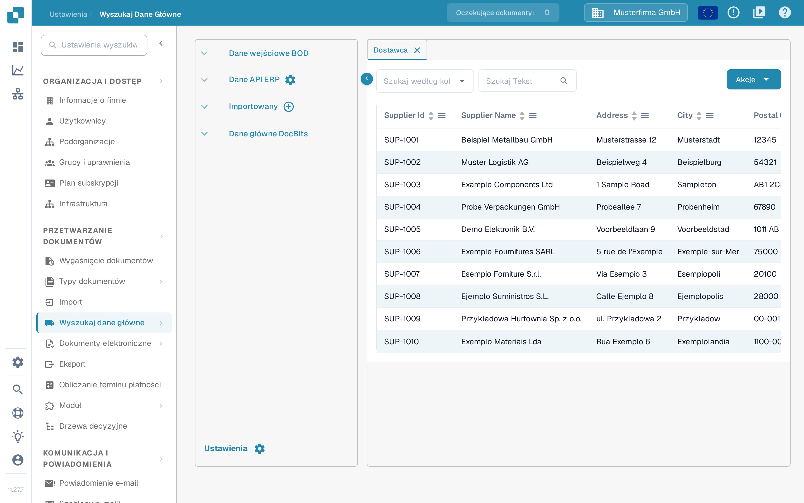
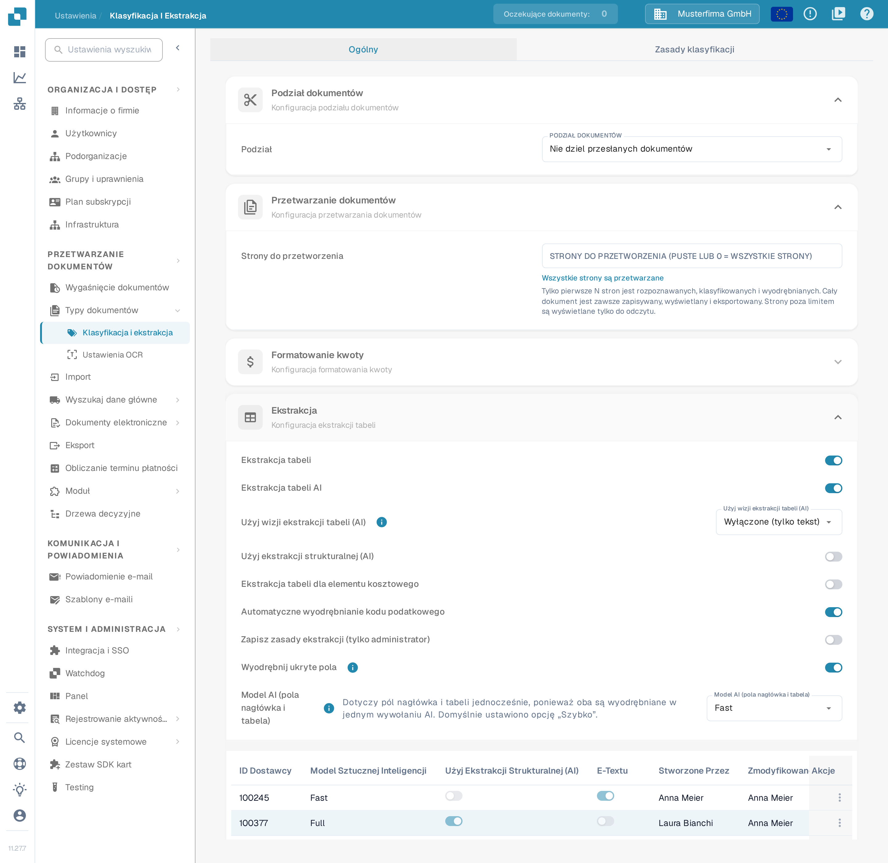

# Importowanie elementów kosztowych M3 do ekstrakcji tabeli

Jeśli DocBits podczas otwierania dokumentu wyświetla komunikat **„Elementy kosztowania nie są poprawnie skonfigurowane. Proszę poproś administratora o skonfigurowanie”**, poproś administratora o sprawdzenie zarówno zaimportowanych danych elementów kosztowych, jak i ustawienia ekstrakcji tabeli. Ten przewodnik pokazuje, gdzie przygotować dane i gdzie sprawdzić je w DocBits. Opis komunikatu i możliwe rozwiązania znajdziesz w [artykule FAQ o elementach kosztowania](../../../overview-and-basics/faq/infor-m3-m3-integration/costing-elements-are-not-properly-configured.-please-ask-your-admin-to-configure-it..md).

## 1. Przygotowanie eksportu z M3

1. W swoim środowisku M3 otwórz **PPS280** i wybierz wiersze elementów kosztowych, których potrzebuje Twoja organizacja. Nazwy menu i dostępne wiersze zależą od Twojego tenanta M3 i Twoich uprawnień.
2. Jeśli Twój ekran M3 oferuje **Narzędzia → Eksportuj do Excela**, wyeksportuj wybrane wiersze lub wszystkie wymagane wiersze. Przed eksportem sprawdź zakres: pokazane poniżej historyczne okno ma maksymalną liczbę wierszy.
3. Zachowaj oryginalny eksport. Pracuj na kopii, aby móc porównać każdą mapowaną kolumnę z jej źródłem w M3.

<figure><figcaption>
Historyczny przykład z M3: akcję eksportu znajdź we własnym tenencie.
</figcaption></figure>

<figure><figcaption>
Historyczny przykład z M3: wybierz wiersze i format świadomie.
</figcaption></figure>

## 2. Przygotowanie pliku CSV dla DocBits

Zanim zapiszesz eksport jako CSV, przypisz jego kolumny do poniższych nazw. Znaczenie każdej kolumny źródłowej sprawdź z administratorem M3; pozycje liter w eksporcie z Excela nie są stabilnym interfejsem.

| Kolumna DocBits | Wartość do sprawdzenia w eksporcie z M3 |
| --- | --- |
| `costing_element` | Kod elementu kosztowego |
| `description` | Czytelna nazwa elementu |
| `charge_operator` | Operator obciążenia |
| `charge_type` | Typ obciążenia |
| `distribution_method` | Metoda podziału |
| `distribution_type` | Typ podziału |
| `charge_sequence_number` | Numer sekwencji, jeśli dostarcza go Twoja konfiguracja |

Usuń z kopii CSV niepowiązane kolumny. Przed importem przejrzyj kilka wierszy, w tym znaki specjalne i puste wartości. Poniższy zrzut ekranu to **starszy przykład arkusza M3**, a nie szablon importu DocBits.

<figure><figcaption>
Arkusza używaj tylko do rozpoznania danych źródłowych; jego kolumny mapuj według znaczenia.
</figcaption></figure>

## 3. Import w DocBits

1. Otwórz **Ustawienia → Przetwarzanie dokumentów → Wyszukaj dane główne**. Opis tej strony znajdziesz w rozdziale [Wyszukiwanie danych podstawowych](../../../administration-and-setup/settings/document-processing/master-data-lookup.md).
2. W grupie **Importowany** kliknij ikonę **plus**. Otworzy się okno **Prześlij plik CSV**.
3. W polu **Typ danych** wpisz `costing_element`, a w polu **Plik** wybierz swój plik CSV.
4. Ustaw **Rozgranicznik** na separator używany w Twoim pliku. Bieżące okno może początkowo pokazywać `;`; nie zakładaj, że plik używa przecinka.
5. Przed przesłaniem omów z administratorem opcje **O konflikcie**, **Zamień wszystko** i **Automatyczne generowanie identyfikatora**. Te wybory mogą zmienić istniejące zaimportowane dane. **Anulować** zamyka okno bez importu; **Prześlij** rozpoczyna import po sprawdzeniu pliku i opcji.
6. Po imporcie otwórz nowy wpis w grupie **Importowany** i potwierdź, że widoczne są oczekiwane kody i opisy elementów kosztowych.

<figure><figcaption>
Ikona plus obok grupy Importowany otwiera okno przesyłania pliku CSV.
</figcaption></figure>

<figure><figcaption>
Dopasuj rozgranicznik do swojego pliku i sprawdź opcje zamiany przed przesłaniem. Pola Typ danych i Plik są w tym przykładzie puste; „;” i REPLACE to wartości domyślne, które okno pokazuje po otwarciu.
</figcaption></figure>

## 4. Sprawdzenie ustawienia ekstrakcji

Otwórz **Ustawienia → Przetwarzanie dokumentów → Klasyfikacja i ekstrakcja → Ekstrakcja** i znajdź **Ekstrakcja tabeli dla elementu kosztowego**. Sprawdź, czy ustawienie jest skonfigurowane dla typu dokumentu, który testujesz. Następnie otwórz ponownie odpowiedni dokument i potwierdź, że pierwotny błąd konfiguracji zniknął. Jeśli nadal występuje, przekaż administratorowi typ dokumentu, kod elementu kosztowego i dokładny tekst błędu. Pozostałe opcje tej strony opisuje rozdział [Klasyfikacja i ekstrakcja](../../../administration-and-setup/settings/document-processing/classification-and-extraction/README.md).

<figure><figcaption>
Ustawienie Ekstrakcja tabeli dla elementu kosztowego znajduje się w sekcji Ekstrakcja.
</figcaption></figure>

Powyższe zrzuty ekranu z Sandboxa pokazują bieżące elementy sterujące w syntetycznej organizacji testowej o nazwie Musterfirma GmbH. Podczas przygotowywania tego przewodnika nie przesłano żadnego eksportu z M3 ani pliku CSV, więc wynik importu trzeba sprawdzić we własnym środowisku.
