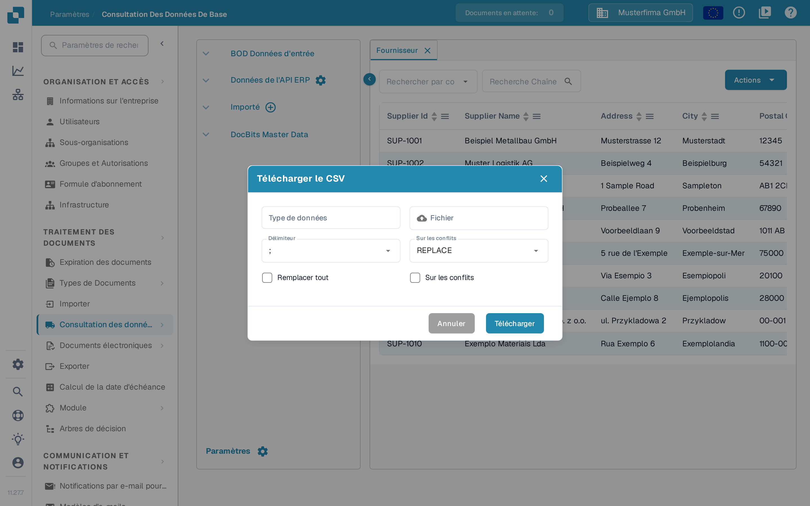
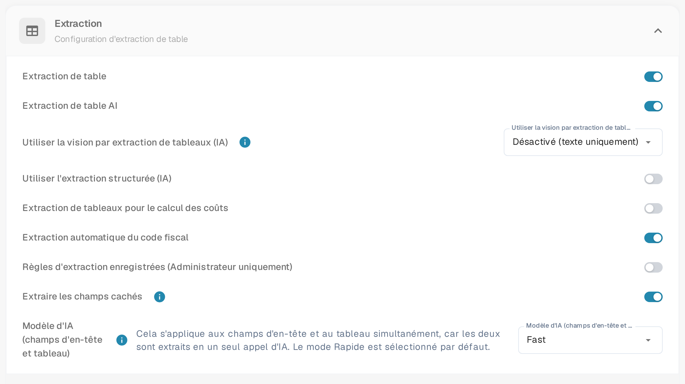

# Importer les éléments de calcul des coûts M3 pour l'extraction de tableaux

Lorsque DocBits signale, à l'ouverture d'un document, que les éléments de coût ne sont pas correctement configurés, vérifiez à la fois les données importées des éléments de coût et le réglage de l'extraction de tableaux. Ce guide montre où préparer les données et où les contrôler dans DocBits. La signification du message est décrite dans [Éléments de coût non configurés correctement](../../../overview-and-basics/faq/infor-m3-m3-integration/costing-elements-are-not-properly-configured.-please-ask-your-admin-to-configure-it..md).

## 1. Préparer l'export M3

1. Dans votre environnement M3, ouvrez **PPS280** et sélectionnez les lignes d'éléments de calcul des coûts dont votre organisation a besoin. Les menus et les lignes disponibles dépendent de votre mandant M3 et de vos autorisations.
2. Si votre écran M3 propose **Tools → Export to Excel**, exportez les lignes sélectionnées ou toutes les lignes nécessaires. Vérifiez l'étendue avant l'export : la fenêtre historique présentée ci-dessous a un nombre de lignes maximal.
3. Conservez l'export d'origine. Travaillez sur une copie afin de pouvoir comparer chaque colonne affectée avec sa source M3.

<figure><figcaption>
Exemple M3 historique : l'action d'export se trouve à l'emplacement correspondant dans votre propre mandant.
</figcaption></figure>

<figure><figcaption>
Exemple M3 historique : choisissez les lignes et le format en connaissance de cause.
</figcaption></figure>

## 2. Préparer un CSV pour DocBits

Affectez l'export à ces noms de colonnes avant de l'enregistrer au format CSV. Faites confirmer la signification de chaque colonne source par votre administration M3 ; les positions de lettres dans un export Excel ne constituent pas une interface stable.

| Colonne DocBits | Valeur à contrôler dans l'export M3 |
| --- | --- |
| `costing_element` | Code de l'élément de calcul des coûts |
| `description` | Nom lisible de l'élément |
| `charge_operator` | Opérateur d'imputation |
| `charge_type` | Type d'imputation |
| `distribution_method` | Méthode de répartition |
| `distribution_type` | Type de répartition |
| `charge_sequence_number` | Numéro de séquence, si votre configuration le fournit |

Supprimez de la copie CSV les colonnes inutiles. Contrôlez quelques lignes avant l'import, y compris les caractères spéciaux et les valeurs vides. L'image suivante montre un **exemple de tableau M3 plus ancien**, et non un modèle d'import DocBits.

<figure><figcaption>
Utilisez le tableau uniquement pour reconnaître les données sources ; affectez ses colonnes selon leur signification.
</figcaption></figure>

## 3. Importer dans DocBits

1. Ouvrez **Paramètres → Traitement des documents → Consultation des données de base**. Cette page est décrite dans la documentation sous [Recherche de données de référence](../../../administration-and-setup/settings/document-processing/master-data-lookup.md).
2. Sous **Importé**, sélectionnez l'icône plus. La fenêtre **Télécharger le CSV** s'ouvre.
3. Saisissez `costing_element` dans **Type de données** et sélectionnez votre fichier CSV sous **Fichier**.
4. Réglez **Délimiteur** sur le séparateur utilisé par votre fichier. La fenêtre actuelle affiche d'abord `;` ; ne partez pas du principe que votre fichier utilise une virgule.
5. Vérifiez **Sur les conflits**, **Remplacer tout** et la seconde case à cocher avec votre administration avant de cliquer sur **Télécharger**. Ces choix peuvent modifier des données déjà importées. **Annuler** ferme la fenêtre sans importer ; **Télécharger** lance l'import une fois le CSV et les options contrôlés. Dans la version française, la case à cocher qui active la génération automatique de l'identifiant porte aussi le libellé **Sur les conflits** ; seule sa position la distingue de la liste déroulante.
6. Après l'import, ouvrez la nouvelle entrée sous **Importé** et vérifiez que les codes et les noms attendus des éléments de calcul des coûts sont visibles.

<figure><figcaption>
L'icône plus à côté de Importé ouvre la fenêtre d'import d'un fichier CSV.
</figcaption></figure>

<figure><figcaption>
Type de données et Fichier sont encore vides dans cet exemple ; le Délimiteur affiche la valeur par défaut. Contrôlez les options de remplacement avant de cliquer sur Télécharger.
</figcaption></figure>

## 4. Contrôler le réglage de l'extraction

Ouvrez **Paramètres → Traitement des documents → Classification et Extraction → Extraction** et recherchez l'interrupteur **Extraction de tableaux pour le calcul des coûts**. Vérifiez que l'interrupteur est actif pour les types de documents que vous testez. Un aperçu des réglages de cette page figure sous [Classification et extraction](../../../administration-and-setup/settings/document-processing/classification-and-extraction/README.md). Ouvrez ensuite un document approprié et vérifiez que le message d'origine n'apparaît plus. S'il persiste, transmettez à votre administration le type de document, le code de l'élément de calcul des coûts et le texte exact du message.

<figure><figcaption>
L'interrupteur Extraction de tableaux pour le calcul des coûts se trouve dans la section Extraction.
</figcaption></figure>

Les captures DocBits actuelles de ce guide proviennent d'un environnement de test avec des données d'exemple inventées. Aucun export M3 ni fichier CSV n'a été importé ; contrôlez donc le résultat de l'import dans votre propre environnement. Les exemples M3 plus anciens montrent des écrans d'un système tiers et restent indépendants de la langue de l'interface DocBits.
