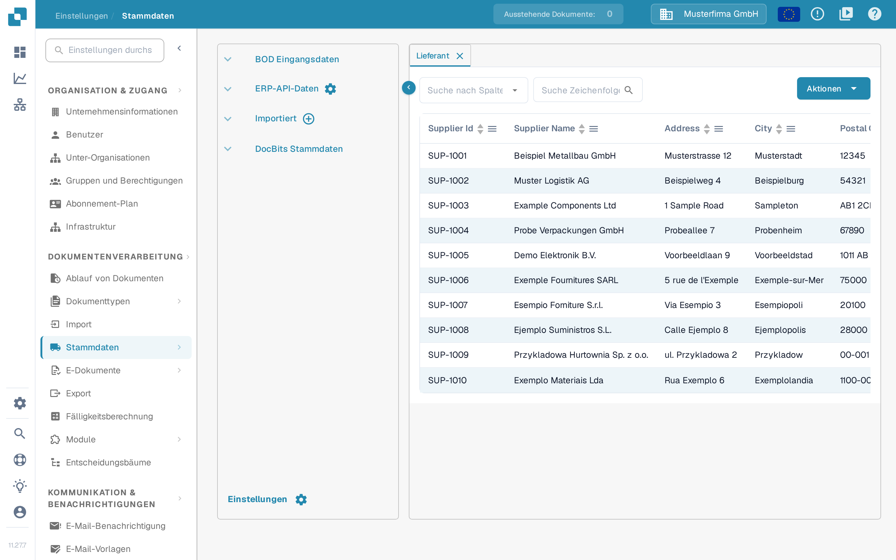
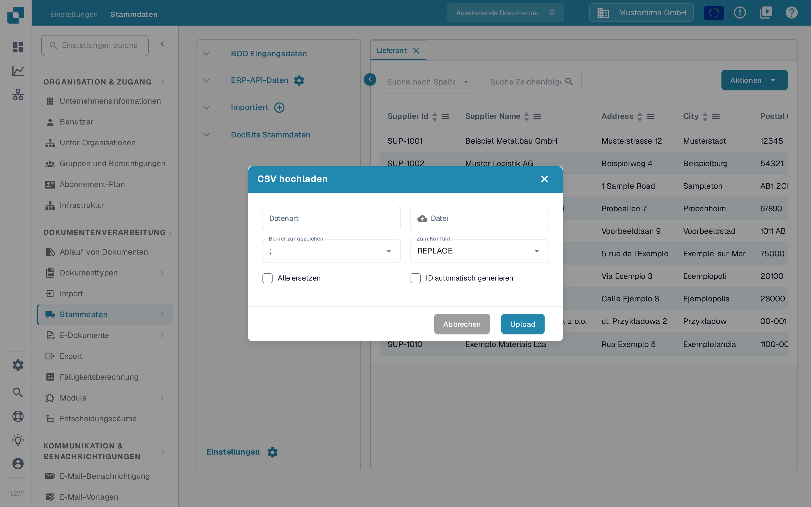

# M3-Kalkulationselemente für die Tabellenextraktion importieren

Wenn DocBits beim Öffnen eines Dokuments meldet, dass die Kalkulationselemente nicht richtig konfiguriert sind, prüfen Sie sowohl die importierten Kalkulationselement-Daten als auch die Einstellung zur Tabellenextraktion. Diese Anleitung zeigt, wo Sie die Daten vorbereiten und wo Sie sie in DocBits prüfen. Was die Meldung im Einzelnen bedeutet, lesen Sie unter [Kostenelemente nicht korrekt konfiguriert](../../../overview-and-basics/faq/infor-m3-m3-integration/costing-elements-are-not-properly-configured.-please-ask-your-admin-to-configure-it..md).

## 1. M3-Export vorbereiten

1. Öffnen Sie in Ihrer M3-Umgebung **PPS280** und wählen Sie die Kalkulationselement-Zeilen aus, die Ihre Organisation benötigt. Welche Menüs und Zeilen verfügbar sind, hängt von Ihrem M3-Mandanten und Ihren Berechtigungen ab.
2. Wenn Ihr M3-Bildschirm **Tools → Export to Excel** anbietet, exportieren Sie die ausgewählten oder alle benötigten Zeilen. Prüfen Sie vor dem Export den Umfang: Der unten gezeigte historische Dialog hat eine maximale Zeilenanzahl.
3. Bewahren Sie den ursprünglichen Export auf. Arbeiten Sie auf einer Kopie, damit Sie jede zugeordnete Spalte mit ihrer M3-Quelle vergleichen können.

<figure><figcaption>
Historisches M3-Beispiel: Die Exportaktion finden Sie in Ihrem eigenen Mandanten an der entsprechenden Stelle.
</figcaption></figure>

<figure><figcaption>
Historisches M3-Beispiel: Wählen Sie Zeilen und Format bewusst.
</figcaption></figure>

## 2. CSV für DocBits vorbereiten

Ordnen Sie den Export diesen Spaltennamen zu, bevor Sie ihn als CSV speichern. Lassen Sie die Bedeutung jeder Quellspalte von Ihrer M3-Administration bestätigen; die Buchstabenpositionen in einem Excel-Export sind keine stabile Schnittstelle.

| DocBits-Spalte | Wert, den Sie im M3-Export prüfen |
| --- | --- |
| `costing_element` | Code des Kalkulationselements |
| `description` | Lesbare Bezeichnung des Elements |
| `charge_operator` | Verrechnungsoperator |
| `charge_type` | Verrechnungsart |
| `distribution_method` | Verteilungsmethode |
| `distribution_type` | Verteilungsart |
| `charge_sequence_number` | Sequenznummer, sofern Ihre Konfiguration sie liefert |

Entfernen Sie nicht benötigte Spalten aus der CSV-Kopie. Prüfen Sie vor dem Import einige Zeilen, auch Sonderzeichen und leere Werte. Das folgende Bild zeigt ein **älteres M3-Tabellenbeispiel**, keine DocBits-Importvorlage.

<figure><figcaption>
Nutzen Sie die Tabelle nur, um die Quelldaten zu erkennen; ordnen Sie ihre Spalten nach ihrer Bedeutung zu.
</figcaption></figure>

## 3. In DocBits importieren

1. Öffnen Sie **Einstellungen → Dokumentenverarbeitung → Stammdaten**. Die Seite wird in der Dokumentation als [Stammdaten-Lookup](../../../administration-and-setup/settings/document-processing/master-data-lookup.md) beschrieben.
2. Wählen Sie unter **Importiert** die **Plus**-Schaltfläche. Damit öffnen Sie den Dialog **CSV hochladen**.
3. Geben Sie bei **Datenart** `costing_element` ein und wählen Sie Ihre CSV-Datei unter **Datei**.
4. Stellen Sie **Begrenzungszeichen** auf das Trennzeichen Ihrer Datei. Der aktuelle Dialog zeigt zunächst `;`; gehen Sie nicht davon aus, dass Ihre Datei ein Komma verwendet.
5. Prüfen Sie **Zum Konflikt**, **Alle ersetzen** und **ID automatisch generieren** mit Ihrer Administration, bevor Sie hochladen. Diese Optionen können vorhandene importierte Daten verändern. **Abbrechen** schließt den Dialog ohne Import; **Upload** startet den Import, sobald CSV und Optionen geprüft sind.
6. Öffnen Sie nach dem Import den neuen Eintrag unter **Importiert** und prüfen Sie, ob die erwarteten Codes und Bezeichnungen der Kalkulationselemente sichtbar sind.

<figure><figcaption>
Die Plus-Schaltfläche neben Importiert öffnet den Dialog zum Hochladen einer CSV-Datei.
</figcaption></figure>

<figure><figcaption>
Datenart und Datei sind im Beispiel noch leer; das Begrenzungszeichen steht auf dem Standardwert. Prüfen Sie die Ersetzungsoptionen vor dem Hochladen.
</figcaption></figure>

## 4. Extraktionseinstellung prüfen

Öffnen Sie **Einstellungen → Dokumentenverarbeitung → Klassifizierung und Extraktion → Extraktion** und suchen Sie den Schalter **Tabellenextraktion für Kalkulationselement**. Prüfen Sie, ob der Schalter für die Dokumenttypen aktiv ist, die Sie testen. Eine Übersicht der Einstellungen auf dieser Seite finden Sie unter [Klassifizierung und Extraktion](../../../administration-and-setup/settings/document-processing/classification-and-extraction/README.md). Öffnen Sie danach ein passendes Dokument und prüfen Sie, ob die ursprüngliche Meldung nicht mehr erscheint. Bleibt sie bestehen, geben Sie Ihrer Administration den Dokumenttyp, den Code des Kalkulationselements und den genauen Meldungstext.

<figure><figcaption>
Der Schalter Tabellenextraktion für Kalkulationselement steht im Bereich Extraktion.
</figcaption></figure>

Die aktuellen DocBits-Aufnahmen in dieser Anleitung stammen aus einer Testumgebung mit erfundenen Beispieldaten. Es wurde kein M3-Export und keine CSV-Datei hochgeladen, deshalb prüfen Sie das Ergebnis des Imports in Ihrer eigenen Umgebung. Die älteren M3-Beispiele zeigen Fremdsystem-Bildschirme und bleiben unabhängig von der Sprache der DocBits-Oberfläche.
