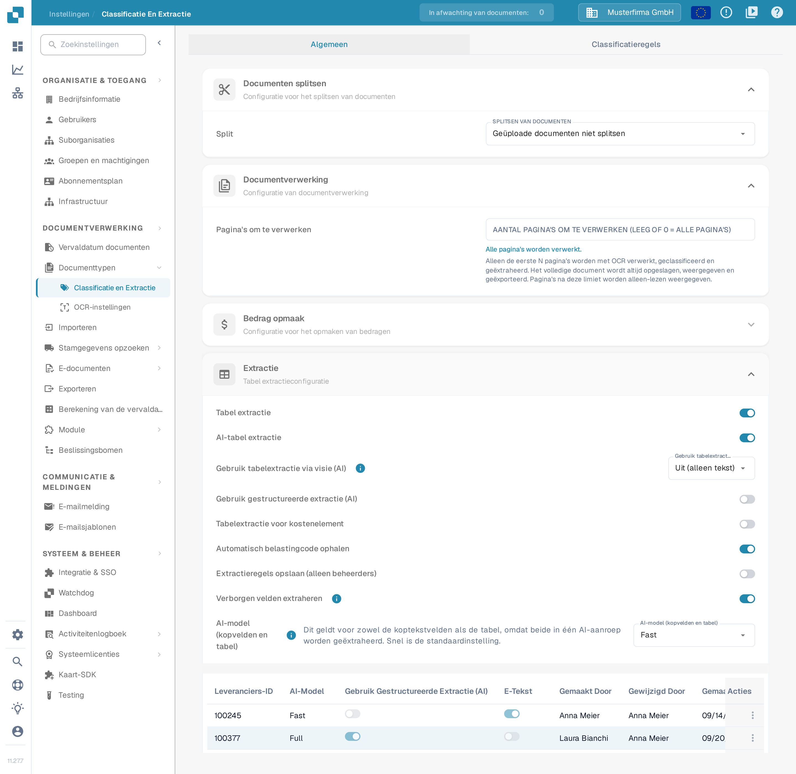

# M3-kostenelementen importeren voor tabelextractie

Meldt DocBits bij het openen van een document **"Kostenelementen zijn niet correct geconfigureerd. Vraag uw beheerder om het te configureren"**, laat een beheerder dan zowel de geïmporteerde kostenelementgegevens als de instelling voor tabelextractie controleren. Deze handleiding laat zien waar u de gegevens voorbereidt en waar u ze in DocBits controleert. Wat de melding precies betekent, leest u bij [Kostenelementen zijn niet correct geconfigureerd](../../../overview-and-basics/faq/infor-m3-m3-integration/costing-elements-are-not-properly-configured.-please-ask-your-admin-to-configure-it..md).

## 1. De M3-export voorbereiden

1. Open in uw M3-omgeving **PPS280** en selecteer de regels voor kostenelementen die uw organisatie nodig heeft. Welke menu's en regels beschikbaar zijn, hangt af van uw M3-tenant en uw rechten.
2. Biedt uw M3-scherm **Hulpmiddelen → Exporteren naar Excel** (de historische opname hieronder toont de Engelse interface met **Tools → Export to Excel**), exporteer dan de geselecteerde regels of alle benodigde regels. Controleer vóór het exporteren de omvang: het venster hieronder meldt een maximum van 9999 rijen.
3. Bewaar de originele export. Werk op een kopie, zodat u elke toegewezen kolom met de M3-bron kunt vergelijken.

<figure><figcaption>
Historisch M3-voorbeeld: zoek de exportactie in uw eigen tenant.
</figcaption></figure>

<figure><figcaption>
Historisch M3-voorbeeld: kies regels en indeling bewust.
</figcaption></figure>

## 2. Een CSV voor DocBits voorbereiden

Wijs de export aan deze kolomnamen toe voordat u het bestand als CSV opslaat. Laat de betekenis van elke bronkolom door uw M3-beheerder bevestigen; de letterposities in een Excel-export zijn geen stabiele koppeling.

| DocBits-kolom | Waarde om te controleren in de M3-export |
| --- | --- |
| `costing_element` | Code van het kostenelement |
| `description` | Leesbare naam van het element |
| `charge_operator` | Verrekeningsoperator |
| `charge_type` | Verrekeningssoort |
| `distribution_method` | Verdelingsmethode |
| `distribution_type` | Verdelingssoort |
| `charge_sequence_number` | Volgnummer, voor zover uw configuratie dit levert |

Verwijder kolommen die u niet nodig heeft uit de CSV-kopie. Controleer enkele regels, ook speciale tekens en lege waarden, voordat u importeert. De afbeelding hieronder toont een **ouder M3-spreadsheetvoorbeeld**, geen DocBits-importsjabloon.

<figure><figcaption>
Gebruik de spreadsheet alleen om de brongegevens te herkennen; wijs de kolommen toe op basis van hun betekenis.
</figcaption></figure>

## 3. Importeren in DocBits

1. Open **Instellingen → Documentverwerking → Stamgegevens opzoeken**. De pagina wordt beschreven bij [Stamgegevens opzoeken](../../../administration-and-setup/settings/document-processing/master-data-lookup.md).
2. Selecteer onder **Geïmporteerd** de **plus**-knop. Hiermee opent u het venster **CSV uploaden**.
3. Voer bij **Gegevenstype** `costing_element` in en kies uw CSV-bestand bij **Bestand**.
4. Zet **scheidingsteken** op het scheidingsteken van uw bestand. Het huidige venster toont eerst `;`; ga er niet van uit dat uw bestand een komma gebruikt.
5. Controleer de keuzelijst **Over Conflict**, het selectievakje **Alles vervangen** en het selectievakje **Automatisch ID genereren** met uw beheerder voordat u uploadt. Deze keuzes kunnen bestaande geïmporteerde gegevens wijzigen. **Annuleren** sluit het venster zonder importeren; **Uploaden** start de import nadat het CSV-bestand en de opties zijn gecontroleerd.
6. Open na de import het nieuwe item onder **Geïmporteerd** en controleer of de verwachte codes en omschrijvingen van kostenelementen zichtbaar zijn.

<figure><figcaption>
De plus-knop naast Geïmporteerd opent het venster om een CSV-bestand te uploaden.
</figcaption></figure>

<figure><figcaption>
Gegevenstype en Bestand zijn in dit voorbeeld nog leeg en het scheidingsteken staat op de standaardwaarde. Controleer de vervangingsopties voordat u uploadt.
</figcaption></figure>

## 4. De extractie-instelling controleren

Open **Instellingen → Documentverwerking → Classificatie en Extractie → Extractie** en zoek de schakelaar **Tabelextractie voor kostenelement**. Controleer of de schakelaar is ingesteld voor het documenttype dat u test. Een overzicht van de instellingen op deze pagina vindt u bij [Classificatie en extractie](../../../administration-and-setup/settings/document-processing/classification-and-extraction/README.md). Open daarna een geschikt document opnieuw en controleer of de oorspronkelijke melding weg is. Blijft de melding staan, geef uw beheerder dan het documenttype, de code van het kostenelement en de exacte tekst van de melding.

<figure><figcaption>
De schakelaar Tabelextractie voor kostenelement staat in het gedeelte Extractie.
</figcaption></figure>

De actuele DocBits-afbeeldingen in deze handleiding komen uit een testomgeving met verzonnen voorbeeldgegevens (organisatie Musterfirma GmbH, build 11.27.7). Er is geen M3-export en geen CSV-bestand geüpload, daarom controleert u het resultaat van de import in uw eigen omgeving. De oudere M3-voorbeelden tonen schermen van een extern systeem en zijn onafhankelijk van de taal van de DocBits-interface.
