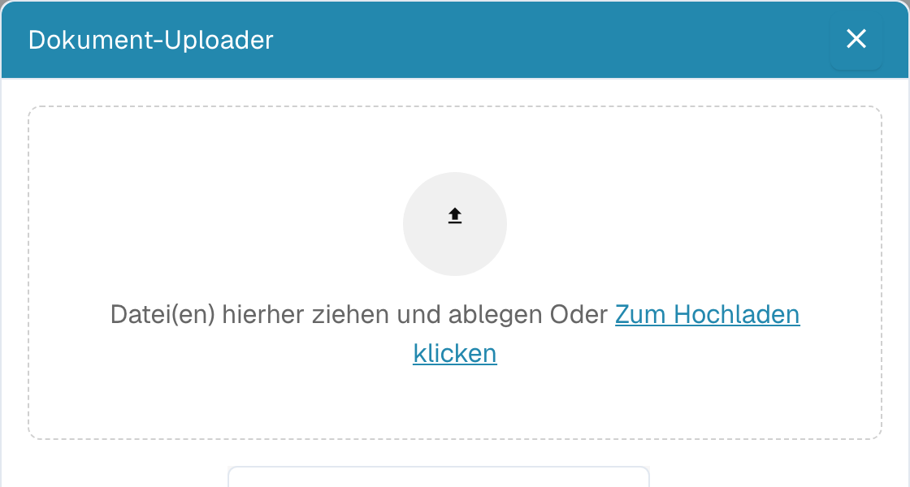

# 5. Fehlgeschlagenen ERP-Export beheben

**Zielgruppe:** Key User, ERP-Administratoren und Support · **Schwierigkeit:** Fortgeschritten · **Übungsdauer:** 20 Minuten

**Lernziel:** Grenzen Sie einen Exportfehler ein, beheben Sie die belegte Ursache und prüfen Sie eine einmalige korrekte Übernahme im ERP.

## Problem

Grenzen Sie einen Exportfehler ein, beheben Sie die belegte Ursache und prüfen Sie eine einmalige korrekte Übernahme im ERP.

## Beispieldokument


Verwenden Sie die Trainingsrechnung IT-2026-1042 in einem isolierten Testziel.


Der Fehlerfall verwendet eine fehlende oder ungültige Zuordnung in einer **separaten Testexportkonfiguration**. Er muss zum gewählten ERP passen. Die Beispieldatei selbst enthält keinen absichtlich defekten produktiven Export. Verwenden Sie alternativ einen bereits vorhandenen, eindeutig identifizierten Testfehler.

## Konfiguration

Ein Administrator benötigt Zugriff auf Exportkonfiguration, fachliche Antwort und das ERP-Testziel. Halten Sie Dokument-ID, Organisation, Gesellschaft, ERP-Typ, Ziel und Rechnungsnummer fest. Eine schreibende Exportoperation darf nur zum vorbereiteten Testziel gehen.

Öffnen Sie **Settings → Document Processing → Export** beziehungsweise die lokalisierte Exportseite und prüfen Sie die für das Dokument aktive Konfiguration. Für M3 und LN sind unterschiedliche Mappings und Pflichtfelder erforderlich. Erzeugen Sie keinen Fehler durch Ändern einer gemeinsam verwendeten produktiven Verbindung.

## Ausführung

1. Öffnen Sie das betroffene Trainingsdokument und notieren Sie Status, Fehlermeldung und Zeitpunkt. Prüfen Sie den Dokument-Flow: Welche Stufe wurde tatsächlich erreicht?
2. Prüfen Sie, ob schon Validierung oder Freigabe blockiert. Ein noch nicht gestarteter Export ist kein fehlgeschlagener ERP-Aufruf.
3. Kontrollieren Sie Lieferant, Rechnungsnummer, Gesellschaft, Währung, Datum, Steuer, Sachkonto und erforderliche Dimensionen gegen Original und ERP-Stammdaten.
4. Prüfen Sie die aktive Exportkonfiguration und vergleichen Sie Dokumenttyp, Organisation, Ziel, Feldnamen und Mapping-Datei. Sichern Sie die vorherige Testkonfiguration.
5. Für M3 vergleichen Sie die tatsächliche Export-Payload mit den Anforderungen der konkreten M3-Transaktion. Prüfen Sie beispielsweise DIVI und SINO samt Datentyp und Großschreibung. Eine Beispielangabe ersetzt nicht die API-Dokumentation Ihrer Transaktion.
6. Für den LN-Fehler „ReceiptLine muss numerisch sein“ prüfen Sie zuerst Bestellung und Lieferdaten. Prüfen Sie danach in der LN-Mappingdatei IRF_ReceiptLine = TF_delivery_line sowie ReceiptLine in InvoiceReceiptFields. Wenden Sie diese Korrektur nur auf genau diesen Fehler an.
7. Beheben Sie die belegte Ursache im Testbeleg oder Testmapping. Notieren Sie den alten und neuen Wert, ohne Zugangsdaten in die Diagnose aufzunehmen.
8. Prüfen Sie vor dem Wiederholen anhand von Lieferant, Rechnungsnummer und Gesellschaft im ERP, ob der ursprüngliche Versuch bereits einen Beleg oder eine Teilverarbeitung erzeugt hat. Bei unklarem Zielzustand zunächst klären.
9. Starten Sie nur nach dieser Prüfung das für Ihre Umgebung vorgesehene Wiederholungsverfahren. Kontrollieren Sie fachliche Antwort und DocBits-Status.
10. Suchen Sie den Zielbeleg erneut und prüfen Sie genau eine Übernahme, Beträge, Positionen und Kontierung. Stellen Sie die Testkonfiguration wieder her und halten Sie ursprünglichen Fehler, Korrektur und Zielbelegreferenz fest.

## Ergebnis

Die Ursache ist durch Fehlermeldung und Feld-/Konfigurationsvergleich belegt. Ein erneuter Versuch liefert eine fachlich erfolgreiche Antwort und genau einen korrekten Beleg im ERP. Ein HTTP-Status allein oder eine verschwundene Fehlermeldung beweist keine vollständige Buchung.

## Fehlerbehebung

| Beobachtung | Vorgehen |
| --- | --- |
| Pflichtfeld fehlt | Quelle, Transformation und Exportmapping bis zum Zielwert verfolgen. |
| Ungültige Stammdaten | Gesellschaft und gültige IDs im ERP vergleichen. |
| Verbindung/Timeout | Erreichbarkeit, Berechtigung und Antwort prüfen; vor Retry möglichen Zielbeleg suchen. |
| ReceiptLine nicht numerisch | Spezifische LN-Anleitung verwenden; PackingSlip ist ein anderes Feld. |
| Status erfolgreich, Beleg fehlt | Fachliche Antwort und nachgelagerte ERP-Verarbeitung prüfen. |

Nach der verifizierten Behebung notieren Sie kurz Ursache, unnötige Versuche und die wichtigste Verbesserung, etwa Pflichtfeldprüfung vor Export oder eine fehlende Zielbelegreferenz im Protokoll.

## Screenshots und Video

<figure><figcaption>
Bestehende echte Importansicht. Ein Screenshot des konkreten fehlgeschlagenen Exports muss bei der Abnahme des Testfalls ergänzt werden.
</figcaption></figure>

Vorbereitung: vorhandene Kurzanleitung zur Kontierung. Dieser Film zeigt keine Diagnose und keinen erfolgreichen ERP-Retry. Für die Freigabe dieses Tutorials ist eine eigene kurze Fehler-/Retry-Aufnahme mit Untertiteln erforderlich.



[Mit Untertiteln ansehen](https://docbits-videos.fra1.cdn.digitaloceanspaces.com/settings-assistant/cost-invoice-accounting-customer/v3/de.html)

## Weiterführende Anleitung

[Exportmodul](../infor-integration-and-configuration/exporting-in-docbits/export-module.md) · [LN ReceiptLine-Fehler](../overview-and-basics/faq/infor-ln-ln-integration/export-error-error-exporting-document-to-ln.-status-code-500/request-validation-attr.-receiptline-value-the-value-must-be-numeric..md) · [M3-Diagnose](../overview-and-basics/faq/infor-m3-m3-integration/m3-api-export-diagnostic-guide.md) · [Dokument-Flow](../end-user-and-partner-section/end-user-section/dashboard/document-flow.md)

**Stand:** 27.10.2026 · **Übungsversion:** 1.0. Die Medien zeigen die jeweils beschriebenen bestehenden Schulungsfälle. Die neuen Übungsbelege sind synthetisch. Ein erfolgreicher Lauf mit diesen Belegen und Ihrer ERP-Konfiguration muss anhand der Prüfkriterien bestätigt werden. [Voraussetzungen und Übungspaket](vorbereitung.md) · [Abnahme](qualitaet-und-abnahme.md) · [Academy](README.md)
