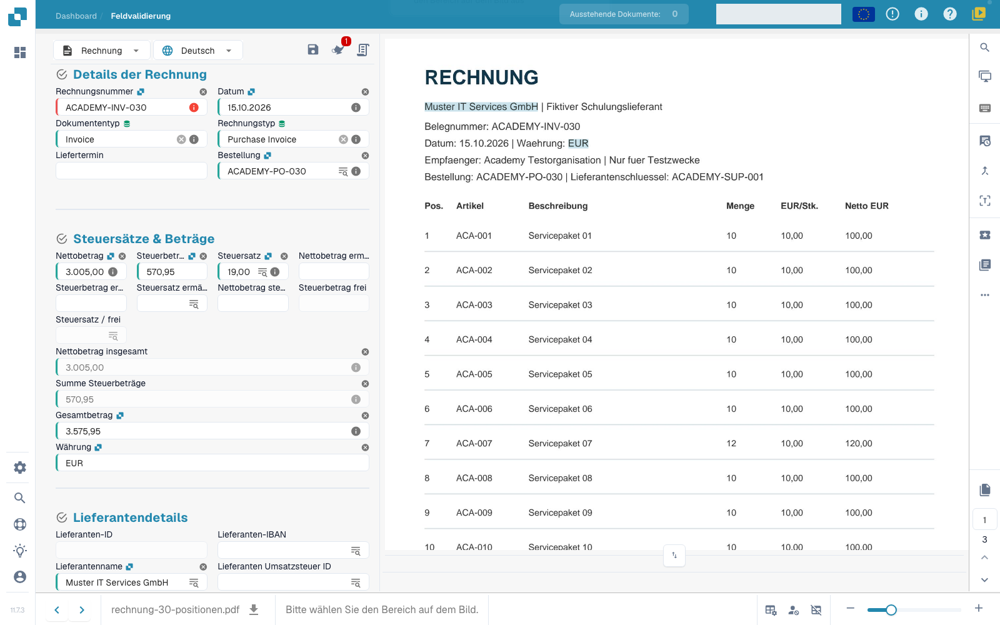

# 6. KI-Tabellen aus mehrseitigen Rechnungen bearbeiten

**Zielgruppe:** Buchhaltung und DocBits Key User · **Schwierigkeit:** Mittel · **Übungsdauer:** 15–20 Minuten

**Lernziel:** Prüfen Sie 30 Positionen über drei PDF-Seiten einschließlich Seitenübergängen, langen Beschreibungen und wiederholten Überschriften.

## Problem

Prüfen Sie 30 Positionen über drei PDF-Seiten einschließlich Seitenübergängen, langen Beschreibungen und wiederholten Überschriften.

## Beispieldokument


ACADEMY-INV-030: drei Seiten, je zehn Positionen, mit mehrzeiligen Beschreibungen an den Seitenübergängen.


Die Artikelnummern laufen von ACA-001 bis ACA-030. Netto: **3.005,00 EUR**, Steuer: **570,95 EUR**, Brutto: **3.575,95 EUR**. Zeile 7 enthält Menge 12, Zeile 18 Menge 8 und Zeile 26 den Einzelpreis 10,50. Diese Werte sind auf der Rechnung korrekt abzulesen; erst der Vergleich mit der Bestellung zeigt die drei fachlichen Abweichungen.

## Konfiguration

Ein Administrator prüft **AI-Tabellen-Extraktion** unter Klassifizierung und Extraktion. Für den Trainingslieferanten dürfen keine gespeicherten klassischen Tabellenregeln den KI-Tab ersetzen. Prüfen Sie die verwendete KI-Stufe und die konfigurierten Spalten Artikelnummer, Beschreibung, Menge, Einheit, Einzelpreis und Nettobetrag.

Nutzen Sie einen isolierten Trainingslieferanten. **Als Training speichern** und klassisches Tabellentraining beeinflussen spätere Dokumente. Prüfen Sie zunächst eine Änderung mit **Änderung testen** und übernehmen Sie sie nur nach Vergleich aller Seiten.

## Ausführung

1. Importieren Sie die dreiseitige PDF und öffnen Sie nach abgeschlossener Verarbeitung den Validierungsbildschirm.
2. Öffnen Sie **KI Extrahierte Tabelle**. Ist der Tab deaktiviert, prüfen Sie mit dem Administrator, ob gespeicherte Tabellenregeln die klassische Tabelle verwenden.
3. Zählen Sie genau 30 Artikelpositionen. Vergleichen Sie ACA-001 bis ACA-030 in Reihenfolge mit dem PDF; eine richtige Gesamtsumme allein beweist keine Vollständigkeit.
4. Prüfen Sie den Übergang ACA-010 zu ACA-011 und ACA-020 zu ACA-021. Die zweite Zeile der langen Beschreibung gehört zur vorherigen Artikelposition.
5. Kontrollieren Sie, dass wiederholte Spaltenüberschriften und die Zwischensummen 1.020,00 und 2.000,00 EUR nicht als Artikelpositionen übernommen wurden.
6. Blenden Sie über die Fußleiste **Nicht zugeordnete Spalten anzeigen** ein. Prüfen Sie, ob relevante Werte dort statt in den konfigurierten Spalten stehen.
7. Klicken Sie zum Neuzuordnen auf den Spaltennamen und wählen Sie die fachlich passende konfigurierte Spalte. Das ändert die Zuordnung; ein frei gewählter Anzeigename definiert kein ERP-Zielfeld.
8. Entfernen Sie eine tatsächlich nicht benötigte Spalte über das Spaltenmenü. Mit **Tabellenspalte wiederherstellen** können Sie sie zurückholen. Prüfen Sie vor dem Ausblenden, ob die Spalte für Validierung oder Export benötigt wird.
9. Vergleichen Sie alle Mengen, Einzelpreise und Nettobeträge mit dem Original. Prüfen Sie 30 Positionen, Netto 3.005,00, Steuer 570,95 und Brutto 3.575,95 EUR.
10. Speichern Sie nach Korrekturen und kontrollieren Sie die Tabelle erneut. Validieren Sie erst, wenn Vollständigkeit und Werte stimmen. Nutzen Sie anschließend den weiterführenden 30-Positionen-Abgleich und die Exportprüfung.

## Ergebnis

Alle 30 Positionen sind in richtiger Reihenfolge vorhanden. Die Langtexte gehören zu den richtigen Zeilen; Überschriften, Überträge und Summen sind keine zusätzlichen Artikel. Spalten sind korrekt zugeordnet und die Beträge stimmen. Diese Abnahme belegt die Extraktion; ein PO-Abgleich und ein ERP-Export brauchen eigene Ergebnisprüfungen.

## Fehlerbehebung

| Fehlerfall | Korrektur und Wiederholung |
| --- | --- |
| 32 oder mehr Zeilen | Überschriften und Überträge prüfen; echte Positionen beim Entfernen erhalten. |
| 29 Zeilen | Seitenübergänge und mehrzeilige Beschreibungen gegen das PDF prüfen. |
| Doppelte Position | Artikelnummer, Seite und Quellzeile vergleichen; keine echten gleichen Artikel blind entfernen. |
| Menge/Preis vertauscht | Konfigurierte Spalten neu zuordnen und alle Zeilen erneut kontrollieren. |
| Falsche Betragslesung | Dezimal-/Tausendertrennzeichen, Währung und Preiseinheit prüfen. |

Üben Sie einen doppelten oder fehlenden Eintrag nur in Ihrer Trainingskopie. **Tabellenvalidierung ignorieren** erfüllt das Lernziel nicht.

## Screenshots und Video

<figure><figcaption>
Eigener Übungsbeleg auf Sandbox/VESTA 11.7.3, geprüft am 27.10.2026. Drei Seiten, Bestellbezug und Kopfsummen wurden erkannt. Rechts ist die Originalrechnung zu sehen. Die KI-Tabellenansicht war in dieser Testorganisation ausgeschaltet; diese Aufnahme belegt daher keine geprüfte Positionstabelle im Editor. Der Organisationskontext ist ausgeblendet.
</figcaption></figure>

Die strukturierte Extraktion enthielt in diesem Lauf alle 30 Positionen mit den richtigen Artikelnummern, Mengen, Einzelpreisen und Nettobeträgen. Die zusätzlichen Langtextzeilen an Position 10, 11, 20 und 21 fehlten jedoch in den Beschreibungen dieses Zwischenergebnisses. Prüfen Sie diese Texte nach eingerichteter KI-Tabellenansicht ausdrücklich gegen das Original. Der vollständige Tabellenfall ist damit noch nicht abgenommen.

<figure><figcaption>
Bestehende echte Oberfläche zur Spaltenzuordnung. Das Bild zeigt nicht die neue Rechnung mit 30 Positionen.
</figcaption></figure>

Kurze Bedienungsanleitung zum Korrigieren und Testen einer Tabellenspalte. Der Film verwendet einen bestehenden Schulungsfall.



[Deutsche Untertitel herunterladen](https://docbits-videos.fra1.cdn.digitaloceanspaces.com/settings-assistant/ai-table-part2/v1/de.vtt)

## Weiterführende Anleitung

[KI-Tabelle vollständig erklärt](../end-user-and-partner-section/end-user-section/ai-table/README.md) · [Drei Abweichungen erkennen](dreissig-positionen-abgleichen.md) · [Zehn Tabellenübungen](ki-tabellen.md)

**Stand:** 27.10.2026 · **Übungsversion:** 1.0. Drei Seiten, Kopfdaten und die 30 numerischen Positionsergebnisse wurden mit dem neuen Beleg geprüft. Vollständige Langtexte, die Positionstabelle im Editor, PO-Abgleich, ERP-Ergebnis und selbständige Key-User-Abnahme sind noch offen. [Voraussetzungen und Übungspaket](vorbereitung.md) · [Abnahme](qualitaet-und-abnahme.md) · [Academy](README.md)
