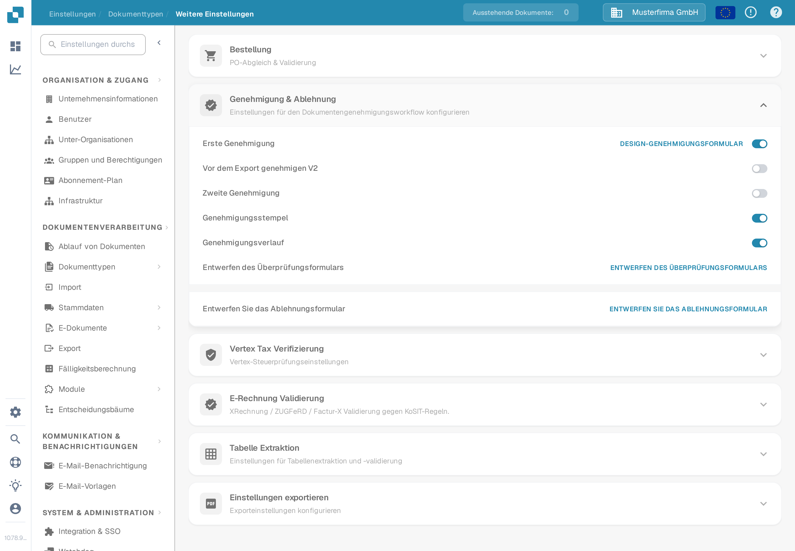

# 4. Eine Rechnung mehrstufig freigeben

**Zielgruppe:** Fachabteilungen, Vorgesetzte und Buchhaltung · **Schwierigkeit:** Mittel · **Übungsdauer:** 15–20 Minuten

**Lernziel:** Prüfen Sie, dass eine Rechnung über 12.000 EUR erst nach beiden erforderlichen Entscheidungen zum Export gelangt.

## Problem

Prüfen Sie, dass eine Rechnung über 12.000 EUR erst nach beiden erforderlichen Entscheidungen zum Export gelangt.

## Beispieldokument


ACADEMY-APP-12000: 10.084,03 EUR netto, 1.915,97 EUR Steuer, 12.000,00 EUR brutto.


Für die Übung ist **der Bruttobetrag in EUR** die Entscheidungsbasis.

| Bruttobetrag | Musterfreigabe |
| --- | --- |
| Bis einschließlich 1.000 EUR | Teamleitung |
| Über 1.000 bis einschließlich 10.000 EUR | Abteilungsleitung |
| Über 10.000 EUR | Abteilungsleitung, danach Geschäftsführung |

Diese Grenzen sind Beispiele und keine DocBits-Standardeinstellungen.

## Konfiguration

Ein Administrator bereitet zwei unterschiedliche Testrollen mit den passenden Berechtigungen vor. Unter **Einstellungen → Dokumenttypen → Rechnung → Weitere Einstellungen → Genehmigung & Ablehnung** prüfen Sie **Erste Genehmigung**, **Zweite Genehmigung** und **Genehmigungsverlauf**. Diese Schalter allein konfigurieren noch keine Betrags-, Gesellschafts- oder Kostenstellenmatrix.

Für eine Freigabematrix muss der Administrator den in Ihrer Organisation tatsächlich eingerichteten Routingmechanismus prüfen und die drei Betragsbereiche samt Gesellschaft und Kostenstelle eindeutig zuordnen. Dokumentieren Sie Feld, Währung, Grenzen, Empfänger, Reihenfolge und Verhalten bei fehlender Zuordnung. [Advanced-Routing-Beispiel](../administration-and-setup/workflow/advanced-workflow-case-study.md) zeigt eine Betragsverzweigung, aber keinen fertig eingerichteten zweistufigen Freigabeprozess. Ohne eingerichtete Empfänger und Exportsperre ist diese Übung nicht ausführbar.

## Ausführung

1. Prüfen Sie mit dem Administrator die aktive Testkonfiguration, beide Prüferrollen, Betragsbasis und Zielgesellschaft. Halten Sie den vorgesehenen Weg vor dem Import fest.
2. Importieren Sie ACADEMY-APP-12000 und validieren Sie die extrahierten Daten. Prüfen Sie insbesondere Brutto 12.000,00 EUR.
3. Öffnen Sie den aktuellen Dokumentstatus, die Aufgaben und die verfügbaren Verlaufsdaten. Prüfen Sie, ob die erste Entscheidung der Abteilungsleitung zugewiesen ist.
4. Melden Sie sich mit der berechtigten ersten Testrolle an. Prüfen und genehmigen Sie die Rechnung. Halten Sie Rolle, Zeitpunkt und Entscheidung fest.
5. Prüfen Sie als Bearbeiter, dass die zweite Freigabe weiterhin erforderlich ist. Kontrollieren Sie die Exportsperre über den normalen Prozess; führen Sie keinen vorzeitigen ERP-Export aus.
6. Melden Sie sich mit der zweiten berechtigten Testrolle an. Prüfen und genehmigen Sie die Rechnung. Kontrollieren Sie beide Entscheidungen im Genehmigungsverlauf.
7. Prüfen Sie nun, ob der Export nach der eingerichteten Konfiguration möglich wird. Bestätigen Sie eine etwaige Übernahme am isolierten ERP-Testziel.
8. Prüfen Sie in getrennten Testfällen 1.000,00, 1.000,01, 10.000,00 und 10.000,01 EUR brutto sowie fehlenden Betrag, falsche Gesellschaft und fehlende Kostenstelle. Ändern Sie dazu keine bereits freigegebene Rechnung.

## Ergebnis

Für 12.000 EUR sind zwei nachvollziehbare Entscheidungen in der vorgesehenen Reihenfolge gespeichert. Nach der ersten Entscheidung bleibt die Weiterverarbeitung gesperrt. Erst nach der zweiten wird sie nach Konfiguration möglich. Grenzfälle folgen genau den angegebenen Bereichen; fehlende Pflichtangaben benötigen eine kontrollierte Klärung.

## Fehlerbehebung

Erweiterte Übung: Leiten Sie einen separaten Trainingsbeleg bis zur zweiten Stufe und lehnen Sie ihn dort mit Begründung ab. Prüfen Sie Status, Aufgaben, Bearbeitungsmöglichkeiten, Exportsperre und konfigurierte Benachrichtigungen. Eine Benachrichtigung gilt erst nach beobachteter Zustellung als bestätigt.

Falsche Person: Rollen, Gesellschaft, Kostenstelle und Regelpriorität prüfen. Zweite Stufe fehlt: beide Freigabeeinstellungen und den tatsächlichen Routingmechanismus prüfen. Export bereits nach Stufe eins möglich: Übung nicht bestanden; bis zur Klärung keinen Export ausführen.

## Screenshots und Video

<figure><figcaption>
Bestehende echte Einstellungsansicht mit ausgeschalteten Optionen. Sie zeigt die Steuerelemente, nicht eine eingerichtete Freigabematrix.
</figcaption></figure>

Der vorhandene Film zeigt die Entscheidung an einer Rechnung. Er ersetzt nicht den Test beider Rollen und der Betragsmatrix.



[Mit Untertiteln ansehen](https://docbits-videos.fra1.cdn.digitaloceanspaces.com/settings-assistant/invoice-approval-customer/v1/de.html)

## Weiterführende Anleitung

[Freigabeeinstellungen](../administration-and-setup/settings/global-settings/document-types/more-settings/approval/README.md) · [Genehmigen oder ablehnen](../end-user-and-partner-section/end-user-section/approve-or-reject-invoices.md) · [Betragsrouting](../administration-and-setup/workflow/advanced-workflow-case-study.md)

**Stand:** 27.10.2026 · **Übungsversion:** 1.0. Die Medien zeigen die jeweils beschriebenen bestehenden Schulungsfälle. Die neuen Übungsbelege sind synthetisch. Ein erfolgreicher Lauf mit diesen Belegen und Ihrer ERP-Konfiguration muss anhand der Prüfkriterien bestätigt werden. [Voraussetzungen und Übungspaket](vorbereitung.md) · [Abnahme](qualitaet-und-abnahme.md) · [Academy](README.md)
