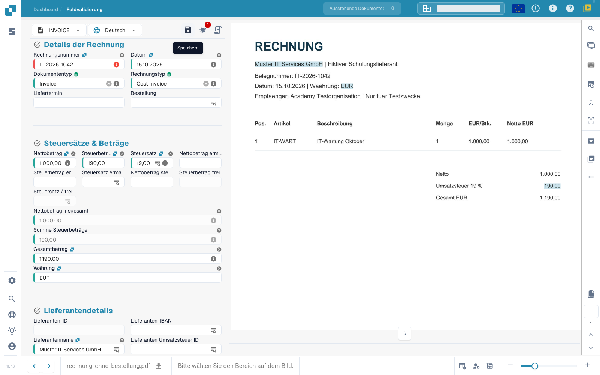
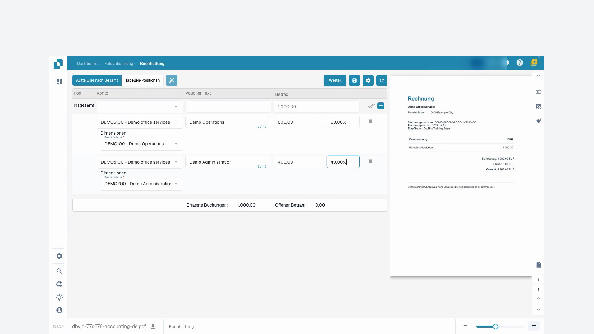

# 1. Eine Rechnung ohne Bestellung verarbeiten

**Zielgruppe:** Kreditorenbuchhaltung · **Schwierigkeit:** Anfänger · **Übungsdauer:** 10–15 Minuten

**Lernziel:** Verarbeiten Sie eine Dienstleistungsrechnung ohne Bestellnummer vom Upload bis zur kontrollierten Übergabe. Lieferant, Steuer, Sachkonto und Freigabe müssen auch ohne PO-Abgleich stimmen.

## Problem

Verarbeiten Sie eine Dienstleistungsrechnung ohne Bestellnummer vom Upload bis zur kontrollierten Übergabe. Lieferant, Steuer, Sachkonto und Freigabe müssen auch ohne PO-Abgleich stimmen.

## Beispieldokument


IT-2026-1042: IT-Wartung Oktober, Muster IT Services GmbH, 15.10.2026.


| Feld | Sollwert |
| --- | ---: |
| Netto | 1.000,00 EUR |
| Umsatzsteuer 19 % | 190,00 EUR |
| Brutto | 1.190,00 EUR |

Die Rechnung enthält keine Bestellnummer. Der Lieferant ist vollständig fiktiv und muss in der Testorganisation einem dafür angelegten Lieferanten zugeordnet werden.

## Konfiguration

Ein Bearbeiter benötigt Import-, Validierungs- und Kontierungsrechte. Ein Administrator stellt den Testlieferanten, gültige Sachkonten, Steuerkennzeichen, Kostenstellen und das isolierte ERP-Testziel bereit. Prüfen Sie den eingerichteten Kostenrechnungsprozess. Tragen Sie keine erfundene Bestellung ein, um eine PO-Pflichtprüfung zu umgehen. [Kontierung und Aufteilung](../end-user-and-partner-section/end-user-section/accounting-for-cost-invoice-and-indirect-sales.md) erläutert die Oberfläche.

## Ausführung

1. Öffnen Sie das Dashboard und wählen Sie **Upload**. Laden Sie die PDF hoch und bestätigen Sie den Import. Warten Sie, bis die Verarbeitung beendet ist.
2. Öffnen Sie die Rechnung. Kontrollieren Sie Dokumentart und Zielorganisation. Vergleichen Sie Lieferant, Rechnungsnummer IT-2026-1042 und Datum 15.10.2026 mit dem Original.
3. Prüfen Sie Netto 1.000,00, Steuer 190,00 und Brutto 1.190,00 EUR. Die Steuerbehandlung und das im ERP gültige Steuerkennzeichen müssen dazu passen.
4. Üben Sie die Korrektur an einem falsch erkannten Feld. Falls die Erkennung bereits korrekt ist, ändern Sie ausschließlich in Ihrem Trainingsdokument vorübergehend den Nettowert auf 100,00. Vergleichen Sie ihn mit dem PDF und stellen Sie 1.000,00 wieder her. Das ist ein absichtlich erzeugter Übungsfehler.
5. Öffnen Sie die konfigurierte Kontierung. Wählen Sie das vorbereitete Sachkonto, die erforderlichen Dimensionen und einen Buchungstext. Kontrollieren Sie die vom System verwendete Betragsbasis und den offenen Restbetrag.
6. Speichern Sie und öffnen Sie das Dokument erneut. Prüfen Sie die gespeicherten Werte und bearbeiten Sie alle blockierenden Validierungsmeldungen.
7. Validieren Sie die Rechnung. Falls eine Freigabe erforderlich ist, lassen Sie die vorgesehene berechtigte Rolle entscheiden. Prüfen Sie den Status nach dieser Entscheidung.
8. Wählen Sie den vorgesehenen Export ausschließlich zum ERP-Testziel. Halten Sie Exportzeitpunkt und Dokument-ID fest.
9. Prüfen Sie die fachliche Antwort der Schnittstelle und suchen Sie im Zielsystem nach Lieferant und Rechnungsnummer. Kontrollieren Sie genau einen übernommenen Beleg, Beträge, Sachkonto und Steuer. Ein grüner DocBits-Status allein reicht nicht als Nachweis der Buchung.

## Ergebnis

Bestanden ist die Übung, wenn die gespeicherten Rechnungswerte dem PDF entsprechen, alle erforderlichen Kontierungsfelder gefüllt sind, Freigaben abgeschlossen wurden und genau ein korrekter Beleg im Test-ERP nachgewiesen ist. Ohne ERP-Zugang endet der belegbare Teil bei der gespeicherten, geprüften Rechnung; markieren Sie den Export dann als offen.

## Fehlerbehebung

| Problem | Nächster Schritt |
| --- | --- |
| Lieferant unbekannt | Testlieferanten und Zuordnung prüfen. Kein fremdes Lieferantenkonto verwenden. |
| Betrag falsch | Original gegen Netto, Steuer und Brutto prüfen. 1.000 + 190 = 1.190. |
| Export nicht verfügbar | Pflichtfelder, Status, Freigaben und Exportkonfiguration prüfen. |
| Kontierung verschwindet | Speicherrückmeldung und Werte nach erneutem Öffnen prüfen. |

## Screenshots und Video

<figure><figcaption>
Eigener Übungsbeleg auf Sandbox, VESTA, Oberfläche 11.7.3, geprüft am 27.10.2026. Die korrigierten Werte wurden gespeichert und nach erneutem Laden bestätigt. Der Organisationsname ist ausgeblendet. Die Lieferanten-ID fehlt noch; eine vollständige Validierung oder ERP-Übernahme ist damit nicht belegt. Invoice und Cost Invoice sind die hier konfigurierten Typwerte.
</figcaption></figure>

Die folgenden Medien ergänzen die Kontierung. Sie verwenden einen anderen Schulungsfall:

<figure><figcaption>
Vorhandener Kontierungsfall über 1.000 EUR ohne Steuer. Er veranschaulicht die Aufteilung, zeigt aber nicht die neue steuerpflichtige Rechnung IT-2026-1042.
</figcaption></figure>

Kurzanleitung zur Bedienung der Kontierung. Der Film verwendet den bestehenden steuerfreien Fall mit zwei Kostenstellen.



[Mit Untertiteln ansehen](https://docbits-videos.fra1.cdn.digitaloceanspaces.com/settings-assistant/cost-invoice-accounting-customer/v3/de.html)

## Weiterführende Anleitung

[Manueller Import](../end-user-and-partner-section/end-user-section/how-to-import-documents/manual-import.md) · [Felder validieren](../end-user-and-partner-section/end-user-section/validation-screen/README.md) · [Kostenrechnung kontieren](../end-user-and-partner-section/end-user-section/accounting-for-cost-invoice-and-indirect-sales.md) · [Exportfehler klären](erp-export-fehler.md)

**Stand:** 27.10.2026 · **Übungsversion:** 1.0. Import, Kopfdaten, Eingabekorrektur, Speicherung und Werte nach erneutem Laden wurden mit diesem synthetischen Beleg auf Sandbox/VESTA 11.7.3 geprüft. Kontierung, Freigabe, ERP-Übernahme und selbständige Key-User-Abnahme sind noch offen. [Voraussetzungen und Übungspaket](vorbereitung.md) · [Abnahme](qualitaet-und-abnahme.md) · [Academy](README.md)
