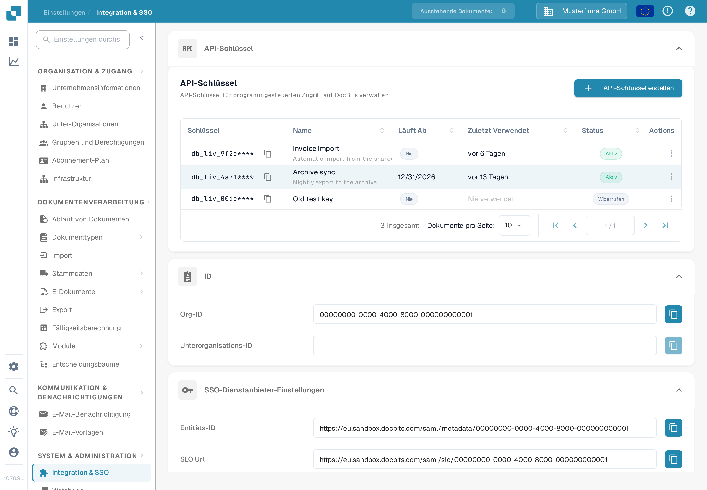

# API-Schlüssel

<figure><figcaption>
Einstellungen → Integration &amp; SSO → API-Schlüssel. Das Schlüsselpräfix ist in diesem Screenshot verborgen.
</figcaption></figure>

Der Abschnitt **API-Schlüssel** oben auf der Seite Integration & SSO listet jeden API-Schlüssel auf, den Ihre Organisation erstellt hat. Ein API-Schlüssel ermöglicht einem anderen System — Ihrem ERP, einem Skript oder einer Partneranwendung — den Zugriff auf DocBits, ohne dass sich ein Benutzer anmeldet. Schritt-für-Schritt-Anleitungen finden Sie unter [API-Schlüsselverwaltung](../../../../administration-and-setup/settings/global-settings/integration/api-key-management.md).

### API-Schlüsselliste

* **Schlüssel:** Die ersten Zeichen des Schlüssels, gefolgt von `****`. Der vollständige Schlüssel wird nur einmal angezeigt — beim Erstellen — und kann später nicht mehr eingesehen werden. Das Kopiersymbol neben dem Schlüssel kopiert den sichtbaren Präfix in die Zwischenablage.
* **Name / Läuft Ab / Zuletzt Verwendet / Status:** Jede Zeile zeigt den Namen des Schlüssels, wann er außer Kraft tritt, wann zuletzt eine Anfrage ihn verwendet hat und ob er noch aktiv ist.
* **API-Schlüssel erstellen:** Öffnet einen Dialog, um einen neuen Schlüssel für eine Integration anzulegen. Die Felder und die einmalige Anzeige des vollständigen Schlüssels sind unter [API-Schlüsselverwaltung](../../../../administration-and-setup/settings/global-settings/integration/api-key-management.md) beschrieben.
* **Actions (Drei-Punkte-Menü):** Öffnet die Aktionen für einen Schlüssel, über die Sie seinen Namen bearbeiten, ihn widerrufen oder einen bereits widerrufenen Schlüssel löschen können. Widerrufen schaltet den Schlüssel dauerhaft ab.

### SSO-Dienstanbieter-Einstellungen

Dies sind die Werte, die Ihr Identitätsanbieter benötigt, damit sich Benutzer mit dem Firmenlogin bei DocBits anmelden können. Die vollständige Einrichtungsanleitung finden Sie unter [Konfiguration von Single Sign-On (SSO)](konfiguration-von-single-sign-on-sso.md).

* **Entitäts-ID:** Die Kennung für DocBits als Dienstanbieter in der SSO-Konfiguration. Das Kopiersymbol kopiert den Wert in die Zwischenablage.
* **SLO Url (Single Logout):** Die URL, über die ein Benutzer gleichzeitig von allen über SSO verbundenen Anwendungen abgemeldet wird. Das Kopiersymbol kopiert den Wert.
* **SSO Url:** Die URL zum Starten des Single-Sign-On-Prozesses. Das Kopiersymbol kopiert den Wert.
* **Zertifikat herunterladen:** Lädt das Sicherheitszertifikat herunter, das Ihr Identitätsanbieter benötigt, um DocBits zu vertrauen.
* **Metadaten herunterladen:** Lädt die SAML-Metadatendatei herunter, die sich direkt in die meisten Identitätsanbieter importieren lässt.

### Einstellungen des Identitätsdienstanbieters

Richten Sie DocBits so ein, dass die Anmeldung über Ihren externen Identitätsanbieter (IdP) erfolgt. Die vollständige Anleitung finden Sie unter [Konfiguration des Identitätsdienstanbieters](konfiguration-des-identitatsdienstanbieters.md).

* **Mandanten-ID:** Die Mandantenkennung Ihres Identitätsanbieters, verwendet wenn DocBits in Cloud-Dienste integriert wird, die den Zugriff pro Mandant verwalten.
* **Datei hochladen:** Lädt die Metadaten- oder Konfigurationsdatei hoch, die Sie von Ihrem Identitätsanbieter erhalten haben.
* **Konfigurieren Sie:** Speichert die Einstellungen und wendet die hochgeladene Konfiguration an. Geben Sie zuerst die Mandanten-ID ein oder laden Sie die Datei hoch, und klicken Sie dann auf **Konfigurieren Sie**.
