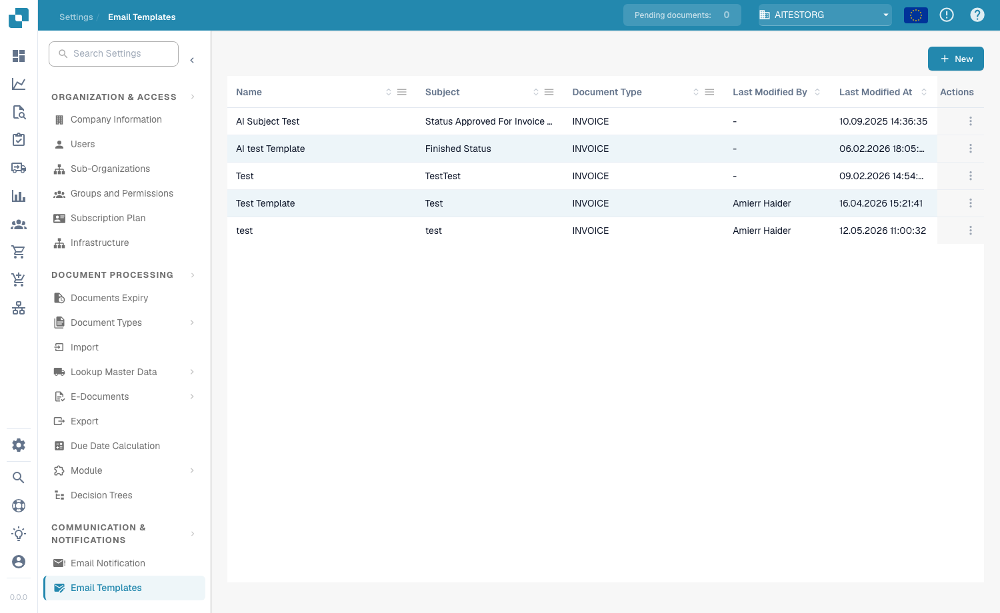

# Email Templates

<figure><figcaption>
Página de Email Templates
</figcaption></figure>

Email Templates le permite diseñar formatos de correo electrónico reutilizables que utiliza Email Notifications. Las plantillas definen el asunto y el contenido del cuerpo, incluidos marcadores de posición dinámicos para los datos del documento.

## Lista de plantillas

| Columna | Descripción |
|--------|-------------|
| **Name** | Un nombre descriptivo para la plantilla. |
| **Subject** | El asunto del correo electrónico. Admite marcadores de posición como `{{invoice_id}}`. |
| **Document Type** | A qué tipo de documento se aplica esta plantilla (p. ej., INVOICE). |
| **Last Modified By** | El usuario que editó la plantilla por última vez. |
| **Last Modified At** | Marca de tiempo del último cambio. |
| **Actions** | Menú de tres puntos para editar o eliminar. |

## Crear una plantilla

1. Haga clic en **+ New** en la esquina superior derecha.
2. Introduzca un **Name** y un **Subject** (utilice `{{field_name}}` para valores dinámicos).
3. Seleccione el **Document Type**.
4. Diseñe el cuerpo del correo electrónico con el editor integrado.
5. Haga clic en **Save**.

## Marcadores de posición dinámicos

Utilice llaves dobles para insertar valores de los campos del documento en su plantilla:

* `{{invoice_id}}` — El número de factura
* `{{supplier_name}}` — El nombre del proveedor
* `{{total_amount}}` — El importe total
* `{{status}}` — El estado actual del documento
