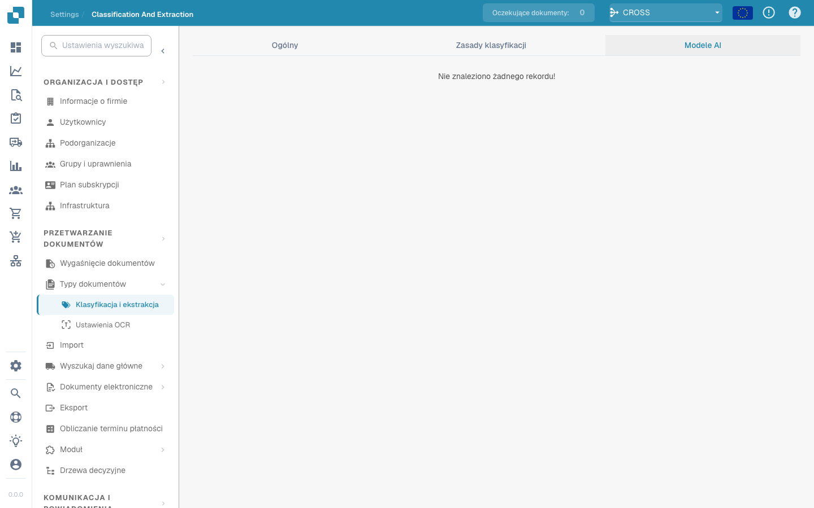

# Classification et extraction

## Vue d'ensemble

Dans les paramètres **Classification et extraction**, vous pouvez :

* Activer la **division des documents** sur la base des codes QR
* Configurer le **formatage des montants**
* Configurer l'**extraction de tableaux**
* Activer ou désactiver le traitement des fichiers **ZUGFeRD** non pris en charge
* Définir des règles de classification spécifiques
* Suivre les **modèles d'IA** entraînés sur mesure utilisés dans le processus de classification

Cette page décrit en détail tous les paramètres disponibles.

## **Accéder aux paramètres de classification et d'extraction**

Pour accéder aux paramètres **Classification et extraction**, allez dans :\
**Paramètres → Traitement des documents → Classification et extraction**

<figure><figcaption>
Ouvrez <strong>Paramètres → Traitement des documents → Classification et extraction</strong>.
</figcaption></figure>

## Division des documents

Dans la section **Division des documents**, vous pouvez configurer si un document téléversé doit être divisé en plusieurs documents dès qu'un **code-barres** apparaît sur l'une de ses pages.

Pour activer cette fonctionnalité :

1. Allez dans la section **Division des documents**.
2.  Ouvrez le menu déroulant.

    <figure><figcaption></figcaption></figure>
3.  Sélectionnez **Diviser par code-barres/code QR**.

    <figure><figcaption></figcaption></figure>

Vous aurez ensuite la possibilité de :

* Sélectionner un ou plusieurs types de codes-barres à détecter.
*   Indiquer un motif regex auquel le code-barres doit correspondre pour déclencher la division du document.

    <figure><figcaption></figcaption></figure>

## Formatage des montants

Dans la section **Formatage des montants**, vous disposez de deux options :

* **Autoriser l'arrondi lors de la comparaison des montants :**\
  Si cette option est activée, une tolérance de ±0,5 est admise lors de la comparaison des montants.\
  Si elle est désactivée, une tolérance par défaut de ±0,05 s'applique.
* **Exiger une correspondance exacte pour la comparaison des montants :**\
  Si cette option est activée, les montants doivent correspondre exactement, sans aucune tolérance.\
  Si elle est désactivée, une tolérance de ±0,05 est admise.

<mark style="color:red;">**Remarque**</mark> : une seule de ces deux options peut être active à la fois.

## Extraction de tableaux


**Prérequis pour une extraction de tableaux fonctionnelle**

* Le type de document dispose de **colonnes de tableau** (Paramètres → Paramètres globaux → Types de documents → [Colonnes de tableau](../../global-settings/document-types/table-columns/README.md)). Sans colonnes, il n'y a rien dans quoi extraire.
* **Extraction de tableaux** ou **Extraction de tableaux par IA** est activée ci-dessous, pour toute l'organisation.
* Le document contient du texte lisible : l'OCR a été exécuté, ou l'E-Text est utilisé pour les PDF nativement numériques ([Paramètres de l'OCR](../ocr-settings.md)).
* L'entraînement et les modèles d'IA sont définis **par fournisseur**. Un tableau entraîné ne s'applique qu'aux documents du fournisseur sur lequel il a été entraîné.


Vous pouvez extraire les tableaux des documents en activant soit **Extraction de tableaux**, soit **Extraction de tableaux par IA**. Un tableau entraîné (qu'il soit basé sur l'IA ou manuel) est toujours lié à un fournisseur précis.

**Extraction de tableaux :** active l'extraction de tableaux basée sur des règles. Les tableaux sont entraînés par fournisseur sur l'écran de validation (*Aller à la vue d'extraction de tableau*).\
En savoir plus sur l'entraînement [ici](../../../setup/document-training/training-line-fields-table-training/defining-tables-and-columns.md).

**Extraction de tableaux par IA :** utilise l'IA pour extraire le tableau de n'importe quel fournisseur sans entraînement. Si les résultats pour un fournisseur ne sont pas assez précis, entraînez le tableau de ce fournisseur ; les règles enregistrées prennent alors le pas sur l'IA pour ce fournisseur.

**Utiliser l'extraction de tableaux Vision (IA) :** l'IA lit l'image de la page au lieu de la couche de texte. Utile pour les documents numérisés et les tableaux sans structure de texte claire ; plus lent. Le menu déroulant à côté de l'interrupteur détermine l'intensité avec laquelle l'image de la page est utilisée :

* **Désactivé (texte uniquement)** – Seule la couche de texte est utilisée. C'est le réglage par défaut.
* **Images uniquement** – Seule l'image de la page est lue.
* **Hybride (texte et images)** – La couche de texte et l'image de la page sont combinées dans la même requête.
* **Auto (décidé par document)** – DocBits décide par document si la couche de texte suffit.

Le mode est stocké sous la clé de préférence `TABLE_EXTRACTION_VISION_MODE` ; l'ancien interrupteur `TABLE_EXTRACTION_USE_VISION` subsiste et équivaut en pratique à *Images uniquement*.

**Utiliser l'extraction structurée (IA) :** l'IA renvoie le tableau dans une structure fixe qui correspond directement aux colonnes de tableau configurées. Recommandé lorsque les en-têtes de colonnes varient beaucoup d'un document à l'autre. Un clic sur le paramètre ouvre un aperçu des champs et colonnes qui seront exactement demandés à l'IA : les champs d'en-tête et les colonnes de ligne sont listés avec leur origine (champs standard demandés ou désactivés), ainsi que le mode de sortie attendu (par exemple *strict* – aucune colonne supplémentaire). Les champs configurés pour le type de document mais désactivés ne sont pas demandés à l'IA.

**Extraction de tableaux pour le calcul des coûts :** lorsque cette option est activée, DocBits peut extraire les éléments de coût des tableaux au niveau des lignes et les classer en conséquence.\
Explication détaillée [ici](table-extraction-for-costing-element.md).

**Extraction automatique du code fiscal :** lorsque cette option est activée, le système remplit automatiquement le champ **Code fiscal** sur l'écran de validation, à condition qu'un champ de code fiscal soit configuré.\
Plus d'informations sur ce paramètre [ici](auto-extract-tax-code.md).

**Enregistrer les règles d'extraction (administrateurs uniquement) :** seuls les administrateurs peuvent cliquer sur *Enregistrer les règles* dans l'entraînement de tableau. Activez cette option lorsque des utilisateurs enregistrent régulièrement des règles qui cassent l'extraction d'un fournisseur.

**Modèle d'IA :** sélectionne le niveau d'IA utilisé pour l'extraction de tableaux. Six options sont disponibles : **Full** (précision maximale, le plus lent, 2 tokens par document), **Fast** (par défaut ; 1 token par document), **Nexus** et **Nexus Flash** (famille de modèles alternative, sur activation), ainsi que **Auto** et **Auto Nexus**, où DocBits décide par document de la puissance de modèle nécessaire. Le tableau sous le sélecteur indique :

* Quels **fournisseurs** utilisent quel modèle d'IA
* S'ils utilisent l'extraction structurée (IA) et l'E-Text
* Des options pour supprimer une entrée et ainsi réinitialiser le fournisseur au réglage par défaut

Ce paramètre est expliqué en détail [ici](ai-model.md).

### Pourquoi le tableau est-il différent d'un fournisseur à l'autre ?

Tout ce que DocBits apprend sur un tableau est stocké **par fournisseur** :

* **Règles enregistrées** (entraînement de tableau) : position du tableau et mappage de ses colonnes sur la mise en page de ce fournisseur.
* **Étiquettes de tableau AI et règles de formatage** : indications que l'utilisateur a enregistrées pour le tableau AI de ce fournisseur.
* **Modèle d'IA spécifique au fournisseur** : le niveau choisi pour ce fournisseur sous *Plus de paramètres* sur l'écran de validation.

Ainsi, le fournisseur A, qui dispose de règles enregistrées, affiche un tableau déterministe dans l'onglet *Tableau extrait* de l'écran de validation, tandis que le fournisseur B, sans règles, obtient le *Tableau extrait par IA*. Pour que le fournisseur B se comporte comme A, entraînez une fois le tableau de B. Pour réinitialiser un fournisseur, supprimez ses règles sur l'écran de validation ou réinitialisez ses données d'entraînement dans le tableau Modèle d'IA.

### Clés de préférence

Chaque option de cette section est stockée sous forme de préférence d'organisation. Utilisez la clé lorsque vous définissez la valeur via l'API (`/preferences/set_preference`), un script ou le DocBits MCP (`get_preference` / `set_preference`).

| Paramètre (libellé dans l'interface) | Clé de préférence | Valeurs |
|---|---|---|
| Extraction de tableaux | `TABLE_EXTRACTION_SETTING` | `true` / `false` |
| Extraction de tableaux par IA | `USE_AI_TABLE_EXTRACTION` | `true` / `false` |
| Utiliser l'extraction de tableaux Vision (IA) | `TABLE_EXTRACTION_VISION_MODE` | `off` (par défaut), `vision`, `hybrid`, `auto` |
| Utiliser l'extraction de tableaux Vision (IA) – ancien interrupteur | `TABLE_EXTRACTION_USE_VISION` | `true` / `false` ; équivaut en pratique à `vision` |
| Utiliser l'extraction structurée (IA) | `USE_STRUCTURED_EXTRACTION` | `true` / `false` |
| Extraction de tableaux pour le calcul des coûts | `CHARGES_TABLE_EXTRACTION` | `true` / `false` |
| Extraction automatique du code fiscal | `AUTO_EXTRACT_TAX_CODE` | `true` / `false` |
| Enregistrer les règles d'extraction (administrateurs uniquement) | `ONLY_ADMIN_CAN_SAVE_RULES` | `true` / `false` |
| Modèle d'IA | `AI_MODEL` | `gpt-6-sol` (Full), `gpt-6-luna` (Fast), `qwen3.8-max` (Nexus), `glm-5.3-flash` (Nexus Flash), `auto` (Auto), `auto-nexus` (Auto Nexus) |
| Version de l'extraction de tableaux (boîte de dialogue de confirmation) | `TBL_EXT_VERSION` | chaîne de version |
| Paramètres de l'OCR → Utiliser les données IA pour les tableaux si disponibles | `USE_AI_DATA_FOR_TABLE` | `true` / `false` |
| Paramètres de l'OCR → Utiliser l'E-Text si disponible | `USE_ETEXT_IF_AVAILABLE` | `true` / `false` |

Remarques :

* Les préférences booléennes sont stockées sous forme de chaînes `true` / `false` ; une clé jamais définie compte comme `false`. Si vous envoyez `1` ou `0`, DocBits stocke `true` / `false`.
* `AI_MODEL` non défini équivaut à **Fast**.
* Un `TABLE_EXTRACTION_VISION_MODE` non défini est déduit de l'ancien interrupteur `TABLE_EXTRACTION_USE_VISION` : `true` donne `vision`, toute autre valeur donne `off`.
* La modification d'une clé prend effet pour les documents traités ensuite. Redémarrez un document pour le réextraire avec le nouveau paramètre.
* Les choix par fournisseur (E-Text, modèle d'IA, règles enregistrées) ne sont pas des préférences d'organisation ; ils se définissent sur l'écran de validation, sous *Plus de paramètres*, pour un document de ce fournisseur.

## Document électronique

**Traiter les PDF ZUGFeRD non pris en charge :** si cette option est activée, les versions **ZUGFeRD** non prises en charge sont traitées comme des PDF standard et le XML intégré est ignoré.

La liste des versions **ZUGFeRD** prises en charge est disponible [ici](../../global-settings/document-types/edi/zugferd/README.md).

## **Règles de classification**

Dans la section **Règles de classification**, vous pouvez définir des motifs **regex** et des critères spécifiques pour aider le système à classer automatiquement les documents lors du traitement.

Pour accéder à cette section, cliquez sur l'onglet **Règles de classification** en haut de la page.

<figure><figcaption></figcaption></figure>

### **Ajouter une nouvelle règle de classification**

Pour créer une nouvelle règle :

1.  Cliquez sur **Ajouter** dans le coin supérieur droit.

    <figure><figcaption></figcaption></figure>
2. Renseignez les champs suivants :
   * **Motif** : le motif regex que le système doit rechercher pour déclencher la classification.
   * **Type** : l'endroit où le motif doit être recherché (par exemple **Code-barres**).
   * **Sous-organisation** _(facultatif)_ : indique à quelle sous-organisation la règle s'applique.
   * **Type de document** : le type de document à attribuer lorsque le motif correspond.
   *   **Sous-type de document** _(facultatif)_ : indique un sous-type pour une classification plus fine.

       <figure><figcaption></figcaption></figure>
3.  Cliquez sur **Enregistrer** pour enregistrer votre règle de classification.

    <figure><figcaption></figcaption></figure>

### **Modifier une règle de classification**

Pour modifier une règle existante :

1.  Cliquez sur les trois points dans la colonne **Actions**.

    <figure><figcaption></figcaption></figure>
2.  Sélectionnez **Modifier**.

    <figure><figcaption></figcaption></figure>
3. Apportez les modifications souhaitées.
4.  Cliquez sur **Enregistrer** pour appliquer les mises à jour.

    <figure><figcaption></figcaption></figure>

### **Supprimer une règle de classification**

Pour supprimer une règle :

1.  Cliquez sur les trois points dans la colonne **Actions**.

    <figure><figcaption></figcaption></figure>
2.  Sélectionnez **Supprimer**.

    <figure><figcaption></figcaption></figure>

## Modèles d'IA

La section **Modèles d'IA** affiche tous les modèles entraînés sur mesure qui ont été spécifiquement ajustés à vos besoins.

### Accéder à la section Modèles d'IA

Pour ouvrir cette section, cliquez sur l'onglet **Modèles d'IA** situé en haut de la page.

<figure><figcaption></figcaption></figure>

### Catégories de modèles

Les modèles sont organisés par catégories. Sous le nom de chaque catégorie figure le nombre de modèles qu'elle contient.\
Cliquez sur une catégorie pour afficher ses détails.

<figure><figcaption></figcaption></figure>

En haut de la page de la catégorie sélectionnée, vous verrez les informations clés de chaque modèle :

* **Type** : le type de modèle.
* **Première page uniquement** : indique si le modèle ne traite que la première page d'un document.
* **Version** : le numéro de version du modèle.

### Tableau des modèles

Tous les modèles d'une catégorie sont répertoriés dans un tableau qui contient les informations suivantes :

* **Nom** : le nom du modèle.
* **Modèle suivant** : le modèle qui traitera ensuite la sortie du modèle actuel.
* **Type de document** : le type de document principal attribué par le modèle lors de la classification.
* **Sous-types de document** : les sous-types dans lesquels le document est ensuite classé.
* **Priorité** : le niveau de priorité qui détermine la position du modèle dans la file de classification.

<figure><figcaption></figcaption></figure>

### Modifier un modèle

Pour modifier un modèle :

1.  Cliquez sur l'icône de crayon dans la colonne **Actions** à côté du modèle à modifier.

    <figure><figcaption></figcaption></figure>
2. Mettez à jour les champs disponibles :
   * **Modèle suivant** : sélectionnez le modèle qui doit traiter la sortie du modèle actuel.
   * **Type de document** : choisissez le type de document dans lequel le modèle doit classer l'entrée.
3.  Cliquez sur **Enregistrer** pour appliquer vos modifications.

    <figure><figcaption></figcaption></figure>
