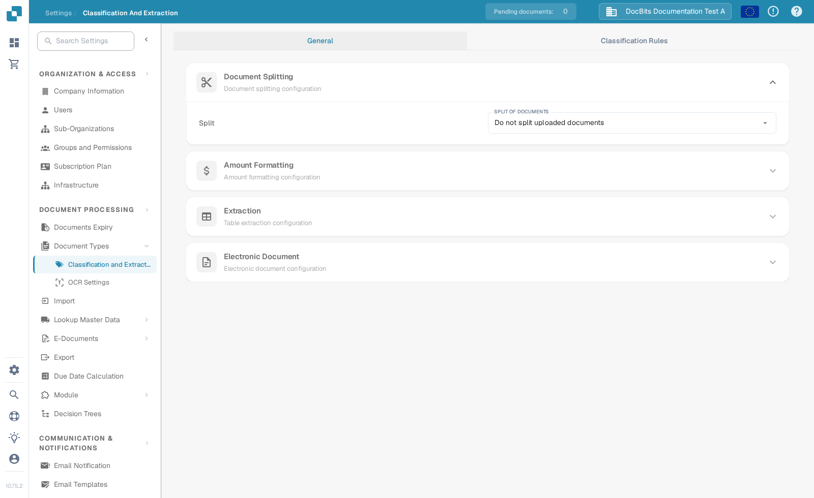
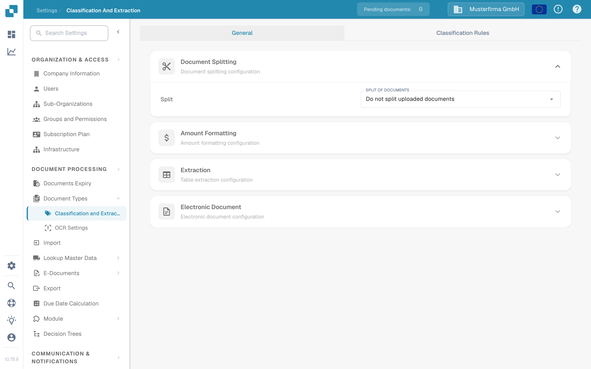
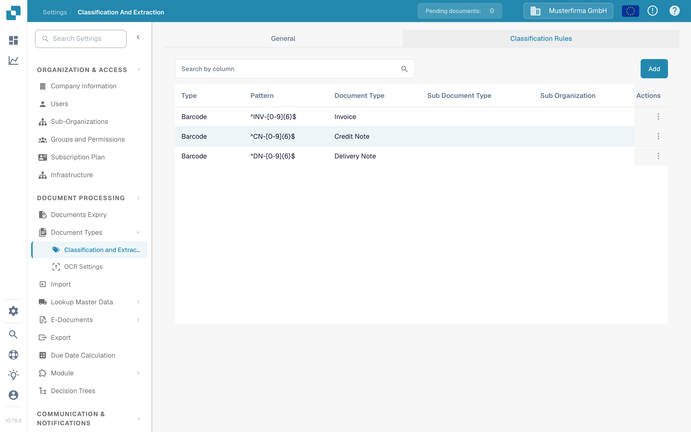
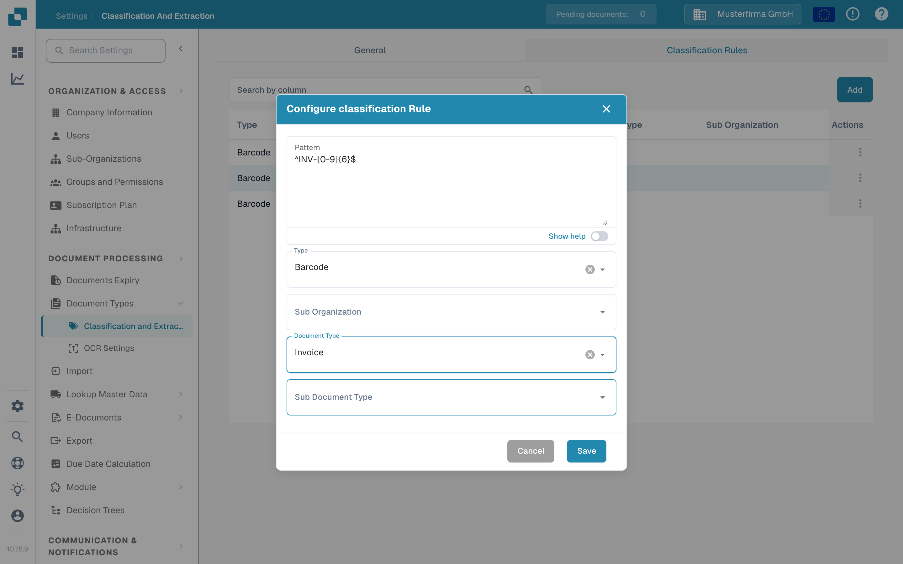
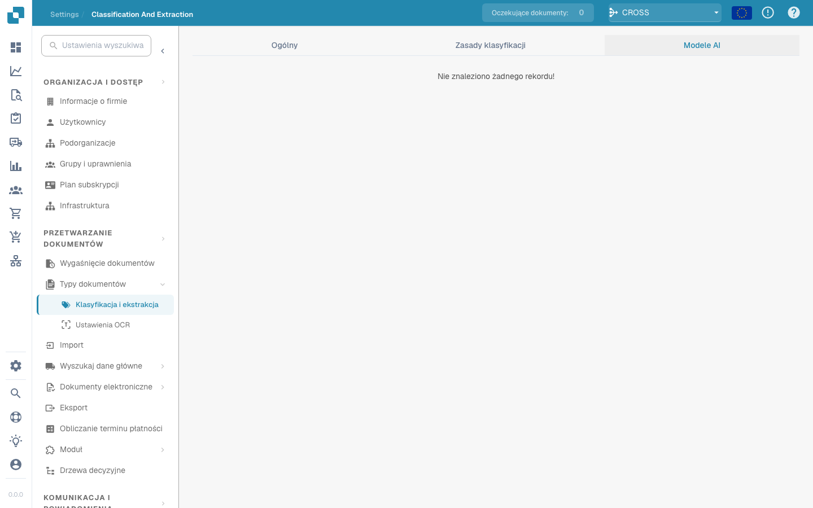

# Classification and Extraction

Use these settings to control how DocBits splits uploaded files, compares amounts, extracts tables, handles certain electronic documents, and classifies documents. You need permission to change organization settings.

Open **Settings → Document Types → Classification and Extraction**. The current page has two tabs: **General** and **Classification Rules**. The AI model controls are in **General → Extraction**; there is no separate **AI Models** tab on this screen.

<figure><figcaption>
Choose General for processing settings or Classification Rules for document classification patterns.
</figcaption></figure>

## General

Open a section to see its settings. Changing an organization setting can affect documents processed later; check the intended document type and test the result before changing a production workflow.

### Document Splitting

**Split** is set to **Do not split uploaded documents** in this test organization. Choose a barcode or QR-code splitting option only when your incoming file format requires it. When that option is selected, configure the supported barcode types and a pattern if needed. A file is split only when the configured conditions are met.

### Amount Formatting

**Allow Rounding During Amount Comparison** controls whether small rounding differences are accepted. **Require Exact Match for Amount Comparison** requires an exact comparison. Check which policy your organization needs before enabling either option; the two settings have different effects on validation.

### Extraction

**Table Extraction** enables extraction based on trained rules. **AI Table extraction** enables AI-based table extraction. The controls for **Use Table Extraction Vision (AI)** and **Use Structured Extraction (AI)** choose how the AI reads and structures a table. A document type also needs configured table columns for useful results; see [Table Columns](../../global-settings/document-types/table-columns/README.md).

The current screen also includes **Table extraction for costing element**, **Auto extract tax code**, **Save extraction rules (Admin only)**, and **AI Model**. The model selector and supplier table live here, within **Extraction**. See [Table Extraction for Costing Element](table-extraction-for-costing-element.md), [Auto Extract Tax Code](auto-extract-tax-code.md), and [AI Model](ai-model.md) for those topics.

**What the AI requests** shows the header fields and table columns requested for the selected document type. Use **Edit fields** or **Edit columns** only after checking the selected type; the list distinguishes requested columns from configured columns that are not requested. Supplier training or AI hints can change the requested fields for a supplier.

<figure><figcaption>
The Extraction section shows both the processing controls and requested fields for the selected type.
</figcaption></figure>

### Electronic Document

**Process Unsupported ZUGFeRD PDF** controls whether unsupported ZUGFeRD PDFs are processed as ordinary PDFs instead of using their embedded XML. For supported versions, see [ZUGFeRD](../../global-settings/document-types/edi/zugferd/README.md).

## Classification Rules

The **Classification Rules** tab lists patterns used to assign a document type or subtype. Search the list with **Search by column**. Existing rows offer **Edit** and **Delete** actions; check which documents rely on a rule before changing it. In the captured test organization the list is empty, so no existing rule was edited or deleted.

<figure><figcaption>
Find existing rules here or choose Add to prepare a new one.
</figcaption></figure>

To prepare a rule, choose **Add**. The dialog asks for **Pattern**, **Type**, **Sub Organization**, **Document Type**, and **Sub Document Type**. Select the type and destination carefully; the pattern determines which documents the rule can match. **Cancel** leaves the organization unchanged. **Save** creates the rule, so review it before saving.

<figure><figcaption>
Review the pattern and target document type before saving a classification rule.
</figcaption></figure>


These screenshots show English UI in the synthetic DocBits Documentation Test A organization. No organization setting or classification rule was saved while capturing them.


You can extract tables from documents by enabling either **Table Extraction** or **AI Table Extraction**. A trained table (whether AI-based or manual) is always linked to a specific supplier.

**Table Extraction:** Activates rule-based table extraction. Tables are trained per supplier on the validation screen (*Go to table extraction view*).\
Learn more about training [here](../../../setup/document-training/training-line-fields-table-training/defining-tables-and-columns.md).

**AI Table Extraction:** Uses AI to extract the table of any supplier without training. If the results for one supplier are not accurate enough, train that supplier's table; the saved rules then take precedence over the AI for that supplier.

**Use Table Extraction Vision (AI):** The AI reads the page image instead of the text layer. Helps with scanned documents and tables without clear text structure; slower. The dropdown next to the switch chooses how aggressively the page image is used:

* **Off (text only)** – Only the text layer is used. This is the default.
* **Images only** – Only the page image is read.
* **Hybrid (text and images)** – Text layer and page image are combined in the same request.
* **Auto (decided per document)** – DocBits decides per document whether the text layer suffices.

The mode is stored under the preference key `TABLE_EXTRACTION_VISION_MODE`; the legacy switch `TABLE_EXTRACTION_USE_VISION` remains and effectively means *Images only*.

**Use Structured Extraction (AI):** The AI returns the table in a fixed structure that maps directly onto the configured table columns. Recommended when column headers on the documents vary a lot. Clicking the setting opens a preview of exactly which fields and columns the AI will be asked for: header fields and line columns are listed with their source (requested or disabled standard fields), and the expected output mode (e.g. *strict* – no additional columns). Fields that are configured for the document type but switched off are not requested from the AI.

**Table Extraction for Costing Element:** When enabled, DocBits can extract costing elements from tables at the line level and classify them accordingly.\
Detailed explanation available [here](table-extraction-for-costing-element.md).

**Auto Extract Tax Code:** When enabled, the system automatically fills the **Tax Code** field on the Validation Screen, provided that a tax code field is configured.\
More information on this setting [here](auto-extract-tax-code.md).

**Save extraction rules (Admin only):** Only administrators can click *Save Rules* in table training. Switch it on when users keep saving rules that break a supplier's extraction.

**AI Model:** Selects the AI tier used for table extraction. Six options are available: **Full** (highest accuracy, slowest, 2 tokens per document), **Fast** (default; 1 token per document), **Nexus** and **Nexus Flash** (alternative model family, opt-in), plus **Auto** and **Auto Nexus**, where DocBits decides per document how strong a model is needed. The table below the selector shows:

* Which **suppliers** use which AI model
* Whether they use structured extraction (AI) and E-Text
* Options to delete an entry and thereby reset the supplier to the default

This setting is explained in detail [here](ai-model.md).

### Why does the table look different per supplier?

Everything that DocBits learns about a table is stored **per supplier**:

* **Saved rules** (table training): position of the table and mapping of its columns on that supplier's layout.
* **AI table tags and formatting rules**: hints the user saved for that supplier's AI table.
* **Supplier-specific AI model**: the tier chosen for that supplier under *More settings* on the validation screen.

So supplier A with saved rules shows a deterministic table in the *Extracted table* tab of the validation screen, while supplier B without rules gets the *AI Extracted table*. To make supplier B behave like A, train B's table once. To reset a supplier, delete its rules on the validation screen or reset its training data in the AI Model table.

### Preference keys

Every toggle in this section is stored as an organization preference. Use the key when you set the value through the API (`/preferences/set_preference`), a script, or the DocBits MCP (`get_preference` / `set_preference`).

| Setting (UI label) | Preference key | Values |
|---|---|---|
| Table Extraction | `TABLE_EXTRACTION_SETTING` | `true` / `false` |
| AI Table extraction | `USE_AI_TABLE_EXTRACTION` | `true` / `false` |
| Use Table Extraction Vision (AI) | `TABLE_EXTRACTION_VISION_MODE` | `off` (default), `vision`, `hybrid`, `auto` |
| Use Table Extraction Vision (AI) – legacy switch | `TABLE_EXTRACTION_USE_VISION` | `true` / `false`; effectively means `vision` |
| Use Structured Extraction (AI) | `USE_STRUCTURED_EXTRACTION` | `true` / `false` |
| Table extraction for costing element | `CHARGES_TABLE_EXTRACTION` | `true` / `false` |
| Auto extract tax code | `AUTO_EXTRACT_TAX_CODE` | `true` / `false` |
| Save extraction rules (Admin only) | `ONLY_ADMIN_CAN_SAVE_RULES` | `true` / `false` |
| AI Model | `AI_MODEL` | `gpt-6-sol` (Full), `gpt-6-luna` (Fast), `qwen3.8-max` (Nexus), `glm-5.3-flash` (Nexus Flash), `auto` (Auto), `auto-nexus` (Auto Nexus) |
| Table extraction version (confirmation dialog) | `TBL_EXT_VERSION` | version string |
| OCR Settings → Use AI data for tables if available | `USE_AI_DATA_FOR_TABLE` | `true` / `false` |
| OCR Settings → Use E-Text if available | `USE_ETEXT_IF_AVAILABLE` | `true` / `false` |

Notes:

* Boolean preferences are stored as the strings `true` / `false`; a key that was never set counts as `false`. If you send `1` or `0`, DocBits stores `true` / `false`.
* `AI_MODEL` unset means **Fast**.
* `TABLE_EXTRACTION_VISION_MODE` unset is resolved from the legacy `TABLE_EXTRACTION_USE_VISION` switch: `true` resolves to `vision`, anything else to `off`.
* Changing a key takes effect for documents processed afterwards. Restart a document to re-extract it with the new setting.
* Per-supplier choices (E-Text, AI model, saved rules) are not organization preferences; they are set on the validation screen under *More settings* for a document of that supplier.

## Electronic Document

**Process Unsupported ZUGFeRD PDF:** If enabled, unsupported **ZUGFeRD** versions will be processed as standard PDFs, and the embedded XML will be ignored.

The list of supported **ZUGFeRD** versions can be found [here](../../global-settings/document-types/edi/zugferd/README.md).

## **Classification Rules**

In the **Classification Rules** section, you can define specific **regex** patterns and criteria to help the system automatically classify documents during processing.

To access this section, click the **Classification Rules** tab at the top of the page.

<figure><figcaption></figcaption></figure>

### **Add a New Classification Rule**

To create a new rule:

1.  Click **Add** in the top-right corner.

    <figure><figcaption></figcaption></figure>
2. Fill in the following fields:
   * **Pattern**: The regex pattern the system should search for to trigger classification.
   * **Type**: Where the pattern should be searched (e.g., **Barcode**).
   * **Sub Organization** _(optional)_: Specify which sub organization the rule applies to.
   * **Document Type**: Define the document type to assign when the pattern is matched.
   *   **Sub Document Type** _(optional)_: Specify a sub type for more detailed classification.

       <figure><figcaption></figcaption></figure>
3.  Click **Save** to save your classification rule.

    <figure><figcaption></figcaption></figure>

### **Edit a Classification Rule**

To edit an existing rule:

1.  Click the three dots in the **Actions** column.

    <figure><figcaption></figcaption></figure>
2.  Select **Edit**.

    <figure><figcaption></figcaption></figure>
3. Make your desired changes.
4.  Click **Save** to apply the updates.

    <figure><figcaption></figcaption></figure>

### **Delete a Classification Rule**

To delete a rule:

1.  Click the three dots in the **Actions** column.

    <figure><figcaption></figcaption></figure>
2.  Select **Delete**.

    <figure><figcaption></figcaption></figure>

## AI Models

The **AI Models** section displays all custom-trained models that have been specifically fine-tuned for your needs.

### Accessing the AI Models Section

To open this section, click the **AI Models** tab located at the top of the page.

<figure><figcaption></figcaption></figure>

### Model Categories

Models are organized into categories. Below each category name, the number of models it contains is shown.\
Click on a category to view its details.

<figure><figcaption></figcaption></figure>

At the top of the selected category page, you’ll see key information about each model:

* **Type**: The type of model.
* **First Page Only**: Indicates whether the model processes only the first page of a document.
* **Version**: The version number of the model.

### Model Table

All models within a category are listed in a table, which includes the following information:

* **Name**: The name of the model.
* **Next Model**: The model that will further process the output of the current model.
* **Document Type**: The primary document type assigned by the model during classification.
* **Document Sub Types**: The sub types into which the document is further classified.
* **Priority**: The priority level that determines the model’s position in the classification queue.

<figure><figcaption></figcaption></figure>

### Editing a Model

To edit a model:

1.  Click the pen icon in the **Actions** column next to the model you want to edit.

    <figure><figcaption></figcaption></figure>
2. Update the available fields:
   * **Next Model**: Select the model that should process the output from the current model.
   * **Document Type**: Choose the document type the model should classify the input as.
3.  Click **Save** to apply your changes.

    <figure><figcaption></figcaption></figure>
