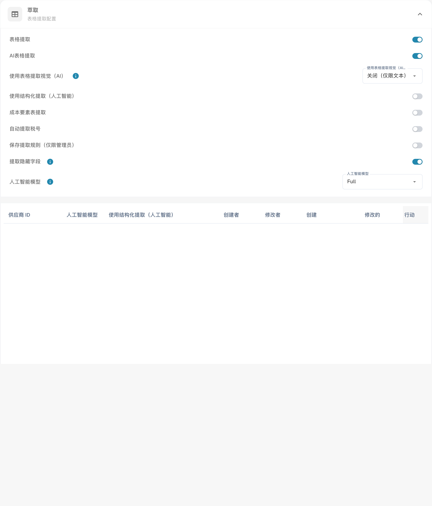

# 分类与提取

<figure><figcaption>
当前中文“分类与提取”中的提取设置；AI、税码和成本要素选项以组织订阅及配置为准。图中的“自动提取税号”指税码提取，未更改任何开关。
</figcaption></figure>

## 概述

在**分类与提取**设置中，您可以：

* 启用基于 QR 码的**文档拆分**
* 配置**金额格式**
* 设置**表格提取**
* 切换是否处理不受支持的 **ZUGFeRD** 文件
* 定义特殊分类规则
* 监控分类过程中使用的自定义训练 **AI 模型**

本页详细介绍所有可用设置。

## **访问分类与提取设置**

要访问**分类与提取**设置，请前往：\
**设置 → 文档处理 → 分类与提取**

## 文档拆分

在**文档拆分**部分，您可以配置：上传的文档页面上出现**条形码**时，是否将该文档拆分为多个文档。

要启用此功能：

1. 前往**文档拆分**部分。
2.  打开下拉菜单。

    <figure><figcaption></figcaption></figure>
3.  选择**按条形码/QR 码拆分**。

    <figure><figcaption></figcaption></figure>

随后，您可以：

* 选择要检测的一种或多种条形码类型。
*   指定条形码必须匹配的正则表达式模式，以触发文档拆分。

    <figure><figcaption></figcaption></figure>

## 金额格式

在**金额格式**部分，您有两个选项：

* **金额比较时允许舍入：**\
  启用后，金额比较时允许 ±0.5 的误差范围。\
  禁用后，默认误差范围为 ±0.05。
* **金额比较时要求完全匹配：**\
  启用后，金额必须完全匹配，误差范围为零。\
  禁用后，允许 ±0.05 的误差范围。

<mark style="color:red;">**注意**</mark>：这两项设置一次只能启用一项。

## 表格提取


**表格提取的运行前提**

* 文档类型已配置**表格列**（设置 → 全局设置 → 文档类型 → [表格列](../../global-settings/document-types/table-columns/README.md)）。没有列就没有可供提取填入的字段。
* 已在下方为整个组织启用**表格提取**或 **AI 表格提取**。
* 文档包含可读取的文本：已运行 OCR，或者数字原生 PDF 使用了 E-Text（[OCR 设置](../ocr-settings.md)）。
* 训练数据和 AI 模型均按**供应商**区分。训练好的表格仅适用于该供应商的文档。


启用**表格提取**或 **AI 表格提取**即可从文档中提取表格。无论基于 AI 还是手动训练，训练好的表格始终关联到特定供应商。

**表格提取：**启用基于规则的表格提取。表格按供应商在验证页面（*转到表格提取视图*）中训练。\
[点击此处](../../../setup/document-training/training-line-fields-table-training/defining-tables-and-columns.md)了解如何训练。

**AI 表格提取：**使用 AI 提取任意供应商的表格，无需训练。如果某个供应商的提取结果不够准确，可以训练该供应商的表格；保存的规则随后会优先于该供应商的 AI 提取结果。

**使用表格提取视觉功能（AI）：**AI 读取页面图像，而不是文本层。这有助于处理扫描文档以及文本结构不清晰的表格，但速度较慢。开关旁的下拉菜单用于选择使用页面图像的强度：

* **关闭（仅文本）** – 仅使用文本层。这是默认模式。
* **仅图像** – 仅读取页面图像。
* **混合（文本和图像）** – 在同一请求中结合文本层和页面图像。
* **自动（按文档决定）** – DocBits 会针对每份文档判断文本层是否足够。

此模式存储在偏好设置键 `TABLE_EXTRACTION_VISION_MODE` 下；旧版开关 `TABLE_EXTRACTION_USE_VISION` 仍然保留，实际含义等同于*仅图像*。

**使用结构化提取（AI）：**AI 按固定结构返回表格，直接映射到已配置的表格列。当文档中的列标题差异较大时，推荐使用此选项。点击此设置会打开预览，准确显示 AI 将接收哪些字段和列：预览会列出表头字段和行项目列及其来源（请求的字段或已禁用的标准字段），并显示预期输出模式（例如 *strict* – 不添加其他列）。为文档类型配置但已关闭的字段不会请求 AI 提取。

**表格提取（成本要素）：**启用后，DocBits 可以在行项目级别从表格中提取成本要素，并据此进行分类。\
[此处](table-extraction-for-costing-element.md)提供详细说明。

**自动提取税码：**启用后，如果已配置税码字段，系统会在验证页面自动填充**税码**字段。\
有关此设置的更多信息，请[点击此处](auto-extract-tax-code.md)。

**保存提取规则（仅管理员）：**只有管理员可以在表格训练中点击*保存规则*。如果用户反复保存导致某个供应商提取出错的规则，请启用此项。

**AI 模型：**选择用于表格提取的 AI 等级。共有六个选项：**Full**（准确度最高、速度最慢，每份文档消耗 2 个 token）、**Fast**（默认；每份文档消耗 1 个 token）、**Nexus** 和 **Nexus Flash**（可选用的另一模型系列），以及 **Auto** 和 **Auto Nexus**；对于这两项，DocBits 会按文档判断所需的模型能力。选择器下方的表格会显示：

* 哪些**供应商**使用哪种 AI 模型
* 他们是否使用结构化提取（AI）和 E-Text
* 删除某条记录并将该供应商重置为默认设置的选项

[此处](ai-model.md)详细介绍此设置。

### 为什么不同供应商的表格看起来不一样？

DocBits 学到的所有表格信息都按**供应商**存储：

* **已保存的规则**（表格训练）：表格在该供应商版面中的位置，以及该供应商版面对应的列映射。
* **AI 表格标签和格式规则**：用户为该供应商的 AI 表格保存的提示。
* **供应商专属 AI 模型**：在验证页面的*更多设置*中为该供应商选择的模型等级。

因此，供应商 A 有已保存的规则时，会在验证页面的*提取的表格*选项卡中显示确定性表格；而没有规则的供应商 B 则会显示 *AI 提取的表格*。要让供应商 B 的行为与 A 一致，请训练一次 B 的表格。要重置某个供应商，请在验证页面删除其规则，或在 AI 模型表格中重置其训练数据。

### 偏好设置键

本部分中的每个开关都存储为组织偏好设置。通过 API (`/preferences/set_preference`)、脚本或 DocBits MCP（`get_preference` / `set_preference`）设置值时，请使用对应的键。

| 设置（UI 标签） | 偏好设置键 | 值 |
|---|---|---|
| 表格提取 | `TABLE_EXTRACTION_SETTING` | `true` / `false` |
| AI 表格提取 | `USE_AI_TABLE_EXTRACTION` | `true` / `false` |
| 使用表格提取视觉功能（AI） | `TABLE_EXTRACTION_VISION_MODE` | `off`（默认）、`vision`、`hybrid`、`auto` |
| 使用表格提取视觉功能（AI）– 旧版开关 | `TABLE_EXTRACTION_USE_VISION` | `true` / `false`；实际含义等同于 `vision` |
| 使用结构化提取（AI） | `USE_STRUCTURED_EXTRACTION` | `true` / `false` |
| 成本要素表格提取 | `CHARGES_TABLE_EXTRACTION` | `true` / `false` |
| 自动提取税码 | `AUTO_EXTRACT_TAX_CODE` | `true` / `false` |
| 保存提取规则（仅管理员） | `ONLY_ADMIN_CAN_SAVE_RULES` | `true` / `false` |
| AI 模型 | `AI_MODEL` | `gpt-6-sol`（Full）、`gpt-6-luna`（Fast）、`qwen3.8-max`（Nexus）、`glm-5.3-flash`（Nexus Flash）、`auto`（Auto）、`auto-nexus`（Auto Nexus） |
| 表格提取版本（确认对话框） | `TBL_EXT_VERSION` | 版本字符串 |
| OCR 设置 → 有可用 AI 数据时对表格使用 AI 数据 | `USE_AI_DATA_FOR_TABLE` | `true` / `false` |
| OCR 设置 → 有可用 E-Text 时使用 E-Text | `USE_ETEXT_IF_AVAILABLE` | `true` / `false` |

说明：

* 布尔型偏好设置存储为字符串 `true` / `false`；从未设置过的键按 `false` 处理。如果发送 `1` 或 `0`，DocBits 会将其存储为 `true` / `false`。
* 未设置 `AI_MODEL` 时，默认使用 **Fast**。
* 未设置 `TABLE_EXTRACTION_VISION_MODE` 时，会根据旧版 `TABLE_EXTRACTION_USE_VISION` 开关确定：`true` 对应 `vision`，其他值对应 `off`。
* 更改某个键后，设置会应用于之后处理的文档。要使用新设置重新提取文档，请重新启动该文档。
* 按供应商设置的选项（E-Text、AI 模型、已保存的规则）不是组织偏好设置；请在该供应商文档验证页面的*更多设置*中进行设置。

## 电子文档

**处理不受支持的 ZUGFeRD PDF：**启用后，不受支持的 **ZUGFeRD** 版本将作为标准 PDF 处理，并忽略其中嵌入的 XML。

[此处](../../global-settings/document-types/edi/zugferd/README.md)列出了受支持的 **ZUGFeRD** 版本。

## **分类规则**

在**分类规则**部分，您可以定义特定的**正则表达式**模式和条件，以帮助系统在处理过程中自动分类文档。

要访问此部分，请点击页面顶部的**分类规则**选项卡。

<figure><figcaption></figcaption></figure>

### **添加新的分类规则**

要创建新规则：

1.  点击右上角的**添加**。

    <figure><figcaption></figcaption></figure>
2. 填写以下字段：
   * **模式**：系统用于触发分类的正则表达式模式。
   * **类型**：指定要在哪个位置搜索该模式（例如 **Barcode**）。
   * **子组织** _(可选)_: 指定此规则适用的子组织。
   * **文档类型**：定义匹配该模式时要分配的文档类型。
   *   **子文档类型** _(可选)_: 指定更具体的分类子类型。

       <figure><figcaption></figcaption></figure>
3.  点击**保存**以保存分类规则。

    <figure><figcaption></figcaption></figure>

### **编辑分类规则**

要编辑现有规则：

1.  点击**操作**列中的三个点。

    <figure><figcaption></figcaption></figure>
2.  选择**编辑**。

    <figure><figcaption></figcaption></figure>
3. 按需进行修改。
4.  点击**保存**以应用更改。

    <figure><figcaption></figcaption></figure>

### **删除分类规则**

要删除规则：

1.  点击**操作**列中的三个点。

    <figure><figcaption></figcaption></figure>
2.  选择**删除**。

    <figure><figcaption></figcaption></figure>

## AI 模型

**AI 模型**部分会显示所有专为满足您的需求而定制训练的模型。

### 访问 AI 模型部分

要打开此部分，请点击页面顶部的 **AI 模型**选项卡。

<figure><figcaption></figcaption></figure>

### 模型类别

模型按类别组织。每个类别名称下方会显示该类别包含的模型数量。\
点击类别可查看详情。

<figure><figcaption></figcaption></figure>

在所选类别页面顶部，您可以查看每个模型的重要信息：

* **类型**：模型的类型。
* **仅第一页**：表示模型是否只处理文档的第一页。
* **版本**：模型的版本号。

### 模型表格

类别中的所有模型都会列在表格中，其中包括以下信息：

* **名称**：模型的名称。
* **下一个模型**：将进一步处理当前模型输出的模型。
* **文档类型**：模型在分类过程中分配的主要文档类型。
* **文档子类型**：文档进一步细分的子类型。
* **优先级**：决定模型在分类队列中位置的优先级。

<figure><figcaption></figcaption></figure>

### 编辑模型

要编辑模型：

1.  点击要编辑的模型对应的**操作**列中的笔形图标。

    <figure><figcaption></figcaption></figure>
2. 更新可用字段：
   * **下一个模型**：选择应处理当前模型输出的模型。
   * **文档类型**：选择模型应将输入分类为何种文档类型。
3.  点击**保存**以应用更改。

    <figure><figcaption></figcaption></figure>
