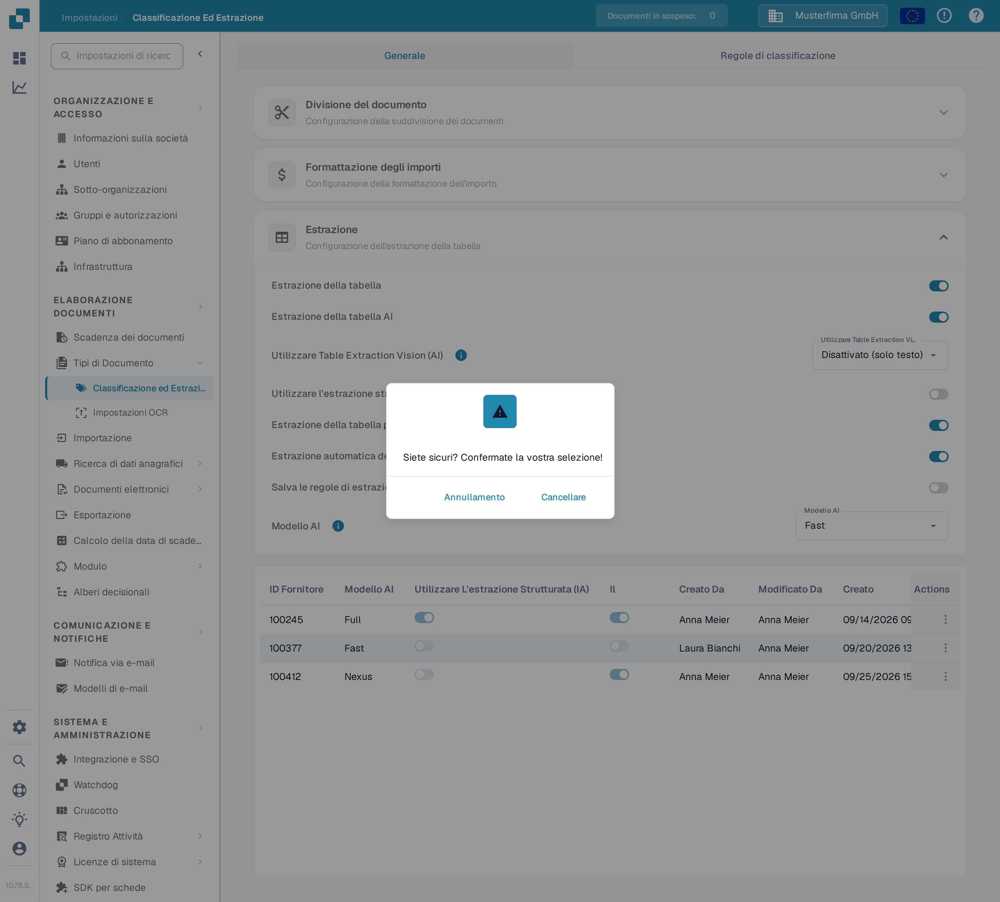

# Modello AI

## Panoramica

L’impostazione del modello AI definisce il modello dell’organizzazione per l’estrazione di campi e tabelle. La tabella delle assegnazioni consente di esaminare le preferenze dei template di estrazione. Verificare i costi nelle informazioni attuali dell’ambiente e nelle condizioni concordate.

## Come Accedere

1.  Vai su **Impostazioni** → **Elaborazione Documenti** → **Classificazione ed Estrazione**

    <figure><figcaption>
Apri <strong>Impostazioni → Elaborazione Documenti → Classificazione ed Estrazione</strong>.
</figcaption></figure>
2.  Scorri verso il basso fino alla sezione **Estrazione**

    <figure><figcaption>
La sezione <strong>Estrazione</strong> contiene l'impostazione <strong>Modello AI</strong> e la tabella di assegnazione per fornitore.
</figcaption></figure>

## Opzioni del Modello AI

Il menu offre **Full**, **Fast**, **Nexus**, **Nexus Flash**, **Auto** e **Auto Nexus**. Sono nomi di livelli del prodotto. Opzioni, modelli sottostanti e costi possono cambiare; nomi storici dei fornitori e prezzi fissi non costituiscono una promessa permanente.

Confrontare i livelli sullo stesso campione rappresentativo e verificare valori estratti, tempi di elaborazione e costi. Full non garantisce sempre la massima precisione, né Fast o Nexus Flash il tempo minore. Verificare anche risultati e costi di Auto e Auto Nexus.

In assenza di una preferenza per il template di estrazione corrente, viene usata la configurazione dell’organizzazione. Un modello specifico del fornitore non impostato non significa quindi sempre Fast. Un cambio di modello non garantisce convalida, abbinamento degli ordini, approvazione o esportazione.

<figure><figcaption>
Il menu a discesa <strong>Modello AI</strong> con le sei opzioni disponibili.
</figcaption></figure>

## Tabella di Assegnazione del Modello AI

La schermata di convalida offre un accesso ai modelli specifici del fornitore. La preferenza viene salvata per organizzazione e template di estrazione corrente (`tfidf_id`). L’associazione al fornitore non aggiorna automaticamente tutti i suoi template o documenti storici.

Verificare le colonne realmente disponibili nella versione in uso: associazione del fornitore, livello del modello, opzioni di estrazione e informazioni di creazione e modifica. Le colonne possono variare.

[qui](../../../../end-user-and-partner-section/end-user-section/validation-screen/supplier-specific-ai-model-for-field-and-table-extraction.md)

<figure><figcaption>
La tabella di assegnazione mostra l'etichetta del livello per fornitore, mai l'identificatore raw del modello.
</figcaption></figure>

### Eliminare una voce: rimuovere le preferenze del template

Prima di eliminare una voce, identificare il template di estrazione e tutte le preferenze interessate. L’eliminazione può rimuovere più preferenze del template, non soltanto il modello AI. Se un amministratore deve eliminare la voce, usare l’azione di eliminazione della riga corretta e controllare la conferma prima di procedere.

<figure><figcaption>
Apri il menu delle azioni della riga e scegli <strong>Cancellare</strong>.
</figcaption></figure>

<figure><figcaption>
Conferma l'eliminazione nella finestra di dialogo.
</figcaption></figure>

Le elaborazioni successive usano la configurazione dell’organizzazione e i valori di ripiego applicabili al template. Altri template dello stesso fornitore possono mantenere preferenze indipendenti. L’eliminazione non rielabora automaticamente i documenti storici. Durante questa verifica non sono state eliminate voci né testate estrazioni successive a un’eliminazione.
