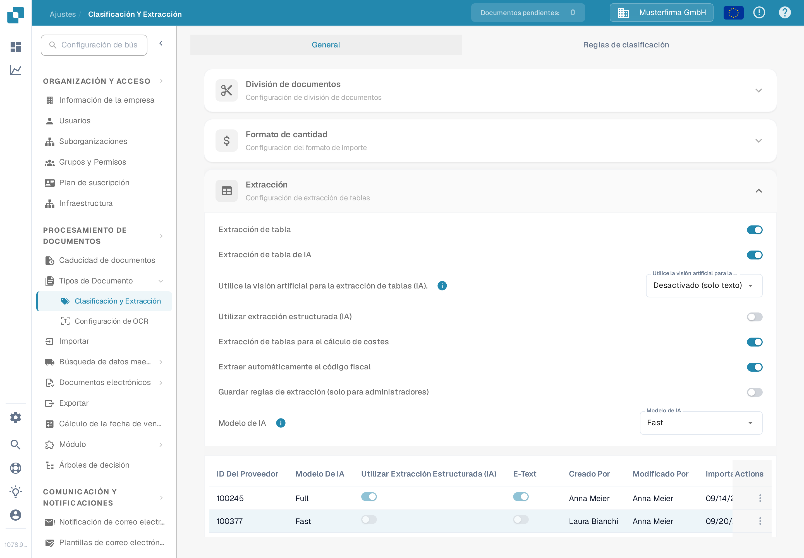

# Extracción de tablas para el elemento de costos

Los elementos de costos son cargos u otros importes representados como líneas de la tabla de la factura. Si esta función está activada y el documento tiene líneas extraídas, DocBits puede clasificar esas líneas según los elementos de costos configurados para la organización. Un revisor puede corregir la clasificación de una línea en la tabla del documento.

## Activar el ajuste

1. Abra **Ajustes → Procesamiento de documentos → Clasificación y extracción**.
2. Permanezca en **General** y despliegue **Extracción**.
3. Busque **Extracción de tablas para el cálculo de costes** debajo de los campos solicitados para la extracción de tablas. Un administrador puede activar este interruptor para la organización.

<figure><figcaption>
El interruptor está desactivado en la organización de prueba sintética. No se cambió para esta guía.
</figcaption></figure>


El interruptor por sí solo no crea elementos de costos ni líneas de factura. Configure primero los elementos e importe los datos necesarios. La [guía de configuración de elementos de costos](../../../../infor-integration-and-configuration/importing-customer-master-data/m3/table-extraction-for-costing-element.md) vinculada explica el ejemplo de M3. Consulte [Clasificación y extracción](README.md) para ver los demás controles de extracción.


## Revisar o corregir una línea

Abra un documento cuya tabla de factura contenga líneas extraídas y observe el icono de elemento de costos junto a la línea correspondiente. Seleccione el icono para abrir las clasificaciones disponibles. Elija el elemento de costos configurado correcto, o elija **Uncategorize** si la línea es un artículo ordinario. Después revise la línea resultante y los totales antes de guardar el documento.

Si el icono o una clasificación falta, confirme primero que el documento tiene líneas extraídas, que la función está activada y que hay un elemento de costos configurado para la organización. El documento de prueba sintético usado para esta comprobación de la documentación no tenía líneas de factura extraídas, por lo que el menú de clasificación no pudo mostrarse ni probarse. Los pasos de arriba reflejan el control de documentos actual; no se guardó ninguna clasificación durante esta comprobación.
