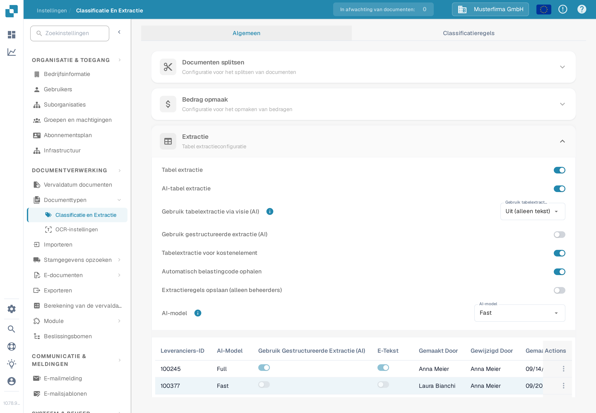

# Tabelextractie voor kostenelement

Kostenelementen zijn toeslagen of andere bedragen die als tabelregels op een factuur voorkomen. Als deze functie is ingeschakeld en het document heeft geëxtraheerde regels, kan DocBits die regels classificeren aan de hand van de kostenelementen die voor de organisatie zijn geconfigureerd. Een reviewer kan de classificatie van een regel corrigeren in de documenttabel.

## De instelling inschakelen

1. Open **Instellingen → Documentverwerking → Classificatie en Extractie**.
2. Blijf op **Algemeen** en vouw **Extractie** uit.
3. Zoek **Tabelextractie voor kostenelement** onder de velden die voor tabelleextractie worden vereist. Een beheerder kan deze schakelaar voor de organisatie aanzetten.

<figure><figcaption>
De schakelaar staat uit in de gesynthetiseerde testorganisatie. Hij is voor deze handleiding niet gewijzigd.
</figcaption></figure>


De schakelaar alleen maakt geen kostenelementen of factuurregels aan. Configureer eerst de elementen en importeer eventueel vereiste gegevens. De gekoppelde [handleiding voor het instellen van kostenelementen](../../../../infor-integration-and-configuration/importing-customer-master-data/m3/table-extraction-for-costing-element.md) legt het M3-voorbeeld uit. Zie [Classificatie en extractie](README.md) voor de andere extractiebedieningselementen.


## Een regel controleren of corrigeren

Open een document waarvan de factuurtabel geëxtraheerde regels bevat en bekijk het kostenelementpictogram naast de betreffende regel. Selecteer het pictogram om de beschikbare classificaties te openen. Kies het juiste geconfigureerde kostenelement, of kies **Uncategorize** als de regel een gewoon artikel is. Controleer daarna de resulterende regel en de totalen voordat u het document opslaat.

Als het pictogram of een classificatie ontbreekt, bevestig dan eerst dat het document geëxtraheerde regels heeft, de functie is ingeschakeld en er een kostenelement voor de organisatie is geconfigureerd. Het gesynthetiseerde testdocument dat voor deze documentatiecontrole werd gebruikt, had geen geëxtraheerde factuurregels, waardoor het classificatiemenu niet kon worden afgebeeld of getest. De bovenstaande stappen geven het huidige documentbedieningselement weer; er werd tijdens deze controle geen classificatie opgeslagen.
