# Arbres de décision


Comment créer un arbre de décision dans DocBits (conditions, politiques, test et export)


## Vidéo pas à pas



*2:11 min · Interface du produit en français · Voix et scène d'introduction générées par IA*

[Sous-titres (VTT)](https://docbits-videos.fra1.cdn.digitaloceanspaces.com/product-tours/decision-trees/2026-10-28/v1/fr.vtt) · [Télécharger la vidéo](https://docbits-videos.fra1.cdn.digitaloceanspaces.com/product-tours/decision-trees/2026-10-28/v1/fr.mp4)

## Vue d'ensemble

Les arbres de décision sont une fonctionnalité puissante qui permet d'automatiser le processus de routage et de prise de décision en s'appuyant sur des règles prédéfinies. Cette fonctionnalité est particulièrement utile dans les environnements complexes où diverses conditions doivent être évaluées pour déterminer la marche à suivre appropriée, comme attribuer des prix, déterminer des quantités ou router des documents.

#### Composants clés

* **Liste des arbres de décision** : il s'agit de l'interface principale dans laquelle tous les arbres de décision existants sont répertoriés. Chaque arbre de décision peut être associé à un type de document spécifique tel qu'une `INVOICE` ou un `QUOTE`.
* **Concepteur d'arbre de décision** : cette interface permet de créer et de modifier des arbres de décision, où vous pouvez définir des règles, des opérateurs et des actions à exécuter lorsque certaines conditions sont remplies.

## Interface des arbres de décision

#### Liste des arbres de décision

La liste des arbres de décision affiche tous les arbres de décision configurés. Ouvrez-la depuis **Settings → Document Processing → Decision Trees**.

<figure>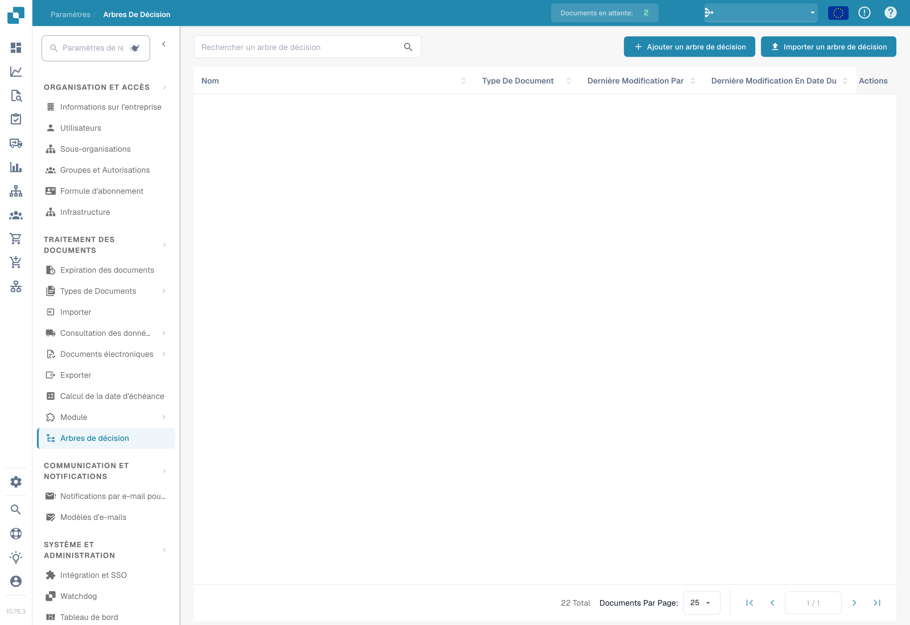<figcaption>
Liste des arbres de décision avec les noms et données de l’organisation masqués ; les lignes masquées ne représentent pas une liste vide.
</figcaption></figure>

Chaque entrée affiche :

| Colonne | Description |
|--------|-------------|
| **Name** | Le nom de l'arbre de décision. Cliquez dessus pour ouvrir le concepteur. |
| **Document Type** | Le type de document auquel s'applique l'arbre (par ex. `INVOICE`, `QUOTE`). |
| **Last Modified By** | L'utilisateur ayant modifié l'arbre en dernier. |
| **Last Modified At** | Horodatage de la dernière modification. |
| **Actions** | Menu à trois points pour modifier, copier, exporter ou supprimer l'arbre. |

#### Créer un arbre de décision

1. Cliquez sur **+ Add Decision Tree** dans le coin supérieur droit.
2. Saisissez un **Name** et sélectionnez le **Document Type**.
3. Utilisez le concepteur d'arbre de décision (ci-dessous) pour définir des conditions, des politiques et des résultats.

#### Importer un arbre de décision

Cliquez sur **Import Decision Tree** pour téléverser un fichier d'arbre de décision précédemment exporté (au format JSON). Cela est utile pour copier un arbre d'une organisation ou d'un environnement à un autre.

## Concepteur d'arbre de décision

Le concepteur d'arbre de décision vous permet de configurer les règles qui régissent la manière dont les décisions sont prises.

### **Composants du concepteur d'arbre de décision**

* **Rules** : chaque règle se compose de conditions et d'actions.
* **Select Source** : ce menu déroulant vous permet de spécifier le champ source à évaluer.
* **Select Operator** : définit l'opérateur logique (par ex. `<=`, `>=`, `=`, `!=`) à appliquer au champ source.
* **Result** : définit le résultat ou l'action à exécuter lorsque les conditions sont remplies.
* **Add New Row** : vous permet d'ajouter des règles supplémentaires à l'arbre de décision.

### Exemple de configuration d'un arbre de décision

Cet arbre de décision évalue le champ **Total Amount** et l'attribue à différents groupes selon des conditions prédéfinies. Chaque règle compare le montant total à une valeur spécifique et, selon la condition qui est vraie, le **Group** correspondant est renvoyé.

<figure><figcaption></figcaption></figure>

Cet arbre de décision évalue deux conditions clés pour déterminer quel groupe doit être attribué : **Total Amount** et **Warehouse Status**. L'arbre utilise des seuils basés sur le montant total pour définir quel groupe est renvoyé, avec la distinction supplémentaire de savoir si l'entrepôt est désigné comme « Warehouse Main », « Warehouse Sub » ou « Not Warehouse Main ».

<figure><figcaption></figcaption></figure>

Chaque règle est évaluée de manière séquentielle.

## Politique de l'arbre de décision

La politique de l'arbre de décision définit la manière dont les multiples règles d'un arbre de décision sont traitées. Vous pouvez choisir parmi plusieurs politiques :

* [Unique](decision-trees/unique-policy.md)
* [Première](decision-trees/first-policy.md)
* [Priorité](decision-trees/priority-policy.md)
* [Collecte (Somme)](decision-trees/collect-sum-policy.md)
* [Collecte (Min/Max/compter)](decision-trees/collect-min-max-count-policy.md)
* [Ordonnance sur les règles](decision-trees/rule-order-policy.md)
* [N'importe quel](decision-trees/any-policy.md)
* [Première et adjacente](decision-trees/first-and-adjacent-policy.md)

## **Tester l'arbre de décision**

**Vue d'ensemble :**
Le concepteur d'arbre de décision inclut une fonctionnalité de test pour valider la logique des règles configurées. Cette fonctionnalité permet aux utilisateurs de tester l'arbre de décision en fournissant des valeurs d'entrée spécifiques pour les champs sélectionnés.

**Étapes pour utiliser la fonctionnalité de test :**

1.  **Localiser le bouton de test :**

    * Dans le concepteur d'arbre de décision, repérez le bouton **Test**.

    <figure><figcaption></figcaption></figure>
2.  **Ouvrir la fenêtre contextuelle de test :**

    * Cliquez sur le bouton **Test**.
    * Une fenêtre contextuelle apparaît, fournissant des champs de saisie correspondant aux critères utilisés dans l'arbre de décision.

    <figure>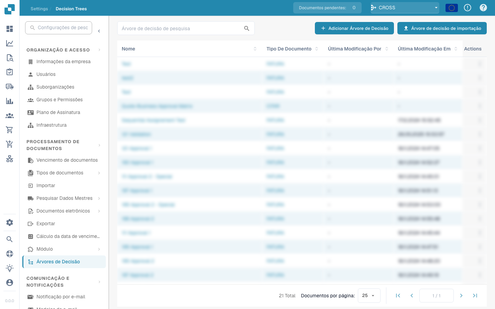<figcaption></figcaption></figure>
3. **Fournir des valeurs d'entrée :**
   *   Saisissez des valeurs dans les champs de saisie pour simuler un scénario réel.

       <figure><figcaption></figcaption></figure>
4.  **Évaluer les résultats :**

    * Après avoir saisi les entrées, l'arbre les traite selon la politique choisie.
    * Le système met en surbrillance la ou les règles qui correspondent aux entrées fournies.

    <figure><figcaption></figcaption></figure>
5. **Examiner le retour en l'absence de correspondance :**
   * Si aucune règle n'est mise en surbrillance, le système affichera un retour expliquant pourquoi aucune règle ne correspond.
   * Utilisez ce retour pour ajuster les entrées ou examiner la configuration de l'arbre afin d'identifier d'éventuels problèmes.

## Export et enregistrement

* **Save** : enregistre la configuration actuelle de l'arbre de décision.
* **Export** : vous permet d'exporter la configuration de l'arbre de décision, qui peut ensuite être importée dans un autre environnement ou utilisée à des fins de sauvegarde.

## Cas d'usage

* **Workflows d'approbation** — routez les factures vers différents approbateurs en fonction de seuils de montant (par exemple, les montants supérieurs à 10 000 nécessitent l'approbation d'un responsable).
* **Règles de validation** — validez automatiquement les valeurs des champs et signalez les documents qui ne répondent pas aux critères configurés.
* **Attribution séquentielle** — attribuez des documents aux utilisateurs dans un ordre spécifique en fonction de conditions.

## Captures d'écran

<figure>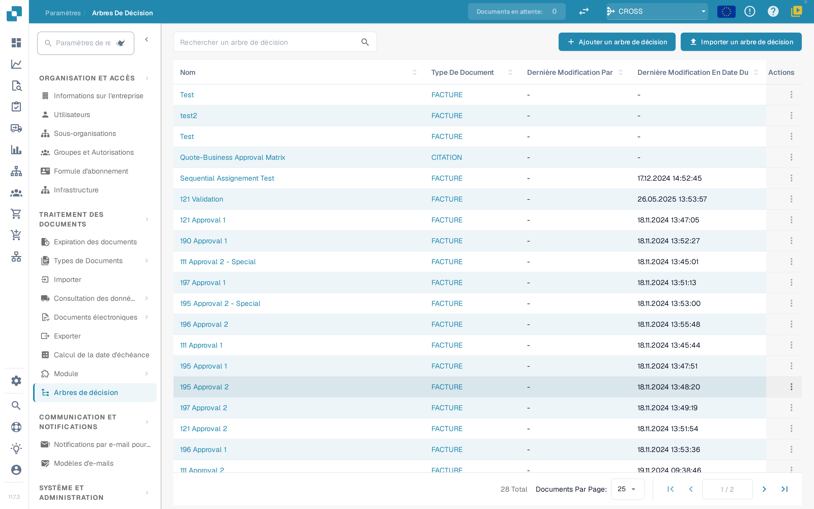<figcaption>
Liste des arbres de décision
</figcaption></figure>

<figure>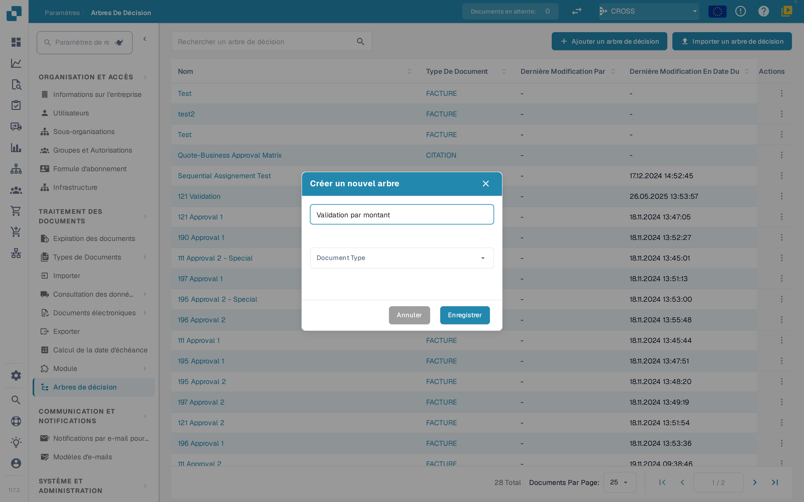<figcaption>
Créer un arbre : saisir le nom
</figcaption></figure>

<figure>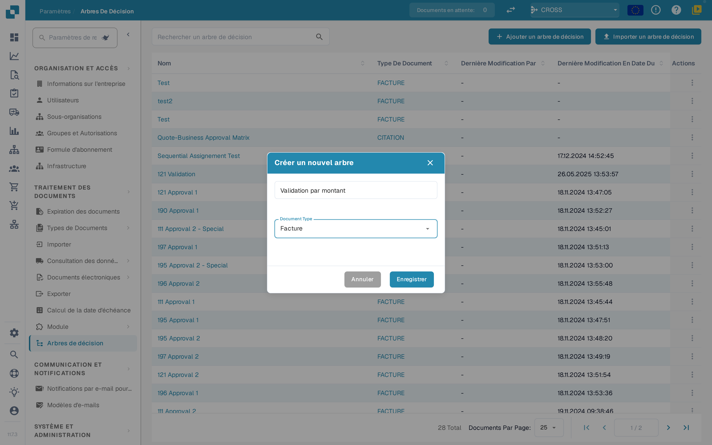<figcaption>
Créer un arbre : choisir le type de document
</figcaption></figure>

<figure>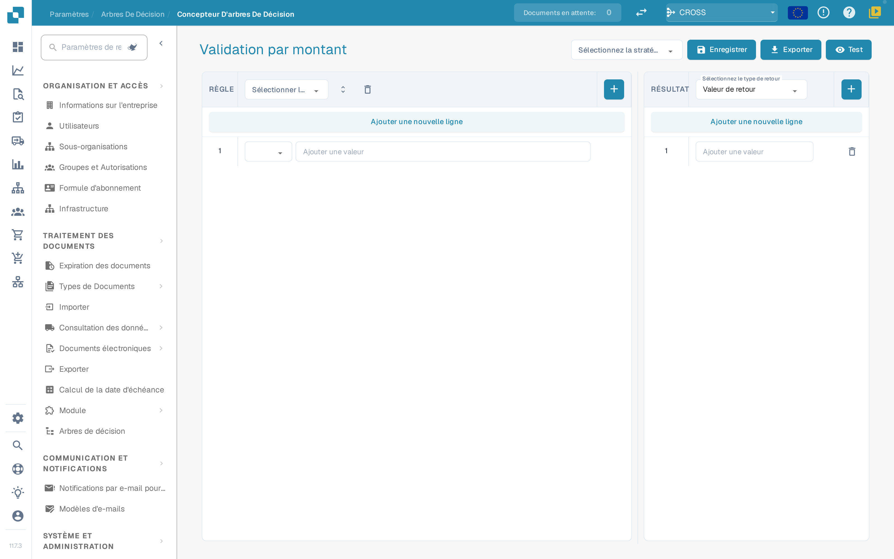<figcaption>
Concepteur vide avec une ligne de règle
</figcaption></figure>

<figure>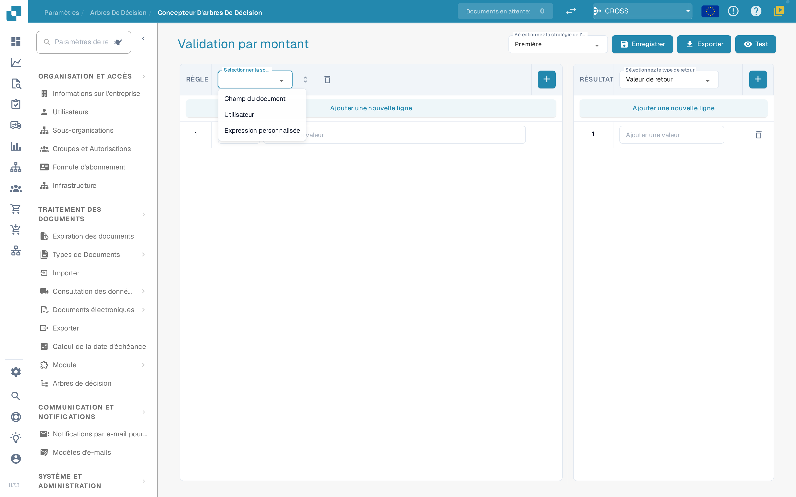<figcaption>
Règle : choisir la source
</figcaption></figure>

<figure><figcaption>
Règle : choisir le champ du document
</figcaption></figure>

<figure>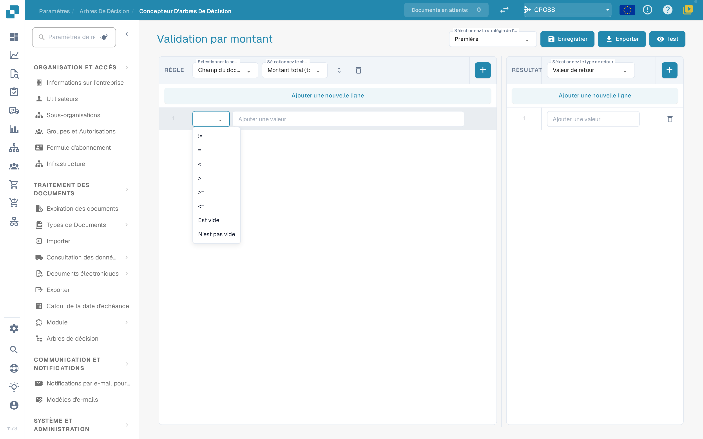<figcaption>
Règle : choisir l'opérateur
</figcaption></figure>

<figure><figcaption>
Règle : saisir la valeur de comparaison
</figcaption></figure>

<figure>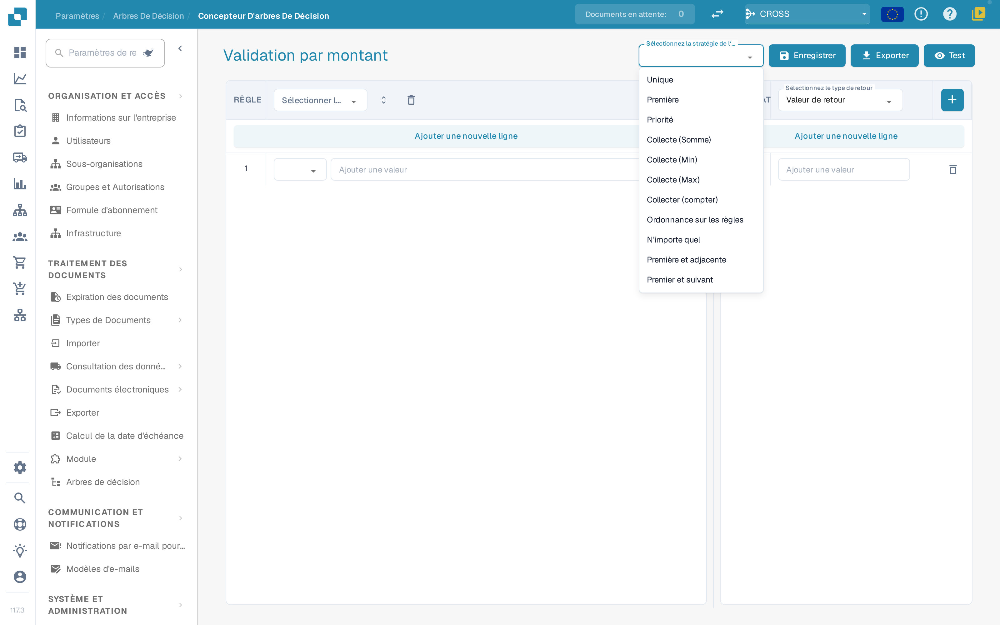<figcaption>
Choisir la politique de l'arbre
</figcaption></figure>

<figure>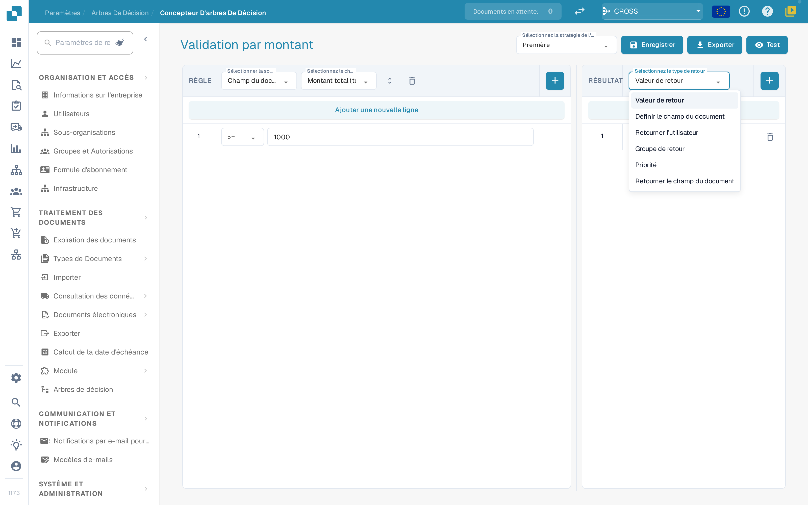<figcaption>
Résultat : choisir le type de retour
</figcaption></figure>

<figure>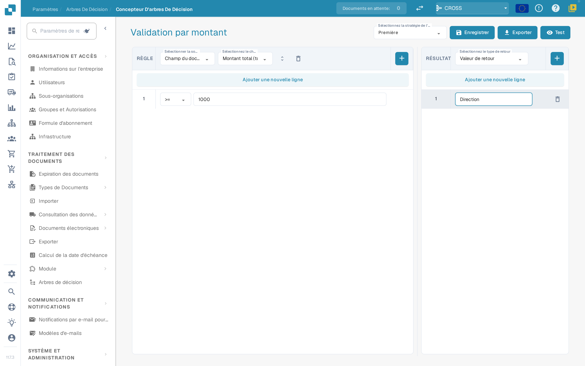<figcaption>
Résultat : saisir la valeur de retour
</figcaption></figure>

<figure>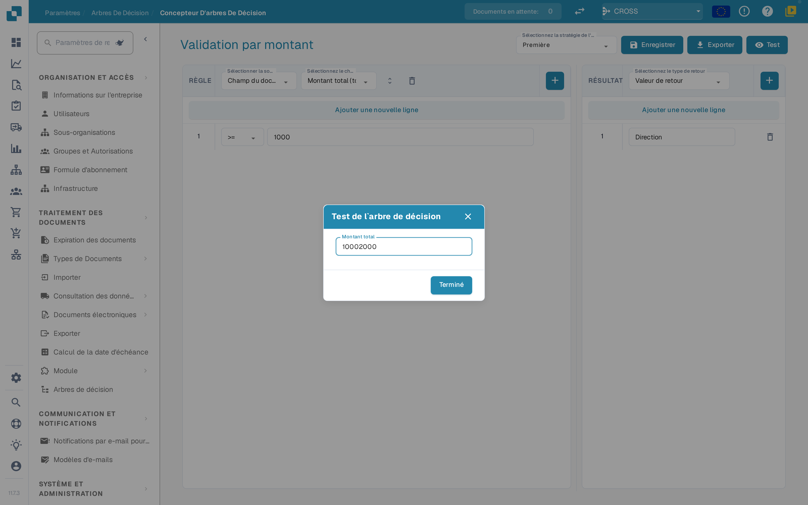<figcaption>
Tester l'arbre avec une valeur d'exemple
</figcaption></figure>

<figure>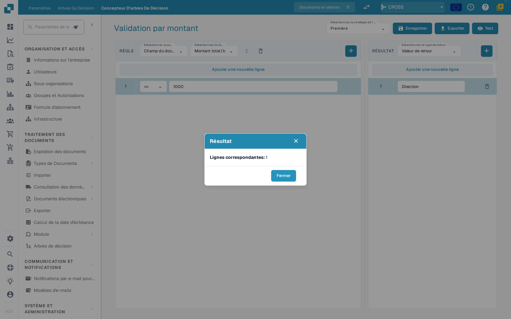<figcaption>
Résultat du test : nombre de lignes correspondantes
</figcaption></figure>
