# Árboles de Decisión


Cómo crear un árbol de decisión en DocBits (condiciones, políticas, pruebas y exportación)


## Vídeo paso a paso



*1:56 min · Interfaz del producto en español · Voz y escena de introducción generadas con IA*

[Subtítulos (VTT)](https://docbits-videos.fra1.cdn.digitaloceanspaces.com/product-tours/decision-trees/2026-10-28/v1/es.vtt) · [Descargar el vídeo](https://docbits-videos.fra1.cdn.digitaloceanspaces.com/product-tours/decision-trees/2026-10-28/v1/es.mp4)

## Descripción general

Los árboles de decisión son una función potente que permite automatizar el enrutamiento y el proceso de toma de decisiones a partir de reglas predefinidas. Esta función resulta especialmente útil en entornos complejos donde es necesario evaluar diversas condiciones para determinar el curso de acción correcto, como asignar precios, determinar cantidades o enrutar documentos.

#### Componentes principales

* **Lista de árboles de decisión**: Es la interfaz principal donde se enumeran todos los árboles de decisión existentes. Cada árbol de decisión puede asociarse a un tipo de documento concreto, como `INVOICE` o `QUOTE`.
* **Diseñador de árboles de decisión**: Esta interfaz permite crear y editar árboles de decisión, donde se pueden definir reglas, operadores y acciones que se ejecutarán cuando se cumplan determinadas condiciones.

## Interfaz del árbol de decisión

#### Lista de árboles de decisión

La lista de árboles de decisión muestra todos los árboles de decisión configurados. Ábrela desde **Settings → Document Processing → Decision Trees**.

<figure>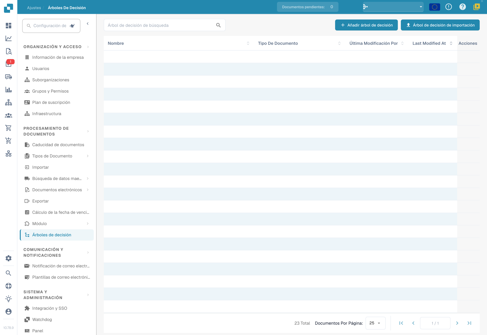<figcaption>
Lista de árboles de decisión con los registros ocultos. La columna «Last Modified At» sigue en inglés y significa fecha de última modificación; las filas enmascaradas no indican una lista vacía.
</figcaption></figure>

Cada entrada muestra:

| Columna | Descripción |
|--------|-------------|
| **Name** | El nombre del árbol de decisión. Haz clic en él para abrir el Diseñador. |
| **Document Type** | El tipo de documento al que se aplica el árbol (p. ej. `INVOICE`, `QUOTE`). |
| **Last Modified By** | El usuario que editó el árbol por última vez. |
| **Last Modified At** | Marca de tiempo del último cambio. |
| **Actions** | Menú de tres puntos para editar, copiar, exportar o eliminar el árbol. |

#### Crear un árbol de decisión

1. Haz clic en **+ Add Decision Tree** en la esquina superior derecha.
2. Introduce un **Name** y selecciona el **Document Type**.
3. Usa el Diseñador de árboles de decisión (más abajo) para definir condiciones, políticas y resultados.

#### Importar un árbol de decisión

Haz clic en **Import Decision Tree** para cargar un archivo de árbol de decisión exportado previamente (formato JSON). Esto resulta útil para copiar un árbol entre organizaciones o entornos.

## Diseñador de árboles de decisión

El Diseñador de árboles de decisión te permite configurar las reglas que rigen cómo se toman las decisiones.

### **Componentes del Diseñador de árboles de decisión**

* **Reglas**: Cada regla consta de condiciones y acciones.
* **Select Source**: Este menú desplegable te permite especificar el campo de origen que se evaluará.
* **Select Operator**: Define el operador lógico (p. ej. `<=`, `>=`, `=`, `!=`) que se aplicará al campo de origen.
* **Result**: Define el resultado o la acción que debe ejecutarse cuando se cumplan las condiciones.
* **Add New Row**: Te permite añadir reglas adicionales al árbol de decisión.

### Ejemplo de configuración de un árbol de decisión

Este árbol de decisión evalúa el campo **Total Amount** y lo asigna a distintos grupos según condiciones predefinidas. Cada regla compara el importe total con un valor específico y, según qué condición sea verdadera, se devuelve el **Group** correspondiente.

<figure><figcaption></figcaption></figure>

Este árbol de decisión evalúa dos condiciones clave para determinar qué grupo debe asignarse: **Total Amount** y **Warehouse Status**. El árbol utiliza umbrales basados en el importe total para definir qué grupo se devuelve, con la distinción adicional de si el almacén está designado como "Warehouse Main", "Warehouse Sub" o "Not Warehouse Main".

<figure><figcaption></figcaption></figure>

Cada regla se evalúa de forma secuencial.

## Política del árbol de decisión

La política del árbol de decisión define cómo se procesan varias reglas dentro de un árbol de decisión. Puedes elegir entre varias políticas:

* [Único](decision-trees/unique-policy.md)
* [En primer lugar](decision-trees/first-policy.md)
* [Prioridad](decision-trees/priority-policy.md)
* [Recaudar (Suma)](decision-trees/collect-sum-policy.md)
* [Recoger (Min/Max/Recuento)](decision-trees/collect-min-max-count-policy.md)
* [Regla Orden](decision-trees/rule-order-policy.md)
* [Cualquier](decision-trees/any-policy.md)
* [Primero y adyacentes](decision-trees/first-and-adjacent-policy.md)

## **Probar el árbol de decisión**

**Descripción general:**
El diseñador de árboles de decisión incluye una función de prueba para validar la lógica de las reglas configuradas. Esta función permite a los usuarios probar el árbol de decisión proporcionando valores de entrada específicos para los campos seleccionados.

**Pasos para usar la función de prueba:**

1.  **Localiza el botón de prueba:**

    * En el diseñador de árboles de decisión, busca el botón **Test**.

    <figure><figcaption></figcaption></figure>
2.  **Abre la ventana emergente de prueba:**

    * Haz clic en el botón **Test**.
    * Aparecerá una ventana emergente con campos de entrada que se corresponden con los criterios utilizados en el árbol de decisión.

    <figure><figcaption></figcaption></figure>
3. **Proporciona valores de entrada:**
   *   Introduce valores en los campos de entrada para simular un escenario real.

       <figure><figcaption></figcaption></figure>
4.  **Evalúa los resultados:**

    * Tras introducir los datos de entrada, el árbol los procesa según la política elegida.
    * El sistema resalta la regla o reglas que coinciden con los datos de entrada proporcionados.

    <figure><figcaption></figcaption></figure>
5. **Revisa los comentarios cuando no haya coincidencia:**
   * Si no se resalta ninguna regla, el sistema mostrará comentarios que explican por qué no coincidió ninguna regla.
   * Usa estos comentarios para ajustar los datos de entrada o revisar la configuración del árbol en busca de posibles problemas.

## Exportar y guardar

* **Save**: Guarda la configuración actual del árbol de decisión.
* **Export**: Te permite exportar la configuración del árbol de decisión, que después puede importarse en otro entorno o utilizarse con fines de copia de seguridad.

## Casos de uso

* **Flujos de aprobación**: enruta las facturas a distintos aprobadores según umbrales de importe (por ejemplo, los importes superiores a 10.000 requieren la aprobación de un gerente).
* **Reglas de validación**: valida automáticamente los valores de los campos y marca los documentos que no cumplen los criterios configurados.
* **Asignación secuencial**: asigna documentos a los usuarios en un orden específico según las condiciones.

## Capturas de pantalla

<figure>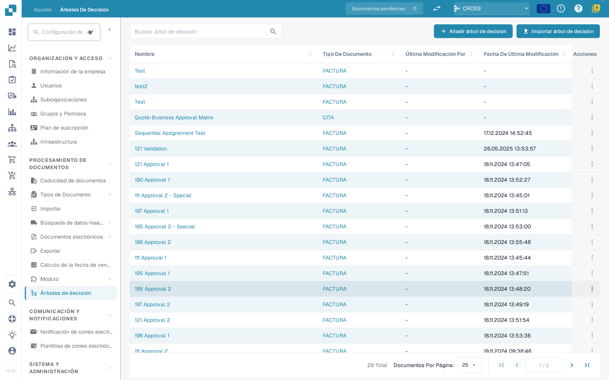<figcaption>
Lista de árboles de decisión
</figcaption></figure>

<figure>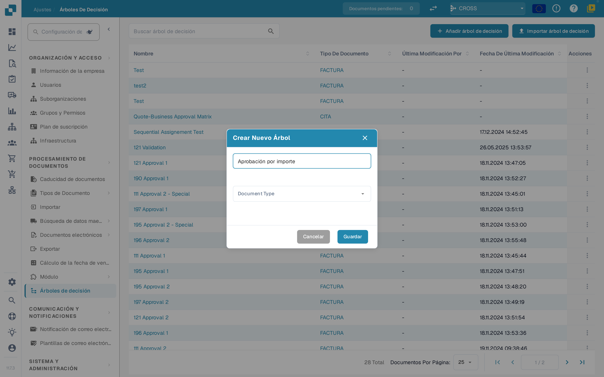<figcaption>
Crear un árbol: introducir el nombre
</figcaption></figure>

<figure>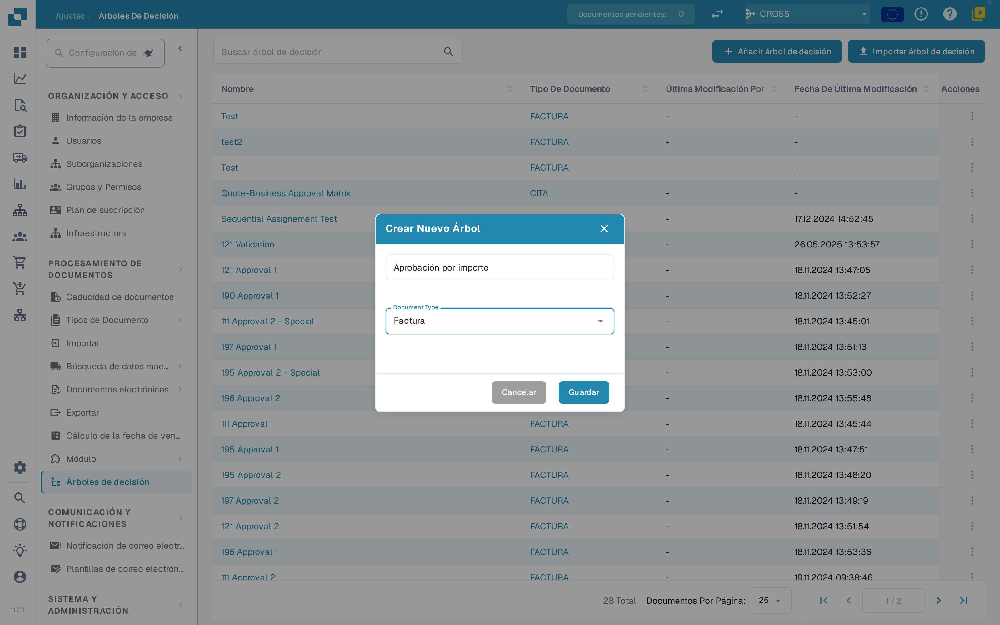<figcaption>
Crear un árbol: elegir el tipo de documento
</figcaption></figure>

<figure><figcaption>
Diseñador vacío con una fila de regla
</figcaption></figure>

<figure>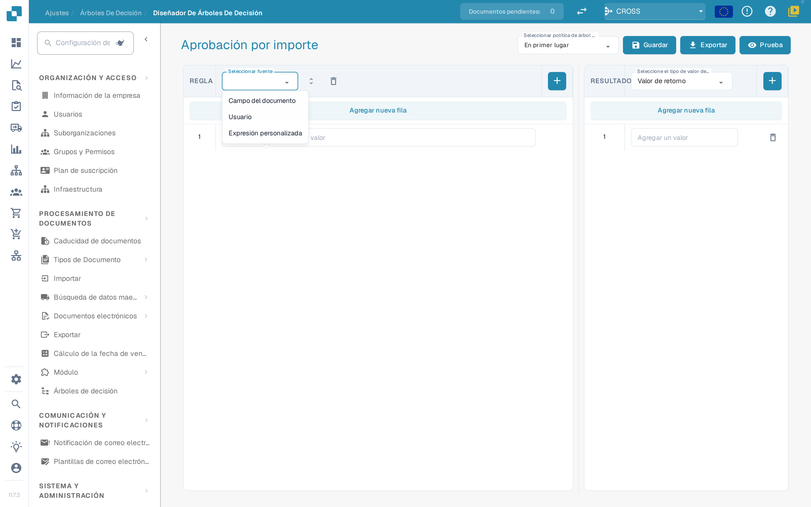<figcaption>
Regla: elegir el origen
</figcaption></figure>

<figure>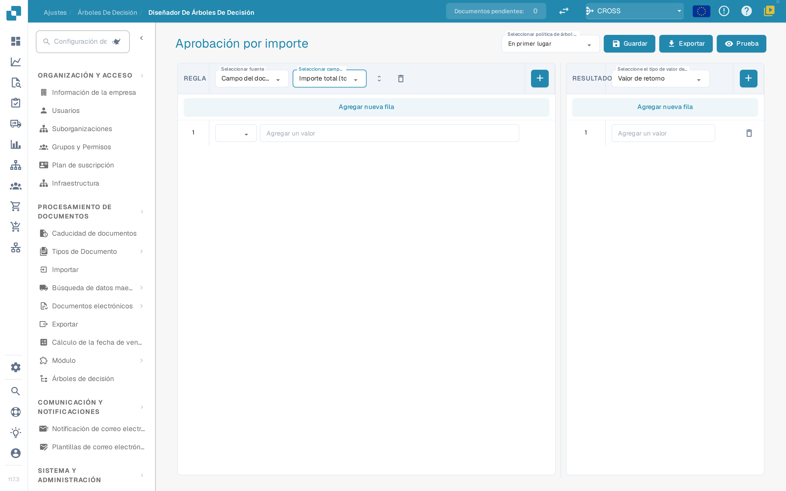<figcaption>
Regla: elegir el campo del documento
</figcaption></figure>

<figure>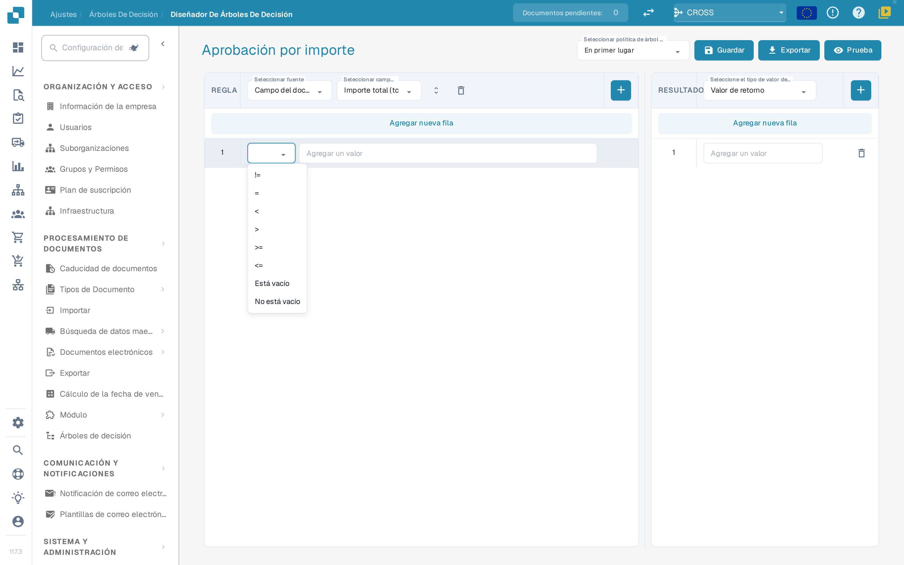<figcaption>
Regla: elegir el operador
</figcaption></figure>

<figure>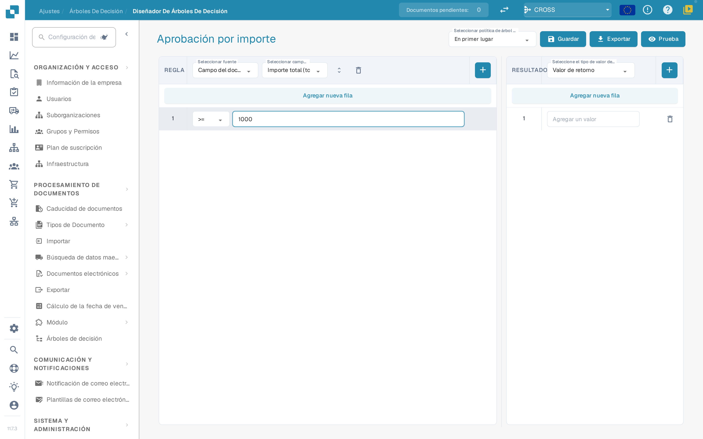<figcaption>
Regla: introducir el valor de comparación
</figcaption></figure>

<figure>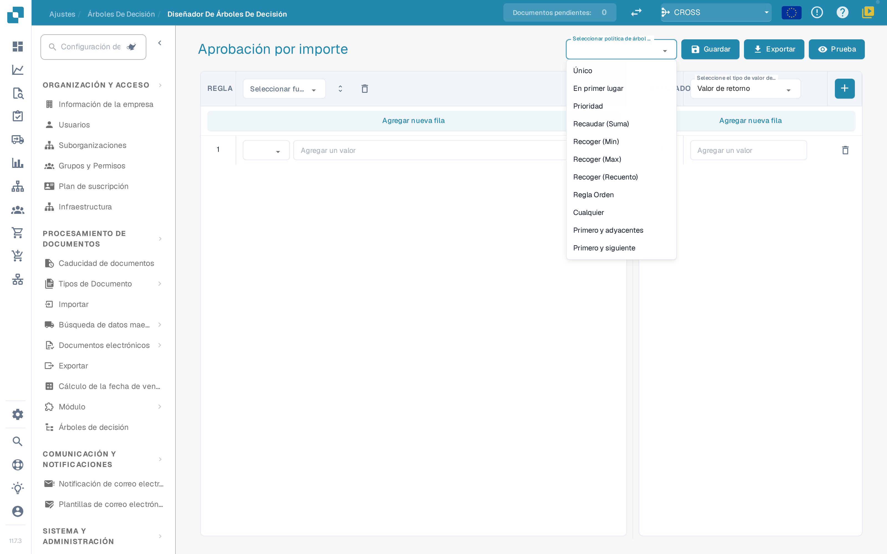<figcaption>
Elegir la política del árbol
</figcaption></figure>

<figure>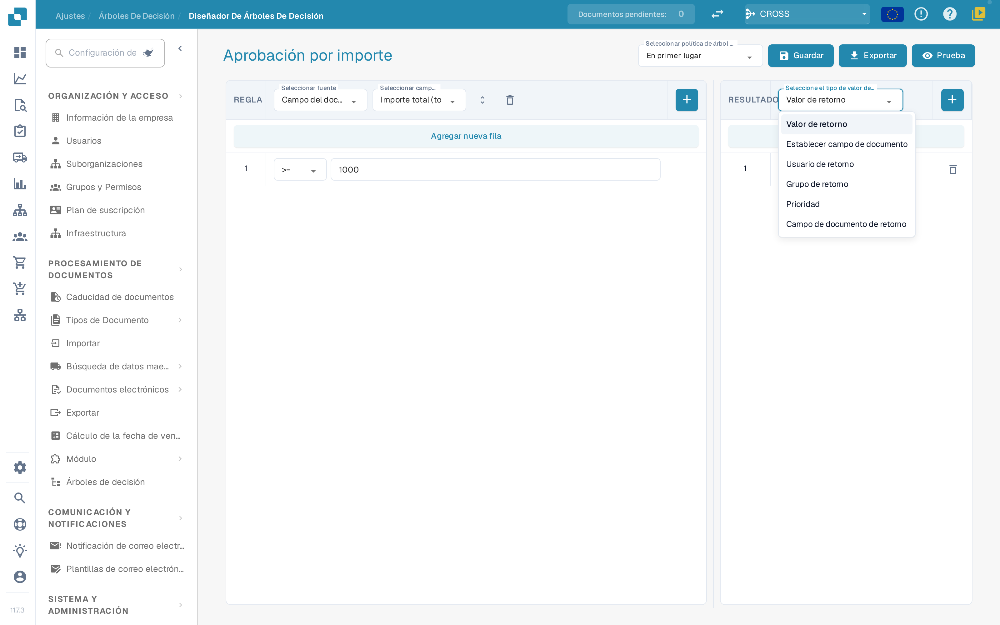<figcaption>
Resultado: elegir el tipo de retorno
</figcaption></figure>

<figure>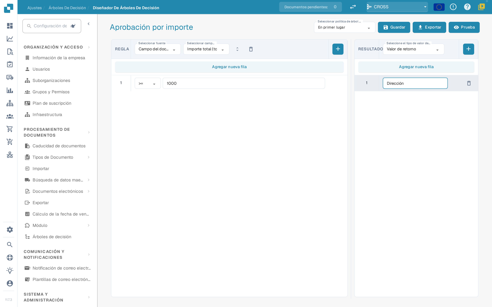<figcaption>
Resultado: introducir el valor de retorno
</figcaption></figure>

<figure><figcaption>
Probar el árbol con un valor de ejemplo
</figcaption></figure>

<figure>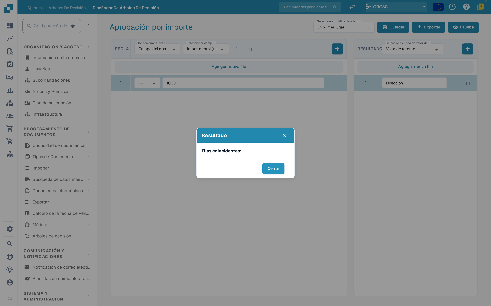<figcaption>
Resultado de la prueba: número de filas coincidentes
</figcaption></figure>
