# 决策树


如何在 DocBits 中创建决策树（条件、策略、测试和导出）


## 视频演示



*1:54 分钟 · 中文产品界面 · 语音和开场画面由 AI 生成*

[字幕 (VTT)](https://docbits-videos.fra1.cdn.digitaloceanspaces.com/product-tours/decision-trees/2026-10-28/v1/zh.vtt) · [下载视频](https://docbits-videos.fra1.cdn.digitaloceanspaces.com/product-tours/decision-trees/2026-10-28/v1/zh.mp4)

## 概述

决策树是一项强大的功能，可根据预定义规则自动执行路由和决策流程。此功能尤其适用于复杂环境，需要评估各种条件以确定正确的操作，例如分配价格、确定数量或路由文档。

#### 关键组件

* **决策树列表**：列出所有现有决策树的主界面。每个决策树都可以关联到特定文档类型，例如 `INVOICE` 或 `QUOTE`。
* **决策树设计器**：用于创建和编辑决策树的界面，可在其中定义规则、运算符，以及满足特定条件时要执行的操作。

## 决策树界面

#### 决策树列表

决策树列表会显示所有已配置的决策树。可从 **设置 → 文档处理 → 决策树** 打开该列表。

<figure>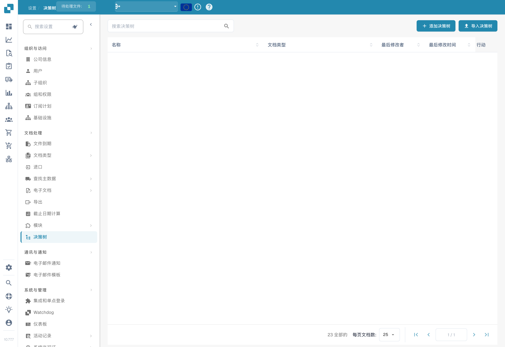<figcaption>
决策树列表，已隐藏名称和组织数据；隐藏的行不表示列表为空。
</figcaption></figure>

每个条目显示：

| 列                   | 描述                                           |
| -------------------- | ---------------------------------------------- |
| **名称**             | 决策树的名称。点击名称可打开设计器。           |
| **文档类型**         | 此决策树适用的文档类型（例如 `INVOICE`、`QUOTE`）。 |
| **最后修改人**       | 最后编辑该决策树的用户。                       |
| **最后修改时间**     | 最近一次更改的时间戳。                         |
| **操作**             | 三点菜单，可用于编辑、复制、导出或删除决策树。 |

#### 创建决策树

1. 点击右上角的 **+ Add Decision Tree**。
2. 输入 **Name** 并选择 **Document Type**。
3. 使用决策树设计器（如下所述）定义条件、策略和结果。

#### 导入决策树

点击 **Import Decision Tree**，上传之前导出的决策树文件（JSON 格式）。这适用于在不同组织或环境之间复制决策树。

## 决策树设计器

决策树设计器可用于配置决定如何做出决策的规则。

### **决策树设计器的组件**

* **规则**：每条规则由条件和操作组成。
* **Select Source**：此下拉菜单用于指定要评估的源字段。
* **Select Operator**：定义要应用于源字段的逻辑运算符（例如 `<=`、`>=`、`=`、`!=`）。
* **结果**：定义满足条件时应采取的结果或操作。
* **Add New Row**：用于向决策树添加其他规则。

### 决策树配置示例

此决策树会评估 **Total Amount** 字段，并根据预定义条件将其分配到不同的组。每条规则都会将总金额与特定值进行比较，并根据满足的条件返回相应的 **Group**。

<figure><figcaption></figcaption></figure>

此决策树会评估两个关键条件，以确定应分配哪个组：**Total Amount** 和 **Warehouse Status**。决策树根据总金额设置阈值，以确定返回哪个组；此外，还会区分仓库是否标记为“Warehouse Main”“Warehouse Sub”或“Not Warehouse Main”。

<figure><figcaption></figcaption></figure>

每条规则都会按顺序进行评估。

## 决策树策略

决策树策略定义如何处理决策树中的多条规则。可从以下策略中选择：

* [唯一策略](unique-policy.md)
* [首条策略](first-policy.md)
* [优先级策略](priority-policy.md)
* [汇总（求和）策略](collect-sum-policy.md)
* [汇总（最小值/最大值/计数）策略](collect-min-max-count-policy.md)
* [规则顺序策略](rule-order-policy.md)
* [任意策略](any-policy.md)
* [首条及相邻策略](first-and-adjacent-policy.md)

## **测试决策树**

**概述：**决策树设计器包含一项测试功能，用于验证已配置规则的逻辑。用户可以为选定字段提供特定输入值，以测试决策树。

**使用测试功能的步骤：**

1.  **找到测试按钮：**

    * 在决策树设计器中找到 **Test** 按钮。

    <figure><figcaption></figcaption></figure>
2.  **打开测试弹窗：**

    * 点击 **Test** 按钮。
    * 系统会显示一个弹窗，其中包含与决策树中所用条件对应的输入字段。

    <figure><figcaption></figcaption></figure>
3. **提供输入值：**
   *   在输入字段中填写值，以模拟实际场景。

       <figure><figcaption></figcaption></figure>
4.  **评估结果：**

    * 输入值后，决策树会根据所选策略进行处理。
    * 系统会突出显示与所提供输入匹配的规则。

    <figure><figcaption></figcaption></figure>
5. **查看无匹配项的反馈：**
   * 如果没有规则突出显示，系统会提供反馈，说明没有规则匹配的原因。
   * 根据反馈调整输入，或检查决策树配置中是否存在问题。

## 导出和保存

* **Save**：保存当前决策树配置。
* **Export**：导出决策树配置，以便导入其他环境或用于备份。

## 使用场景

* **审批工作流** — 根据金额阈值将发票路由给不同的审批人（例如，金额超过 10,000 时需要经理审批）。
* **验证规则** — 自动验证字段值，并标记不符合已配置条件的文档。
* **顺序分配** — 根据条件，按特定顺序将文档分配给用户。

## 截图

<figure>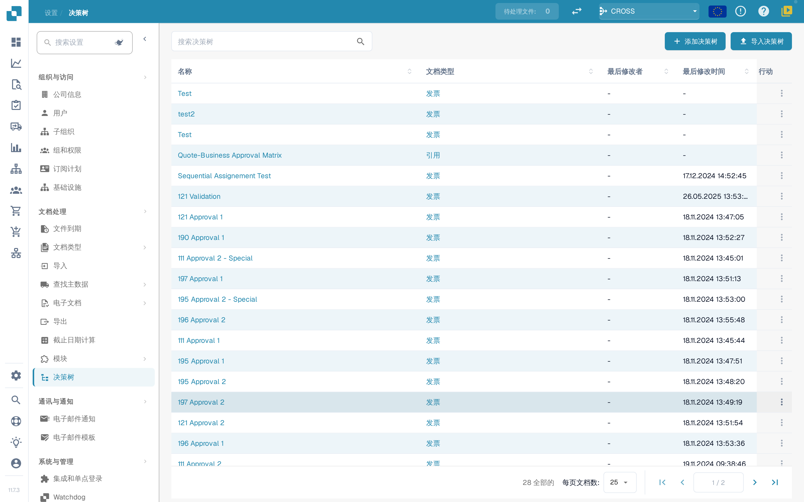<figcaption>
决策树列表
</figcaption></figure>

<figure>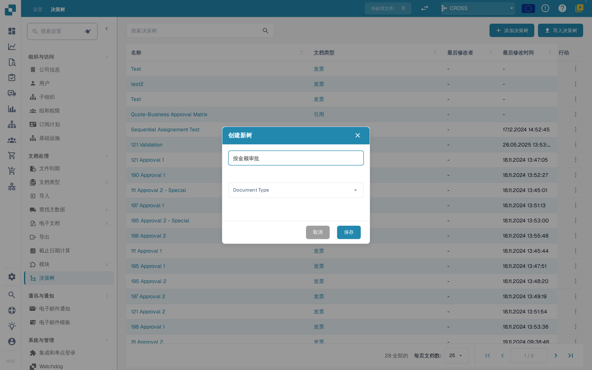<figcaption>
创建决策树：输入名称
</figcaption></figure>

<figure>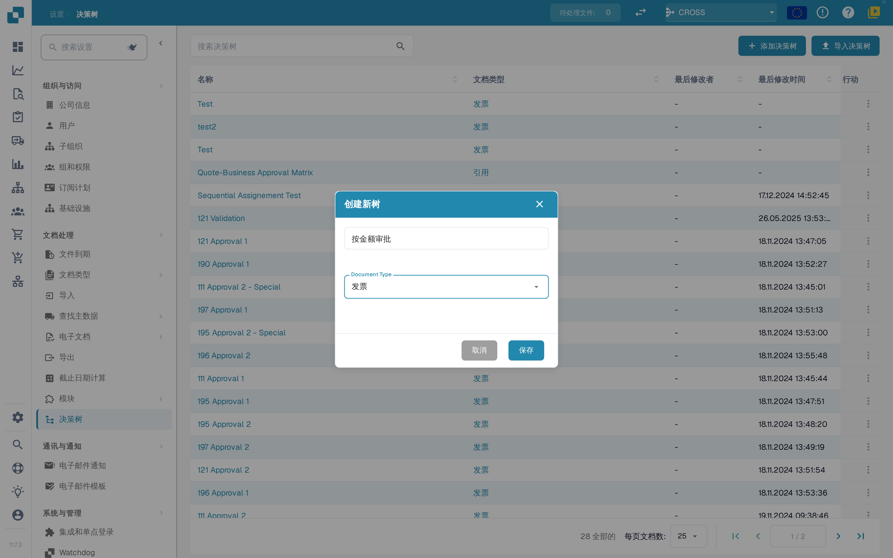<figcaption>
创建决策树：选择文档类型
</figcaption></figure>

<figure>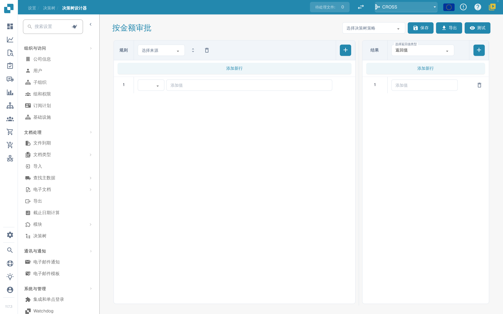<figcaption>
带一行规则的空设计器
</figcaption></figure>

<figure>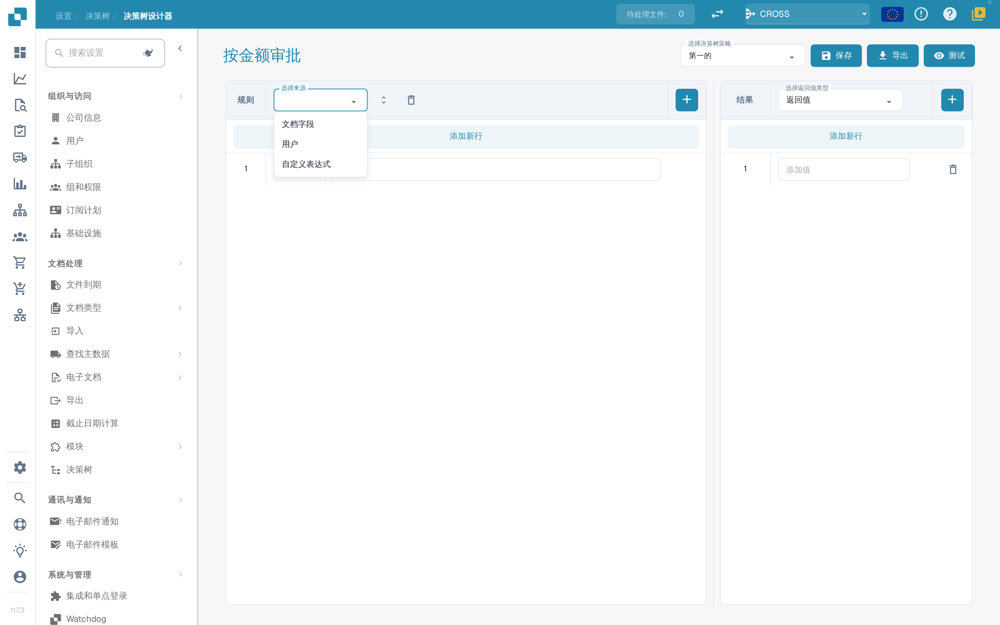<figcaption>
规则：选择来源
</figcaption></figure>

<figure>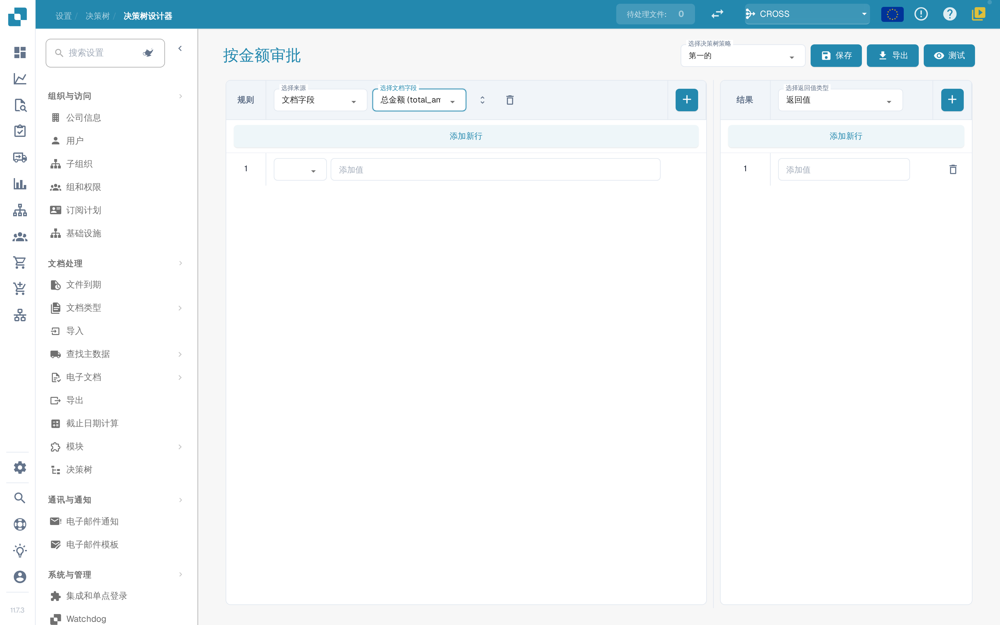<figcaption>
规则：选择文档字段
</figcaption></figure>

<figure>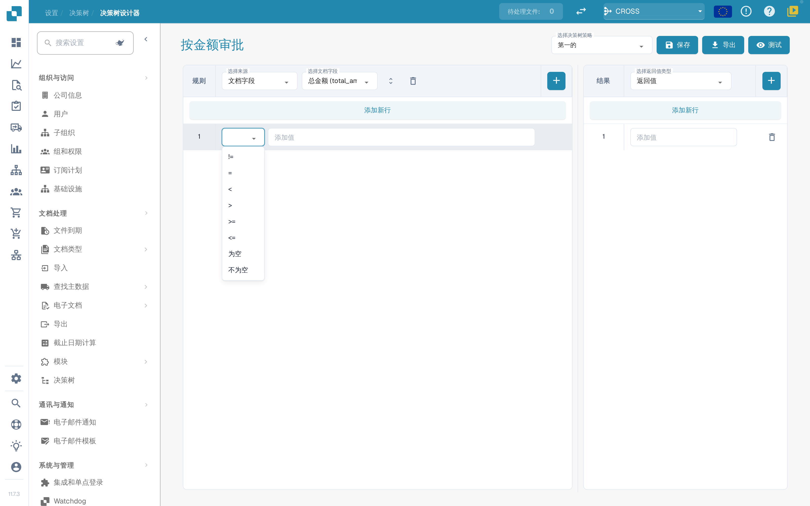<figcaption>
规则：选择运算符
</figcaption></figure>

<figure>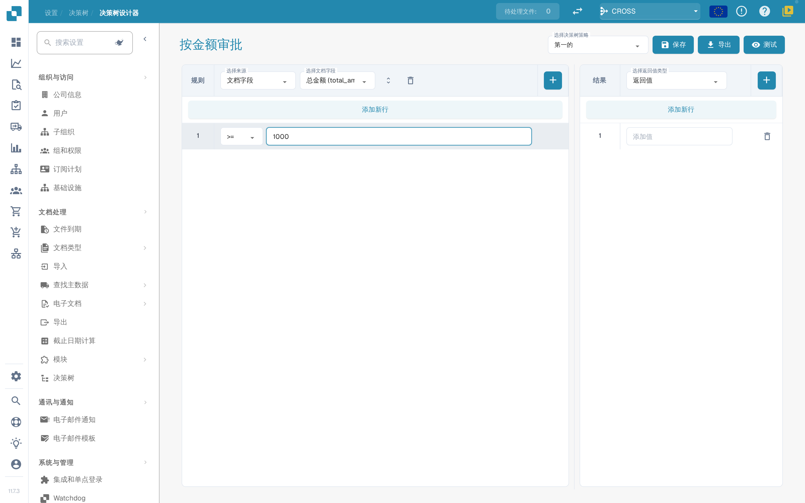<figcaption>
规则：输入比较值
</figcaption></figure>

<figure>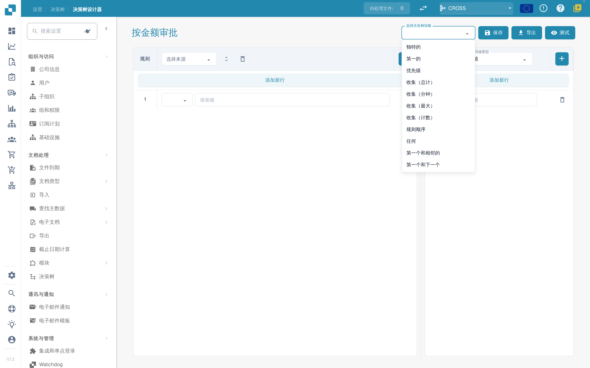<figcaption>
选择决策树策略
</figcaption></figure>

<figure>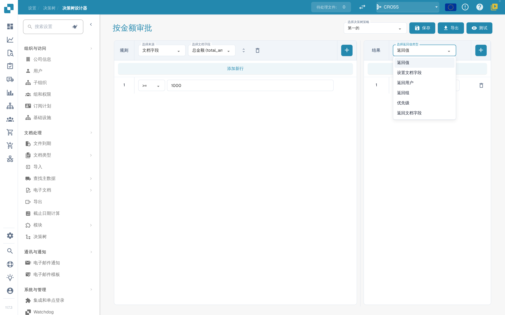<figcaption>
结果：选择返回类型
</figcaption></figure>

<figure>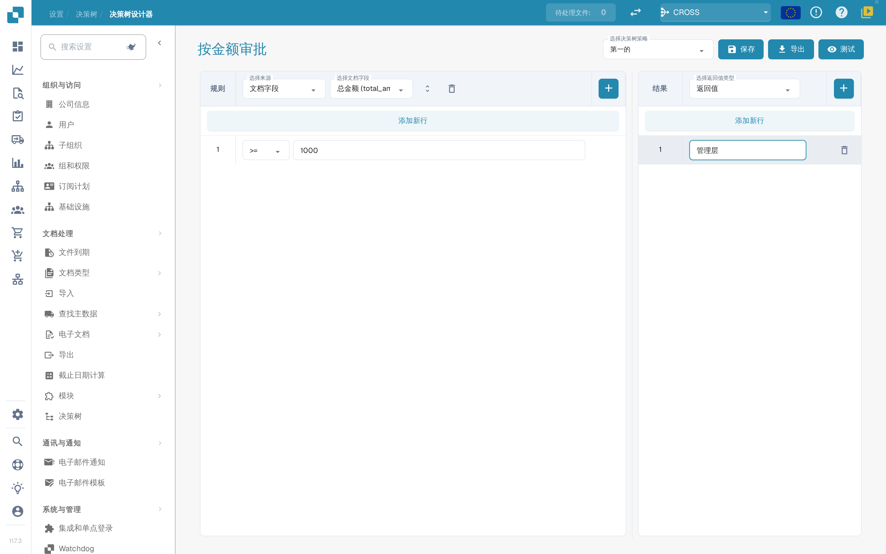<figcaption>
结果：输入返回值
</figcaption></figure>

<figure>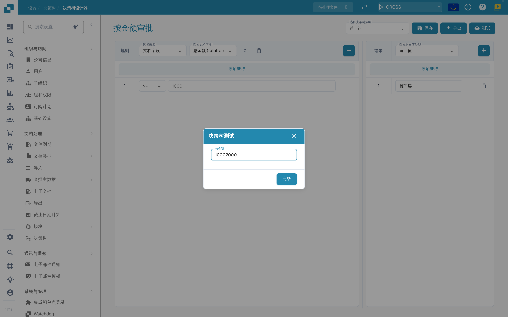<figcaption>
用示例值测试决策树
</figcaption></figure>

<figure>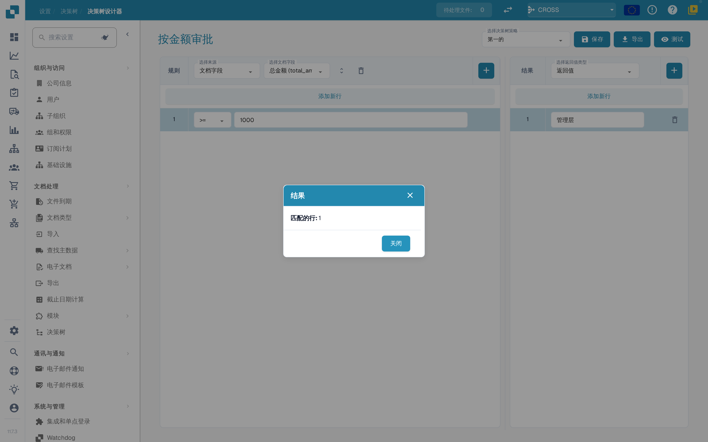<figcaption>
测试结果：匹配的行数
</figcaption></figure>
