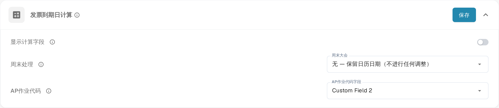
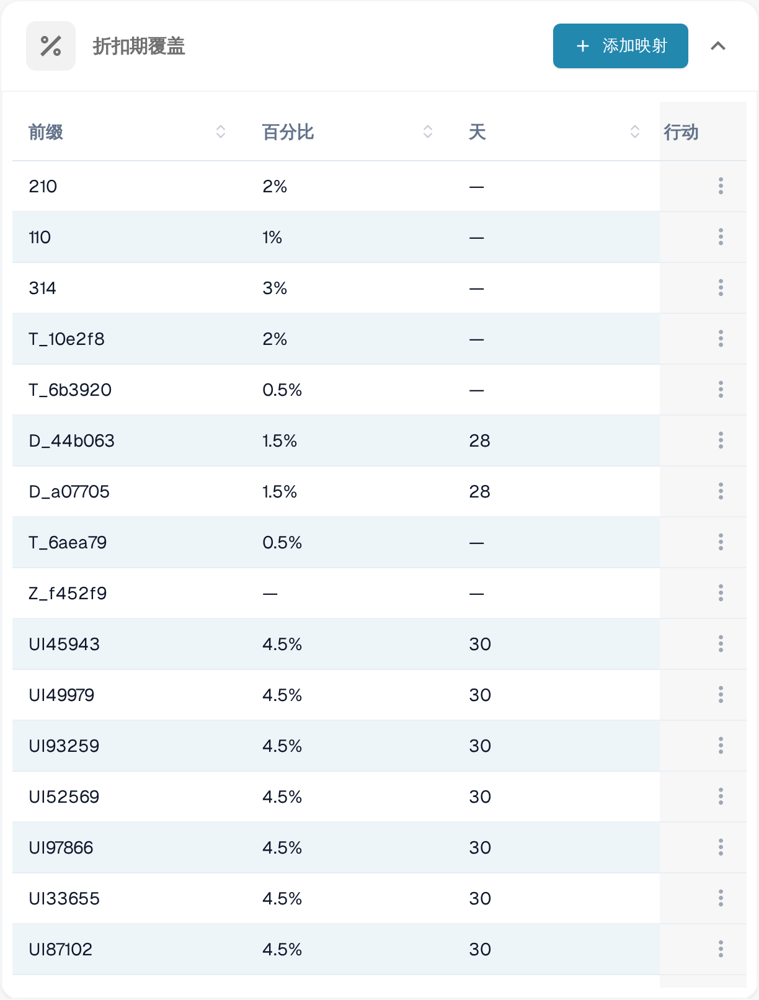
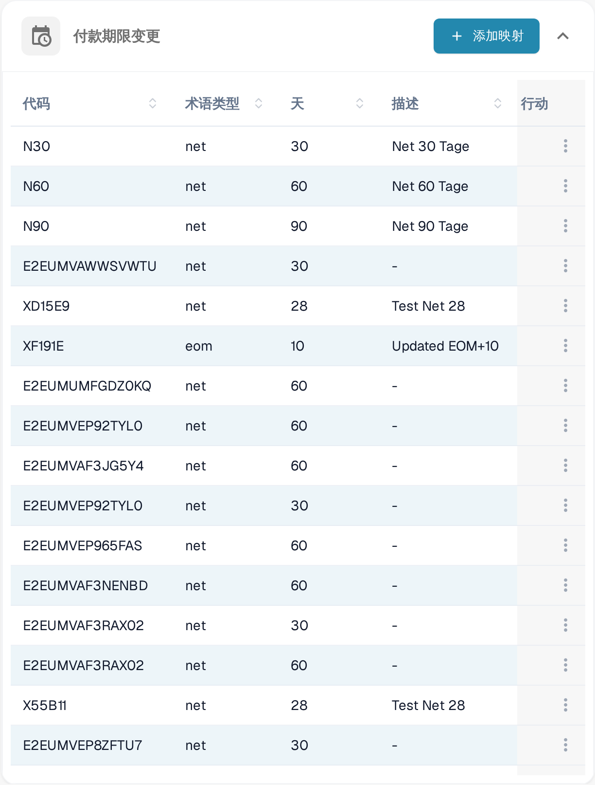
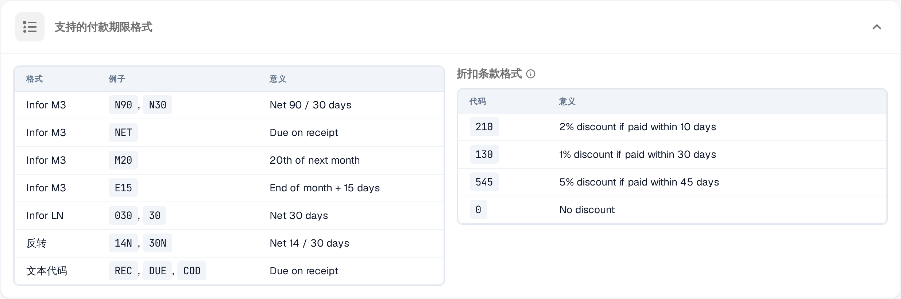

# 到期日计算

<figure><figcaption>
中文到期日计算设置；“周末大会”在此指周末日期调整规则，“AP作业代码”指应付账款分配代码。Custom Field 2 是已配置的字段名；本图未更改设置。
</figcaption></figure>

**到期日计算**页面（**文档处理 → 到期日计算**）用于控制 DocBits 如何根据发票中的付款条件代码计算发票到期日、折扣（Skonto）到期日和付款条件。

**Invoice Due Date Calculation** 卡片包含常规设置。使用其标题栏中的**保存**按钮保存更改。下方是折扣条件和付款条件映射表，以及支持的格式说明。

## 显示计算字段

启用**显示计算字段**后，自动计算的发票字段（到期日、折扣到期日、付款条件和 AP 分配代码）会显示在字段设置中，并作为变量供快速搜索和电子邮件模板使用。自定义文档类型不受影响。

## 发票到期日计算

### 周末处理方式

选择**周末处理方式**可控制到期日落在星期六或星期日时的调整方式。此设置同时适用于**发票到期日**和**折扣（Skonto）到期日**。

| 规则 | 效果 |
| --- | --- |
| **无** | 保留日历日期（不作调整）。 |
| **顺延** | 将星期六或星期日移至下一个星期一。 |
| **提前** | 将星期六或星期日移至前一个星期五。 |
| **就近调整** | 星期六 → 星期五，星期日 → 星期一。 |
| **修改后顺延** | 顺延至下一个星期一；如果跨入下个月，则改为前一个星期五。 |

### AP 分配代码

选择**AP 分配代码字段**，将供应商付款条件映射到 AP 分配代码，以便自动路由发票。

## 折扣条件覆盖

<figure><figcaption>
折扣条件覆盖
</figcaption></figure>

使用**折扣条件覆盖**将特定前缀映射到折扣百分比和天数。点击**添加映射**，添加包含**前缀**、**百分比**和**天数**的行。要更改或删除已有映射，使用行末的菜单（⋮）。

## 付款条件覆盖

<figure><figcaption>
付款条件覆盖
</figcaption></figure>

使用**付款条件覆盖**将付款条件代码映射到期限类型、天数和说明。点击**添加映射**添加行，使用行末菜单（⋮）更改或删除映射。

## 支持的格式

<figure><figcaption>
支持的格式
</figcaption></figure>

DocBits 可识别以下付款条件代码和折扣条件代码。

**支持的付款条件格式**

| 格式 | 示例 | 含义 |
| --- | --- | --- |
| Infor M3 | `N90`、`N30` | 净额 90 天／30 天 |
| Infor M3 | `NET` | 收到发票时到期 |
| Infor M3 | `M20` | 下个月 20 日 |
| Infor M3 | `E15` | 月末 + 15 天 |
| Infor LN | `030`、`30` | 净额 30 天 |
| 反向格式 | `14N`、`30N` | 净额 14 天／30 天 |
| 文本代码 | `REC`、`DUE`、`COD` | 收到发票时到期 |

**折扣条件格式** — 折扣条件使用 3 位代码表示提前付款折扣：首位数字表示折扣百分比，后两位表示付款期限（天数）。

| 代码 | 含义 |
| --- | --- |
| `210` | 在 10 天内付款可享受 2% 折扣 |
| `130` | 在 30 天内付款可享受 1% 折扣 |
| `545` | 在 45 天内付款可享受 5% 折扣 |
| `0` | 无折扣 |
