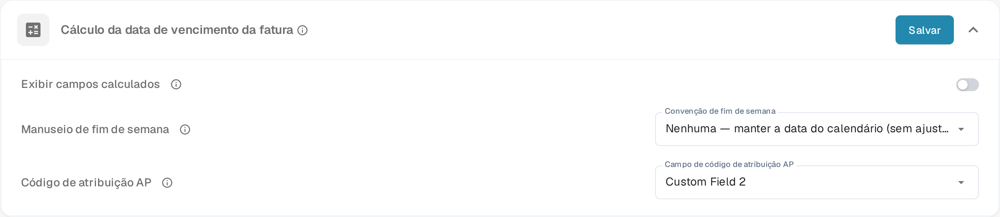
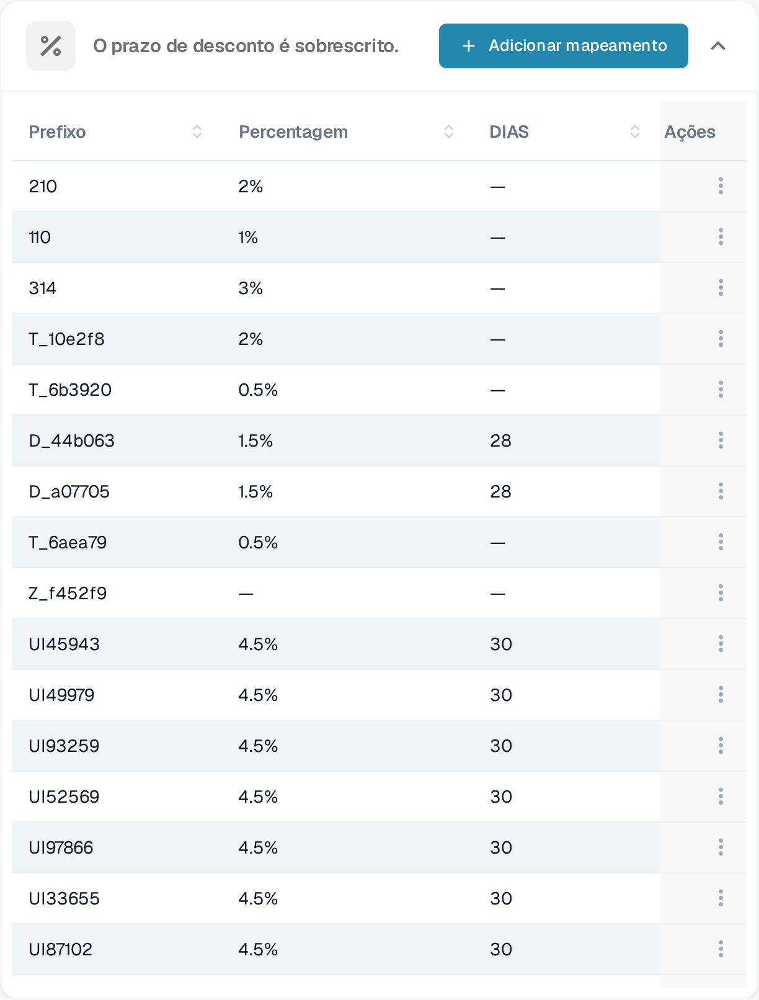
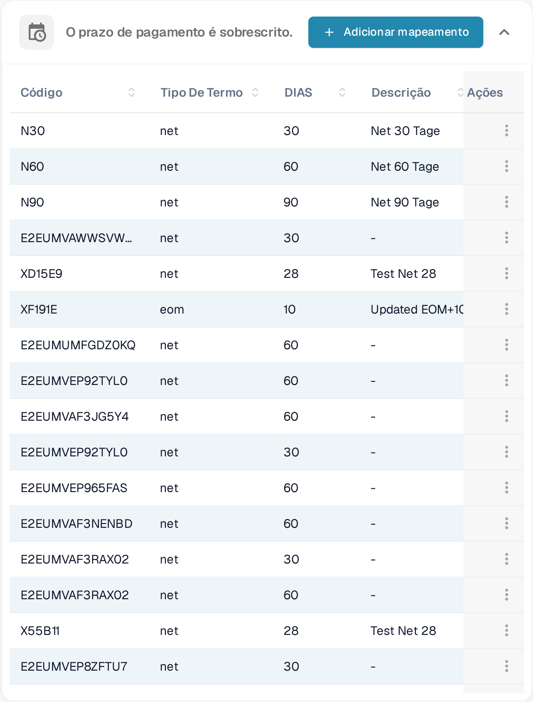
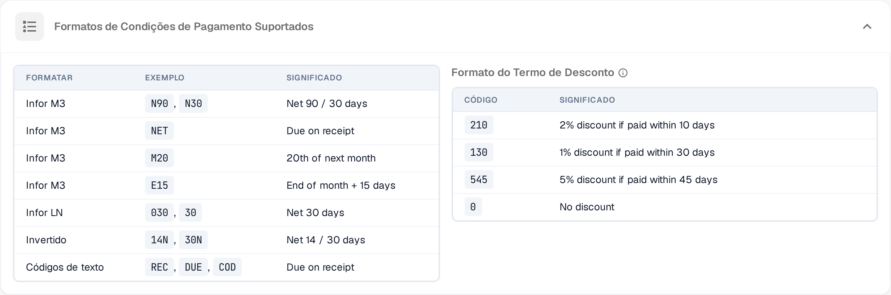

# Cálculo da data de vencimento

<figure><figcaption>
Definições do cálculo da data de vencimento
</figcaption></figure>

A página **Cálculo da data de vencimento** (**Processamento de documentos → Cálculo da data de vencimento**) controla a forma como o DocBits calcula as datas de vencimento das faturas, as datas de vencimento do desconto (Skonto) e as condições de pagamento a partir dos códigos de condições de pagamento encontrados nas faturas.

O cartão **Invoice Due Date Calculation** reúne as definições gerais. Use **Guardar** no seu cabeçalho para guardar as alterações. Mais abaixo estão as tabelas das condições de desconto e de pagamento e uma referência dos formatos suportados.

## Mostrar campos calculados

Ative **Mostrar campos calculados** para que os campos da fatura calculados automaticamente — data de vencimento, data de vencimento do desconto, condições de pagamento e código de atribuição de AP — apareçam nas Definições de campos e como variáveis na Pesquisa rápida e nos modelos de e-mail. Os tipos de documento personalizados nunca são afetados.

## Cálculo da data de vencimento da fatura

### Tratamento de fins de semana

Escolha o **Tratamento de fins de semana** para controlar como uma data de vencimento que calha a um sábado ou domingo é ajustada. Isto aplica-se **tanto** à data de vencimento da fatura como à do desconto (Skonto).

| Convenção | Efeito |
|-----------|--------|
| **Nenhuma** | Manter a data de calendário (sem ajuste). |
| **Seguinte** | Mover sábado/domingo para a segunda-feira seguinte. |
| **Anterior** | Mover sábado/domingo para a sexta-feira anterior. |
| **Mais próxima** | Sábado → sexta-feira, domingo → segunda-feira. |
| **Seguinte modificada** | Segunda-feira seguinte, exceto se passar para o mês seguinte; nesse caso, a sexta-feira anterior. |

### Código de atribuição de AP

Associe as condições de pagamento do fornecedor a códigos de atribuição de AP para o encaminhamento automatizado de faturas selecionando o **campo do código de atribuição de AP**.

## Substituições das condições de desconto

<figure><figcaption>
Substituições das condições de desconto
</figcaption></figure>

Use as **Substituições das condições de desconto** para associar um prefixo específico a uma percentagem de desconto e a um número de dias. Clique em **Adicionar associação** para acrescentar uma linha com **Prefixo**, **Percentagem** e **Dias**. Para alterar ou remover uma associação existente, use o menu (⋮) no fim da linha.

## Substituições de condições de pagamento

<figure><figcaption>
Substituições de condições de pagamento
</figcaption></figure>

Use as **Substituições de condições de pagamento** para associar um código de condições de pagamento a um tipo de prazo, a um número de dias e a uma descrição. Clique em **Adicionar associação** para acrescentar uma linha e use o menu (⋮) no fim da linha para a alterar ou remover.

## Formatos suportados

<figure><figcaption>
Formatos de condições de pagamento e desconto suportados
</figcaption></figure>

O DocBits reconhece os seguintes códigos de condições de pagamento e de desconto.

**Formatos de condições de pagamento suportados**

| Formato | Exemplo | Significado |
|---------|---------|-------------|
| Infor M3 | `N90`, `N30` | Líquido 90 / 30 dias |
| Infor M3 | `NET` | Pagável na receção |
| Infor M3 | `M20` | Dia 20 do mês seguinte |
| Infor M3 | `E15` | Fim do mês + 15 dias |
| Infor LN | `030`, `30` | Líquido 30 dias |
| Reversed | `14N`, `30N` | Líquido 14 / 30 dias |
| Códigos de texto | `REC`, `DUE`, `COD` | Pagável na receção |

**Formato das condições de desconto** — as condições de desconto codificam os descontos por pagamento antecipado como códigos de 3 dígitos: o primeiro dígito é a percentagem de desconto, os dois últimos são os dias dentro dos quais pagar.

| Código | Significado |
|--------|-------------|
| `210` | 2% de desconto se pago em 10 dias |
| `130` | 1% de desconto se pago em 30 dias |
| `545` | 5% de desconto se pago em 45 dias |
| `0` | Sem desconto |
