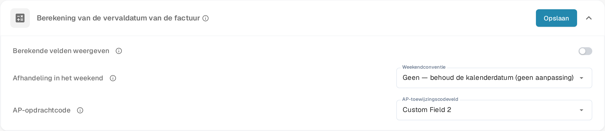
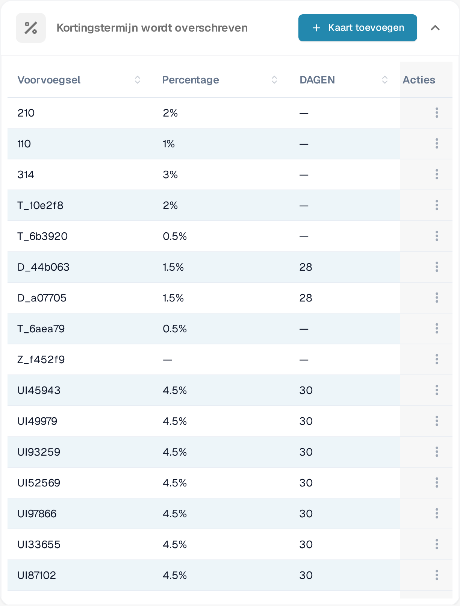
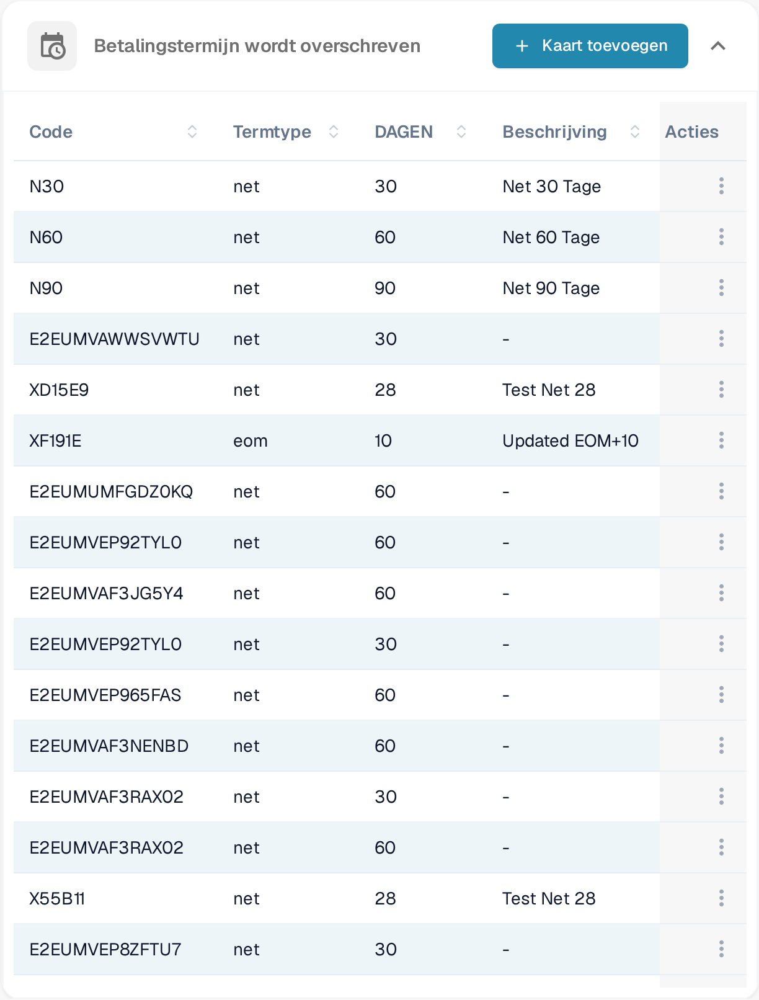
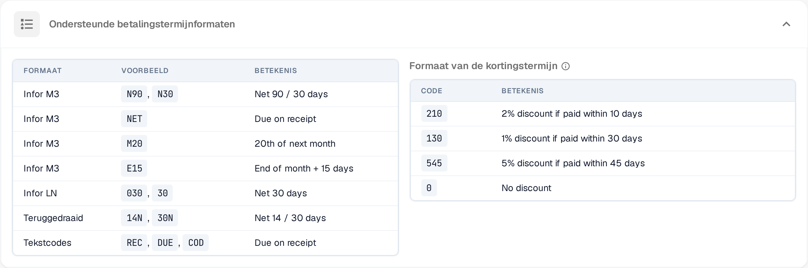

# Vervaldatumberekening

<figure><figcaption>
Instellingen voor de vervaldatumberekening
</figcaption></figure>

De pagina **Vervaldatumberekening** (**Documentverwerking → Vervaldatumberekening**) bepaalt hoe DocBits vervaldatums van facturen, kortingsvervaldatums (Skonto) en betalingsvoorwaarden berekent op basis van de betalingsvoorwaardecodes die op facturen worden gevonden.

De kaart **Invoice Due Date Calculation** bevat de algemene instellingen. Gebruik **Opslaan** in de koptekst om wijzigingen op te slaan. Verderop staan de tabellen voor kortings- en betalingsvoorwaarden en een overzicht van de ondersteunde formaten.

## Berekende velden tonen

Schakel **Berekende velden tonen** in zodat de automatisch berekende factuurvelden — vervaldatum, kortingsvervaldatum, betalingsvoorwaarden en AP-toewijzingscode — verschijnen in de Veldinstellingen en als variabelen in Snel zoeken en e-mailsjablonen. Aangepaste documenttypen worden nooit beïnvloed.

## Berekening van de factuurvervaldatum

### Weekendafhandeling

Kies de **Weekendafhandeling** om te bepalen hoe een vervaldatum die op een zaterdag of zondag valt, wordt aangepast. Dit geldt **zowel** voor de factuurvervaldatum als voor de kortingsvervaldatum (Skonto).

| Conventie | Effect |
|-----------|--------|
| **Geen** | Kalenderdatum behouden (geen aanpassing). |
| **Volgend** | Za/zo verplaatsen naar de volgende maandag. |
| **Voorgaand** | Za/zo verplaatsen naar de vorige vrijdag. |
| **Dichtstbijzijnd** | Zaterdag → vrijdag, zondag → maandag. |
| **Aangepast volgend** | Volgende maandag, tenzij die in de volgende maand valt; dan de vorige vrijdag. |

### AP-toewijzingscode

Koppel de betalingsvoorwaarden van de leverancier aan AP-toewijzingscodes voor geautomatiseerde factuurroutering door het **AP-toewijzingscodeveld** te selecteren.

## Kortingsvoorwaarde-overschrijvingen

<figure><figcaption>
Kortingsvoorwaarde-overschrijvingen
</figcaption></figure>

Gebruik **Kortingsvoorwaarde-overschrijvingen** om een specifiek voorvoegsel te koppelen aan een kortingspercentage en een aantal dagen. Klik op **Koppeling toevoegen** om een rij toe te voegen met **Voorvoegsel**, **Percentage** en **Dagen**. Gebruik het menu (⋮) aan het einde van een rij om een bestaande koppeling te wijzigen of te verwijderen.

## Overschrijvingen van betalingsvoorwaarden

<figure><figcaption>
Overschrijvingen van betalingsvoorwaarden
</figcaption></figure>

Gebruik **Overschrijvingen van betalingsvoorwaarden** om een betalingsvoorwaardecode te koppelen aan een termijntype, een aantal dagen en een omschrijving. Klik op **Koppeling toevoegen** om een rij toe te voegen en gebruik het menu (⋮) aan het einde van de rij om deze te wijzigen of te verwijderen.

## Ondersteunde formaten

<figure><figcaption>
Ondersteunde betalingsvoorwaarde- en kortingsformaten
</figcaption></figure>

DocBits herkent de volgende betalingsvoorwaarde- en kortingscodes.

**Ondersteunde betalingsvoorwaardeformaten**

| Formaat | Voorbeeld | Betekenis |
|---------|-----------|-----------|
| Infor M3 | `N90`, `N30` | Netto 90 / 30 dagen |
| Infor M3 | `NET` | Betaalbaar bij ontvangst |
| Infor M3 | `M20` | De 20e van de volgende maand |
| Infor M3 | `E15` | Einde maand + 15 dagen |
| Infor LN | `030`, `30` | Netto 30 dagen |
| Reversed | `14N`, `30N` | Netto 14 / 30 dagen |
| Tekstcodes | `REC`, `DUE`, `COD` | Betaalbaar bij ontvangst |

**Kortingsvoorwaardeformaat** — kortingsvoorwaarden coderen kortingen voor vroege betaling als codes van 3 cijfers: het eerste cijfer is het kortingspercentage, de laatste twee zijn de dagen waarbinnen moet worden betaald.

| Code | Betekenis |
|------|-----------|
| `210` | 2% korting bij betaling binnen 10 dagen |
| `130` | 1% korting bij betaling binnen 30 dagen |
| `545` | 5% korting bij betaling binnen 45 dagen |
| `0` | Geen korting |
