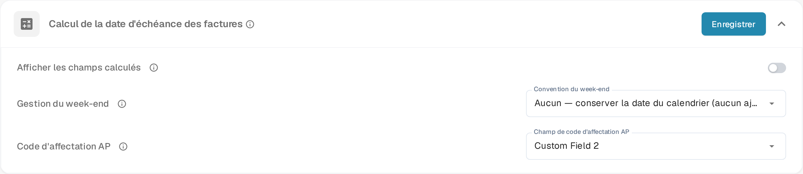
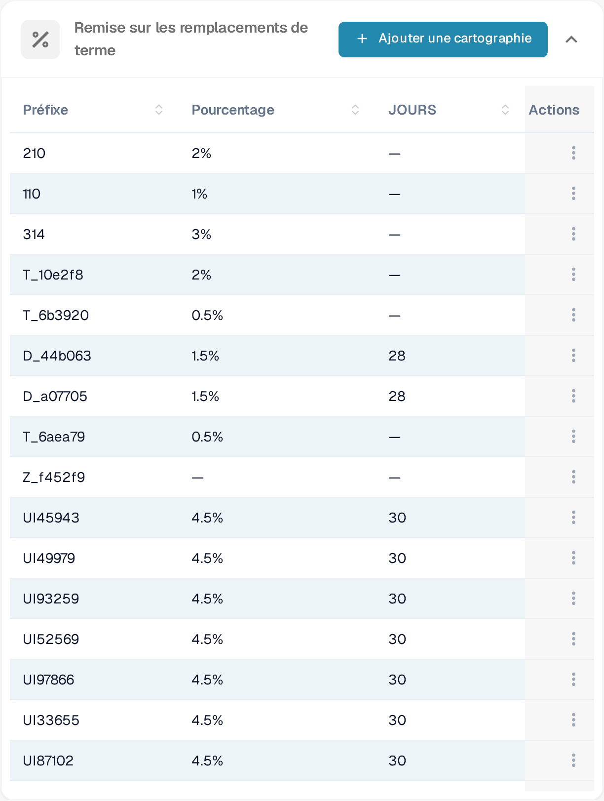
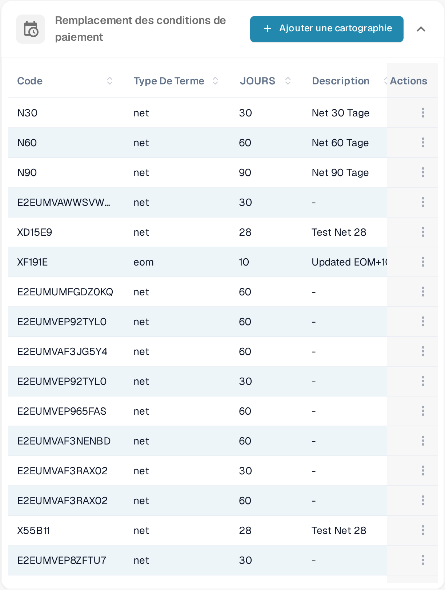
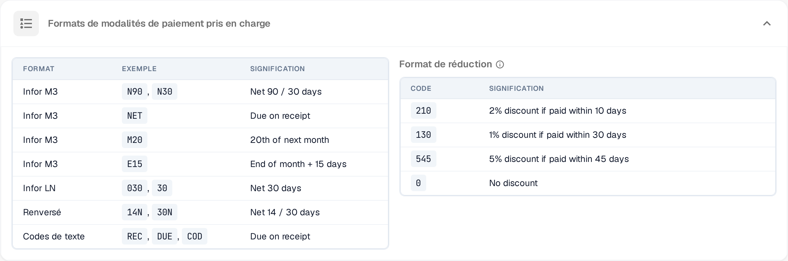

# Calcul de la date d'échéance

<figure><figcaption>
Paramètres du calcul de la date d'échéance
</figcaption></figure>

La page **Calcul de la date d'échéance** (**Traitement des documents → Calcul de la date d'échéance**) contrôle la manière dont DocBits calcule les dates d'échéance des factures, les dates d'échéance d'escompte (Skonto) et les conditions de paiement à partir des codes de conditions de paiement trouvés sur les factures.

La carte **Invoice Due Date Calculation** regroupe les paramètres généraux. Utilisez **Enregistrer** dans son en-tête pour enregistrer vos modifications. Plus bas se trouvent les tableaux des conditions d’escompte et de paiement ainsi qu’une référence des formats pris en charge.

## Afficher les champs calculés

Activez **Afficher les champs calculés** pour que les champs de facture calculés automatiquement — date d'échéance, date d'échéance d'escompte, conditions de paiement et code d'affectation comptable (AP) — apparaissent dans les Paramètres des champs et comme variables dans la Recherche rapide et les modèles d'e-mail. Les types de documents personnalisés ne sont jamais affectés.

## Calcul de la date d'échéance de la facture

### Gestion des week-ends

Choisissez la **Gestion des week-ends** pour contrôler comment une date d’échéance qui tombe un samedi ou un dimanche est ajustée. Cela s’applique **à la fois** à la date d’échéance de la facture et à celle de l’escompte (Skonto).

| Convention | Effet |
|------------|-------|
| **Aucune** | Conserver la date du calendrier (aucun ajustement). |
| **Suivante** | Déplacer samedi/dimanche au lundi suivant. |
| **Précédente** | Déplacer samedi/dimanche au vendredi précédent. |
| **La plus proche** | Samedi → vendredi, dimanche → lundi. |
| **Suivante modifiée** | Lundi suivant, sauf s'il passe au mois suivant ; dans ce cas, le vendredi précédent. |

### Code d'affectation comptable (AP)

Associez les conditions de paiement du fournisseur à des codes d'affectation comptable pour l'acheminement automatisé des factures en sélectionnant le **champ du code d'affectation comptable**.

## Remplacements des conditions d'escompte

<figure><figcaption>
Remplacements des conditions d'escompte
</figcaption></figure>

Utilisez les **Remplacements des conditions d’escompte** pour associer un préfixe précis à un pourcentage d’escompte et à un nombre de jours. Cliquez sur **Ajouter une association** pour ajouter une ligne avec **Préfixe**, **Pourcentage** et **Jours**. Pour modifier ou supprimer une association existante, utilisez le menu (⋮) en fin de ligne.

## Remplacements des conditions de paiement

<figure><figcaption>
Remplacements des conditions de paiement
</figcaption></figure>

Utilisez les **Remplacements des conditions de paiement** pour associer un code de conditions de paiement à un type de délai, à un nombre de jours et à une description. Cliquez sur **Ajouter une association** pour ajouter une ligne, puis utilisez le menu (⋮) en fin de ligne pour modifier ou supprimer une association.

## Formats pris en charge

<figure><figcaption>
Formats de conditions de paiement et d'escompte pris en charge
</figcaption></figure>

DocBits reconnaît les codes de conditions de paiement et d'escompte suivants.

**Formats de conditions de paiement pris en charge**

| Format | Exemple | Signification |
|--------|---------|---------------|
| Infor M3 | `N90`, `N30` | Net 90 / 30 jours |
| Infor M3 | `NET` | Payable à réception |
| Infor M3 | `M20` | Le 20 du mois suivant |
| Infor M3 | `E15` | Fin de mois + 15 jours |
| Infor LN | `030`, `30` | Net 30 jours |
| Reversed | `14N`, `30N` | Net 14 / 30 jours |
| Codes texte | `REC`, `DUE`, `COD` | Payable à réception |

**Format des conditions d'escompte** : les conditions d'escompte codent les escomptes pour paiement anticipé sous forme de codes à 3 chiffres : le premier chiffre est le pourcentage d'escompte, les deux derniers sont le nombre de jours pour payer.

| Code | Signification |
|------|---------------|
| `210` | 2 % d'escompte si payé sous 10 jours |
| `130` | 1 % d'escompte si payé sous 30 jours |
| `545` | 5 % d'escompte si payé sous 45 jours |
| `0` | Aucun escompte |
