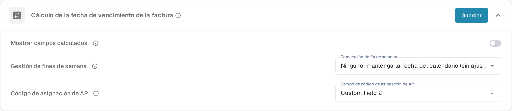
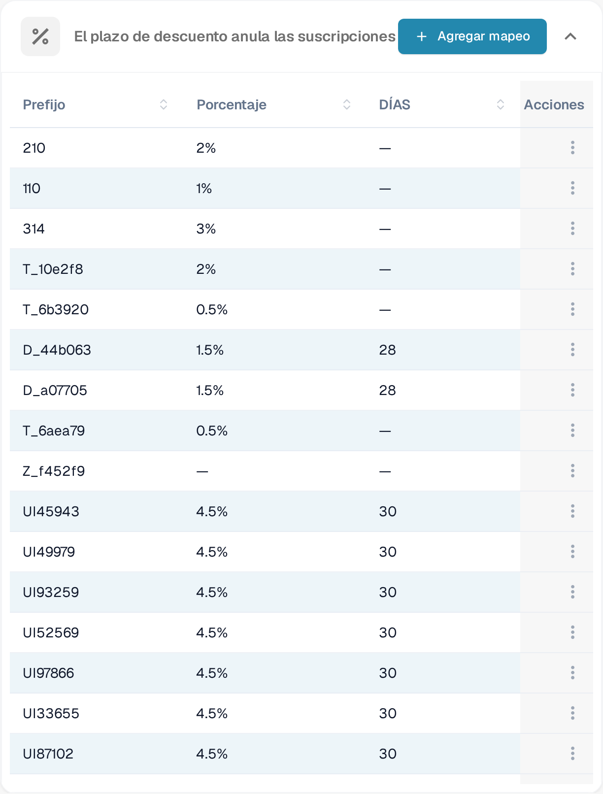
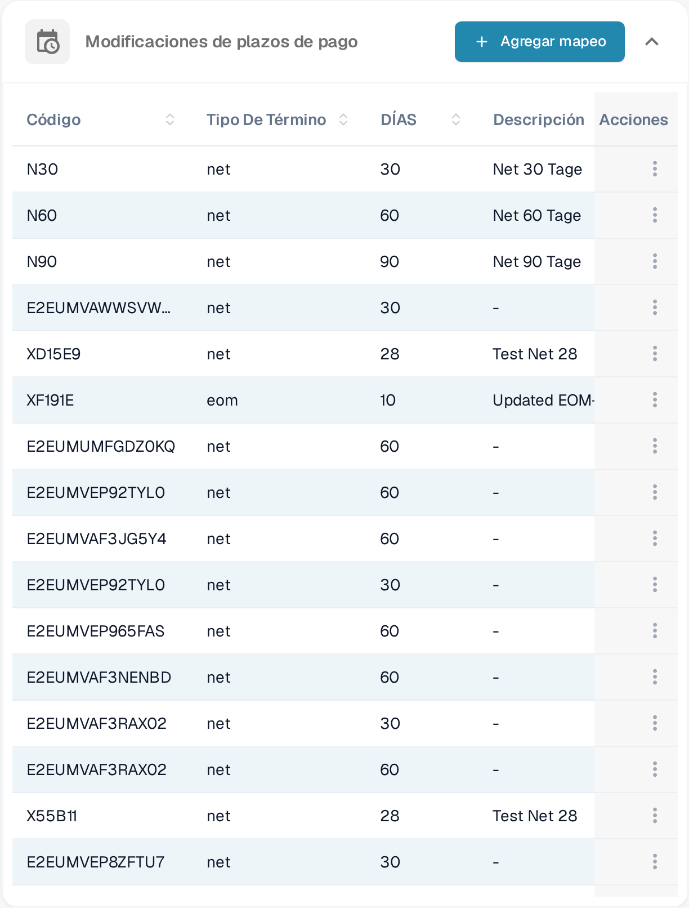
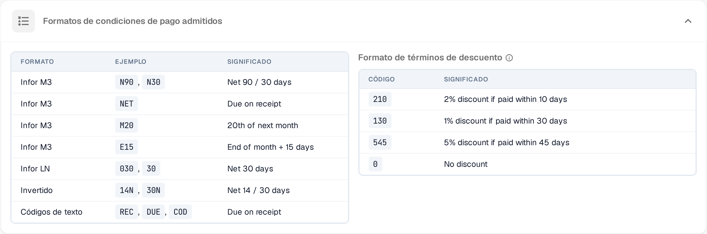

# Cálculo de fecha de vencimiento

<figure><figcaption>
Ajustes del cálculo de fecha de vencimiento
</figcaption></figure>

La página **Cálculo de fecha de vencimiento** (**Procesamiento de documentos → Cálculo de fecha de vencimiento**) controla cómo DocBits calcula las fechas de vencimiento de las facturas, las fechas de vencimiento del descuento (Skonto) y las condiciones de pago a partir de los códigos de condiciones de pago encontrados en las facturas.

La tarjeta **Invoice Due Date Calculation** contiene los ajustes generales. Use **Guardar** en su encabezado para guardar los cambios. Más abajo están las tablas de condiciones de descuento y de pago y una referencia de los formatos admitidos.

## Mostrar campos calculados

Active **Mostrar campos calculados** para que los campos de factura calculados automáticamente —fecha de vencimiento, fecha de vencimiento del descuento, condiciones de pago y código de asignación de cuentas por pagar (AP)— aparezcan en los Ajustes de campos y como variables en la Búsqueda rápida y en las plantillas de correo. Los tipos de documento personalizados nunca se ven afectados.

## Cálculo de la fecha de vencimiento de la factura

### Tratamiento de fines de semana

Elija el **Tratamiento de fines de semana** para controlar cómo se ajusta una fecha de vencimiento que cae en sábado o domingo. Esto se aplica **tanto** a la fecha de vencimiento de la factura como a la del descuento (Skonto).

| Convención | Efecto |
|------------|--------|
| **Ninguna** | Mantener la fecha de calendario (sin ajuste). |
| **Siguiente** | Mover sábado/domingo al lunes siguiente. |
| **Anterior** | Mover sábado/domingo al viernes anterior. |
| **Más cercana** | Sábado → viernes, domingo → lunes. |
| **Siguiente modificada** | Lunes siguiente, salvo que cruce al mes siguiente; entonces el viernes anterior. |

### Código de asignación de cuentas por pagar (AP)

Asigne las condiciones de pago del proveedor a códigos de asignación de AP para el enrutamiento automatizado de facturas seleccionando el **campo de código de asignación de AP**.

## Anulaciones de condiciones de descuento

<figure><figcaption>
Anulaciones de condiciones de descuento
</figcaption></figure>

Use las **Anulaciones de condiciones de descuento** para asignar un prefijo concreto a un porcentaje de descuento y un número de días. Haga clic en **Añadir asignación** para agregar una fila con **Prefijo**, **Porcentaje** y **Días**. Para cambiar o eliminar una asignación existente, use el menú (⋮) al final de la fila.

## Anulaciones de condiciones de pago

<figure><figcaption>
Anulaciones de condiciones de pago
</figcaption></figure>

Use las **Anulaciones de condiciones de pago** para asignar un código de condiciones de pago a un tipo de plazo, un número de días y una descripción. Haga clic en **Añadir asignación** para agregar una fila y use el menú (⋮) al final de la fila para cambiarla o eliminarla.

## Formatos admitidos

<figure><figcaption>
Formatos de condiciones de pago y descuento admitidos
</figcaption></figure>

DocBits reconoce los siguientes códigos de condiciones de pago y de descuento.

**Formatos de condiciones de pago admitidos**

| Formato | Ejemplo | Significado |
|---------|---------|-------------|
| Infor M3 | `N90`, `N30` | Neto 90 / 30 días |
| Infor M3 | `NET` | Pago contra recepción |
| Infor M3 | `M20` | Día 20 del mes siguiente |
| Infor M3 | `E15` | Fin de mes + 15 días |
| Infor LN | `030`, `30` | Neto 30 días |
| Reversed | `14N`, `30N` | Neto 14 / 30 días |
| Códigos de texto | `REC`, `DUE`, `COD` | Pago contra recepción |

**Formato de condiciones de descuento**: las condiciones de descuento codifican los descuentos por pronto pago como códigos de 3 dígitos: el primer dígito es el porcentaje de descuento y los dos últimos son los días dentro de los cuales se debe pagar.

| Código | Significado |
|--------|-------------|
| `210` | 2 % de descuento si se paga en 10 días |
| `130` | 1 % de descuento si se paga en 30 días |
| `545` | 5 % de descuento si se paga en 45 días |
| `0` | Sin descuento |
