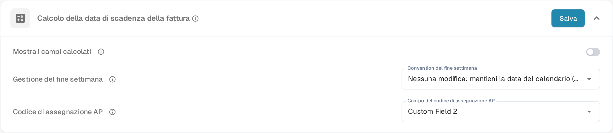
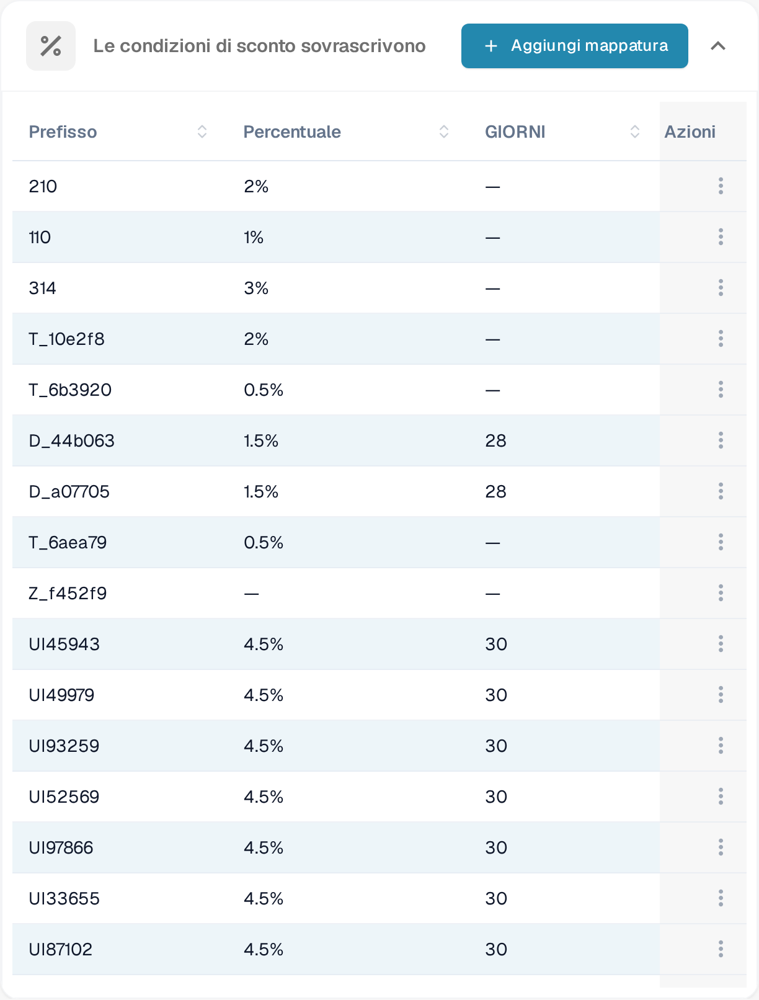
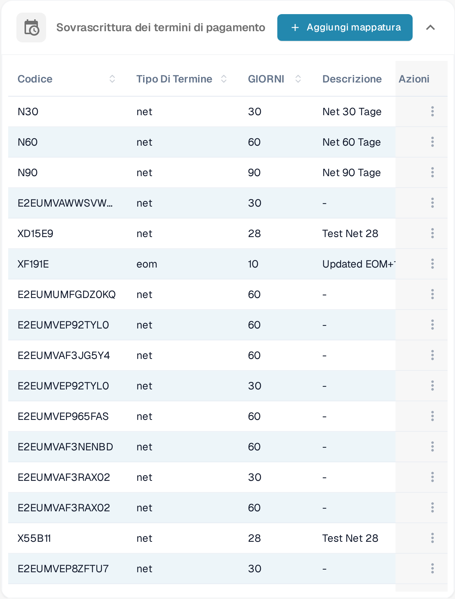
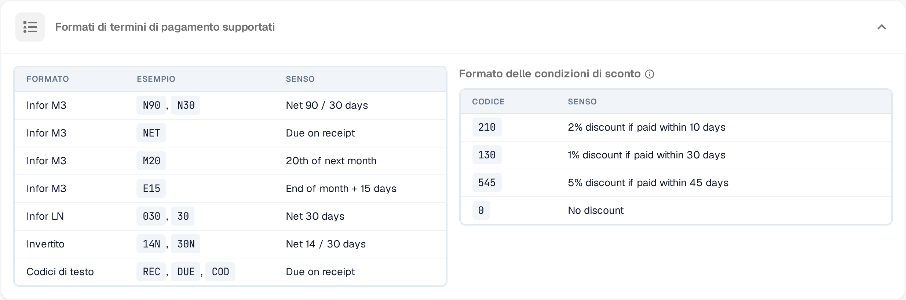

# Calcolo della data di scadenza

<figure><figcaption>
Impostazioni del calcolo della data di scadenza
</figcaption></figure>

La pagina **Calcolo della data di scadenza** (**Elaborazione dei documenti → Calcolo della data di scadenza**) controlla come DocBits calcola le date di scadenza delle fatture, le date di scadenza dello sconto (Skonto) e le condizioni di pagamento a partire dai codici delle condizioni di pagamento trovati sulle fatture.

La scheda **Invoice Due Date Calculation** raccoglie le impostazioni generali. Usa **Salva** nella sua intestazione per memorizzare le modifiche. Più in basso ci sono le tabelle delle condizioni di sconto e di pagamento e un riferimento dei formati supportati.

## Mostra campi calcolati

Attiva **Mostra campi calcolati** affinché i campi della fattura calcolati automaticamente — data di scadenza, data di scadenza dello sconto, condizioni di pagamento e codice di assegnazione contabilità fornitori (AP) — compaiano nelle Impostazioni dei campi e come variabili nella Ricerca rapida e nei modelli di e-mail. I tipi di documento personalizzati non sono mai interessati.

## Calcolo della data di scadenza della fattura

### Gestione dei fine settimana

Scegli la **Gestione dei fine settimana** per controllare come viene rettificata una data di scadenza che cade di sabato o di domenica. Questo vale **sia** per la data di scadenza della fattura sia per quella dello sconto (Skonto).

| Convenzione | Effetto |
|-------------|---------|
| **Nessuna** | Mantieni la data di calendario (nessuna rettifica). |
| **Successiva** | Sposta sabato/domenica al lunedì successivo. |
| **Precedente** | Sposta sabato/domenica al venerdì precedente. |
| **Più vicina** | Sabato → venerdì, domenica → lunedì. |
| **Successiva modificata** | Lunedì successivo, a meno che non passi al mese successivo; in tal caso, venerdì precedente. |

### Codice di assegnazione contabilità fornitori (AP)

Associa le condizioni di pagamento del fornitore ai codici di assegnazione AP per l'instradamento automatizzato delle fatture selezionando il **campo del codice di assegnazione AP**.

## Sostituzioni delle condizioni di sconto

<figure><figcaption>
Sostituzioni delle condizioni di sconto
</figcaption></figure>

Usa le **Sostituzioni delle condizioni di sconto** per associare un prefisso specifico a una percentuale di sconto e a un numero di giorni. Fai clic su **Aggiungi associazione** per aggiungere una riga con **Prefisso**, **Percentuale** e **Giorni**. Per modificare o eliminare un’associazione esistente, usa il menu (⋮) a fine riga.

## Sostituzioni dei termini di pagamento

<figure><figcaption>
Sostituzioni dei termini di pagamento
</figcaption></figure>

Usa le **Sostituzioni dei termini di pagamento** per associare un codice di condizione di pagamento a un tipo di termine, a un numero di giorni e a una descrizione. Fai clic su **Aggiungi associazione** per aggiungere una riga e usa il menu (⋮) a fine riga per modificarla o eliminarla.

## Formati supportati

<figure><figcaption>
Formati di condizioni di pagamento e sconto supportati
</figcaption></figure>

DocBits riconosce i seguenti codici di condizioni di pagamento e di sconto.

**Formati di condizioni di pagamento supportati**

| Formato | Esempio | Significato |
|---------|---------|-------------|
| Infor M3 | `N90`, `N30` | Netto 90 / 30 giorni |
| Infor M3 | `NET` | Pagamento alla ricezione |
| Infor M3 | `M20` | Il 20 del mese successivo |
| Infor M3 | `E15` | Fine mese + 15 giorni |
| Infor LN | `030`, `30` | Netto 30 giorni |
| Reversed | `14N`, `30N` | Netto 14 / 30 giorni |
| Codici di testo | `REC`, `DUE`, `COD` | Pagamento alla ricezione |

**Formato delle condizioni di sconto**: le condizioni di sconto codificano gli sconti per pagamento anticipato come codici a 3 cifre: la prima cifra è la percentuale di sconto, le ultime due sono i giorni entro cui pagare.

| Codice | Significato |
|--------|-------------|
| `210` | 2% di sconto se pagato entro 10 giorni |
| `130` | 1% di sconto se pagato entro 30 giorni |
| `545` | 5% di sconto se pagato entro 45 giorni |
| `0` | Nessuno sconto |
