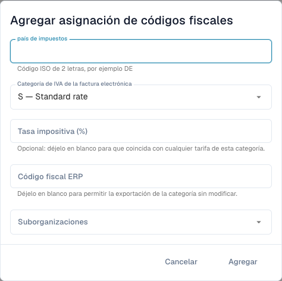

# Asignar categorías de IVA de facturas electrónicas a códigos ERP

<figure><figcaption>
Formulario de asignación fiscal antes de guardar un registro.
</figcaption></figure>

Una factura electrónica puede contener una categoría de IVA como **S** en lugar del código fiscal del ERP. La asignación define su conversión; es independiente de corregir importes fiscales o reglas de validación.

## Requisitos

Necesita acceso administrativo, país fiscal, categoría y tipo de IVA de la factura y un código ERP válido acordado con su administrador. Confirme organización y suborganización. La página debe estar disponible en su versión.

## Crear y comprobar la asignación

1. Abra **Configuración → Documentos electrónicos → Asignación de códigos fiscales** y revise los registros existentes.
2. Seleccione añadir una asignación.
3. Introduzca el país fiscal con su código ISO de dos letras, por ejemplo `DE`.
4. Seleccione la categoría: **S** tipo estándar, **Z** tipo cero, **E** exento u **O** fuera del ámbito fiscal. No intercambie categorías para evitar un error.
5. Introduzca un porcentaje para un tipo específico. Dejarlo vacío permite cualquier porcentaje de esa categoría, según indica el formulario.
6. Introduzca el código fiscal ERP y las suborganizaciones pertinentes. Un código ERP vacío permite expresamente exportar la categoría original sin convertir; úselo solo si el destino la acepta.
7. Añada y compruebe país, categoría, tipo, código ERP, alcance y estado activo guardados.
8. Pruebe una factura representativa con un destino de exportación controlado. Verifique código real en el ERP y respuesta, además del caso de asignación incorrecta o ausente.

Una factura alemana con categoría `S` y porcentaje `19` necesita el código configurado para ese caso. Obtenga el código real del ERP; un ejemplo no es un valor predeterminado de producción.

## Resolver un error

Compare país, categoría, porcentaje, alcance y activación. Compruebe la respuesta de integración antes de repetir una exportación con resultado incierto. Eliminar la asignación cambia operaciones futuras; no revierte exportaciones anteriores.

Consulte [Validación de facturas electrónicas](validation-rules.md) y [Exportación](../export.md).
