# Esportazione

## Panoramica

La pagina Esportazione mostra tutte le configurazioni di esportazione impostate, incluso se sono attive o inattive. Da qui, gli utenti possono:

* Visualizzare e gestire le configurazioni di esportazione esistenti
* Creare nuove connessioni di esportazione (ad es. verso **Infor**, **Infor & IDM**, **Webhook** o **SFTP**)
* Modificare o eliminare configurazioni di esportazione esistenti

## Dove trovarlo

Lo trovi in: **Impostazioni** → **Elaborazione documenti** → **Esportazione**

<figure>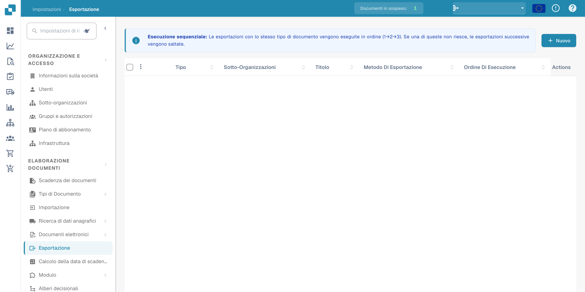<figcaption>
Accesso alla configurazione delle esportazioni dalle impostazioni.
</figcaption></figure>

## **Utilizzo della pagina Esportazione**

Quando apri la pagina Esportazione, vedrai un elenco di tutte le configurazioni di esportazione esistenti.

Ogni riga nell'elenco mostra:

* **Indicatore di stato**
  * **Verde** significa che l'esportazione è attiva
  * **Rosso** significa che l'esportazione è disattivata
* **Nome** – il nome della configurazione di esportazione
* **Tipo di documento** – il tipo di documento per cui è configurata l'esportazione
* **Sotto-organizzazione** – se l'esportazione è limitata a una sotto-organizzazione specifica
* **Metodo di esportazione** – dove verrà inviato il documento (ad es. Infor, IDM, SFTP)
* **Azioni** – pulsanti per **modificare, eliminare** o **attivare/disattivare** la configurazione

#### **Regole importanti per la configurazione dell'esportazione**

Per ogni **tipo di documento** **all'interno di una data organizzazione o sotto-organizzazione**, si applicano le seguenti regole:

* Puoi avere **solo un'esportazione Infor attiva**
* Puoi avere **solo un'esportazione non-Infor attiva** (ad es. Webhook, SFTP)

Tuttavia, è possibile avere:

* **Un'esportazione Infor attiva** _e_ **un'esportazione non-Infor attiva** contemporaneamente per lo stesso tipo di documento
* **Diverse configurazioni di esportazione per diverse sotto-organizzazioni** — ad esempio, un'esportazione Infor per la Sotto-Org A e un'altra esportazione Infor per la Sotto-Org B

## Attivazione dalla schermata di modifica

Una configurazione esistente ha un interruttore **Attivo** nel piè di pagina della schermata di modifica, accanto a **Salva**.

1. Aprite la configurazione in modifica (**Modifica**).
2. Portate l'interruttore **Attivo** nello stato desiderato e selezionate **Salva**.

DocBits attiva o disattiva quindi la configurazione con lo stesso controllo usato dall'elenco: se per lo stesso tipo di documento è già attiva un'altra configurazione, l'attivazione viene rifiutata. Salvare il modulo non modifica più da solo lo stato memorizzato; l'interruttore nel piè di pagina e lo stato mostrato nell'elenco coincidono sempre.

<figure>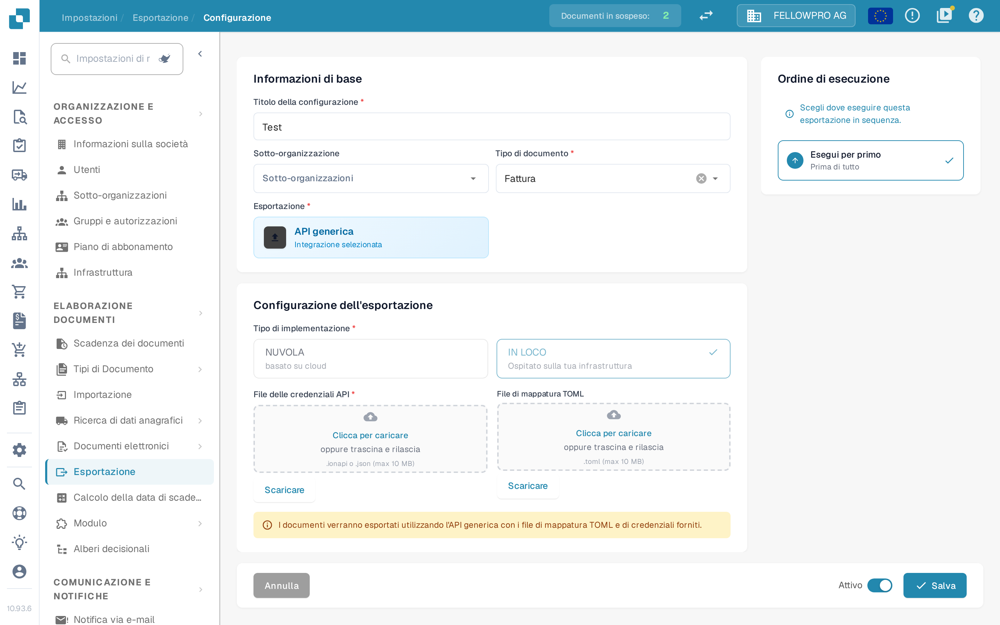<figcaption>
L'interruttore Attivo accanto a Salva nella schermata di modifica della configurazione di esportazione.
</figcaption></figure>

## **Creazione di una nuova esportazione**

Per creare una nuova esportazione:

1. Clicca sul pulsante **"Nuovo"**.

<figure>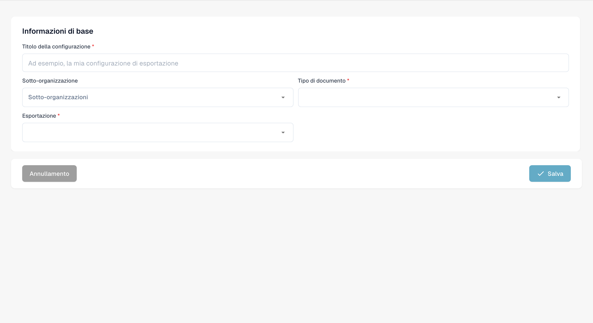<figcaption>
Bozza non salvata di una configurazione di esportazione.
</figcaption></figure>

2. Seleziona il **Tipo di esportazione** che vuoi configurare (ad es. Infor, IDM, SFTP).
3. Compila i campi richiesti in base al tipo di esportazione.
4. Salva la configurazione.

## Opzioni di esportazione

#### Webhook

Webhook

<figure>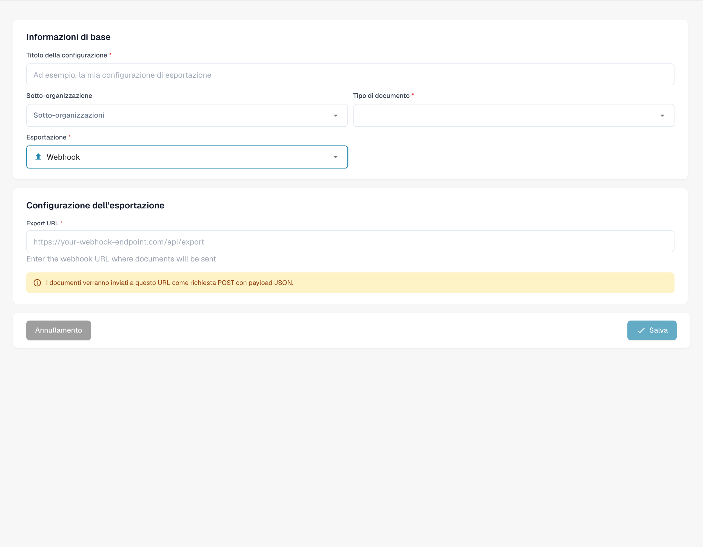<figcaption>
Bozza di configurazione dell’esportazione tramite Webhook.
</figcaption></figure>

**Descrizione dei campi**

* **Titolo** Il nome della configurazione di esportazione. Apparirà nell'elenco delle esportazioni.
* **Sotto-organizzazione** _(opzionale)_ Un menu a tendina con tutte le sotto-organizzazioni disponibili.
  * Se lasciato vuoto: si applica all'organizzazione principale.
  * Se selezionato: l'esportazione si applicherà solo alla sotto-organizzazione scelta.
* **Tipo di documento** Menu a tendina che elenca tutti i tipi di documento disponibili. Questo determina a quale tipo di documento si applica questa configurazione di esportazione.
* **Export URL** L'URL di destinazione dove il documento deve essere esportato.

#### SFTP

SFTP

<figure>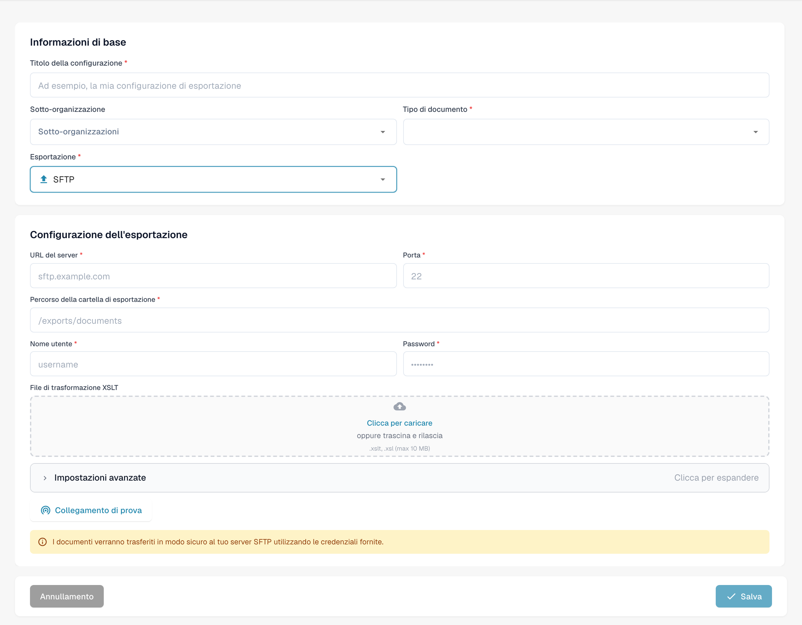<figcaption>
Bozza di configurazione dell’esportazione tramite SFTP.
</figcaption></figure>

**Descrizione dei campi**

* **Titolo** Il nome della configurazione di esportazione. Apparirà nell'elenco delle esportazioni.
* **Sotto-organizzazione** _(opzionale)_ Un menu a tendina con tutte le sotto-organizzazioni disponibili.
  * Se lasciato vuoto: si applica all'organizzazione principale.
  * Se selezionato: l'esportazione si applicherà solo alla sotto-organizzazione scelta.
* **Tipo di documento** Menu a tendina che elenca tutti i tipi di documento disponibili. Questo determina a quale tipo di documento si applica questa configurazione di esportazione.
* **Nome utente** Il nome utente utilizzato per autenticarsi sul server SFTP.
* **Password** La password corrispondente per l'account SFTP. Assicurati che l'account abbia accesso in scrittura alla cartella specificata.
* **URL del server** Il nome host o l'indirizzo IP del server SFTP di destinazione.
* **Porta** La porta utilizzata per connettersi al server SFTP.
* **Cartella** Il percorso sul server SFTP dove i documenti devono essere caricati (ad es. `/incoming/invoices/`). Deve esistere ed essere scrivibile.
*   **XSLT File (Opzionale)**

    Il **file XSLT** permette la trasformazione del formato di esportazione predefinito di DocBits.

    * **Quando usarlo:** Solo se il sistema ricevente richiede una struttura diversa o una formattazione specifica diversa da quella predefinita di DocBits.
    * **Lasciarlo vuoto** se il formato di esportazione predefinito soddisfa i requisiti.

**Impostazioni avanzate:**

* **Modalità di esportazione del nome file** Specifica se il file esportato mantiene il nome file originale o viene rinominato usando l'ID documento DocBits.
* **Includi cronologia documenti** Quando abilitato, il file esportato includerà la cronologia del documento basata sui log disponibili nella dashboard.

<figure>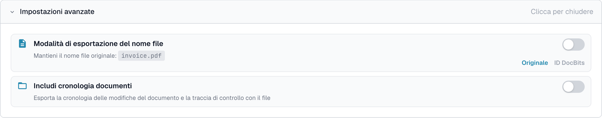<figcaption>
Opzioni avanzate non salvate dell’esportazione SFTP.
</figcaption></figure>

#### Esportazione Infor su SFTP

Esportazione Infor su SFTP

<figure>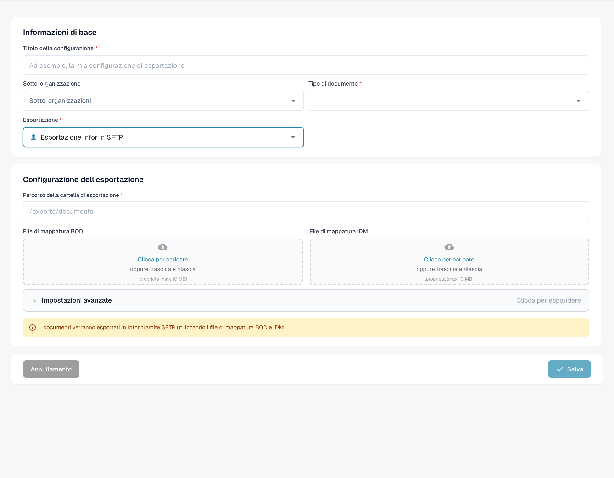<figcaption>
Bozza di esportazione tramite Infor SFTP.
</figcaption></figure>

**Descrizione dei campi**

* **Titolo** Il nome della configurazione di esportazione. Apparirà nell'elenco delle esportazioni.
* **Sotto-organizzazione** _(opzionale)_ Un menu a tendina con tutte le sotto-organizzazioni disponibili.
  * Se lasciato vuoto: si applica all'organizzazione principale.
  * Se selezionato: l'esportazione si applicherà solo alla sotto-organizzazione scelta.
* **Tipo di documento** Menu a tendina che elenca tutti i tipi di documento disponibili. Questo determina a quale tipo di documento si applica questa configurazione di esportazione.
* **File di mappatura IDM** Seleziona un file di mapping dal file manager. [Hai bisogno di aiuto per crearne uno? Consulta la Guida al Mapping IDM](../../../infor-integration-and-configuration/exporting-to-infor/creating-an-idm-mapping-file.md)
* **File di mappatura BOD** Seleziona un file di mapping dal file manager. [Hai bisogno di aiuto per crearne uno? Consulta la Guida al Mapping BOD](../../../infor-integration-and-configuration/exporting-to-infor/creating-a-bod-mapping-file.md)
* **Cartella** Il percorso sul server SFTP dove i documenti devono essere caricati (ad es. `/incoming/invoices/`). Deve esistere ed essere scrivibile.

#### **SMB**

SMB

<figure>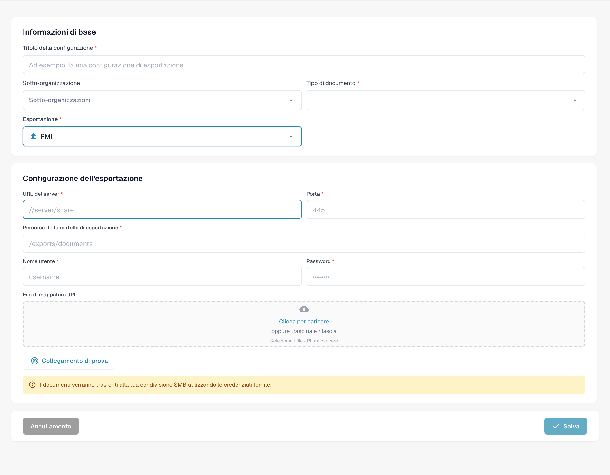<figcaption>
Bozza di esportazione tramite SMB; mantenere il protocollo previsto. L’etichetta PMI indica qui il protocollo SMB ed è una traduzione errata.
</figcaption></figure>

**Descrizione dei campi**

* **Titolo** Il nome della configurazione di esportazione. Apparirà nell'elenco delle esportazioni.
* **Sotto-organizzazione** _(opzionale)_ Un menu a tendina con tutte le sotto-organizzazioni disponibili.
  * Se lasciato vuoto: si applica all'organizzazione principale.
  * Se selezionato: l'esportazione si applicherà solo alla sotto-organizzazione scelta.
* **Tipo di documento** Menu a tendina che elenca tutti i tipi di documento disponibili. Questo determina a quale tipo di documento si applica questa configurazione di esportazione.
* **Nome utente** Il nome utente utilizzato per connettersi alla condivisione SMB.
* **Password** La password corrispondente per l'autenticazione SMB.
* **URL del server** L'indirizzo del server SMB.
* **Porta** Numero di porta utilizzato per accedere alla condivisione SMB.
* **Cartella** Il percorso della cartella all'interno della condivisione SMB dove i documenti devono essere salvati (ad es. `/incoming/invoices/`). Deve esistere ed essere scrivibile.
*   **JPL Mapping File (Opzionale)**

    Il **file JPL** è utilizzato per definire una trasformazione dei dati esportati prima che vengano scritti sulla condivisione SMB.

    * **Quando usarlo:** Solo quando i dati del documento esportato devono essere adattati per corrispondere alla formattazione esterna o alle aspettative del sistema.
    * **Lasciarlo vuoto** se non è necessaria alcuna trasformazione.

#### **Infor IDM**

Infor IDM

<figure>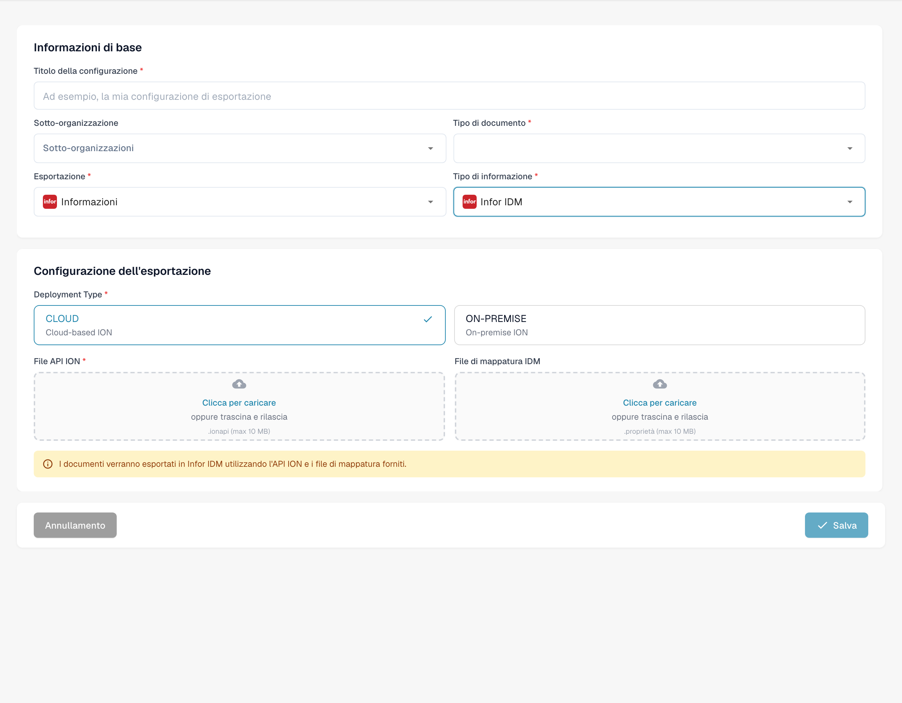<figcaption>
Bozza di esportazione verso Infor IDM. Le etichette Informazioni e Tipo di informazione indicano Infor e il relativo sottotipo.
</figcaption></figure>

**Descrizione dei campi**

* **Titolo** Il nome della configurazione di esportazione. Apparirà nell'elenco delle esportazioni.
* **Sotto-organizzazione** _(opzionale)_ Un menu a tendina con tutte le sotto-organizzazioni disponibili.
  * Se lasciato vuoto: si applica all'organizzazione principale.
  * Se selezionato: l'esportazione si applicherà solo alla sotto-organizzazione scelta.
* **Tipo di documento** Menu a tendina che elenca tutti i tipi di documento disponibili. Questo determina a quale tipo di documento si applica questa configurazione di esportazione.
* **File di mappatura ION** Seleziona un file di mapping dal file manager.
* **File di mappatura IDM** Seleziona un file di mapping dal file manager. [Hai bisogno di aiuto per crearne uno? Consulta la Guida al Mapping IDM](../../../infor-integration-and-configuration/exporting-to-infor/creating-an-idm-mapping-file.md)
* **Cloud / On-Prem Toggle** Un interruttore per indicare il tipo di distribuzione Infor:
  * **Distribuzione cloud**: Seleziona questo se sei un cliente Infor CloudSuite.
  * **On-Prem**: Seleziona questo se Infor è self-hosted.

#### **Infor ION**

Infor ION

<figure>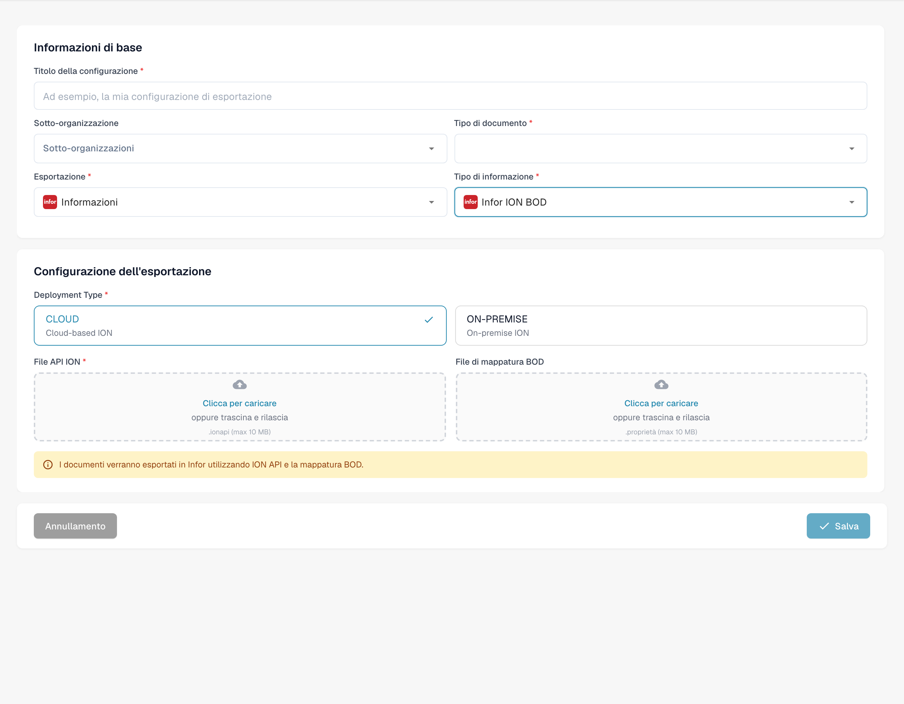<figcaption>
Bozza di esportazione verso Infor ION. Le etichette Informazioni e Tipo di informazione indicano Infor e il relativo sottotipo.
</figcaption></figure>

**Descrizione dei campi**

* **Titolo** Il nome della configurazione di esportazione. Apparirà nell'elenco delle esportazioni.
* **Sotto-organizzazione** _(opzionale)_ Un menu a tendina con tutte le sotto-organizzazioni disponibili.
  * Se lasciato vuoto: si applica all'organizzazione principale.
  * Se selezionato: l'esportazione si applicherà solo alla sotto-organizzazione scelta.
* **Tipo di documento** Menu a tendina che elenca tutti i tipi di documento disponibili. Questo determina a quale tipo di documento si applica questa configurazione di esportazione.
* **File di mappatura ION** Seleziona un file di mapping dal file manager.
* **File di mappatura BOD** Seleziona un file di mapping dal file manager. [Hai bisogno di aiuto per crearne uno? Consulta la Guida al Mapping BOD](../../../infor-integration-and-configuration/exporting-to-infor/creating-a-bod-mapping-file.md)
* **Cloud / On-Prem Toggle** Un interruttore per indicare il tipo di distribuzione Infor:
  * **Distribuzione cloud**: Seleziona questo se sei un cliente Infor CloudSuite.
  * **On-Prem**: Seleziona questo se Infor è self-hosted.

#### Infor IDM + ION BOD

Infor IDM + ION BOD

<figure>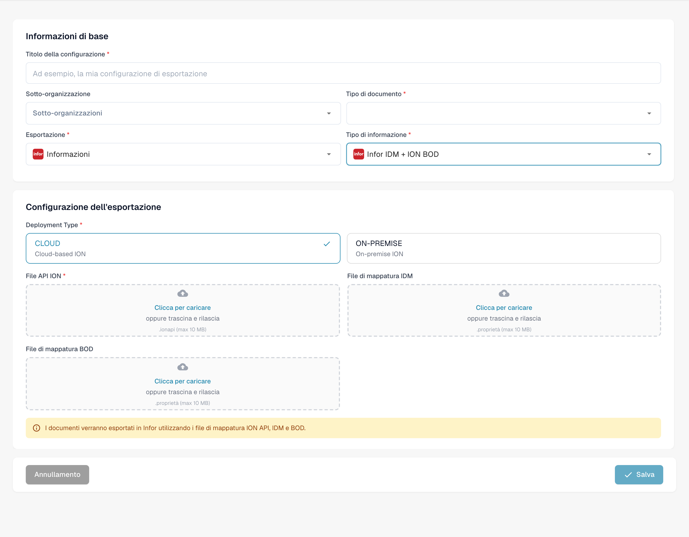<figcaption>
Bozza di esportazione verso Infor IDM ION BOD. Le etichette Informazioni e Tipo di informazione indicano Infor e il relativo sottotipo.
</figcaption></figure>

**Descrizione dei campi**

* **Titolo** Il nome della configurazione di esportazione. Apparirà nell'elenco delle esportazioni.
* **Sotto-organizzazione** _(opzionale)_ Un menu a tendina con tutte le sotto-organizzazioni disponibili.
  * Se lasciato vuoto: si applica all'organizzazione principale.
  * Se selezionato: l'esportazione si applicherà solo alla sotto-organizzazione scelta.
* **Tipo di documento** Menu a tendina che elenca tutti i tipi di documento disponibili. Questo determina a quale tipo di documento si applica questa configurazione di esportazione.
* **File di mappatura ION** Seleziona un file di mapping dal file manager.
* **File di mappatura IDM** Seleziona un file di mapping dal file manager. [Hai bisogno di aiuto per crearne uno? Consulta la Guida al Mapping IDM](../../../infor-integration-and-configuration/exporting-to-infor/creating-an-idm-mapping-file.md)
* **File di mappatura BOD** Seleziona un file di mapping dal file manager. [Hai bisogno di aiuto per crearne uno? Consulta la Guida al Mapping BOD](../../../infor-integration-and-configuration/exporting-to-infor/creating-a-bod-mapping-file.md)
* **Cloud / On-Prem Toggle** Un interruttore per indicare il tipo di distribuzione Infor:
  * **Distribuzione cloud**: Seleziona questo se sei un cliente Infor CloudSuite.
  * **On-Prem**: Seleziona questo se Infor è self-hosted.

### Per i clienti Infor CloudSuite

#### Infor IDM + LN

Infor IDM + LN

<figure>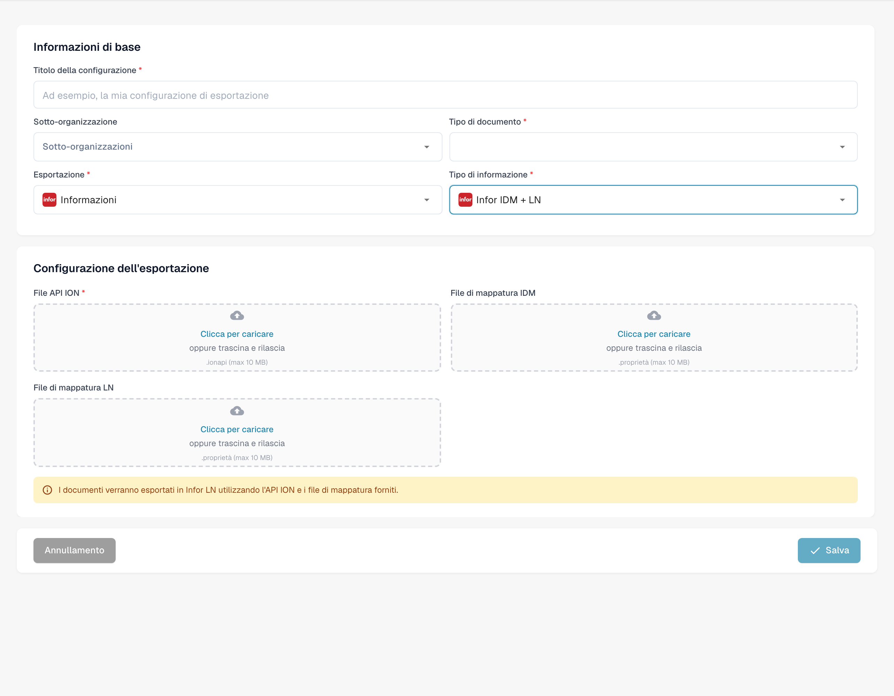<figcaption>
Bozza di esportazione verso Infor IDM LN. Le etichette Informazioni e Tipo di informazione indicano Infor e il relativo sottotipo.
</figcaption></figure>

**Descrizione dei campi**

* **Titolo** Il nome della configurazione di esportazione. Apparirà nell'elenco delle esportazioni.
* **Sotto-organizzazione** _(opzionale)_ Un menu a tendina con tutte le sotto-organizzazioni disponibili.
  * Se lasciato vuoto: si applica all'organizzazione principale.
  * Se selezionato: l'esportazione si applicherà solo alla sotto-organizzazione scelta.
* **Tipo di documento** Menu a tendina che elenca tutti i tipi di documento disponibili. Questo determina a quale tipo di documento si applica questa configurazione di esportazione.
* **File di mappatura ION** Seleziona un file di mapping dal file manager.
* **File di mappatura IDM** Seleziona un file di mapping dal file manager. [Hai bisogno di aiuto per crearne uno? Consulta la Guida al Mapping IDM](../../../infor-integration-and-configuration/exporting-to-infor/creating-an-idm-mapping-file.md)
* **File di mappatura LN** Seleziona un file di mapping dal file manager. [Hai bisogno di aiuto per crearne uno? Consulta l'Esempio di Mapping LN](../../../infor-integration-and-configuration/exporting-to-infor/ln/example-export-ln/)

#### Infor IDM + M3

Infor IDM + M3

<figure>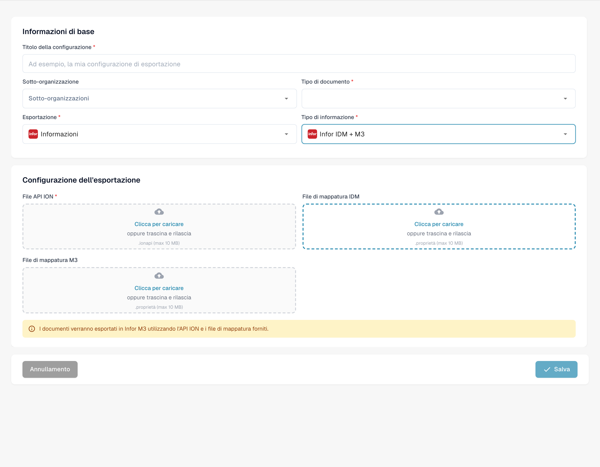<figcaption>
Bozza di esportazione verso Infor IDM M3. Le etichette Informazioni e Tipo di informazione indicano Infor e il relativo sottotipo.
</figcaption></figure>

**Descrizione dei campi**

* **Titolo** Il nome della configurazione di esportazione. Apparirà nell'elenco delle esportazioni.
* **Sotto-organizzazione** _(opzionale)_ Un menu a tendina con tutte le sotto-organizzazioni disponibili.
  * Se lasciato vuoto: si applica all'organizzazione principale.
  * Se selezionato: l'esportazione si applicherà solo alla sotto-organizzazione scelta.
* **Tipo di documento** Menu a tendina che elenca tutti i tipi di documento disponibili. Questo determina a quale tipo di documento si applica questa configurazione di esportazione.
* **File di mappatura ION** Seleziona un file di mapping dal file manager.
* **File di mappatura IDM** Seleziona un file di mapping dal file manager. [Hai bisogno di aiuto per crearne uno? Consulta la Guida al Mapping IDM](../../../infor-integration-and-configuration/exporting-to-infor/creating-an-idm-mapping-file.md)
* **File di mappatura M3** Seleziona un file di mapping dal file manager. [Hai bisogno di aiuto per crearne uno? Consulta l'Esempio di Mapping M3](../../../infor-integration-and-configuration/exporting-to-infor/m3/example-export-m3.md)

#### Infor IDM + M3 (toml)

Infor IDM + M3 (toml)

<figure>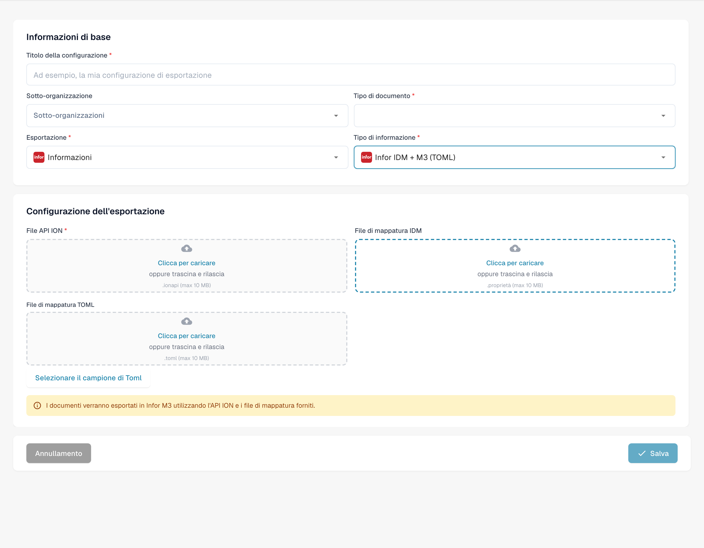<figcaption>
Bozza di esportazione verso Infor IDM M3 con TOML. Le etichette Informazioni e Tipo di informazione indicano Infor e il relativo sottotipo.
</figcaption></figure>

**Descrizione dei campi**

* **Titolo** Il nome della configurazione di esportazione. Apparirà nell'elenco delle esportazioni.
* **Sotto-organizzazione** _(opzionale)_ Un menu a tendina con tutte le sotto-organizzazioni disponibili.
  * Se lasciato vuoto: si applica all'organizzazione principale.
  * Se selezionato: l'esportazione si applicherà solo alla sotto-organizzazione scelta.
* **Tipo di documento** Menu a tendina che elenca tutti i tipi di documento disponibili. Questo determina a quale tipo di documento si applica questa configurazione di esportazione.
* **File di mappatura ION** Seleziona un file di mapping dal file manager.
* **File di mappatura IDM** Seleziona un file di mapping dal file manager. [Hai bisogno di aiuto per crearne uno? Consulta la Guida al Mapping IDM](../../../infor-integration-and-configuration/exporting-to-infor/creating-an-idm-mapping-file.md)
* **File di mappatura M3 TOML** Seleziona un file di mapping dal file manager o usa l'opzione seleziona Toml per usare un toml creato con il gestore delle regole. [Hai bisogno di aiuto per crearne uno? Consulta la Guida al Gestore delle Regole](rule-manager/)

## Video tutorial: Configurare e testare l’esportazione verso l’ERP


Configurare e testare l’esportazione verso l’ERP


[Guarda con sottotitoli e capitoli](https://docbits-videos.fra1.cdn.digitaloceanspaces.com/settings-assistant/erp-export-admin/v1/it.html)

Alcune etichette native possono rimanere in un’altra lingua. Gli identificatori tecnici dei campi sono conservati.

Utilizzo una configurazione e un tipo di documento dedicati al test. Le fatture contengono dati fittizi. Il destinatario di prova verifica la trasmissione, senza effettuare registrazioni in un ERP di produzione. Non modifico le altre integrazioni.

Nella configurazione di esportazione, controllo il tipo di documento, l'organizzazione e il tipo di esportazione. Questo esempio utilizza Generic API nel cloud. Le credenziali JSON e la mappatura dei campi TOML sono file separati. Nei progetti reali, il sistema di destinazione, le autorizzazioni e la sottorganizzazione devono corrispondere al processo previsto.

<figure>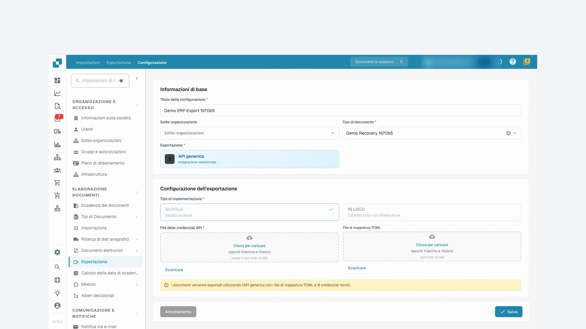<figcaption>
Configurazione di esportazione limitata al tipo di documento di formazione
</figcaption></figure>

Nella mappatura corretta, il campo DocBits invoice_id fornisce il numero di fattura inviato al destinatario di prova. Sono associati anche il fornitore, l’importo totale e la valuta. Questo test controlla i dati di intestazione. Le righe di fattura e la registrazione nell’ERP richiedono verifiche aziendali separate per ogni progetto.

Carico il file TOML corretto e salvo la configurazione. Poi la riapro e verifico che la modifica sia stata salvata. Le credenziali di test restano invariate; quelle di produzione non devono comparire nella registrazione.

Torno alla fattura di test con errore di esportazione e riavvio l'esportazione esattamente una volta. Attendo che il processo sia concluso. La sola accettazione della richiesta non dimostra che la trasmissione sia riuscita.

DocBits mostra ora la fattura come completata. Inoltre, controllo la conferma di ricezione del destinatario di prova. Il numero di fattura, il fornitore, l’importo e la valuta coincidono con la fattura di test. L’autenticazione e la trasmissione sono riuscite. Il destinatario di prova non conferma alcuna registrazione nell’ERP.

<figure>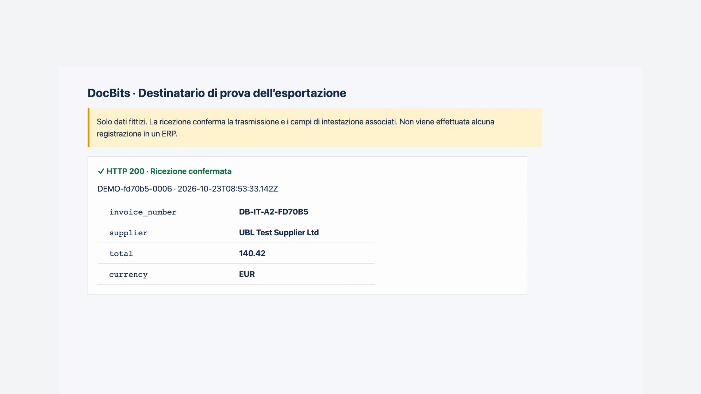<figcaption>
Ricezione effettiva presso il destinatario di test; nessuna registrazione nell’ERP
</figcaption></figure>
