# Exporteren

## Overzicht

De Export-pagina toont alle geconfigureerde exportinstellingen, inclusief of ze actief of inactief zijn. Vanaf hier kunnen gebruikers:

* Bestaande exportconfiguraties bekijken en beheren
* Nieuwe exportverbindingen maken (bijv. naar **Infor**, **Infor & IDM**, **Webhook** of **SFTP**)
* Bestaande exportconfiguraties bewerken of verwijderen

## Waar te vinden

Je kunt het vinden onder: **Instellingen** → **Documentverwerking** → **Exporteren**

<figure>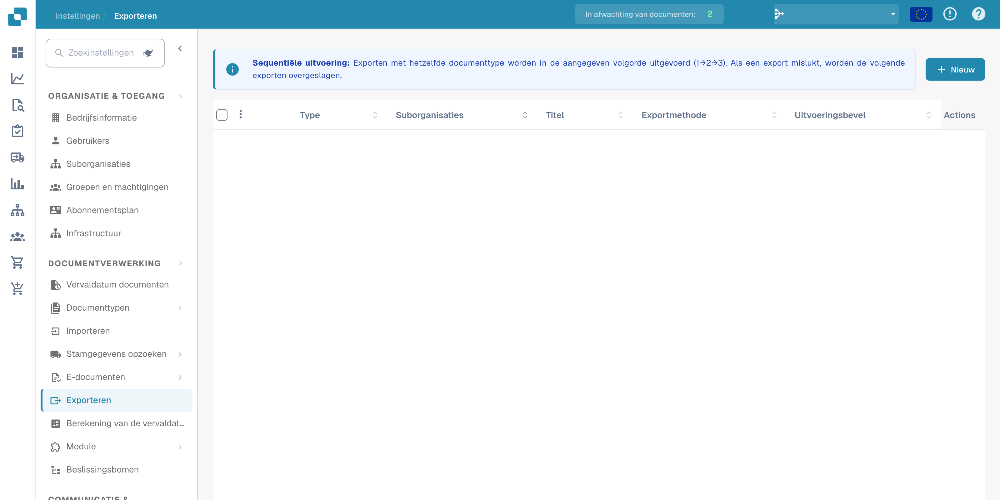<figcaption>
Toegang tot exportconfiguraties vanuit de instellingen.
</figcaption></figure>

## **Gebruik van de Export-pagina**

Wanneer je de Export-pagina opent, zie je een lijst van alle bestaande exportconfiguraties.

Elke rij in de lijst toont:

* **Statusindicator**
  * **Groen** betekent dat de export actief is
  * **Rood** betekent dat de export gedeactiveerd is
* **Naam** – de naam van de exportconfiguratie
* **Documenttype** – het type document waarvoor de export is geconfigureerd
* **Sub-organisatie** – als de export beperkt is tot een specifieke sub-organisatie
* **Exportmethode** – waar het document naartoe wordt gestuurd (bijv. Infor, IDM, SFTP)
* **Acties** – knoppen om de configuratie te **bewerken, verwijderen** of **activeren/deactiveren**

#### **Belangrijke regels voor exportconfiguratie**

Voor elk **documenttype** **binnen een gegeven organisatie of sub-organisatie** gelden de volgende regels:

* Je kunt **slechts één actieve Infor-export** hebben
* Je kunt **slechts één actieve niet-Infor-export** hebben (bijv. Webhook, SFTP)

Het is echter mogelijk om:

* **Eén actieve Infor-export** _en_ **één actieve niet-Infor-export** tegelijkertijd te hebben voor hetzelfde documenttype
* **Verschillende exportconfiguraties voor verschillende sub-organisaties** — bijvoorbeeld een Infor-export voor Sub-Org A en een andere Infor-export voor Sub-Org B

## Activeren vanuit het bewerkscherm

Een bestaande configuratie heeft een schakelaar **Actief** in de voettekst van het bewerkscherm, direct naast **Opslaan**.

1. Open de configuratie om te bewerken (**Bewerken**).
2. Zet de schakelaar **Actief** in de gewenste stand en kies **Opslaan**.

DocBits activeert of deactiveert de configuratie daarna met dezelfde controle als de lijst: is er voor hetzelfde documenttype al een andere configuratie actief, dan wordt activeren geweigerd. Opslaan van het formulier verandert de opgeslagen status niet meer op zichzelf; de schakelaar in de voettekst en de status in de lijst tonen altijd dezelfde stand.

<figure>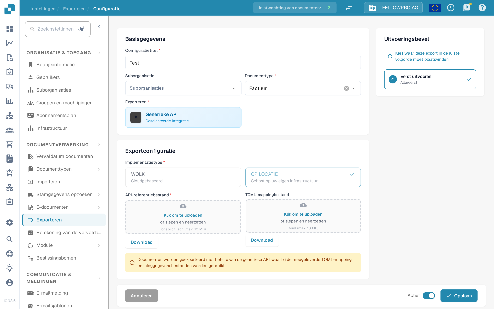<figcaption>
De schakelaar Actief naast Opslaan in het bewerkscherm van de exportconfiguratie.
</figcaption></figure>

## **Een nieuwe export maken**

Om een nieuwe export te maken:

1. Klik op de knop **"Nieuw"**.

<figure>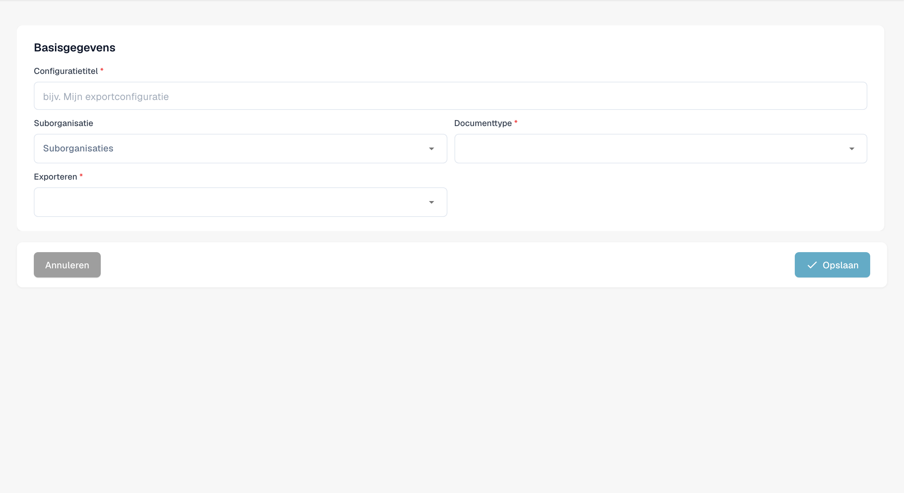<figcaption>
Niet-opgeslagen concept van een exportconfiguratie.
</figcaption></figure>

2. Selecteer het **Exporttype** dat je wilt configureren (bijv. Infor, IDM, SFTP).
3. Vul de vereiste velden in op basis van het exporttype.
4. Sla de configuratie op.

## Exportopties

#### Webhook

Webhook

<figure>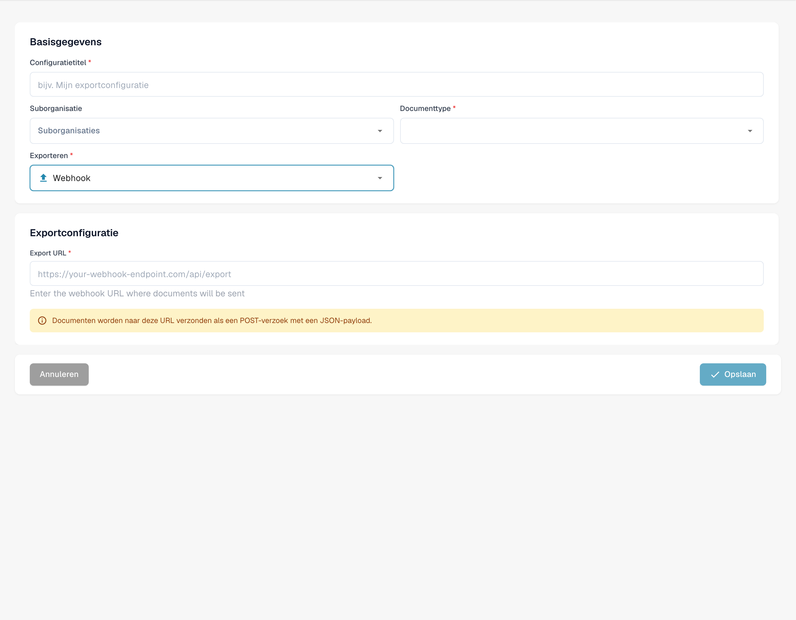<figcaption>
Concept van een exportconfiguratie via Webhook. De toelichting onder Export URL blijft Engelstalig.
</figcaption></figure>

**Veldbeschrijvingen**

* **Titel** De naam van de exportconfiguratie. Dit verschijnt in de exportlijst.
* **Suborganisatie** _(optioneel)_ Een dropdown met alle beschikbare sub-organisaties.
  * Indien leeg gelaten: van toepassing op de hoofdorganisatie.
  * Indien geselecteerd: de export is alleen van toepassing op de gekozen sub-organisatie.
* **Documenttype** Dropdown met alle beschikbare documenttypen. Dit bepaalt op welk type document deze exportconfiguratie van toepassing is.
* **Export URL** De bestemmings-URL waar het document naartoe geëxporteerd moet worden.

#### SFTP

SFTP

<figure>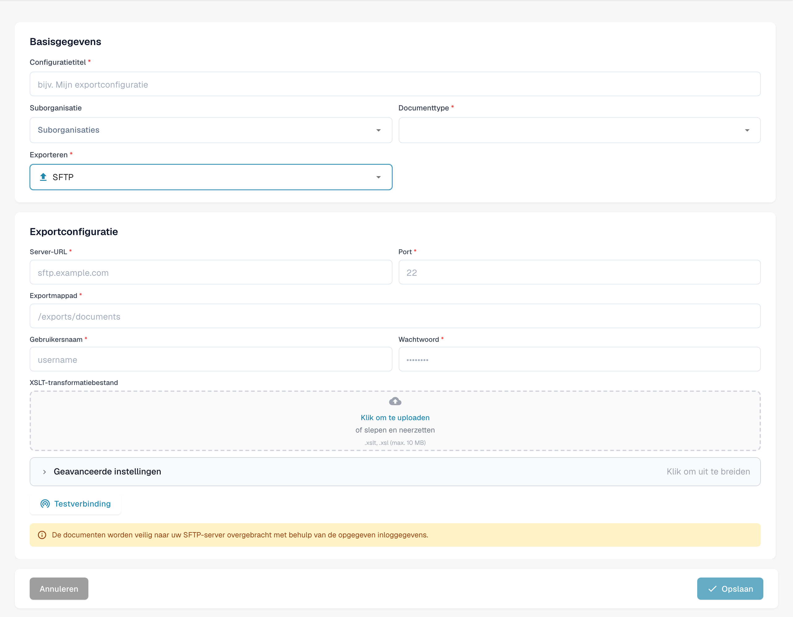<figcaption>
Concept van een exportconfiguratie via SFTP.
</figcaption></figure>

**Veldbeschrijvingen**

* **Titel** De naam van de exportconfiguratie. Dit verschijnt in de exportlijst.
* **Suborganisatie** _(optioneel)_ Een dropdown met alle beschikbare sub-organisaties.
  * Indien leeg gelaten: van toepassing op de hoofdorganisatie.
  * Indien geselecteerd: de export is alleen van toepassing op de gekozen sub-organisatie.
* **Documenttype** Dropdown met alle beschikbare documenttypen. Dit bepaalt op welk type document deze exportconfiguratie van toepassing is.
* **Gebruikersnaam** De gebruikersnaam die wordt gebruikt om te authenticeren tegen de SFTP-server.
* **Wachtwoord** Het bijbehorende wachtwoord voor het SFTP-account. Zorg ervoor dat het account schrijftoegang heeft tot de gespecificeerde map.
* **Server-URL** De hostnaam of het IP-adres van de doel-SFTP-server.
* **Port** De poort die wordt gebruikt om verbinding te maken met de SFTP-server.
* **Map** Het pad op de SFTP-server waar documenten moeten worden geüpload (bijv. `/incoming/invoices/`). Moet bestaan en beschrijfbaar zijn.
*   **XSLT File (Optioneel)**

    Het **XSLT-bestand** maakt transformatie van het standaard DocBits-exportformaat mogelijk.

    * **Wanneer te gebruiken:** Alleen als het ontvangende systeem een andere structuur of specifieke opmaak vereist die verschilt van de standaard van DocBits.
    * **Laat het leeg** als het standaard exportformaat voldoet aan de vereisten.

**Geavanceerde instellingen:**

* **Bestandsnaam Exportmodus** Specificeert of het geëxporteerde bestand zijn oorspronkelijke bestandsnaam behoudt of wordt hernoemd met het DocBits document-ID.
* **Documentgeschiedenis opnemen** Wanneer ingeschakeld, bevat het geëxporteerde bestand de documentgeschiedenis gebaseerd op de logs beschikbaar in het dashboard.

<figure>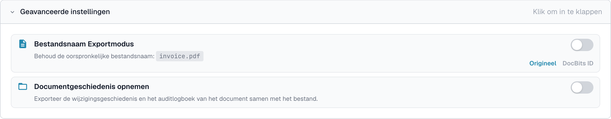<figcaption>
Niet-opgeslagen geavanceerde SFTP-exportopties.
</figcaption></figure>

#### Infor Export naar SFTP

Infor Export naar SFTP

<figure>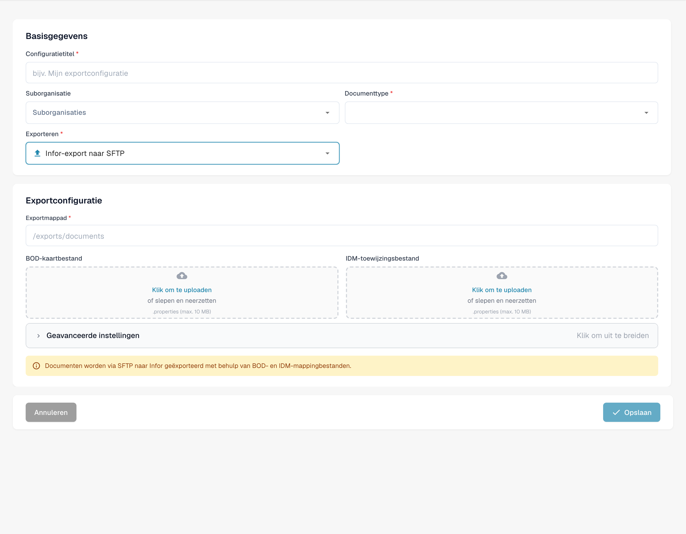<figcaption>
Exportconcept via Infor SFTP.
</figcaption></figure>

**Veldbeschrijvingen**

* **Titel** De naam van de exportconfiguratie. Dit verschijnt in de exportlijst.
* **Suborganisatie** _(optioneel)_ Een dropdown met alle beschikbare sub-organisaties.
  * Indien leeg gelaten: van toepassing op de hoofdorganisatie.
  * Indien geselecteerd: de export is alleen van toepassing op de gekozen sub-organisatie.
* **Documenttype** Dropdown met alle beschikbare documenttypen. Dit bepaalt op welk type document deze exportconfiguratie van toepassing is.
* **IDM-toewijzingsbestand** Selecteer een mapping-bestand uit de bestandsbeheerder. [Hulp nodig bij het maken? Bekijk de IDM Mapping Gids](../../../infor-integration-and-configuration/exporting-to-infor/creating-an-idm-mapping-file.md)
* **BOD-kaartbestand** Selecteer een mapping-bestand uit de bestandsbeheerder. [Hulp nodig bij het maken? Bekijk de BOD Mapping Gids](../../../infor-integration-and-configuration/exporting-to-infor/creating-a-bod-mapping-file.md)
* **Map** Het pad op de SFTP-server waar documenten moeten worden geüpload (bijv. `/incoming/invoices/`). Moet bestaan en beschrijfbaar zijn.

#### **SMB**

SMB

<figure>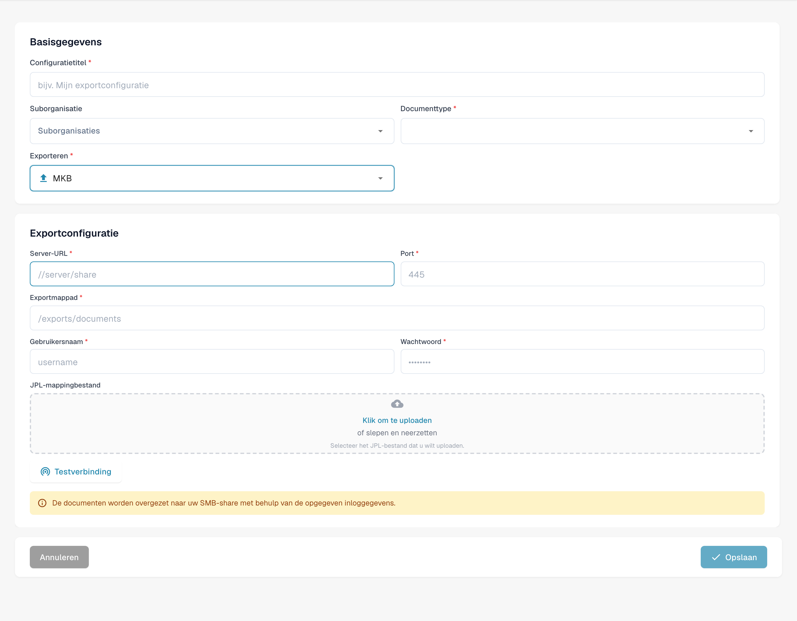<figcaption>
Exportconcept via SMB; het bedoelde protocol behouden. MKB is hier een onjuiste productvertaling van het protocol SMB.
</figcaption></figure>

**Veldbeschrijvingen**

* **Titel** De naam van de exportconfiguratie. Dit verschijnt in de exportlijst.
* **Suborganisatie** _(optioneel)_ Een dropdown met alle beschikbare sub-organisaties.
  * Indien leeg gelaten: van toepassing op de hoofdorganisatie.
  * Indien geselecteerd: de export is alleen van toepassing op de gekozen sub-organisatie.
* **Documenttype** Dropdown met alle beschikbare documenttypen. Dit bepaalt op welk type document deze exportconfiguratie van toepassing is.
* **Gebruikersnaam** De gebruikersnaam die wordt gebruikt om verbinding te maken met de SMB-share.
* **Wachtwoord** Het bijbehorende wachtwoord voor SMB-authenticatie.
* **Server-URL** Het adres van de SMB-server.
* **Port** Poortnummer dat wordt gebruikt om toegang te krijgen tot de SMB-share.
* **Map** Het mappad binnen de SMB-share waar documenten moeten worden opgeslagen (bijv. `/incoming/invoices/`). Moet bestaan en beschrijfbaar zijn.
*   **JPL Mapping File (Optioneel)**

    Het **JPL-bestand** wordt gebruikt om een transformatie van de geëxporteerde gegevens te definiëren voordat deze naar de SMB-share worden geschreven.

    * **Wanneer te gebruiken:** Alleen wanneer de geëxporteerde documentgegevens moeten worden aangepast om overeen te komen met externe opmaak of systeemverwachtingen.
    * **Laat het leeg** als er geen transformatie nodig is.

#### **Infor IDM**

Infor IDM

<figure>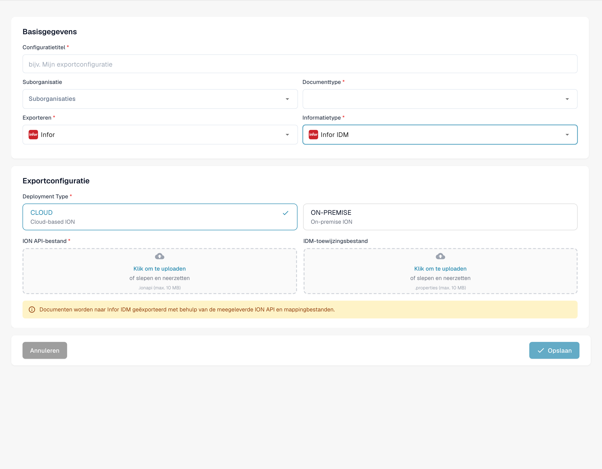<figcaption>
Exportconcept naar Infor IDM.
</figcaption></figure>

**Veldbeschrijvingen**

* **Titel** De naam van de exportconfiguratie. Dit verschijnt in de exportlijst.
* **Suborganisatie** _(optioneel)_ Een dropdown met alle beschikbare sub-organisaties.
  * Indien leeg gelaten: van toepassing op de hoofdorganisatie.
  * Indien geselecteerd: de export is alleen van toepassing op de gekozen sub-organisatie.
* **Documenttype** Dropdown met alle beschikbare documenttypen. Dit bepaalt op welk type document deze exportconfiguratie van toepassing is.
* **ION-toewijzingsbestand** Selecteer een mapping-bestand uit de bestandsbeheerder.
* **IDM-toewijzingsbestand** Selecteer een mapping-bestand uit de bestandsbeheerder. [Hulp nodig bij het maken? Bekijk de IDM Mapping Gids](../../../infor-integration-and-configuration/exporting-to-infor/creating-an-idm-mapping-file.md)
* **Cloud / On-Prem Toggle** Een schakelaar om het Infor-implementatietype aan te geven:
  * **Cloudimplementatie**: Selecteer dit als je een Infor CloudSuite-klant bent.
  * **On-Prem**: Selecteer dit als Infor zelf gehost is.

#### **Infor ION**

Infor ION

<figure>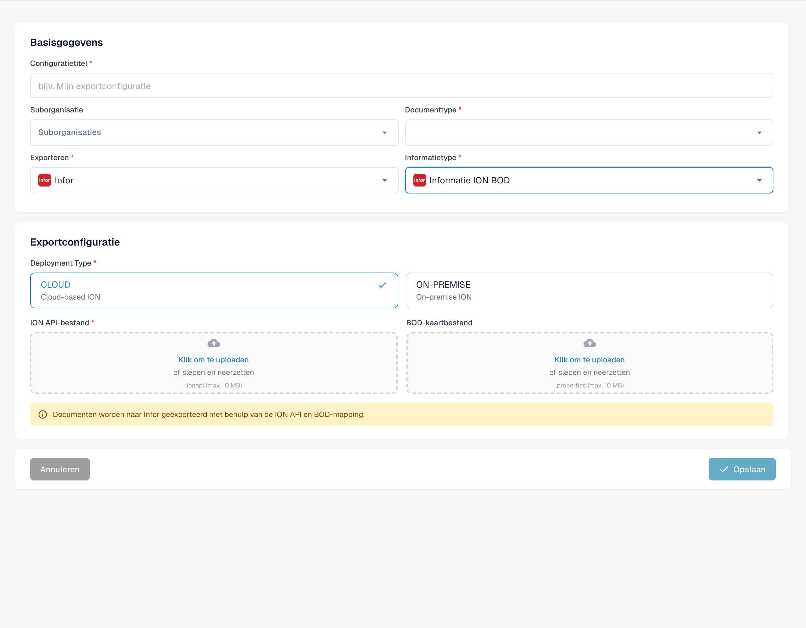<figcaption>
Exportconcept naar Infor ION. Informatie ION BOD verwijst naar Infor ION BOD.
</figcaption></figure>

**Veldbeschrijvingen**

* **Titel** De naam van de exportconfiguratie. Dit verschijnt in de exportlijst.
* **Suborganisatie** _(optioneel)_ Een dropdown met alle beschikbare sub-organisaties.
  * Indien leeg gelaten: van toepassing op de hoofdorganisatie.
  * Indien geselecteerd: de export is alleen van toepassing op de gekozen sub-organisatie.
* **Documenttype** Dropdown met alle beschikbare documenttypen. Dit bepaalt op welk type document deze exportconfiguratie van toepassing is.
* **ION-toewijzingsbestand** Selecteer een mapping-bestand uit de bestandsbeheerder.
* **BOD-kaartbestand** Selecteer een mapping-bestand uit de bestandsbeheerder. [Hulp nodig bij het maken? Bekijk de BOD Mapping Gids](../../../infor-integration-and-configuration/exporting-to-infor/creating-a-bod-mapping-file.md)
* **Cloud / On-Prem Toggle** Een schakelaar om het Infor-implementatietype aan te geven:
  * **Cloudimplementatie**: Selecteer dit als je een Infor CloudSuite-klant bent.
  * **On-Prem**: Selecteer dit als Infor zelf gehost is.

#### Infor IDM + ION BOD

Infor IDM + ION BOD

<figure>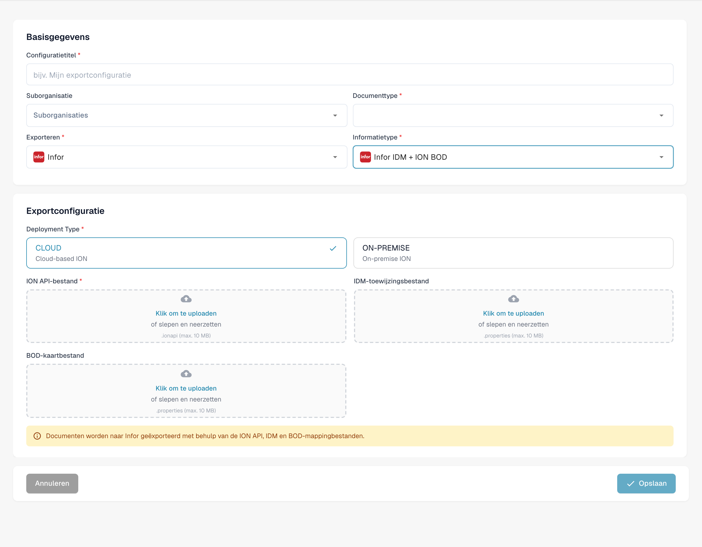<figcaption>
Exportconcept naar Infor IDM ION BOD.
</figcaption></figure>

**Veldbeschrijvingen**

* **Titel** De naam van de exportconfiguratie. Dit verschijnt in de exportlijst.
* **Suborganisatie** _(optioneel)_ Een dropdown met alle beschikbare sub-organisaties.
  * Indien leeg gelaten: van toepassing op de hoofdorganisatie.
  * Indien geselecteerd: de export is alleen van toepassing op de gekozen sub-organisatie.
* **Documenttype** Dropdown met alle beschikbare documenttypen. Dit bepaalt op welk type document deze exportconfiguratie van toepassing is.
* **ION-toewijzingsbestand** Selecteer een mapping-bestand uit de bestandsbeheerder.
* **IDM-toewijzingsbestand** Selecteer een mapping-bestand uit de bestandsbeheerder. [Hulp nodig bij het maken? Bekijk de IDM Mapping Gids](../../../infor-integration-and-configuration/exporting-to-infor/creating-an-idm-mapping-file.md)
* **BOD-kaartbestand** Selecteer een mapping-bestand uit de bestandsbeheerder. [Hulp nodig bij het maken? Bekijk de BOD Mapping Gids](../../../infor-integration-and-configuration/exporting-to-infor/creating-a-bod-mapping-file.md)
* **Cloud / On-Prem Toggle** Een schakelaar om het Infor-implementatietype aan te geven:
  * **Cloudimplementatie**: Selecteer dit als je een Infor CloudSuite-klant bent.
  * **On-Prem**: Selecteer dit als Infor zelf gehost is.

### Voor Infor CloudSuite-klanten

#### Infor IDM + LN

Infor IDM + LN

<figure>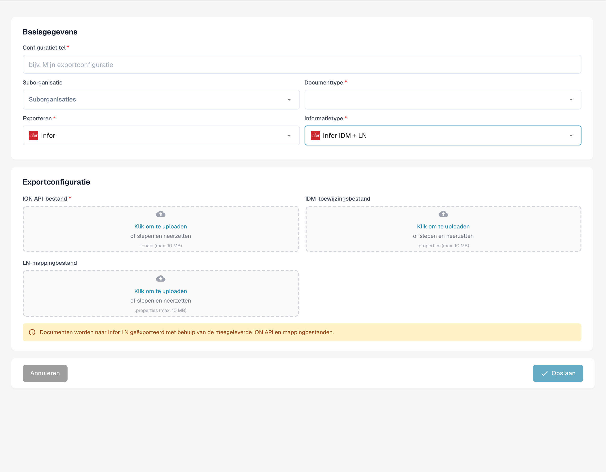<figcaption>
Exportconcept naar Infor IDM LN.
</figcaption></figure>

**Veldbeschrijvingen**

* **Titel** De naam van de exportconfiguratie. Dit verschijnt in de exportlijst.
* **Suborganisatie** _(optioneel)_ Een dropdown met alle beschikbare sub-organisaties.
  * Indien leeg gelaten: van toepassing op de hoofdorganisatie.
  * Indien geselecteerd: de export is alleen van toepassing op de gekozen sub-organisatie.
* **Documenttype** Dropdown met alle beschikbare documenttypen. Dit bepaalt op welk type document deze exportconfiguratie van toepassing is.
* **ION-toewijzingsbestand** Selecteer een mapping-bestand uit de bestandsbeheerder.
* **IDM-toewijzingsbestand** Selecteer een mapping-bestand uit de bestandsbeheerder. [Hulp nodig bij het maken? Bekijk de IDM Mapping Gids](../../../infor-integration-and-configuration/exporting-to-infor/creating-an-idm-mapping-file.md)
* **LN-mappingbestand** Selecteer een mapping-bestand uit de bestandsbeheerder. [Hulp nodig bij het maken? Bekijk het LN Mapping Voorbeeld](../../../infor-integration-and-configuration/exporting-to-infor/ln/example-export-ln/)

#### Infor IDM + M3

Infor IDM + M3

<figure>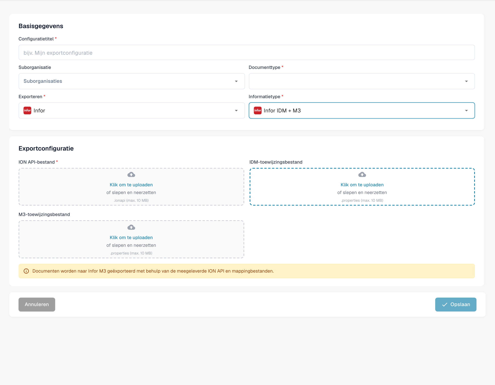<figcaption>
Exportconcept naar Infor IDM M3.
</figcaption></figure>

**Veldbeschrijvingen**

* **Titel** De naam van de exportconfiguratie. Dit verschijnt in de exportlijst.
* **Suborganisatie** _(optioneel)_ Een dropdown met alle beschikbare sub-organisaties.
  * Indien leeg gelaten: van toepassing op de hoofdorganisatie.
  * Indien geselecteerd: de export is alleen van toepassing op de gekozen sub-organisatie.
* **Documenttype** Dropdown met alle beschikbare documenttypen. Dit bepaalt op welk type document deze exportconfiguratie van toepassing is.
* **ION-toewijzingsbestand** Selecteer een mapping-bestand uit de bestandsbeheerder.
* **IDM-toewijzingsbestand** Selecteer een mapping-bestand uit de bestandsbeheerder. [Hulp nodig bij het maken? Bekijk de IDM Mapping Gids](../../../infor-integration-and-configuration/exporting-to-infor/creating-an-idm-mapping-file.md)
* **M3-toewijzingsbestand** Selecteer een mapping-bestand uit de bestandsbeheerder. [Hulp nodig bij het maken? Bekijk het M3 Mapping Voorbeeld](../../../infor-integration-and-configuration/exporting-to-infor/m3/example-export-m3.md)

#### Infor IDM + M3 (toml)

Infor IDM + M3 (toml)

<figure>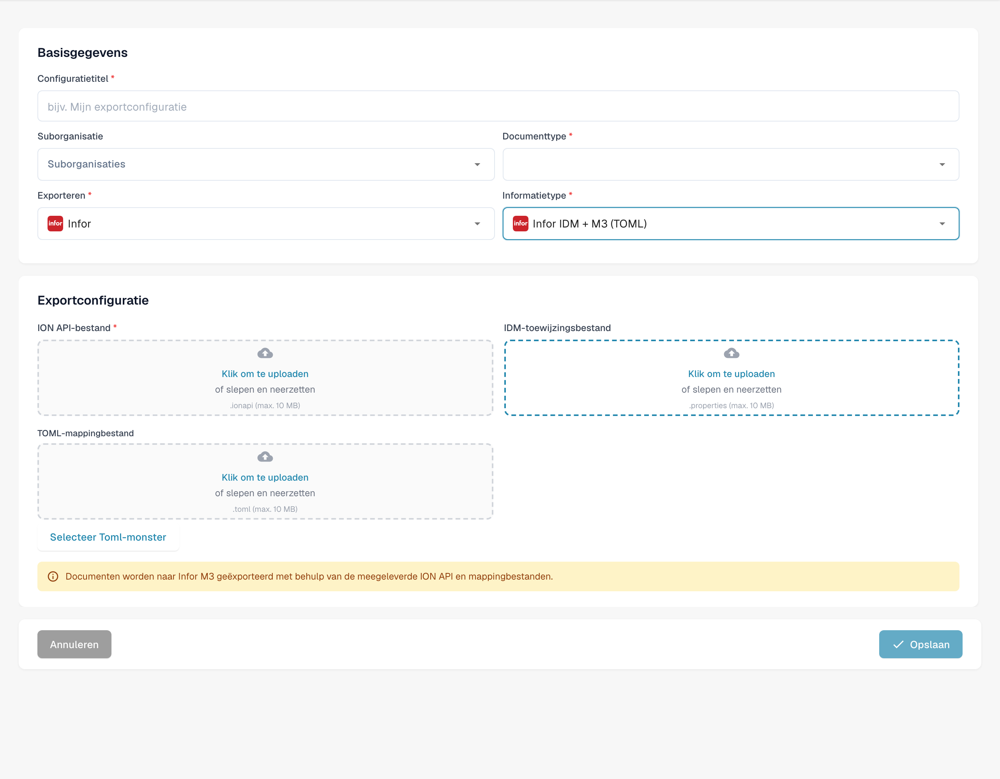<figcaption>
Exportconcept naar Infor IDM M3 met TOML.
</figcaption></figure>

**Veldbeschrijvingen**

* **Titel** De naam van de exportconfiguratie. Dit verschijnt in de exportlijst.
* **Suborganisatie** _(optioneel)_ Een dropdown met alle beschikbare sub-organisaties.
  * Indien leeg gelaten: van toepassing op de hoofdorganisatie.
  * Indien geselecteerd: de export is alleen van toepassing op de gekozen sub-organisatie.
* **Documenttype** Dropdown met alle beschikbare documenttypen. Dit bepaalt op welk type document deze exportconfiguratie van toepassing is.
* **ION-toewijzingsbestand** Selecteer een mapping-bestand uit de bestandsbeheerder.
* **IDM-toewijzingsbestand** Selecteer een mapping-bestand uit de bestandsbeheerder. [Hulp nodig bij het maken? Bekijk de IDM Mapping Gids](../../../infor-integration-and-configuration/exporting-to-infor/creating-an-idm-mapping-file.md)
* **M3-TOML-toewijzingsbestand** Selecteer een mapping-bestand uit de bestandsbeheerder of gebruik de optie Toml selecteren om een toml te gebruiken die is gemaakt met de regelbeheerder. [Hulp nodig bij het maken? Bekijk de Rule Manager Gids](rule-manager/)

## Videohandleiding: ERP-export instellen en testen


ERP-export instellen en testen


[Bekijken met ondertiteling en hoofdstukken](https://docbits-videos.fra1.cdn.digitaloceanspaces.com/settings-assistant/erp-export-admin/v1/nl.html)

Sommige oorspronkelijke productlabels kunnen in een andere taal staan. Technische veld-ID’s blijven behouden.

Ik gebruik een eigen testconfiguratie en documenttype. De facturen bevatten fictieve gegevens. Onze testontvanger controleert de gegevensoverdracht. Er vindt geen boeking plaats in een ERP-productieomgeving. Ik wijzig de andere integraties niet.

In de exportconfiguratie controleer ik het documenttype, de organisatie en het exporttype. Dit voorbeeld gebruikt Generic API in de cloud. Een JSON-bestand bevat de inloggegevens; het TOML-bestand bepaalt de veldmapping. In echte projecten moeten het doelsysteem, de rechten en de suborganisatie passen bij het beoogde proces.

<figure>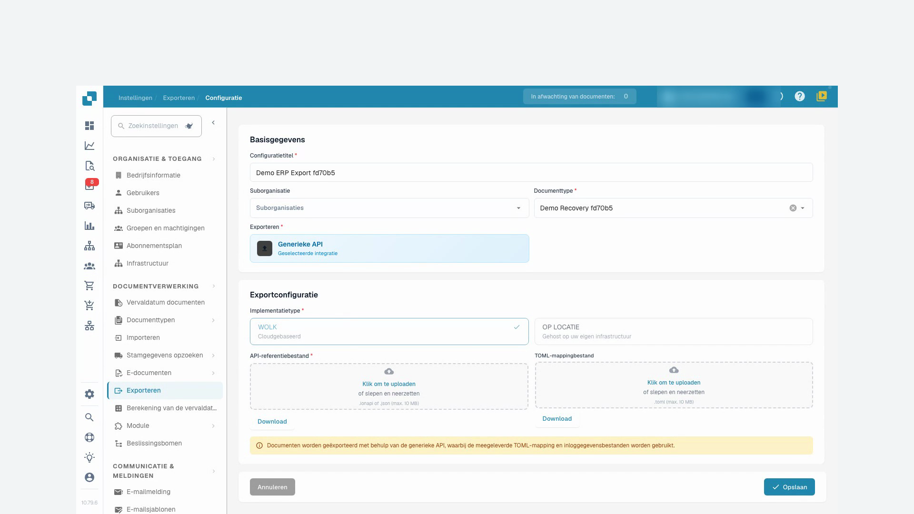<figcaption>
Exportconfiguratie voor het trainingsdocumenttype
</figcaption></figure>

In de gecorrigeerde mapping levert het DocBits-veld invoice_id het factuurnummer voor de testontvanger. Ook leverancier, totaalbedrag en valuta zijn gekoppeld. Deze test controleert de kopgegevens. Factuurregels en ERP-boekingen vragen afzonderlijke controles binnen het eigen project.

Ik upload het gecorrigeerde TOML-bestand en sla de configuratie op. Daarna open ik de configuratie opnieuw en controleer ik of de wijziging is opgeslagen. De testinloggegevens blijven gelijk; inloggegevens uit de productieomgeving horen niet in de opname.

Nu ga ik terug naar de testfactuur waarvan de export is mislukt en start ik de export precies één keer opnieuw. Ik wacht tot de verwerking is afgerond. Een geaccepteerd verzoek alleen bewijst nog niet dat de overdracht is geslaagd.

DocBits toont de factuur nu als voltooid. Daarnaast controleer ik het ontvangstbewijs van onze testontvanger. Factuurnummer, leverancier, bedrag en valuta komen overeen met de testfactuur. De authenticatie en overdracht zijn geslaagd. De testontvanger bevestigt geen ERP-boeking.

<figure>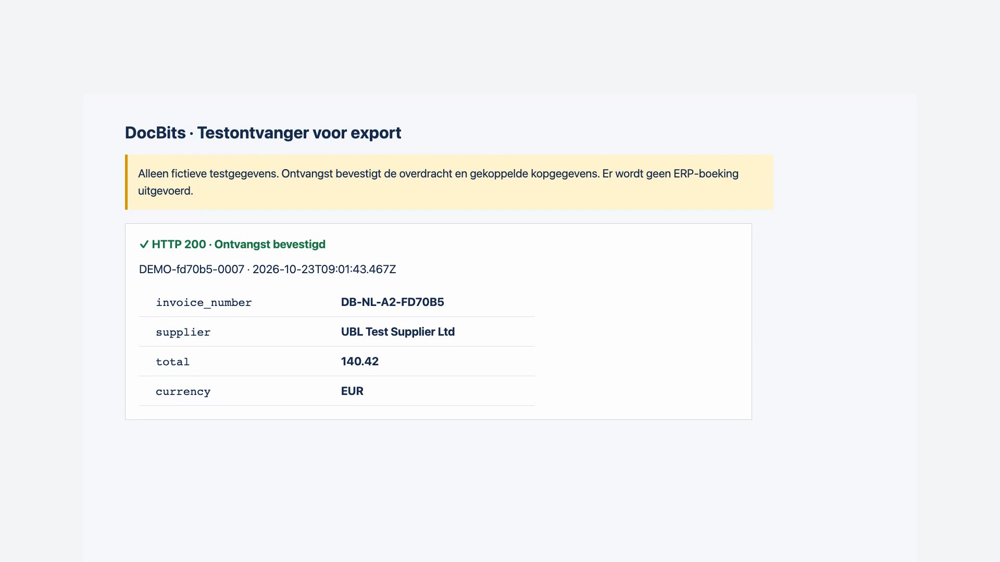<figcaption>
Werkelijke ontvangst bij de testontvanger; geen ERP-boeking
</figcaption></figure>
