# Eksport

## Przegląd

Strona Eksport wyświetla wszystkie skonfigurowane ustawienia eksportu, w tym informację czy są aktywne czy nieaktywne. Stąd użytkownicy mogą:

* Przeglądać i zarządzać istniejącymi konfiguracjami eksportu
* Tworzyć nowe połączenia eksportu (np. do **Infor**, **Infor & IDM**, **Webhook** lub **SFTP**)
* Edytować lub usuwać istniejące konfiguracje eksportu

## Gdzie znaleźć

Możesz to znaleźć w: **Ustawienia** → **Przetwarzanie dokumentów** → **Eksport**

<figure>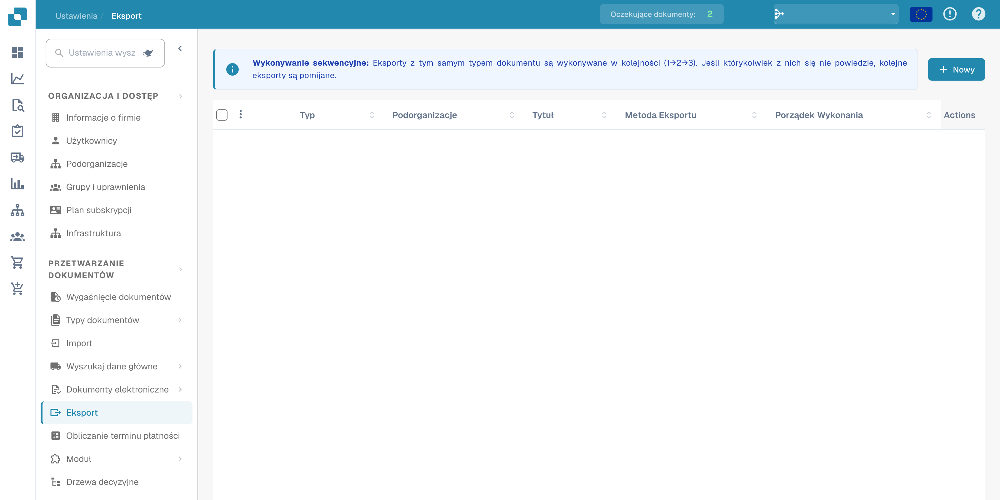<figcaption>
Dostęp do konfiguracji eksportu z ustawień.
</figcaption></figure>

## **Korzystanie ze strony Eksportu**

Po otwarciu strony Eksport zobaczysz listę wszystkich istniejących konfiguracji eksportu.

Każdy wiersz na liście pokazuje:

* **Wskaźnik statusu**
  * **Zielony** oznacza, że eksport jest aktywny
  * **Czerwony** oznacza, że eksport jest dezaktywowany
* **Nazwa** – nazwa konfiguracji eksportu
* **Typ dokumentu** – typ dokumentu, dla którego skonfigurowano eksport
* **Podorganizacja** – jeśli eksport jest ograniczony do określonej podorganizacji
* **Metoda eksportu** – gdzie dokument zostanie wysłany (np. Infor, IDM, SFTP)
* **Akcje** – przyciski do **edycji, usuwania** lub **aktywowania/dezaktywowania** konfiguracji

#### **Ważne zasady konfiguracji eksportu**

Dla każdego **typu dokumentu** **w ramach danej organizacji lub podorganizacji** obowiązują następujące zasady:

* Możesz mieć **tylko jeden aktywny eksport Infor**
* Możesz mieć **tylko jeden aktywny eksport nie-Infor** (np. Webhook, SFTP)

Jednak możliwe jest posiadanie:

* **Jednego aktywnego eksportu Infor** _i_ **jednego aktywnego eksportu nie-Infor** jednocześnie dla tego samego typu dokumentu
* **Różnych konfiguracji eksportu dla różnych podorganizacji** — na przykład jeden eksport Infor dla Pod-Org A i inny eksport Infor dla Pod-Org B

## **Tworzenie nowego eksportu**

Aby utworzyć nowy eksport:

1. Kliknij przycisk **"Nowy"**.

<figure>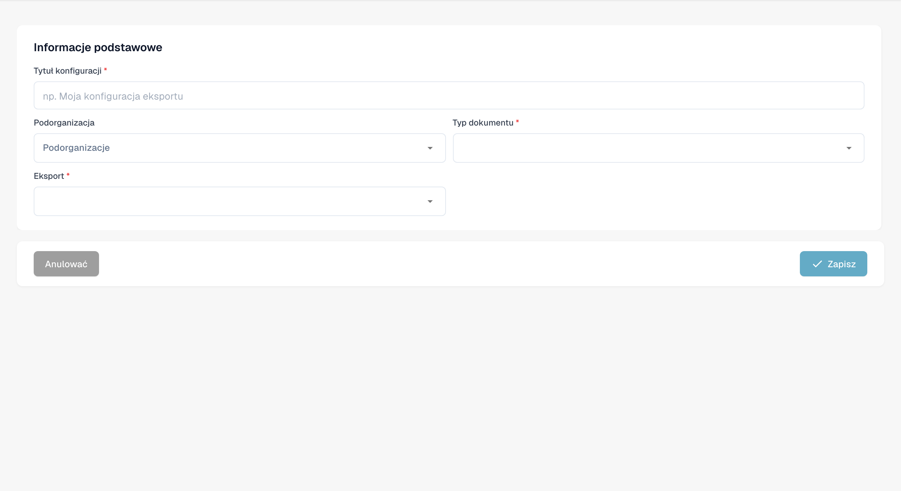<figcaption>
Niezapisany projekt konfiguracji eksportu.
</figcaption></figure>

2. Wybierz **Typ eksportu**, który chcesz skonfigurować (np. Infor, IDM, SFTP).
3. Wypełnij wymagane pola w zależności od typu eksportu.
4. Zapisz konfigurację.

## Opcje eksportu

#### Webhook

Webhook

<figure>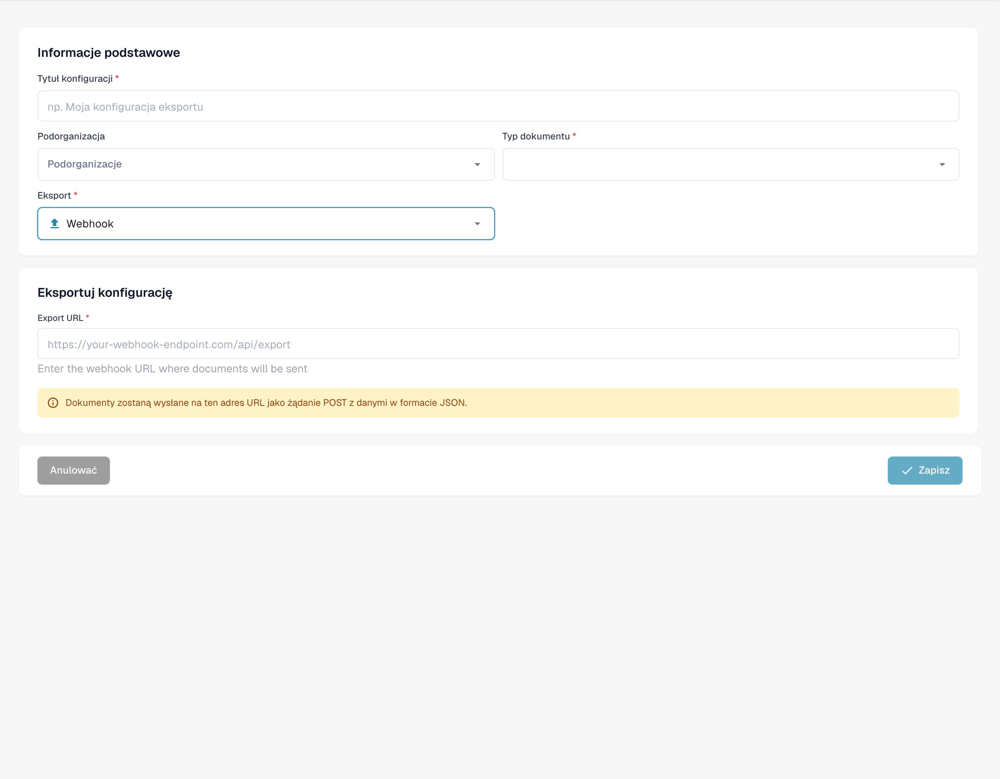<figcaption>
Projekt konfiguracji eksportu przez Webhook. Tekst pomocniczy adresu Webhook pozostaje angielski.
</figcaption></figure>

**Opisy pól**

* **Tytuł** Nazwa konfiguracji eksportu. Pojawi się na liście eksportów.
* **Podorganizacja** _(opcjonalnie)_ Lista rozwijana ze wszystkimi dostępnymi podorganizacjami.
  * Jeśli pozostawione puste: dotyczy głównej organizacji.
  * Jeśli wybrane: eksport będzie dotyczył tylko wybranej podorganizacji.
* **Typ dokumentu** Lista rozwijana zawierająca wszystkie dostępne typy dokumentów. Określa, do jakiego typu dokumentu odnosi się ta konfiguracja eksportu.
* **Export URL** Docelowy URL, gdzie dokument powinien zostać wyeksportowany.

#### SFTP

SFTP

<figure>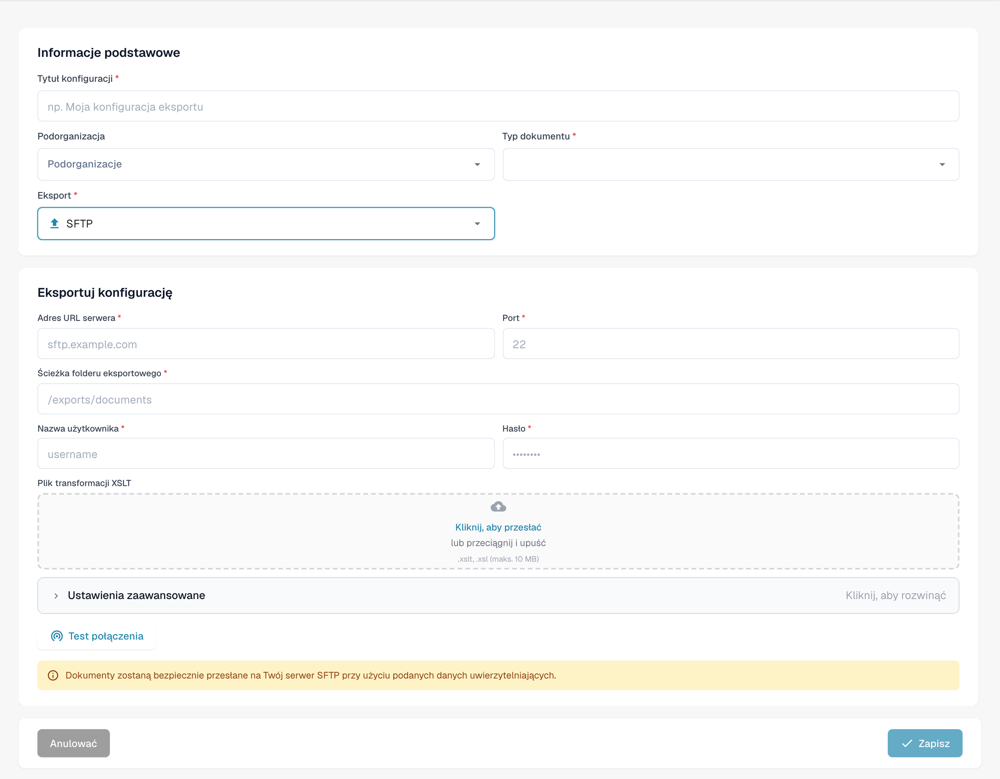<figcaption>
Projekt konfiguracji eksportu przez SFTP.
</figcaption></figure>

**Opisy pól**

* **Tytuł** Nazwa konfiguracji eksportu. Pojawi się na liście eksportów.
* **Podorganizacja** _(opcjonalnie)_ Lista rozwijana ze wszystkimi dostępnymi podorganizacjami.
  * Jeśli pozostawione puste: dotyczy głównej organizacji.
  * Jeśli wybrane: eksport będzie dotyczył tylko wybranej podorganizacji.
* **Typ dokumentu** Lista rozwijana zawierająca wszystkie dostępne typy dokumentów. Określa, do jakiego typu dokumentu odnosi się ta konfiguracja eksportu.
* **Nazwa użytkownika** Nazwa użytkownika używana do uwierzytelniania na serwerze SFTP.
* **Hasło** Odpowiednie hasło do konta SFTP. Upewnij się, że konto ma dostęp do zapisu w określonym folderze.
* **Adres URL serwera** Nazwa hosta lub adres IP docelowego serwera SFTP.
* **Port** Port używany do połączenia z serwerem SFTP.
* **Falcówka** Ścieżka na serwerze SFTP, gdzie dokumenty powinny być przesyłane (np. `/incoming/invoices/`). Musi istnieć i być zapisywalny.
*   **XSLT File (Opcjonalnie)**

    **Plik XSLT** umożliwia transformację domyślnego formatu eksportu DocBits.

    * **Kiedy używać:** Tylko jeśli system odbierający wymaga innej struktury lub specyficznego formatowania, które różni się od domyślnego formatu DocBits.
    * **Pozostaw puste** jeśli domyślny format eksportu spełnia wymagania.

**Ustawienia zaawansowane:**

* **Tryb eksportu nazwy pliku** Określa, czy wyeksportowany plik zachowuje oryginalną nazwę pliku, czy jest zmieniany na ID dokumentu DocBits.
* **Uwzględnij historię dokumentu** Po włączeniu wyeksportowany plik będzie zawierał historię dokumentu na podstawie logów dostępnych w panelu.

<figure>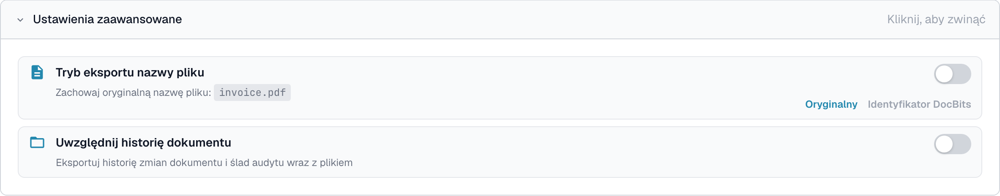<figcaption>
Niezapisane zaawansowane opcje eksportu SFTP.
</figcaption></figure>

#### Eksport Infor do SFTP

Eksport Infor do SFTP

<figure>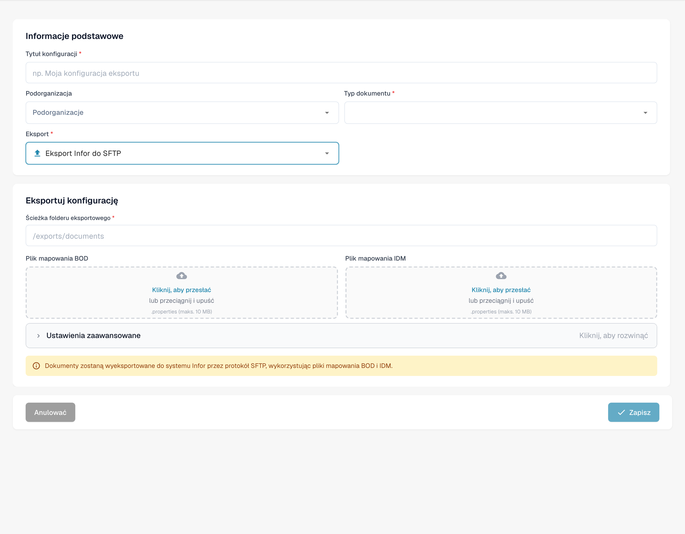<figcaption>
Projekt eksportu przez Infor SFTP.
</figcaption></figure>

**Opisy pól**

* **Tytuł** Nazwa konfiguracji eksportu. Pojawi się na liście eksportów.
* **Podorganizacja** _(opcjonalnie)_ Lista rozwijana ze wszystkimi dostępnymi podorganizacjami.
  * Jeśli pozostawione puste: dotyczy głównej organizacji.
  * Jeśli wybrane: eksport będzie dotyczył tylko wybranej podorganizacji.
* **Typ dokumentu** Lista rozwijana zawierająca wszystkie dostępne typy dokumentów. Określa, do jakiego typu dokumentu odnosi się ta konfiguracja eksportu.
* **Plik mapowania IDM** Wybierz plik mapowania z menedżera plików. [Potrzebujesz pomocy przy tworzeniu? Zobacz Przewodnik Mapowania IDM](../../../infor-integration-and-configuration/exporting-to-infor/creating-an-idm-mapping-file.md)
* **Plik mapowania BOD** Wybierz plik mapowania z menedżera plików. [Potrzebujesz pomocy przy tworzeniu? Zobacz Przewodnik Mapowania BOD](../../../infor-integration-and-configuration/exporting-to-infor/creating-a-bod-mapping-file.md)
* **Falcówka** Ścieżka na serwerze SFTP, gdzie dokumenty powinny być przesyłane (np. `/incoming/invoices/`). Musi istnieć i być zapisywalny.

#### **SMB**

SMB

<figure>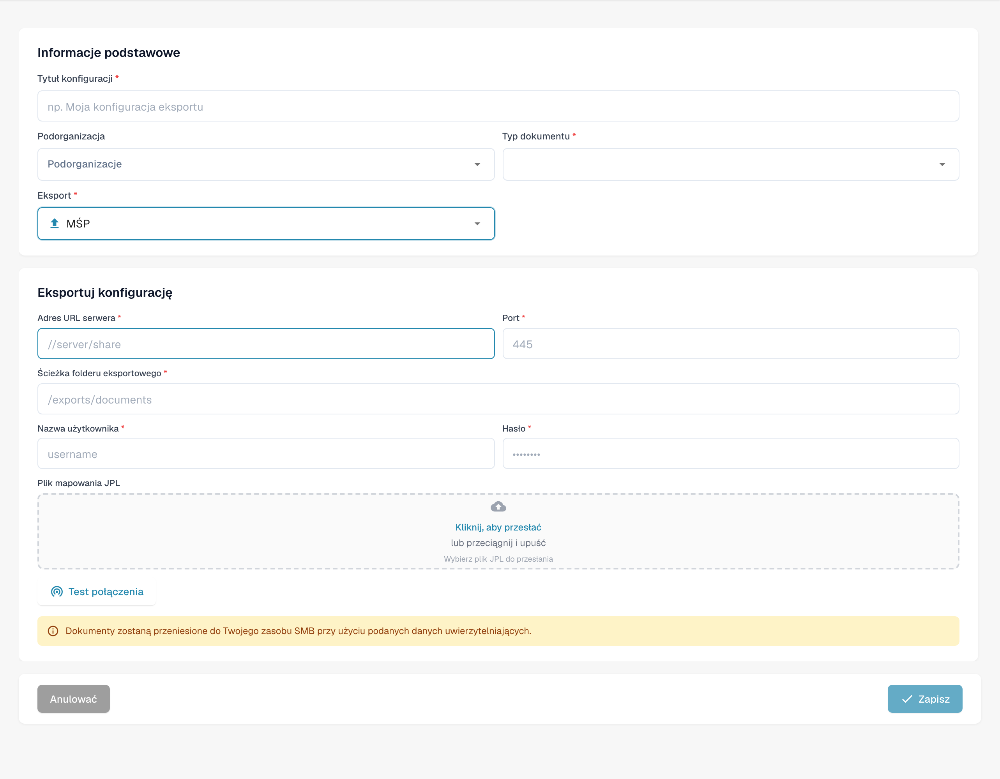<figcaption>
Projekt eksportu przez SMB z zachowaniem właściwego protokołu. Błędna etykieta MŚP oznacza tutaj protokół SMB; nie zmieniaj nazwy protokołu.
</figcaption></figure>

**Opisy pól**

* **Tytuł** Nazwa konfiguracji eksportu. Pojawi się na liście eksportów.
* **Podorganizacja** _(opcjonalnie)_ Lista rozwijana ze wszystkimi dostępnymi podorganizacjami.
  * Jeśli pozostawione puste: dotyczy głównej organizacji.
  * Jeśli wybrane: eksport będzie dotyczył tylko wybranej podorganizacji.
* **Typ dokumentu** Lista rozwijana zawierająca wszystkie dostępne typy dokumentów. Określa, do jakiego typu dokumentu odnosi się ta konfiguracja eksportu.
* **Nazwa użytkownika** Nazwa użytkownika używana do połączenia z udziałem SMB.
* **Hasło** Odpowiednie hasło do uwierzytelniania SMB.
* **Adres URL serwera** Adres serwera SMB.
* **Port** Numer portu używany do dostępu do udziału SMB.
* **Falcówka** Ścieżka folderu w udziale SMB, gdzie dokumenty powinny być zapisywane (np. `/incoming/invoices/`). Musi istnieć i być zapisywalny.
*   **JPL Mapping File (Opcjonalnie)**

    **Plik JPL** służy do definiowania transformacji eksportowanych danych przed ich zapisaniem w udziale SMB.

    * **Kiedy używać:** Tylko gdy eksportowane dane dokumentu muszą być dostosowane do zewnętrznego formatowania lub oczekiwań systemu.
    * **Pozostaw puste** jeśli nie jest wymagana żadna transformacja.

#### **Infor IDM**

Infor IDM

<figure>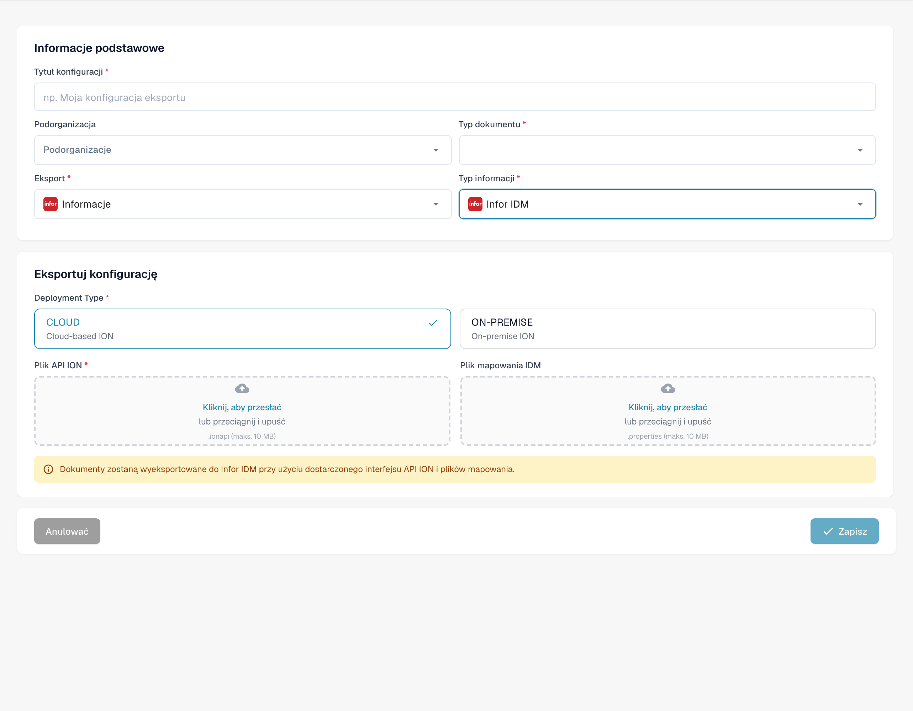<figcaption>
Projekt eksportu do Infor IDM. Etykieta Informacje oznacza tutaj markę Infor; nazwy Infor, ION, IDM, LN i M3 pozostają niezmienione. Deployment Type pozostaje angielskie tam, gdzie występuje.
</figcaption></figure>

**Opisy pól**

* **Tytuł** Nazwa konfiguracji eksportu. Pojawi się na liście eksportów.
* **Podorganizacja** _(opcjonalnie)_ Lista rozwijana ze wszystkimi dostępnymi podorganizacjami.
  * Jeśli pozostawione puste: dotyczy głównej organizacji.
  * Jeśli wybrane: eksport będzie dotyczył tylko wybranej podorganizacji.
* **Typ dokumentu** Lista rozwijana zawierająca wszystkie dostępne typy dokumentów. Określa, do jakiego typu dokumentu odnosi się ta konfiguracja eksportu.
* **Plik mapowania ION** Wybierz plik mapowania z menedżera plików.
* **Plik mapowania IDM** Wybierz plik mapowania z menedżera plików. [Potrzebujesz pomocy przy tworzeniu? Zobacz Przewodnik Mapowania IDM](../../../infor-integration-and-configuration/exporting-to-infor/creating-an-idm-mapping-file.md)
* **Cloud / On-Prem Toggle** Przełącznik wskazujący typ wdrożenia Infor:
  * **Wdrożenie w chmurze**: Wybierz to, jeśli jesteś klientem Infor CloudSuite.
  * **On-Prem**: Wybierz to, jeśli Infor jest hostowany samodzielnie.

#### **Infor ION**

Infor ION

<figure>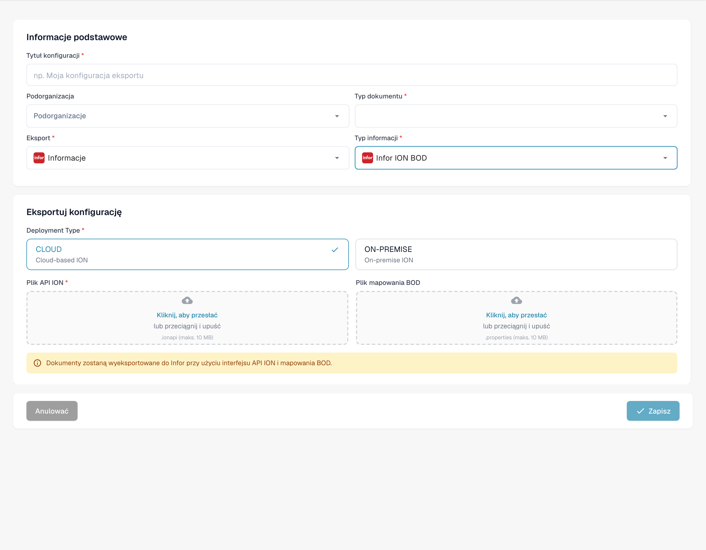<figcaption>
Projekt eksportu do Infor ION. Etykieta Informacje oznacza tutaj markę Infor; nazwy Infor, ION, IDM, LN i M3 pozostają niezmienione. Deployment Type pozostaje angielskie tam, gdzie występuje.
</figcaption></figure>

**Opisy pól**

* **Tytuł** Nazwa konfiguracji eksportu. Pojawi się na liście eksportów.
* **Podorganizacja** _(opcjonalnie)_ Lista rozwijana ze wszystkimi dostępnymi podorganizacjami.
  * Jeśli pozostawione puste: dotyczy głównej organizacji.
  * Jeśli wybrane: eksport będzie dotyczył tylko wybranej podorganizacji.
* **Typ dokumentu** Lista rozwijana zawierająca wszystkie dostępne typy dokumentów. Określa, do jakiego typu dokumentu odnosi się ta konfiguracja eksportu.
* **Plik mapowania ION** Wybierz plik mapowania z menedżera plików.
* **Plik mapowania BOD** Wybierz plik mapowania z menedżera plików. [Potrzebujesz pomocy przy tworzeniu? Zobacz Przewodnik Mapowania BOD](../../../infor-integration-and-configuration/exporting-to-infor/creating-a-bod-mapping-file.md)
* **Cloud / On-Prem Toggle** Przełącznik wskazujący typ wdrożenia Infor:
  * **Wdrożenie w chmurze**: Wybierz to, jeśli jesteś klientem Infor CloudSuite.
  * **On-Prem**: Wybierz to, jeśli Infor jest hostowany samodzielnie.

#### Infor IDM + ION BOD

Infor IDM + ION BOD

<figure>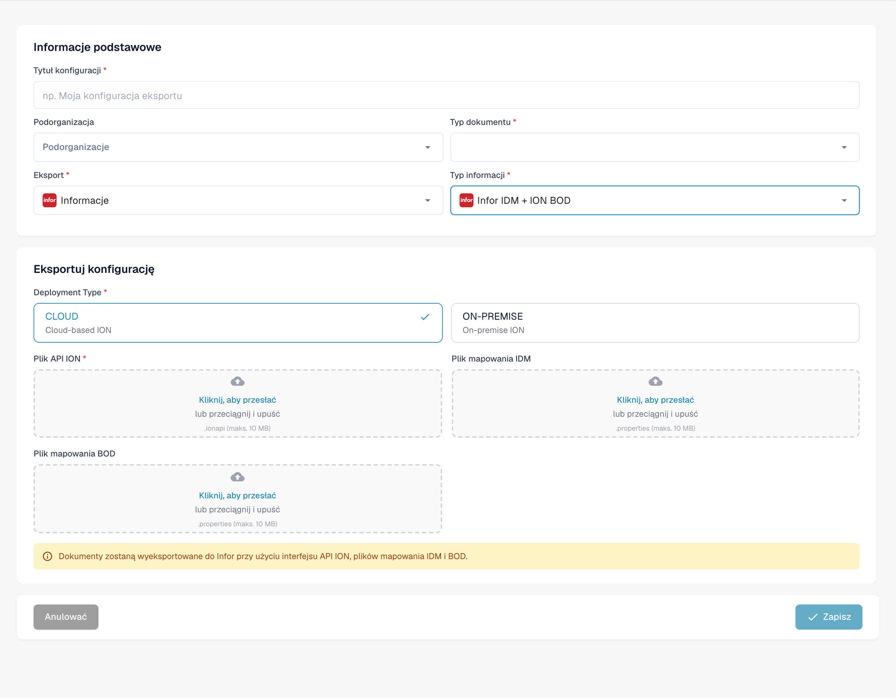<figcaption>
Projekt eksportu do Infor IDM ION BOD. Etykieta Informacje oznacza tutaj markę Infor; nazwy Infor, ION, IDM, LN i M3 pozostają niezmienione. Deployment Type pozostaje angielskie tam, gdzie występuje.
</figcaption></figure>

**Opisy pól**

* **Tytuł** Nazwa konfiguracji eksportu. Pojawi się na liście eksportów.
* **Podorganizacja** _(opcjonalnie)_ Lista rozwijana ze wszystkimi dostępnymi podorganizacjami.
  * Jeśli pozostawione puste: dotyczy głównej organizacji.
  * Jeśli wybrane: eksport będzie dotyczył tylko wybranej podorganizacji.
* **Typ dokumentu** Lista rozwijana zawierająca wszystkie dostępne typy dokumentów. Określa, do jakiego typu dokumentu odnosi się ta konfiguracja eksportu.
* **Plik mapowania ION** Wybierz plik mapowania z menedżera plików.
* **Plik mapowania IDM** Wybierz plik mapowania z menedżera plików. [Potrzebujesz pomocy przy tworzeniu? Zobacz Przewodnik Mapowania IDM](../../../infor-integration-and-configuration/exporting-to-infor/creating-an-idm-mapping-file.md)
* **Plik mapowania BOD** Wybierz plik mapowania z menedżera plików. [Potrzebujesz pomocy przy tworzeniu? Zobacz Przewodnik Mapowania BOD](../../../infor-integration-and-configuration/exporting-to-infor/creating-a-bod-mapping-file.md)
* **Cloud / On-Prem Toggle** Przełącznik wskazujący typ wdrożenia Infor:
  * **Wdrożenie w chmurze**: Wybierz to, jeśli jesteś klientem Infor CloudSuite.
  * **On-Prem**: Wybierz to, jeśli Infor jest hostowany samodzielnie.

### Dla klientów Infor CloudSuite

#### Infor IDM + LN

Infor IDM + LN

<figure>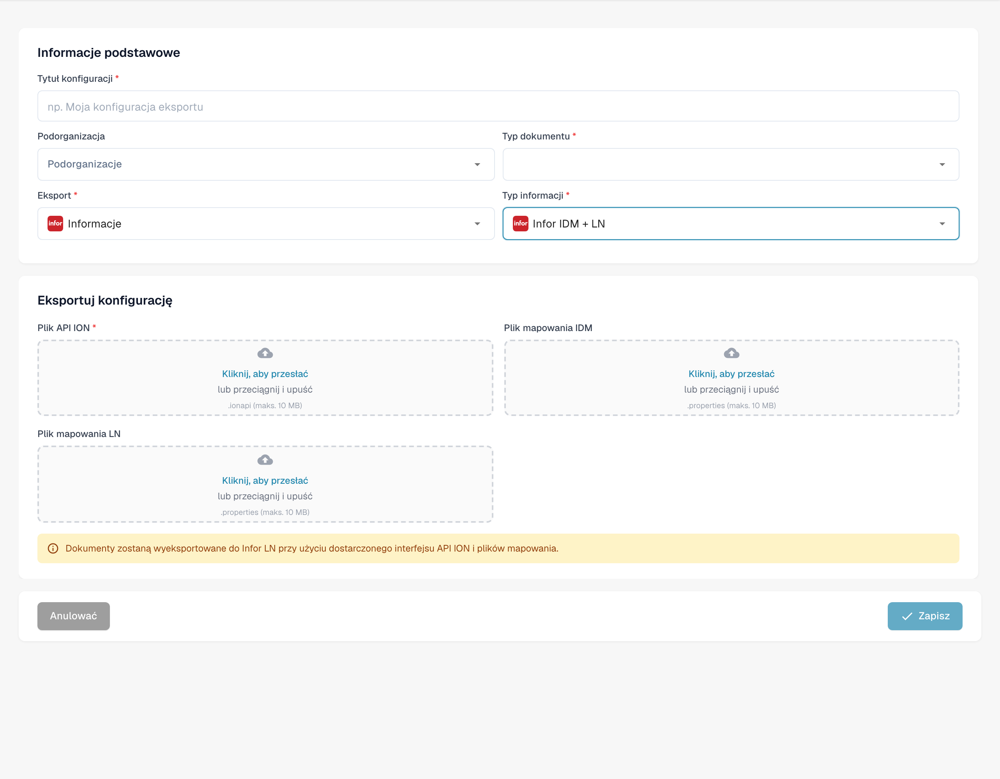<figcaption>
Projekt eksportu do Infor IDM LN. Etykieta Informacje oznacza tutaj markę Infor; nazwy Infor, ION, IDM, LN i M3 pozostają niezmienione. Deployment Type pozostaje angielskie tam, gdzie występuje.
</figcaption></figure>

**Opisy pól**

* **Tytuł** Nazwa konfiguracji eksportu. Pojawi się na liście eksportów.
* **Podorganizacja** _(opcjonalnie)_ Lista rozwijana ze wszystkimi dostępnymi podorganizacjami.
  * Jeśli pozostawione puste: dotyczy głównej organizacji.
  * Jeśli wybrane: eksport będzie dotyczył tylko wybranej podorganizacji.
* **Typ dokumentu** Lista rozwijana zawierająca wszystkie dostępne typy dokumentów. Określa, do jakiego typu dokumentu odnosi się ta konfiguracja eksportu.
* **Plik mapowania ION** Wybierz plik mapowania z menedżera plików.
* **Plik mapowania IDM** Wybierz plik mapowania z menedżera plików. [Potrzebujesz pomocy przy tworzeniu? Zobacz Przewodnik Mapowania IDM](../../../infor-integration-and-configuration/exporting-to-infor/creating-an-idm-mapping-file.md)
* **Plik mapowania LN** Wybierz plik mapowania z menedżera plików. [Potrzebujesz pomocy przy tworzeniu? Zobacz Przykład Mapowania LN](../../../infor-integration-and-configuration/exporting-to-infor/ln/example-export-ln/)

#### Infor IDM + M3

Infor IDM + M3

<figure>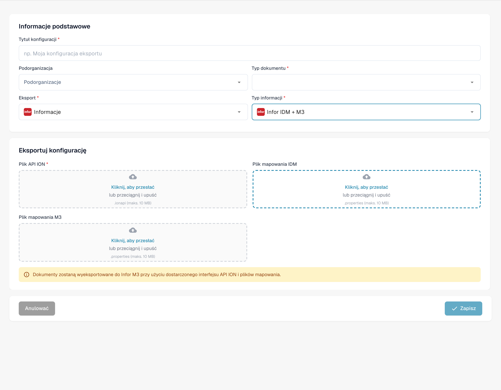<figcaption>
Projekt eksportu do Infor IDM M3. Etykieta Informacje oznacza tutaj markę Infor; nazwy Infor, ION, IDM, LN i M3 pozostają niezmienione. Deployment Type pozostaje angielskie tam, gdzie występuje.
</figcaption></figure>

**Opisy pól**

* **Tytuł** Nazwa konfiguracji eksportu. Pojawi się na liście eksportów.
* **Podorganizacja** _(opcjonalnie)_ Lista rozwijana ze wszystkimi dostępnymi podorganizacjami.
  * Jeśli pozostawione puste: dotyczy głównej organizacji.
  * Jeśli wybrane: eksport będzie dotyczył tylko wybranej podorganizacji.
* **Typ dokumentu** Lista rozwijana zawierająca wszystkie dostępne typy dokumentów. Określa, do jakiego typu dokumentu odnosi się ta konfiguracja eksportu.
* **Plik mapowania ION** Wybierz plik mapowania z menedżera plików.
* **Plik mapowania IDM** Wybierz plik mapowania z menedżera plików. [Potrzebujesz pomocy przy tworzeniu? Zobacz Przewodnik Mapowania IDM](../../../infor-integration-and-configuration/exporting-to-infor/creating-an-idm-mapping-file.md)
* **Plik mapowania M3** Wybierz plik mapowania z menedżera plików. [Potrzebujesz pomocy przy tworzeniu? Zobacz Przykład Mapowania M3](../../../infor-integration-and-configuration/exporting-to-infor/m3/example-export-m3.md)

#### Infor IDM + M3 (toml)

Infor IDM + M3 (toml)

<figure>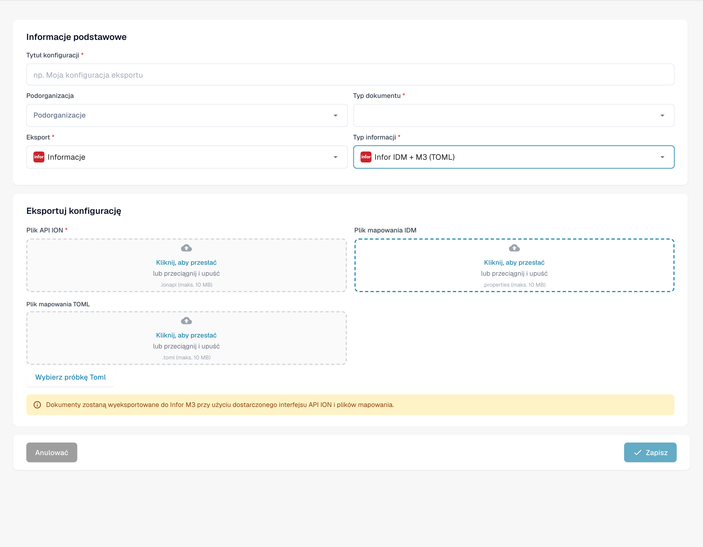<figcaption>
Projekt eksportu do Infor IDM M3 z TOML. Etykieta Informacje oznacza tutaj markę Infor; nazwy Infor, ION, IDM, LN i M3 pozostają niezmienione. Deployment Type pozostaje angielskie tam, gdzie występuje.
</figcaption></figure>

**Opisy pól**

* **Tytuł** Nazwa konfiguracji eksportu. Pojawi się na liście eksportów.
* **Podorganizacja** _(opcjonalnie)_ Lista rozwijana ze wszystkimi dostępnymi podorganizacjami.
  * Jeśli pozostawione puste: dotyczy głównej organizacji.
  * Jeśli wybrane: eksport będzie dotyczył tylko wybranej podorganizacji.
* **Typ dokumentu** Lista rozwijana zawierająca wszystkie dostępne typy dokumentów. Określa, do jakiego typu dokumentu odnosi się ta konfiguracja eksportu.
* **Plik mapowania ION** Wybierz plik mapowania z menedżera plików.
* **Plik mapowania IDM** Wybierz plik mapowania z menedżera plików. [Potrzebujesz pomocy przy tworzeniu? Zobacz Przewodnik Mapowania IDM](../../../infor-integration-and-configuration/exporting-to-infor/creating-an-idm-mapping-file.md)
* **Plik mapowania M3 TOML** Wybierz plik mapowania z menedżera plików lub użyj opcji wybierz Toml, aby użyć pliku toml utworzonego za pomocą menedżera reguł. [Potrzebujesz pomocy przy tworzeniu? Zobacz Przewodnik Menedżera Reguł](rule-manager/)

