# 导出

<figure>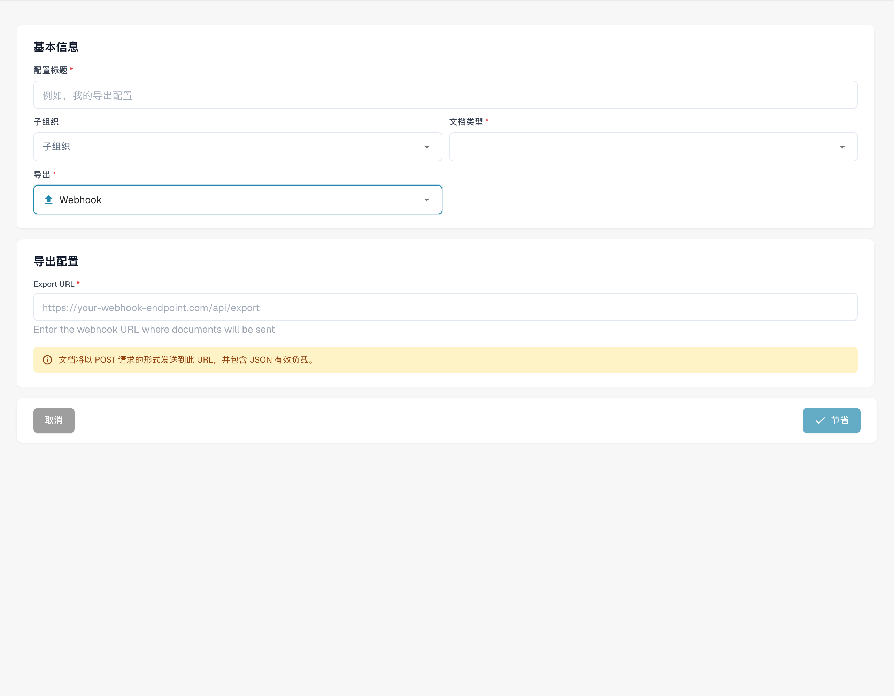<figcaption>
Webhook 导出配置草稿。 Webhook 地址标签和说明仍为英文，“节省”实际表示保存；本例未保存或测试连接。
</figcaption></figure>

<figure>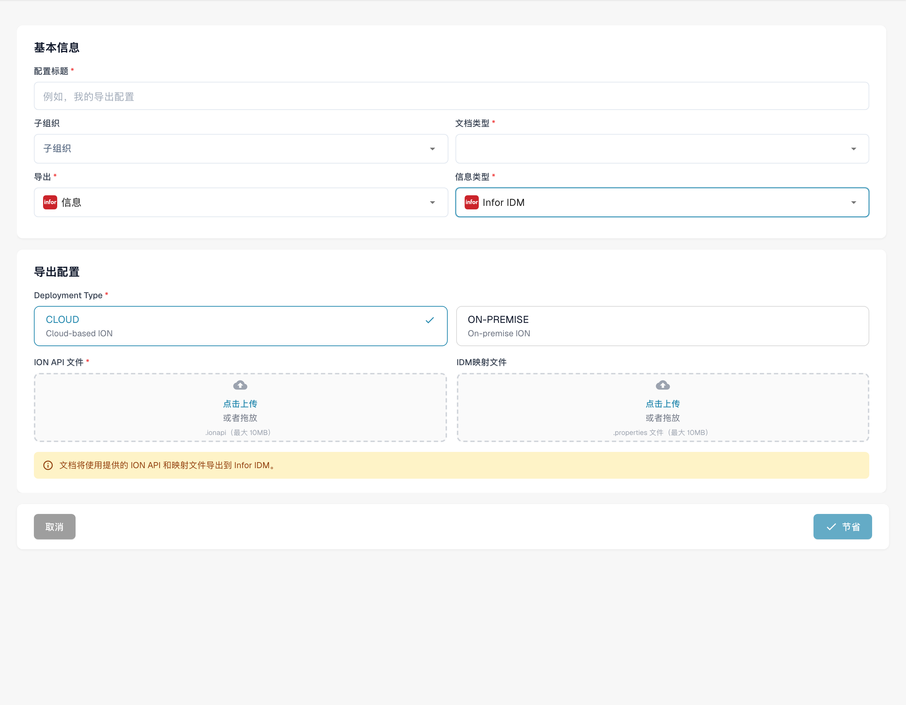<figcaption>
Infor IDM 导出草稿。 品牌 Infor 在界面中误译为“信息”；部署方式标签仍为英文，本例未保存。
</figcaption></figure>

<figure><figcaption>
从设置页面打开导出配置。
</figcaption></figure>

## 概述

“导出”页面会显示所有已配置的导出设置，以及这些设置处于启用还是停用状态。在此页面中，用户可以：

* 查看和管理现有导出配置
* 创建新的导出连接（例如 **Infor**、**Infor & IDM**、**Webhook** 或 **SFTP**）
* 编辑或删除现有导出配置

## 查找位置

路径：**设置** → **文档处理** → **出口**

<figure><figcaption>
中文导出配置列表，配置内容已隐藏；Actions 仍为英文。此处展示配置入口，不代表已执行导出。
</figcaption></figure>

## **使用导出页面**

打开“导出”页面后，会看到所有现有导出配置的列表。

列表中的每一行显示：

* **状态指示器**
  * **绿色**表示导出已启用
  * **红色**表示导出已停用
* **名称** – 导出配置的名称
* **文档类型** – 此导出配置适用的文档类型
* **子组织** – 如果导出仅适用于特定子组织，此处会显示该子组织
* **导出方式** – 文档的发送位置（例如 Infor、IDM、SFTP）
* **操作** – 用于**编辑、删除**或**启用/停用**配置的按钮

#### **导出配置的重要规则**

对于给定组织或子组织中的每种**文档类型**，适用以下规则：

* 只能有**一个已启用的 Infor 导出**
* 只能有**一个已启用的非 Infor 导出**（例如 Webhook、SFTP）

不过，同一文档类型可以同时拥有：

* **一个已启用的 Infor 导出**_以及_**一个已启用的非 Infor 导出**
* **不同子组织各自的导出配置**——例如，子组织 A 使用一个 Infor 导出，子组织 B 使用另一个 Infor 导出

## 在编辑界面中启用或停用

已有导出配置的编辑界面底部，在**保存**旁边有一个**已启用**开关。

1. 通过**编辑**打开该配置。
2. 将**已启用**开关设置到所需状态，然后点击**保存**。

随后 DocBits 会用与列表相同的检查来启用或停用该配置：如果同一文档类型已经有一个配置处于启用状态，启用操作会被拒绝。仅保存表单本身不再改变已存储的启用状态，底部开关与列表中的状态始终显示相同的结果。

<figure>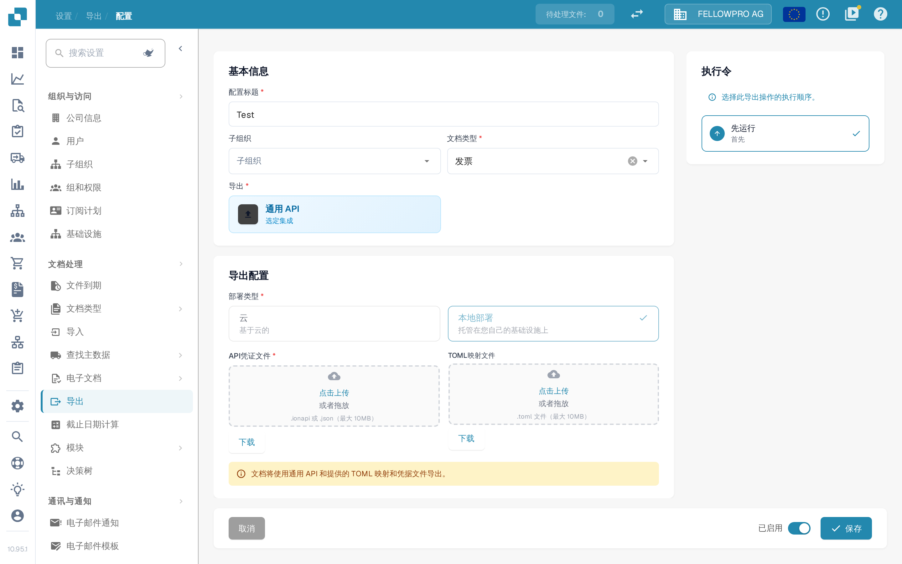<figcaption>
导出配置编辑界面中“保存”旁边的“已启用”开关。
</figcaption></figure>

## **创建新的导出配置**

创建新的导出配置：

1. 点击 **“New”** 按钮。

<figure>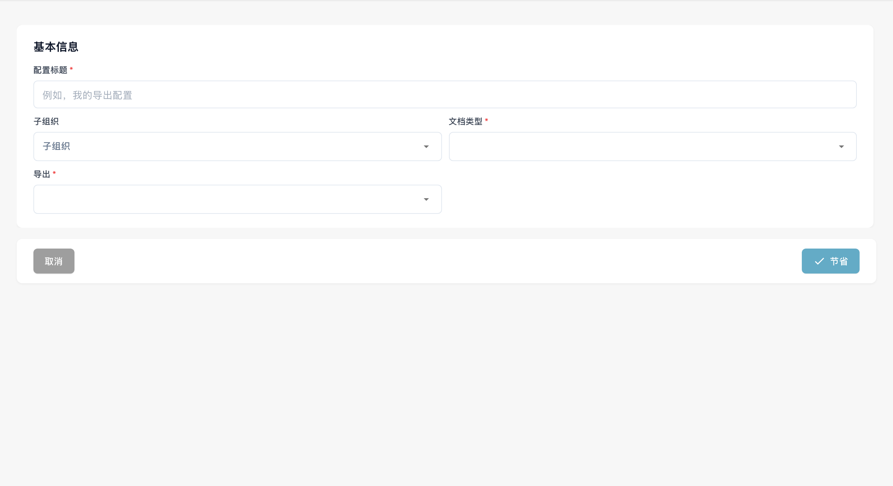<figcaption>
未保存的导出配置草稿。 界面中的“节省”按钮实际表示保存配置；本例未保存。
</figcaption></figure>

2. 选择要配置的**导出类型**（例如 Infor、IDM、SFTP）。
3. 根据导出类型填写必填字段。
4. 保存配置。

## 导出选项

#### Webhook

Webhook

<figure><figcaption></figcaption></figure>

**字段说明**

* **标题** 导出配置的名称。该名称会显示在导出列表中。
* **子组织** _（可选）_ 下拉菜单，列出所有可用的子组织。
  * 留空：适用于主组织。
  * 选择子组织：导出仅适用于所选子组织。
* **文档类型** 下拉菜单，列出所有可用的文档类型。此项决定此导出配置适用于哪种文档。
* **导出 URL** 导出文档的目标 URL。

#### SFTP

SFTP

<figure>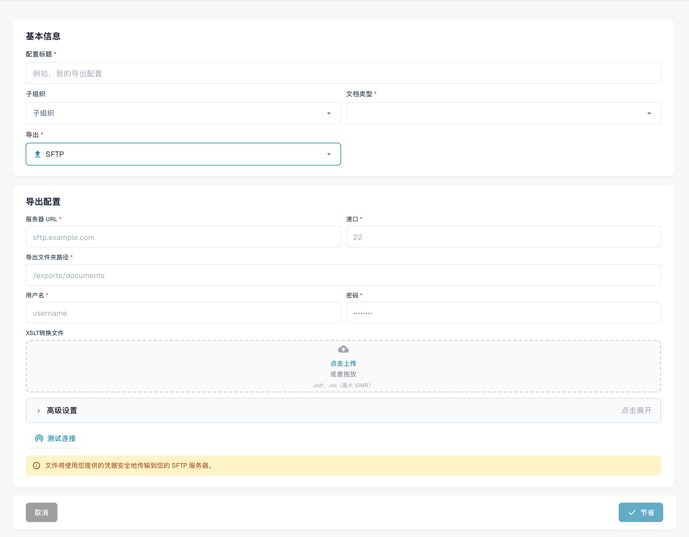<figcaption>
SFTP 导出配置草稿。 “节省”实际表示保存；本例未保存或测试连接。
</figcaption></figure>

**字段说明**

* **标题** 导出配置的名称。该名称会显示在导出列表中。
* **子组织** _（可选）_ 下拉菜单，列出所有可用的子组织。
  * 留空：适用于主组织。
  * 选择子组织：导出仅适用于所选子组织。
* **文档类型** 下拉菜单，列出所有可用的文档类型。此项决定此导出配置适用于哪种文档。
* **用户名** 用于向 SFTP 服务器进行身份验证的用户名。
* **密码** 对应的 SFTP 账户密码。请确保该账户对指定文件夹具有写入权限。
* **服务器 URL** 目标 SFTP 服务器的主机名或 IP 地址。
* **港口** 连接到 SFTP 服务器所使用的端口。
* **文件夹** 在 SFTP 服务器上上传文档的路径（例如 `/incoming/invoices/`）。该路径必须已存在且可写入。
*   **XSLT File (Optional)**

    **XSLT 文件**可用于转换 DocBits 的默认导出格式。

    * **使用场景：**仅当接收系统要求采用不同于 DocBits 默认格式的结构或特定格式时使用。
    * 如果默认导出格式符合要求，请**留空**。

**高级设置：**

* **文件名导出模式** 指定导出的文件保留原文件名，还是使用 DocBits 文档 ID 重新命名。
* **包含文档历史记录** 启用后，导出文件将包含根据仪表板上可用日志生成的文档历史记录。

<figure><figcaption></figcaption></figure>

<figure><figcaption>
未保存的 SFTP 导出高级选项。
</figcaption></figure>

#### Infor 导出到 SFTP

Infor Export to SFTP

<figure>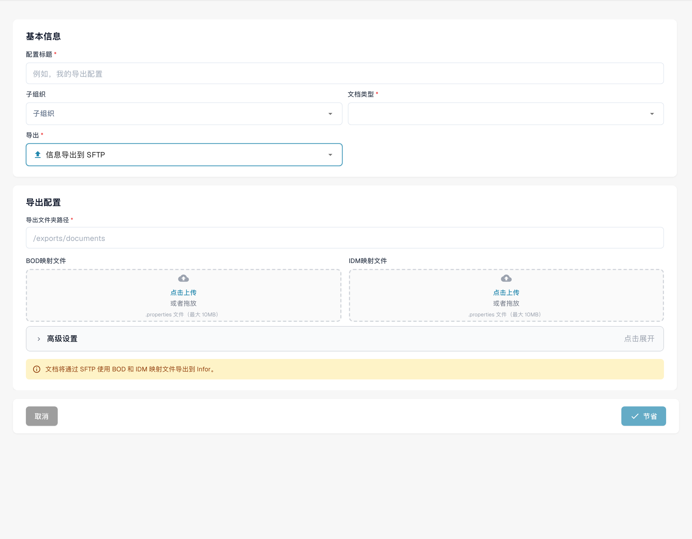<figcaption>
Infor SFTP 导出草稿。 品牌 Infor 在界面中误译为“信息”；“节省”表示保存，本例未保存或测试连接。
</figcaption></figure>

**字段说明**

* **标题** 导出配置的名称。该名称会显示在导出列表中。
* **子组织** _（可选）_ 下拉菜单，列出所有可用的子组织。
  * 留空：适用于主组织。
  * 选择子组织：导出仅适用于所选子组织。
* **文档类型** 下拉菜单，列出所有可用的文档类型。此项决定此导出配置适用于哪种文档。
* **IDM 映射文件** 从文件管理器中选择映射文件。[需要帮助创建映射文件？请参阅 IDM 映射指南](../../../../infor-integration-and-configuration/exporting-to-infor/creating-an-idm-mapping-file.md)
* **BOD 映射文件** 从文件管理器中选择映射文件。[需要帮助创建映射文件？请参阅 BOD 映射指南](../../../../infor-integration-and-configuration/exporting-to-infor/creating-a-bod-mapping-file.md)
* **文件夹** 在 SFTP 服务器上上传文档的路径（例如 `/incoming/invoices/`）。该路径必须已存在且可写入。

#### **SMB**

SMB

<figure>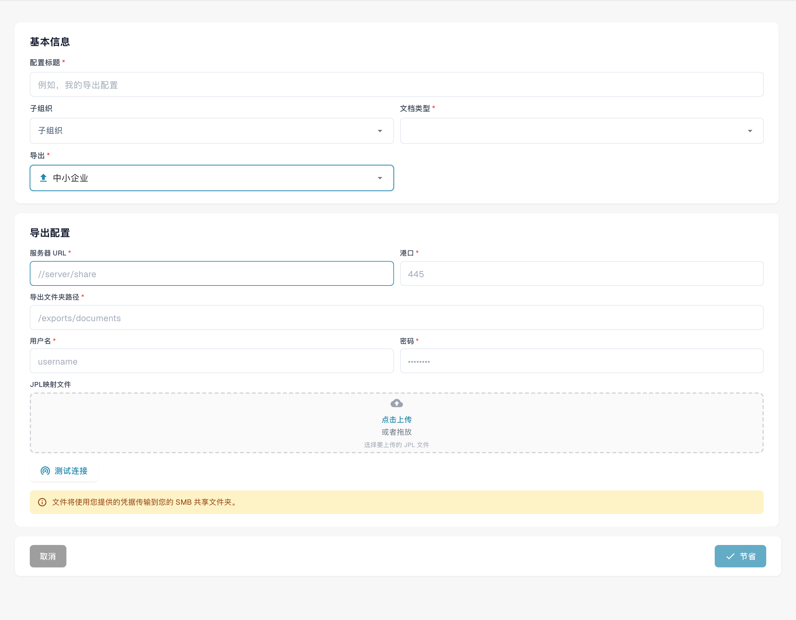<figcaption>
SMB 导出草稿；协议名称保持不变。 协议 SMB 在界面中误译为“中小企业”；“节省”表示保存，本例未保存或测试连接。
</figcaption></figure>

**字段说明**

* **标题** 导出配置的名称。该名称会显示在导出列表中。
* **子组织** _（可选）_ 下拉菜单，列出所有可用的子组织。
  * 留空：适用于主组织。
  * 选择子组织：导出仅适用于所选子组织。
* **文档类型** 下拉菜单，列出所有可用的文档类型。此项决定此导出配置适用于哪种文档。
* **用户名** 用于连接 SMB 共享的用户名。
* **密码** 用于 SMB 身份验证的对应密码。
* **服务器 URL** SMB 服务器的地址。
* **港口** 用于访问 SMB 共享的端口号。
* **文件夹** SMB 共享中用于保存文档的文件夹路径（例如 `/incoming/invoices/`）。该路径必须已存在且可写入。
*   **JPL Mapping File (Optional)**（JPL 映射文件，可选）

    **JPL 文件**用于在导出数据写入 SMB 共享之前定义数据转换。

    * **使用场景：**仅当需要调整导出的文档数据以符合外部格式或系统要求时使用。
    * 如果不需要转换，请**留空**。

#### **Infor IDM**

Infor IDM

<figure><figcaption></figcaption></figure>

**字段说明**

* **标题** 导出配置的名称。该名称会显示在导出列表中。
* **子组织** _（可选）_ 下拉菜单，列出所有可用的子组织。
  * 留空：适用于主组织。
  * 选择子组织：导出仅适用于所选子组织。
* **文档类型** 下拉菜单，列出所有可用的文档类型。此项决定此导出配置适用于哪种文档。
* **ION 映射文件** 从文件管理器中选择映射文件。
* **IDM 映射文件** 从文件管理器中选择映射文件。[需要帮助创建映射文件？请参阅 IDM 映射指南](../../../../infor-integration-and-configuration/exporting-to-infor/creating-an-idm-mapping-file.md)
* **Cloud / On-Prem Toggle** 用于指定 Infor 部署类型的开关：
  * **云端**：如果使用 Infor CloudSuite，请选择此项。
  * **On-Prem**：如果 Infor 由本地托管，请选择此项。

#### **Infor ION**

Infor ION

<figure><figcaption>
Infor ION 导出草稿。 Infor 被误译为“信息”，ION BOD 被误译为“离子生化需氧量”；它们是集成技术名称，本例未保存。
</figcaption></figure>

**字段说明**

* **标题** 导出配置的名称。该名称会显示在导出列表中。
* **子组织** _（可选）_ 下拉菜单，列出所有可用的子组织。
  * 留空：适用于主组织。
  * 选择子组织：导出仅适用于所选子组织。
* **文档类型** 下拉菜单，列出所有可用的文档类型。此项决定此导出配置适用于哪种文档。
* **ION 映射文件** 从文件管理器中选择映射文件。
* **BOD 映射文件** 从文件管理器中选择映射文件。[需要帮助创建映射文件？请参阅 BOD 映射指南](../../../../infor-integration-and-configuration/exporting-to-infor/creating-a-bod-mapping-file.md)
* **Cloud / On-Prem Toggle** 用于指定 Infor 部署类型的开关：
  * **云端**：如果使用 Infor CloudSuite，请选择此项。
  * **On-Prem**：如果 Infor 由本地托管，请选择此项。

#### Infor IDM + ION BOD

Infor IDM + ION BOD

<figure>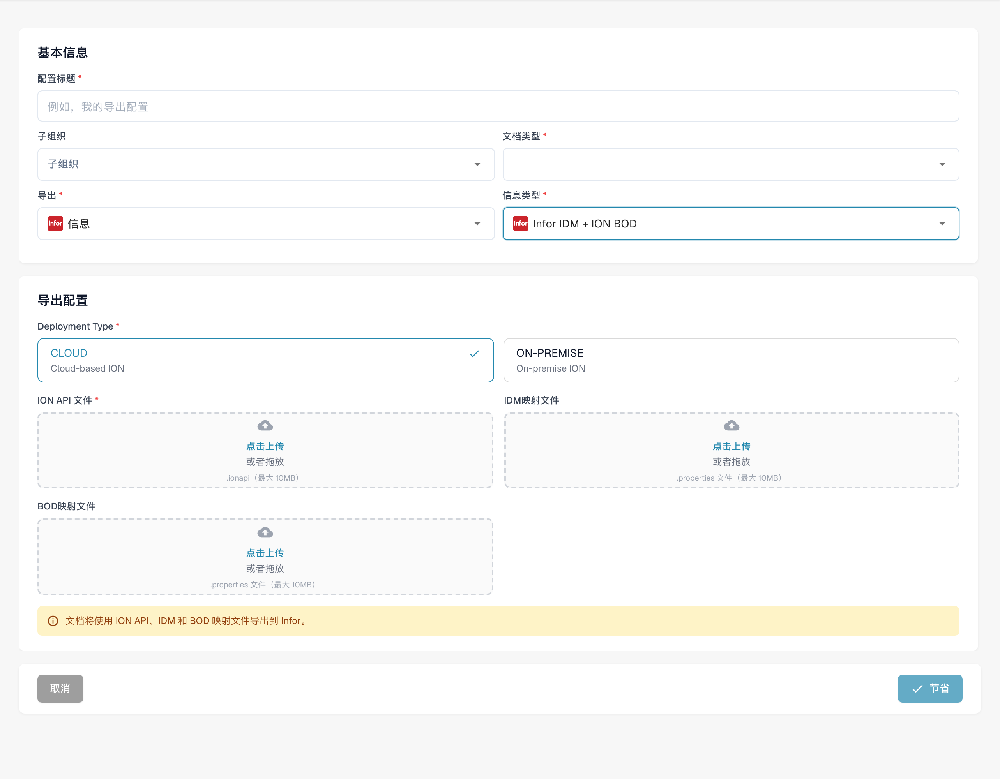<figcaption>
Infor IDM ION BOD 导出草稿。 品牌 Infor 在界面中误译为“信息”；部署方式标签仍为英文，本例未保存。
</figcaption></figure>

**字段说明**

* **标题** 导出配置的名称。该名称会显示在导出列表中。
* **子组织** _（可选）_ 下拉菜单，列出所有可用的子组织。
  * 留空：适用于主组织。
  * 选择子组织：导出仅适用于所选子组织。
* **文档类型** 下拉菜单，列出所有可用的文档类型。此项决定此导出配置适用于哪种文档。
* **ION 映射文件** 从文件管理器中选择映射文件。
* **IDM 映射文件** 从文件管理器中选择映射文件。[需要帮助创建映射文件？请参阅 IDM 映射指南](../../../../infor-integration-and-configuration/exporting-to-infor/creating-an-idm-mapping-file.md)
* **BOD 映射文件** 从文件管理器中选择映射文件。[需要帮助创建映射文件？请参阅 BOD 映射指南](../../../../infor-integration-and-configuration/exporting-to-infor/creating-a-bod-mapping-file.md)
* **Cloud / On-Prem Toggle** 用于指定 Infor 部署类型的开关：
  * **云端**：如果使用 Infor CloudSuite，请选择此项。
  * **On-Prem**：如果 Infor 由本地托管，请选择此项。

### 对于 Infor CloudSuite 客户

#### Infor IDM + LN

Infor IDM + LN

<figure>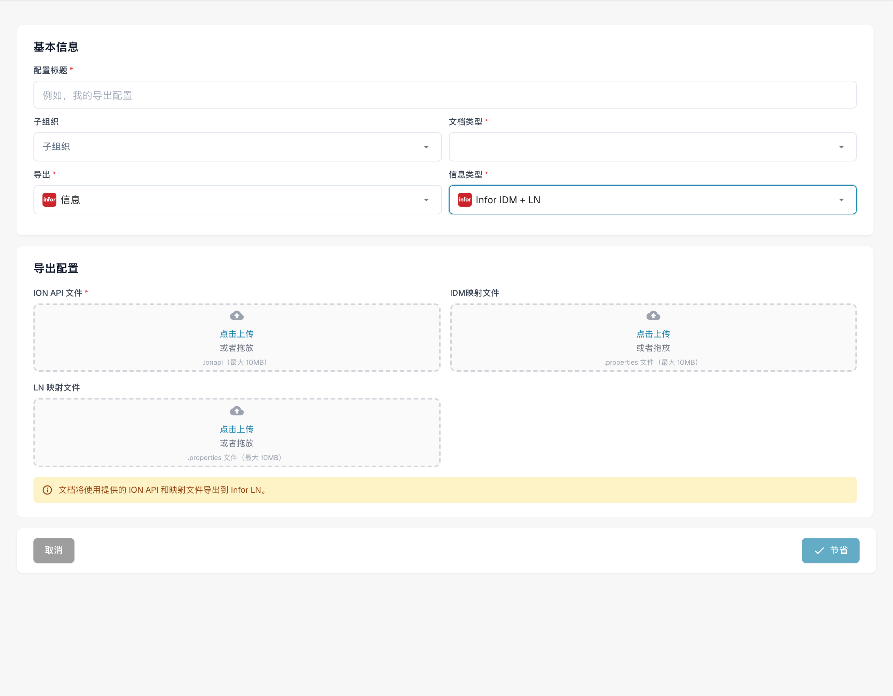<figcaption>
Infor IDM LN 导出草稿。 品牌 Infor 在界面中误译为“信息”；本例未保存。
</figcaption></figure>

**字段说明**

* **标题** 导出配置的名称。该名称会显示在导出列表中。
* **子组织** _（可选）_ 下拉菜单，列出所有可用的子组织。
  * 留空：适用于主组织。
  * 选择子组织：导出仅适用于所选子组织。
* **文档类型** 下拉菜单，列出所有可用的文档类型。此项决定此导出配置适用于哪种文档。
* **ION 映射文件** 从文件管理器中选择映射文件。
* **IDM 映射文件** 从文件管理器中选择映射文件。[需要帮助创建映射文件？请参阅 IDM 映射指南](../../../../infor-integration-and-configuration/exporting-to-infor/creating-an-idm-mapping-file.md)
* **LN 映射文件** 从文件管理器中选择映射文件。[需要帮助？请参阅 LN 导出示例](../../../../infor-integration-and-configuration/exporting-to-infor/ln/example-export-ln/)

#### Infor IDM + M3

Infor IDM + M3

<figure>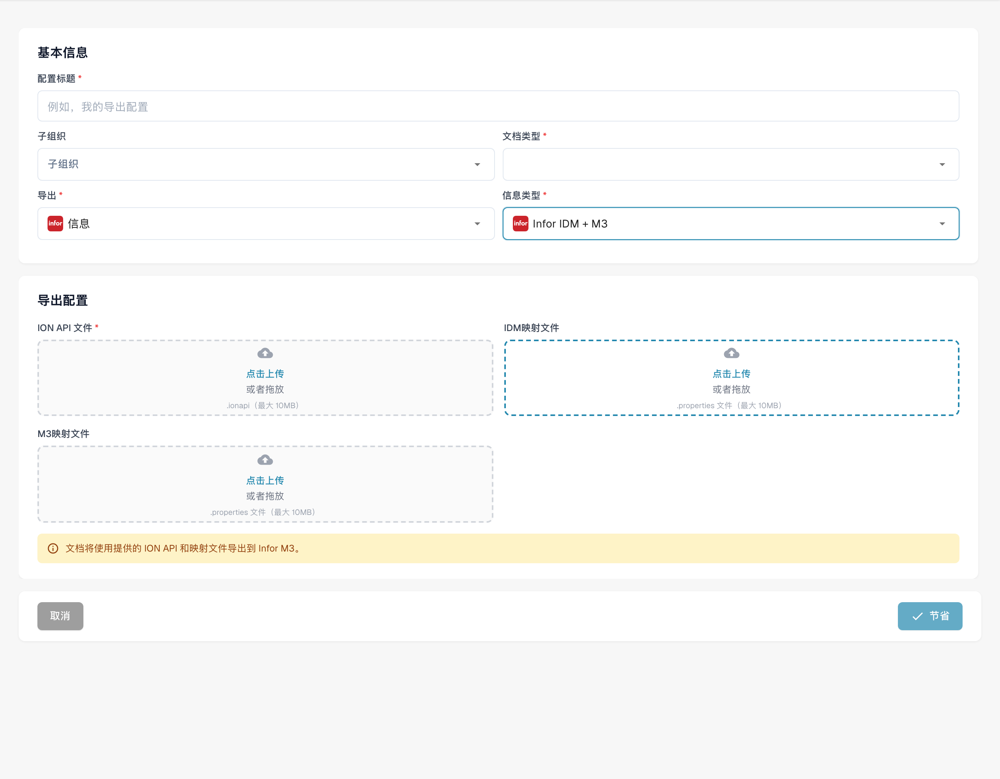<figcaption>
Infor IDM M3 导出草稿。 品牌 Infor 在界面中误译为“信息”；本例未保存。
</figcaption></figure>

**字段说明**

* **标题** 导出配置的名称。该名称会显示在导出列表中。
* **子组织** _（可选）_ 下拉菜单，列出所有可用的子组织。
  * 留空：适用于主组织。
  * 选择子组织：导出仅适用于所选子组织。
* **文档类型** 下拉菜单，列出所有可用的文档类型。此项决定此导出配置适用于哪种文档。
* **ION 映射文件** 从文件管理器中选择映射文件。
* **IDM 映射文件** 从文件管理器中选择映射文件。[需要帮助创建映射文件？请参阅 IDM 映射指南](../../../../infor-integration-and-configuration/exporting-to-infor/creating-an-idm-mapping-file.md)
* **M3映射文件** 从文件管理器中选择映射文件。[需要帮助？请参阅 M3 映射示例](../../../../infor-integration-and-configuration/exporting-to-infor/m3/example-export-m3.md)

#### Infor IDM + M3 (toml)

Infor IDM + M3 (toml)

<figure>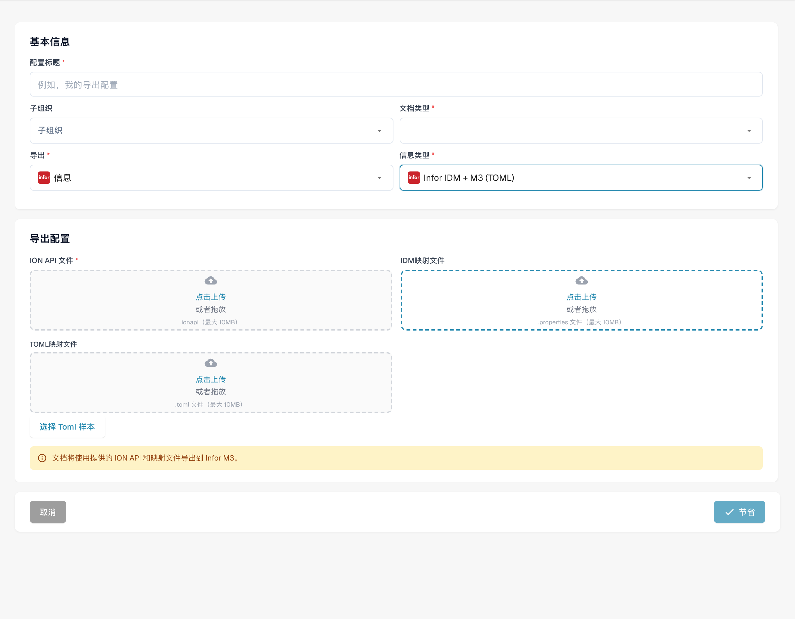<figcaption>
带 TOML 的 Infor IDM M3 导出草稿。 品牌 Infor 在界面中误译为“信息”；本例未保存。
</figcaption></figure>

**字段说明**

* **标题** 导出配置的名称。该名称会显示在导出列表中。
* **子组织** _（可选）_ 下拉菜单，列出所有可用的子组织。
  * 留空：适用于主组织。
  * 选择子组织：导出仅适用于所选子组织。
* **文档类型** 下拉菜单，列出所有可用的文档类型。此项决定此导出配置适用于哪种文档。
* **ION 映射文件** 从文件管理器中选择映射文件。
* **IDM 映射文件** 从文件管理器中选择映射文件。[需要帮助创建映射文件？请参阅 IDM 映射指南](../../../../infor-integration-and-configuration/exporting-to-infor/creating-an-idm-mapping-file.md)
* **M3 Toml 映射文件** 从文件管理器中选择映射文件，或选择 Toml 选项以使用通过规则管理器创建的 toml 文件。[需要帮助？请参阅规则管理器指南](../rule-manager/)

## 视频教程: 配置并测试 ERP 导出


配置并测试 ERP 导出


[查看带字幕和章节的视频](https://docbits-videos.fra1.cdn.digitaloceanspaces.com/settings-assistant/erp-export-admin/v1/zh.html)

部分产品原生标签可能仍为其他语言。技术字段标识符保持不变。

我使用专门的测试配置和单据类型。这些发票只用于培训，里面都是虚构数据。测试接收端会检查数据传输，但不会在生产 ERP 中记账。我不会更改其他集成。

在导出配置中，我检查单据类型、组织和导出类型。本例在云端使用Generic API。凭证JSON和TOML字段映射是独立的文件。在实际项目中，目标系统、权限和子组织必须与预期流程相匹配。

<figure>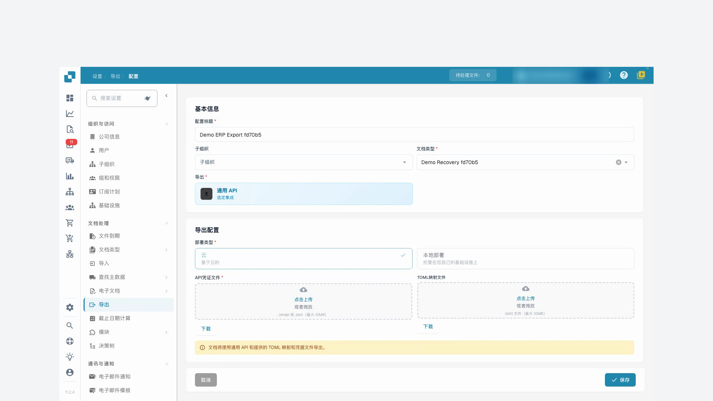<figcaption>
仅用于培训文档类型的导出配置
</figcaption></figure>

在修正后的映射中，DocBits 的 invoice_id 字段提供发送给测试接收端的发票号码。供应商、总金额和货币也会进行映射。本次测试只检查发票抬头数据。发票行项目和 ERP 记账需要在各自项目中另做业务核验。

我上传修正后的TOML文件并保存配置。然后我重新打开它，确认修改已生效。准备好的测试凭证保持不变；生产环境的机密信息不应出现在录屏中。

现在我返回导出失败的测试发票，只重新启动一次导出。我会等待处理完成。仅仅接受请求，并不能证明数据已成功传输。

DocBits 现在显示发票已完成。此外，我还会核对接收回执。发票号码、供应商、金额和货币均与测试发票一致。身份验证和数据传输已成功。测试接收端不会确认 ERP 记账。

<figure>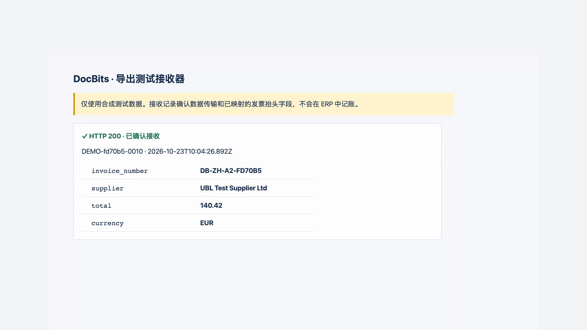<figcaption>
测试接收端的实际接收记录；不表示 ERP 记账
</figcaption></figure>
