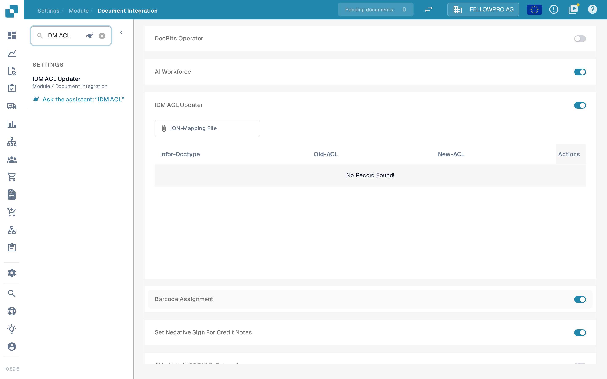
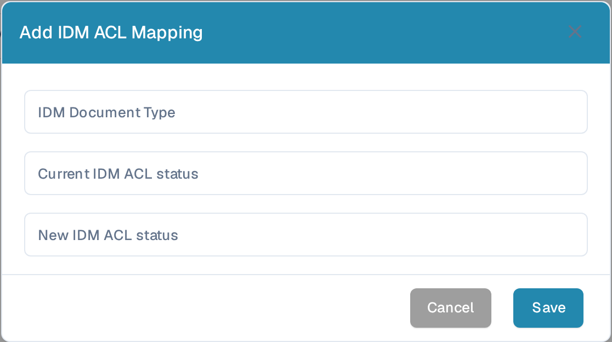

# IDM ACL Updater

## Overview

The IDM ACL Updater module manages the Access Control Lists (ACLs) of documents that DocBits exports to Infor IDM. The module keeps a mapping from an Infor document type and its old ACL status to the new ACL status, so that the exported document receives the correct access rights.

## Activation Instructions

To activate the IDM ACL Updater module:

1. Go to **Settings → Module → Document Integration**.
2. In the **Document Type** section, switch on **IDM ACL Updater**.
3. Select the **ION-Mapping File** to use.

The settings search finds the entry quickly: enter `IDM ACL`.

<figure><figcaption>The module sits in the **Document Type** section of **Document Integration**. Once it is on, the **ION-Mapping File** field and the table of mappings appear.</figcaption></figure>

### Adding ACL information

Below the switch, the table lists the mappings that exist for the organization. It has the columns **Infor-Doctype**, **Old-ACL** and **New-ACL**, and a delete action on each row.

To add a mapping, select **Add** and fill in the dialog:

* **IDM Document Type**
* **Current IDM ACL status**
* **New IDM ACL status**

Select **Save** to store the mapping, or **Cancel** to close the dialog without saving.

<figure><figcaption>A new mapping is entered in the **Add IDM ACL Mapping** dialog.</figcaption></figure>
