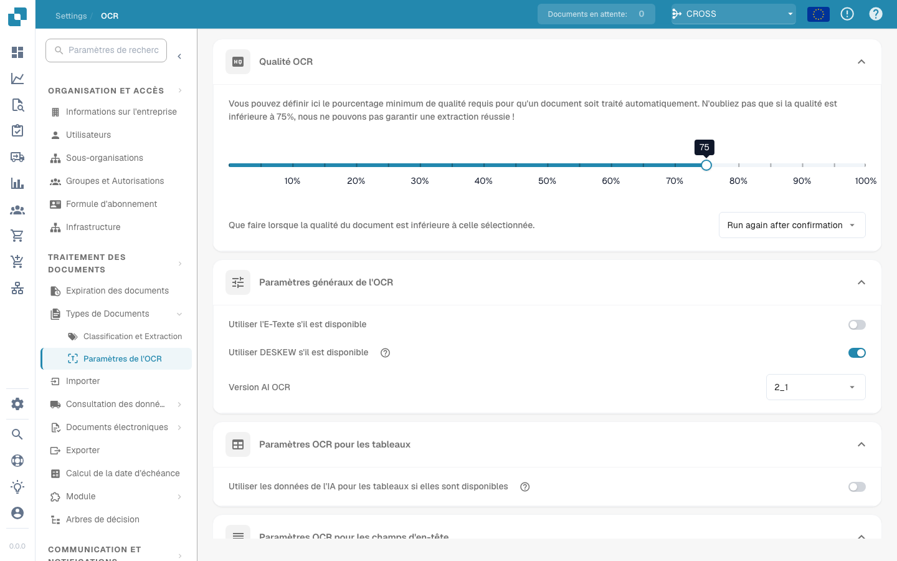

# Paramètres OCR


DocBits OCR & E-Text expliqués : paramètres, qualité et extraction d'en-tête


## Vue d’ensemble

Dans les paramètres **OCR (Reconnaissance optique de caractères)**, vous pouvez configurer la façon dont OCR est appliqué pendant le traitement du document. Cela inclut la spécification de la qualité minimale requise, le choix d'utiliser ou non du texte intégré (texte électronique), la sélection de la version OCR, etc. Cette page fournit une explication détaillée de tous les paramètres disponibles.

## Accéder aux paramètres OCR

Pour accéder aux paramètres OCR :

*   Accédez à : **Paramètres** → **Traitement des documents** → **OCR Paramètres**

    <figure><figcaption></figcaption></figure>

## Qualité OCR

Dans cette section, vous pouvez définir la qualité minimale du document requise pour le traitement OCR en ajustant le curseur de qualité. Déplacez le curseur vers la gauche ou la droite pour diminuer ou augmenter le seuil de qualité, respectivement.

Si un document ne répond pas au niveau de qualité défini, DocBits propose trois options pour le traiter :

* **Run Anyway**\
  Le document sera traité quelle que soit sa qualité.
* **Exécuter à nouveau après confirmation**\
  **DocBits** fera une pause et vous demandera de confirmer si vous souhaitez poursuivre le traitement.
* **Throw Error**\
  Le traitement du document s'arrêtera complètement et un message d'erreur s'affichera, indiquant que le document n'a pas atteint le seuil de qualité requis.

<figure><figcaption></figcaption></figure>

## Paramètres OCR généraux

* **Use E-Text if Available**\
  Lorsqu'il est activé, **DocBits** utilisera le texte électronique intégré (par exemple, à partir de PDF) au lieu d'exécuter OCR. Cela améliore à la fois la vitesse et la précision, car le texte est extrait directement sans nécessiter de traitement OCR.
* **Use DESKEW if Available**\
  Cette option corrige automatiquement l'alignement des documents numérisés. Le redressement des images inclinées contribue à améliorer la précision de l’OCR.
*   **AI OCR Version**\
    Vous permet de sélectionner une version spécifique du AI-basé OCR moteur.\
    Cela peut être utile si :

    * Vous n'obtenez pas les résultats souhaités avec la version actuellement sélectionnée.
    * Vous résolvez des problèmes liés aux performances ou à la précision de l’OCR.

    <figure><figcaption></figcaption></figure>

## Paramètres OCR pour les tableaux

* **Use AI Data for Tables if Available**\
  Lorsqu'il est activé, DocBits utilisera les données OCR pour les tableaux au lieu du texte électronique intégré (texte électronique) — même si le paramètre **Utiliser le texte électronique si disponible** est activé.

## Paramètres OCR pour les champs d’en-tête

* **Use Rules Extraction**\
  DocBits appliquera vos règles d'extraction prédéfinies pour identifier les champs d'en-tête.
* **Use AI Extraction**\
  DocBits utilisera AI pour détecter et extraire automatiquement les champs d'en-tête.

**Execution Order:**\
Si les deux options sont activées, **DocBits** effectuera l'extraction dans l'ordre suivant :\
**Rules Extraction → AI Extraction**\
\
<mark style="color:red;">**Remarque**</mark> : Pour de meilleurs résultats et un comportement cohérent, activez les deux options. Cela permet à **DocBits** d'utiliser à la fois des méthodes basées sur des règles et des méthodes basées sur AI en combinaison lors de l'extraction d'en-tête.
