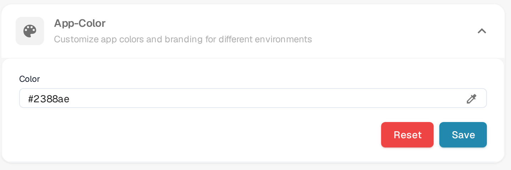

# Defining App Color in Company Settings

## Overview

The **App Color** setting allows administrators to define the color scheme of the application interface. This feature is particularly useful for distinguishing between different environments such as testing, sandbox, and production. By assigning distinct colors to each environment, users can easily identify which environment they are working in, reducing the risk of performing critical actions in the wrong environment.

<figure><figcaption>
App-Color in Settings → Company Information
</figcaption></figure>

## Accessing the App Color Setting

1. **Open Company Information**:
   * Go to **Settings** → **Company Information**.
2. **Locate the App Color Section**:
   * Expand the **App-Color** section (*Customize app colors and branding for different environments*).

## Setting the App Color

1. **Choose a Color**:
   * Click the eyedropper icon on the right-hand side of the **Color** field. A color picker opens.
   * Pick the color you want in the picker. The **Color** field shows the hex value of the color currently selected.
2. **Save the Color**:
   * Once you have selected the color, click on the **Save** button to apply the change.
   * The application interface updates to the new color immediately.
3. **Reset to Default**:
   * Click **Reset** to return to the default color, **#2388AE**. The default is saved immediately, so nothing else needs to be done.

## Best Practices for Environment Colors

To avoid confusion, it is recommended to establish a standard color scheme for each environment:

* **Production**: Use a neutral or default color, such as **#FFFFFF** (white) or **#f0f0f0** (light grey), to indicate the live environment.
* **Testing**: Use a bright or alerting color, such as **#ffcc00** (yellow) or **#ffa500** (orange), to indicate a testing environment.
* **Sandbox**: Use a distinct color, such as **#007bff** (blue) or **#6c757d** (grey), to indicate a sandbox or development environment.

## Subscription Plan

The subscription plan has its own page under **Settings** → **Subscription Plan**; plan details are not part of this section.

## Importance of App Color

The App Color setting is a simple yet effective tool to help users quickly recognize the environment they are working in. By carefully selecting and managing these colors, organizations can minimize errors and improve workflow efficiency.
