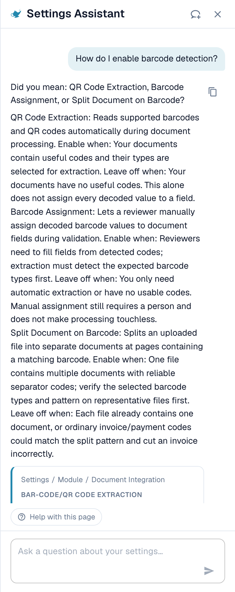
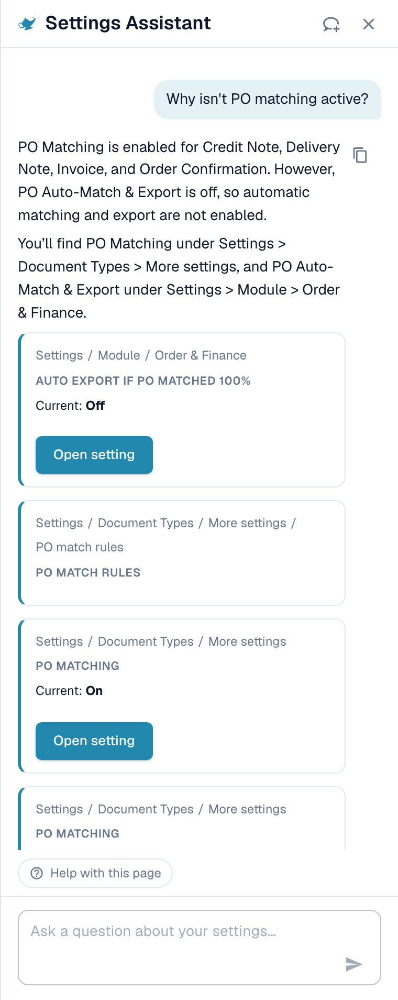
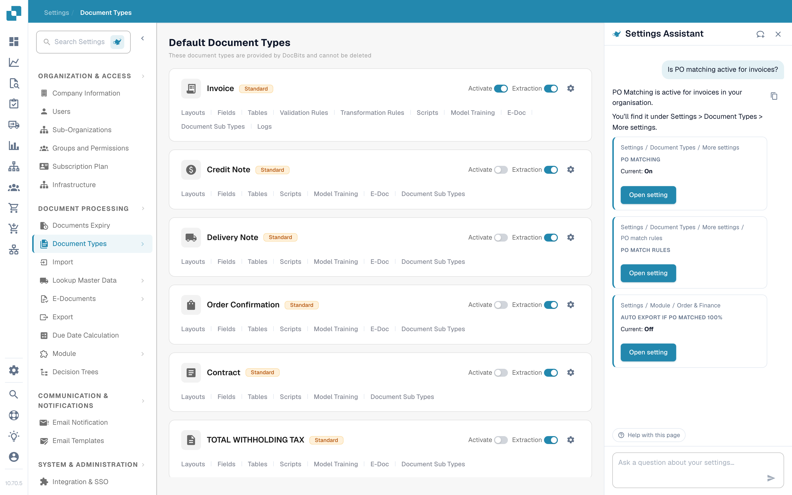
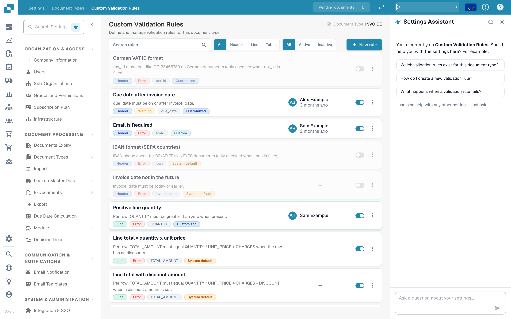

# Asystent ustawień: co potrafi czat

## Przegląd

Czat **Asystenta ustawień** odpowiada na pytania o Twoje ustawienia, ostrzega, gdy import przestaje działać, i, po Twoim potwierdzeniu, zmienia za Ciebie ustawienie. Zanim go użyjesz, administrator musi [włączyć asystenta](settings-assistant.md).

### Co potrafi

| Chcesz… | Przykład | Co dostajesz |
| --- | --- | --- |
| Znaleźć ustawienie | „Gdzie znajdę ustawienia importu e-mail?" | Ścieżkę (na przykład Ustawienia / Import) i przycisk **Open setting** (Otwórz ustawienie), który przechodzi do ustawienia i je podświetla |
| Zrozumieć ustawienie | „Jak włączyć wykrywanie kodów kreskowych?" | Krótkie wyjaśnienie każdego pasującego ustawienia: kiedy je włączyć, a kiedy zostawić wyłączone |
| Sprawdzić konfigurację | „Dlaczego dopasowanie PO nie jest aktywne?" | Bieżącą wartość każdego powiązanego ustawienia w Twojej organizacji (**Current: On** lub **Current: Off**) i informację, które z nich Cię blokuje |
| Zauważyć zepsuty import | Czerwona karta u góry panelu | Która skrzynka pocztowa lub które połączenie FTP zawodzi, jak często i prawdopodobny powód |
| Bezpiecznie zmienić ustawienie | **Switch off** (Wyłącz) na zawodzącej skrzynce w karcie ustalenia | Podgląd zmiany. Nic nie jest zapisywane, dopóki nie potwierdzisz. Każdą zmianę można cofnąć. |
| Poznać stronę | **Watch video explanation** (Obejrzyj wideo z objaśnieniem) | Krótkie wideo o stronie, na której jesteś (dostępne dla wybranych stron) |


Asystent działa na poziomie AI **Fast**. Nie ma ustawienia organizacji, które pozwalałoby wybrać inny model.


## Zadawanie pytań

Wpisz pytanie w polu na dole („Ask a question about your settings…") i naciśnij **Enter**. Asystent pokazuje, co robi („Reading configuration…", „Searching documentation…", „Writing answer…"), a w dowolnej chwili możesz go zatrzymać przyciskiem **Stop**.

### Panel wie, na której stronie jesteś

Gdy otwierasz panel na stronie ustawień, wita Cię w kontekście **tej strony** i proponuje trzy pasujące pytania. To prawdziwe przykłady:

| Strona | Przykładowe pytania |
| --- | --- |
| Informacje o firmie (Company Information) | „Jak zmienić adres naszej firmy?", „Gdzie wgrać nasze logo?", „Jakie domeny są zarejestrowane dla naszej organizacji?" |
| Import | „Czy import e-mail jest u nas aktywny?", „Na jaki adres e-mail wysyłamy dokumenty?", „Jak skonfigurować import FTP lub SFTP?" |
| Klasyfikacja i ekstrakcja (Classify & Extract) | „Który model AI jest używany do ekstrakcji?", „Czy dzielenie dokumentów według kodów kreskowych jest u nas aktywne?", „Czy mogę użyć innego modelu AI dla jednego dostawcy?" |
| Użytkownicy (Users) | „Jak zaprosić nowego użytkownika?", „Jak nadać użytkownikowi rolę administratora?", „Jak dezaktywować użytkownika?" |
| Przegląd ustawień (Settings overview) | „Jak włączyć wykrywanie kodów kreskowych?", „Dlaczego dopasowanie PO nie jest aktywne?", „Gdzie znajdę ustawienia importu e-mail?" |

Kliknij pytanie, a zostanie wysłane od razu. Pod trzema pytaniami panel mówi *I can also help with any other setting — just ask.* (Mogę też pomóc z każdym innym ustawieniem, wystarczy zapytać). W trakcie rozmowy na dole pozostaje chip **Help with this page** (Pomoc dla tej strony), który pyta „What can I configure on this page?" (Co mogę skonfigurować na tej stronie?).

### Przykład 1: Znajdź ustawienie

Pytasz **„Jak zmienić adres naszej firmy?"**

<figure><figcaption>
Odpowiedź wskazuje miejsce, a karta podaje dokładną ścieżkę i przycisk <strong>Open setting</strong>.
</figcaption></figure>

Odpowiedź mówi, gdzie znajduje się adres. Karta poniżej pokazuje ścieżkę (**Settings / Company Settings**) i przycisk **Open setting**. Kliknij go: DocBits otwiera stronę, przewija do ustawienia i podświetla je na kilka sekund.

### Przykład 2: Zrozum ustawienie o kilku nazwach

Pytasz **„Jak włączyć wykrywanie kodów kreskowych?"**

<figure><figcaption>
Gdy słowo pasuje do kilku ustawień, asystent wymienia każde z nich z informacją <strong>Enable when</strong> (Włącz, gdy) i <strong>Leave off when</strong> (Zostaw wyłączone, gdy).
</figcaption></figure>

„Wykrywanie kodów kreskowych" może oznaczać trzy różne ustawienia, więc asystent pyta *Did you mean: QR Code Extraction, Barcode Assignment, or Split Document on Barcode?* (Czy chodziło o: QR Code Extraction, Barcode Assignment czy Split Document on Barcode?) i wyjaśnia każde z nich:

* **QR Code Extraction**: automatycznie odczytuje obsługiwane kody kreskowe i kody QR podczas przetwarzania. Włącz je, gdy Twoje dokumenty zawierają użyteczne kody.
* **Barcode Assignment**: pozwala osobie sprawdzającej ręcznie przypisać odczytane wartości kodów kreskowych do pól podczas walidacji. Wymaga, aby ekstrakcja najpierw wykryła kod, i nie sprawia, że przetwarzanie jest touchless.
* **Split Document on Barcode**: dzieli jeden wgrany plik na osobne dokumenty na stronach separatorów. Używaj go tylko wtedy, gdy kody separatorów są niezawodne.

### Przykład 3: Dowiedz się, dlaczego coś się nie dzieje

Pytasz **„Dlaczego dopasowanie PO nie jest aktywne?"**

<figure><figcaption>
Przy pytaniu „dlaczego" asystent odczytuje Twoją konfigurację i pokazuje każde ustawienie z jego wartością <strong>Current</strong> (Bieżąca).
</figcaption></figure>

Asystent odczytuje ustawienia Twojej organizacji i raportuje, co znalazł. W tym przykładzie dopasowanie PO jest **On** (włączone) dla wszystkich czterech typów dokumentów, a ustawienie **Auto export if PO matched 100%** jest **Off** (wyłączone), więc automatyczne dopasowanie i eksport nie działają. Każda karta pokazuje **Current: On / Off** i przycisk **Open setting**, więc możesz od razu to naprawić.

### Przykład 4: Dopasowanie PO

Otwierasz **Ustawienia → Typy dokumentów** i pytasz **„Czy dopasowanie PO jest aktywne dla faktur?"** (to pytanie jest też jedną z trzech sugestii na tej stronie).

<figure><figcaption>
Strona <strong>Document Types</strong> (Typy dokumentów) z asystentem po prawej. Odpowiedź mówi, że <strong>PO Matching is active for invoices in your organisation</strong> (dopasowanie PO jest aktywne dla faktur w Twojej organizacji) i pokazuje trzy powiązane ustawienia: <strong>PO Matching</strong> (Current: On), <strong>PO match rules</strong> i <strong>Auto export if PO matched 100%</strong> (Current: Off).
</figcaption></figure>

Asystent odczytuje ustawienie dla typu dokumentu i dodaje ustawienia, które z nim się wiążą. W tym przykładzie dopasowanie jest włączone, ale automatyczny eksport po 100-procentowym dopasowaniu jest wyłączony, więc dopasowane faktury nadal czekają na człowieka. Każda karta ma przycisk **Open setting**.

* Do **reguł dopasowania i tolerancji** użyj strony [Zasady Dopasowywania Zamówień Zakupu](../document-types/more-settings/purchase-order/purchase-order-matching-rules.md).
* Aby zobaczyć, **dlaczego dokumenty dostawcy nie są dopasowywane**, otwórz [Touchless Intelligence: Diagnoza dopasowania PO](../../../touchless-po-matching-diagnosis.md). Pokazuje powód, dotknięte dokumenty i schemat decyzyjny.

### Przykład 5: Walidacja pól (niestandardowe reguły walidacji)

Na stronie **Ustawienia → Typy dokumentów → Niestandardowe reguły walidacji** (Custom Validation Rules) panel wita Cię w kontekście tej strony i sugeruje trzy pytania.

<figure><figcaption>
Strona <strong>Custom Validation Rules</strong> z asystentem po prawej. Lista reguł jest pośrodku, a trzy sugestie panelu to: <strong>Which validation rules exist for this document type?</strong> (Jakie reguły walidacji istnieją dla tego typu dokumentu?), <strong>How do I create a new validation rule?</strong> (Jak utworzyć nową regułę walidacji?) i <strong>What happens when a validation rule fails?</strong> (Co się dzieje, gdy reguła walidacji nie przechodzi?)
</figcaption></figure>

Użyj tu asystenta, aby **znaleźć** właściwe ustawienie i dowiedzieć się, co robi reguła. Aby **utworzyć lub zmienić** regułę, pracuj na samej stronie: zobacz [Niestandardowe reguły walidacji](../document-types/custom-validation-rules.md) i [Duplikowanie niestandardowej reguły walidacji](../document-types/duplicate-a-custom-validation-rule.md). Jeśli asystent utworzy dla Ciebie regułę, jest ona zawsze tworzona jako **nieaktywna**, a włączasz ją samodzielnie.


Nie myl **Niestandardowych reguł walidacji** (reguł dla pól typu dokumentu) z **Walidacją e-faktur** (E-Invoice Validation) (sprawdzaniem plików XRechnung, ZUGFeRD i Factur-X). To dwie różne strony.


### Przykład 6: Więcej pytań do wypróbowania

* „Który model AI jest używany do ekstrakcji?"
* „Czy dzielenie dokumentów według kodów kreskowych jest u nas aktywne?"
* „Jak dezaktywować użytkownika?"
* „Gdzie ustawić, jak długo dokumenty są przechowywane?"
* „Które ustawienia wpływają na wskaźnik touchless?"
* „Pokaż mi zrzut ekranu ustawień portalu dostawców."


Jeśli pytanie wykracza poza obszar ustawień albo asystent nie znajduje nic na jego temat w posiadanych informacjach o DocBits, mówi o tym. Na przykład pytanie o coś, co nie jest ustawieniem, zwraca *I can't find anything about … in the DocBits information available here* (Nie mogę znaleźć niczego o … w dostępnych tu informacjach o DocBits) razem z linkiem do najbliższej strony. Nie zgaduje.


### Linki i zrzuty ekranu w odpowiedziach

* Odpowiedzi mogą zawierać linki **View documentation** (Zobacz dokumentację). Wskazują tylko na docs.docbits.com i otwierają się w nowej karcie. Linki do dokumentacji pojawiają się, gdy wyszukiwanie w dokumentacji jest dostępne w Twoim środowisku.
* Odpowiedzi mogą pokazywać **zrzuty ekranu** z dokumentacji. Kliknij miniaturę, aby ją powiększyć.
* **Copy answer** (Kopiuj odpowiedź) (mała ikona kopiowania obok odpowiedzi) kopiuje tekst.

## Ustalenia: asystent Cię ostrzega

Gdy coś w Twojej konfiguracji przestało działać, u góry panelu pojawia się **czerwona karta**. Nie musisz pytać. Asystent sprawdza ponownie za każdym razem, gdy otwierasz panel i gdy wracasz do karty przeglądarki.

<figure><figcaption>
Rozwinięte ustalenie: skrzynka pocztowa, jej stan (<strong>Switched off</strong>), liczba nieudanych prób i powód.
</figcaption></figure>

Obecnie są dwie kontrole:

| Kontrola | Tytuł karty | Co liczy |
| --- | --- | --- |
| Import e-mail | „Email import: 1 mailbox affected" / „Email import: 3 mailboxes affected" | Skrzynki pocztowe z nieudanymi logowaniami |
| Import FTP | „FTP import: 1 connection affected" / „FTP import: 2 connections affected" | Połączenia z nieudanymi próbami połączenia lub logowania |

Każda karta ma trzy przyciski:

* **Show errors** (Pokaż błędy) (potem **Hide** (Ukryj)): wymienia dotknięte skrzynki lub połączenia, do dziesięciu, ze stanem (**Switched off** lub **Retrying**), liczbą nieudanych prób i powodem.
* **Open import settings** (Otwórz ustawienia importu): otwiera **Ustawienia → Import**.
* **Help me fix this** (Pomóż mi to naprawić): rozpoczyna czat. Asystent zadaje sobie pytanie „My email import has stopped working. Can you help me fix it?" (Mój import e-mail przestał działać. Możesz pomóc mi to naprawić?) i prowadzi Cię przez powód.

Wiersz podsumowania mówi, jak poważna jest sytuacja:

| Wiersz podsumowania | Znaczenie |
| --- | --- |
| *Switched off: nothing is being imported from here.* (Wyłączone: nic stąd nie jest importowane.) | Wszystkie dotknięte skrzynki są wyłączone. Nic nie przychodzi. |
| *Still being retried, but imports are probably failing.* (Nadal ponawiane, ale importy prawdopodobnie zawodzą.) | DocBits wciąż próbuje, ale logowanie nie działa. |
| *1 switched off, 2 still being retried.* (1 wyłączona, 2 nadal ponawiane.) | Mieszanka obu. |

### Powody, które możesz zobaczyć

Asystent tłumaczy techniczny błąd na jeden z tych powodów:

| Pokazany powód | Co zrobić |
| --- | --- |
| Sign-in blocked by policy (e.g. basic authentication disabled, or an app password/MFA is required) (Logowanie zablokowane przez politykę, np. wyłączone uwierzytelnianie podstawowe albo wymagane hasło aplikacji/MFA) | Poproś administratora poczty o hasło aplikacji lub przełącz skrzynkę na nowoczesne uwierzytelnianie |
| Sign-in rejected (check username and password) (Logowanie odrzucone, sprawdź nazwę użytkownika i hasło) | Hasło się zmieniło. Wpisz nowe w ustawieniach importu |
| Mailbox or path not found (Nie znaleziono skrzynki lub ścieżki) | Skrzynka została przemianowana lub usunięta. Sprawdź adres lub folder |
| Server not reachable (Serwer niedostępny) | Sprawdź nazwę serwera i swoją zaporę |
| Timeout while connecting (Przekroczono czas łączenia) | Serwer jest wolny lub zablokowany. Spróbuj ponownie później |
| Certificate or TLS connection failed (Połączenie certyfikatu lub TLS nie powiodło się) | Sprawdź ustawienie szyfrowania i certyfikat serwera |
| Reason could not be determined (Nie udało się ustalić powodu) | Otwórz ustawienia importu i przetestuj połączenie |

### Wyłączanie lub usuwanie zawodzącego połączenia

W rozwiniętym wierszu możesz użyć **Switch off** (pokazywane tylko, jeśli nadal jest włączone) lub **Delete** (Usuń). Oba przebiegają według tego samego bezpiecznego procesu:

1. Klikasz przycisk. Asystent pyta *Switch off (name)? Nothing will be imported from this mailbox until it is switched on again.* (Wyłączyć (nazwa)? Nic nie będzie importowane z tej skrzynki, dopóki nie zostanie ponownie włączona.) lub *Delete (name)? It is removed permanently and cannot be undone.* (Usunąć (nazwa)? Zostanie usunięte na stałe i nie można tego cofnąć.)
2. Potwierdzasz przyciskiem **Yes, switch off** lub **Yes, delete**, albo klikasz **Cancel** (Anuluj).
3. Pojawia się wiersz z wynikiem: *(name) was switched off.* ((nazwa) została wyłączona.) z przyciskiem **Undo** (Cofnij). Usunięte połączenie nie ma przycisku **Undo**, ponieważ usunięcie jest trwałe.

Jeśli ktoś w międzyczasie zmienił skrzynkę, widzisz *This mailbox was changed in the meantime. Please check it and try again.* (Ta skrzynka została w międzyczasie zmieniona. Sprawdź ją i spróbuj ponownie.) Nic nie zostaje zmienione.

## Bezpieczna zmiana ustawień

Asystent nigdy nie zmienia niczego samodzielnie. Każda zmiana przebiega według tych samych czterech kroków:

1. **Podgląd**: widzisz ustawienie, jego zakres (**Organization**) i wartość **bieżąca → proponowana**. Nic nie jest jeszcze zapisane.
2. **Twoje potwierdzenie**: klikasz **Confirm** (lub **Yes**). Może to zrobić tylko administrator organizacji.
3. **Wiersz z wynikiem**: czat pokazuje **Changed: (setting) → (value)**.
4. **Cofnięcie**: przycisk z odliczaniem („14 min left") pozwala wycofać zmianę. Zmiana jest też zapisywana w logu.

**Przykład (poglądowy).** Karta rekomendacji dla ustawienia, które asystent może zapisać, pokazuje przycisk **Apply** (Zastosuj) obok **Open setting**. Załóżmy, że karta dotyczy **Auto export if PO matched 100%**. Klikasz **Apply**. Okno **Apply this change?** pokazuje *Current: Off → Proposed: On*. Klikasz **Confirm**. Pojawia się komunikat **Setting updated.** z przyciskiem **Undo**. Jeśli zauważysz pomyłkę w ciągu około 15 minut, klikasz **Undo** i stara wartość wraca. Karty bez przycisku **Apply** służą tylko do nawigacji: użyj **Open setting** i zmień wartość samodzielnie.

Jeśli wartość zmieniła się od otwarcia okna, widzisz *This setting changed since you opened this dialog. Preview it again.* (To ustawienie zmieniło się od otwarcia tego okna. Wyświetl podgląd ponownie.) i nic nie zostaje zastosowane.

### Co asystent może zmienić

| Zmiana | Przykładowe polecenie (poglądowe) |
| --- | --- |
| Pojedyncze ustawienie organizacji (**Apply** na rekomendacji) | „Włącz automatyczne dopasowanie PO i eksport" |
| Włączenie lub wyłączenie typów dokumentów | „Dezaktywuj typ dokumentu Dowód dostawy" |
| Zmiana nazwy grupy dostępu | „Zmień nazwę grupy Kupcy na Zakupy" |
| Tryb wyszukiwania pola wyszukiwania (Auto lub Ręczny) | „Wyszukuj dostawców ręcznie zamiast automatycznie" |
| Usunięcie pola | „Usuń pole Miejsce powstawania kosztów" |
| Utworzenie nieaktywnej reguły walidacji z katalogu | Otwórz stronę **Niestandardowe reguły walidacji** i opisz kontrolę |
| Utworzenie nieaktywnej reguły transformacji | „Utwórz regułę, która usuwa myślniki z numeru VAT dostawcy" |
| Wyłączenie lub usunięcie połączenia importu | Użyj przycisków w karcie ustalenia |

### Szkice reguł

Jeśli poprosisz o **regułę transformacji**, asystent najpierw pokazuje **Rule preview** (Podgląd reguły):

* nazwę reguły i zwykłe zdanie („Usuń myślniki z numeru VAT dostawcy"),
* cel (pole nagłówka, kolumna tabeli, wiersze tabeli, atrybut dokumentu),
* test na przykładowych dokumentach: **Applies to 4 of 5 samples** (Dotyczy 4 z 5 próbek), z każdym dokumentem oznaczonym jako **Applies** (Dotyczy), **Does not apply** (Nie dotyczy) lub **Applies, no change** (Dotyczy, bez zmiany).

Przyciskiem **Create rule** (Utwórz regułę) zapisujesz ją. Reguła jest tworzona jako **nieaktywna**: aktywujesz ją samodzielnie po sprawdzeniu. Utworzenie możesz cofnąć w ciągu **15 minut**. Potem usuń regułę na liście reguł. Przez asystenta można utworzyć najwyżej **10 reguł na godzinę**.

## Wideo z objaśnieniami

Na wybranych stronach (obecnie **Layouts**, **Users** i **Sub-Organizations**) asystent oferuje **Watch video explanation**. Wideo odtwarza się w panelu, ma napisy i transkrypcję (**Show transcript**) (Pokaż transkrypcję) i używa Twojego języka, gdy istnieje taka wersja.

## Limity i komunikaty

| Komunikat | Znaczenie |
| --- | --- |
| Too many requests. Please wait a moment. (Zbyt wiele żądań. Poczekaj chwilę.) | Wysłano wiele pytań w krótkim czasie. **Retry** (Ponów) staje się aktywny po krótkim oczekiwaniu. |
| Available to administrators only. (Dostępne tylko dla administratorów.) | Twoje konto nie jest administratorem organizacji. |
| The assistant is temporarily unavailable. (Asystent jest chwilowo niedostępny.) | Spróbuj ponownie za kilka minut. |
| The assistant is taking too long to respond. (Asystent odpowiada zbyt długo.) | Odpowiedź nie rozpoczęła się na czas. Kliknij **Retry**. |
| Something went wrong. Please try again. (Coś poszło nie tak. Spróbuj ponownie.) | Ogólny błąd. **Error ID** można skopiować dla pomocy technicznej. |
| The assistant is being set up (Asystent jest konfigurowany) | Funkcja nie jest jeszcze dostępna w Twoim środowisku. |
| You've switched organizations — this response no longer applies here. (Zmieniono organizację, ta odpowiedź już tu nie obowiązuje.) | Organizacja została zmieniona, gdy odpowiedź lub zmiana były otwarte. |

Rozmowa przechowuje w Twojej przeglądarce ostatnie 50 tur. Pytanie może mieć do 4000 znaków.

## Wskazówki

* Pytaj o **jedną rzecz naraz**. „Gdzie jest import e-mail i czy jest włączony?" działa lepiej jako dwa pytania.
* Korzystaj z **powitania strony**. Trzy pytania są napisane dla strony, na której jesteś, i to najszybszy start.
* Mów, **co chcesz osiągnąć**, a nie podawaj nazwy ustawienia. „Chcę, żeby faktury były eksportowane, zanim ktokolwiek na nie spojrzy" znajdzie właściwe ustawienia.
* Sprawdź **podgląd**, zanim potwierdzisz, zwłaszcza wartości **bieżąca → proponowana**.
* Nie masz pewności? Użyj **Open setting** i spójrz na stronę. Asystent nigdy nie ukrywa, gdzie znajduje się ustawienie.

## Powiązane strony

* [Asystent ustawień: włączanie](settings-assistant.md)
* [Panel Analityczny](../../../analytics-dashboard.md)
* [DocBits MCP](../../../../advanced-functions-and-tools/docbits-mcp/README.md)

<!-- Source notes (not shown): the assistant answers for custom validation rules and for PO tolerance / "why not matched" questions are weak on dev (tracked in the CORE project, CORE-6433), so this page shows only the greeting for validation and the PO matching status answer. Re-test and add answer screenshots after the fix. facts read from the doc2app code on dev (SettingsAssistant, AssistantChat components) and checked in the dev UI on 14 Oct 2026. "Fast tier, no organisation switch" and "documentation search not configured on Sandbox yet" come from the feature team (CORE-6379). Strings for the apply/action cards not verified in the UI are described, not quoted. -->
