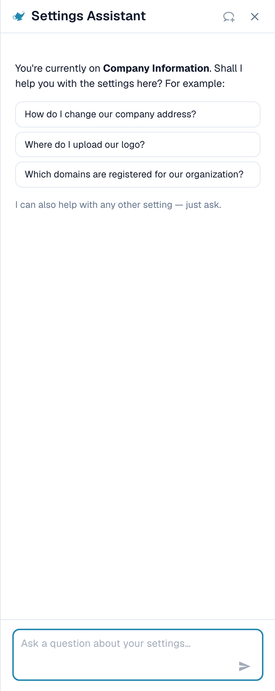

# Asystent ustawień

**Asystent ustawień** (Settings Assistant) to panel czatu w obszarze Ustawień. Zadajesz pytanie zwykłym językiem, a on odczytuje konfigurację Twojej organizacji, odpowiada i prowadzi Cię prosto do właściwego ustawienia. Może też ostrzec, gdy coś w Twojej konfiguracji przestało działać, i, po Twoim potwierdzeniu, zmienić za Ciebie ustawienie.

Pomaga najbardziej, gdy wiesz, **co** chcesz osiągnąć („przestań dzielić dokumenty według kodów kreskowych"), ale nie wiesz, **gdzie** znajduje się ustawienie, albo gdy zastanawiasz się, **dlaczego** coś się nie dzieje („Dlaczego dopasowanie PO nie jest aktywne?").

<figure><figcaption>
Asystent ustawień na stronie Informacje o firmie: powitanie dla bieżącej strony, trzy przykładowe pytania i pole pytania. Karta ostrzeżenia pojawia się nad powitaniem, gdy import przestał działać (zobacz <a href="settings-assistant-chat.md#ustalenia-asystent-cie-ostrzega">Ustalenia</a>).
</figcaption></figure>

Asystent jest **domyślnie wyłączony**. Ta strona pokazuje, gdzie go włączyć i jak otworzyć. To, o co możesz go zapytać i co może zmienić, opisuje strona [Asystent ustawień: co potrafi czat](settings-assistant-chat.md).

## Kto może z niego korzystać

* **Administrator organizacji** włącza lub wyłącza asystenta dla całej organizacji.
* Po włączeniu każdy administrator, który może otworzyć **Ustawienia**, może pokazać lub ukryć panel dla siebie.
* Zmiany (zastosowanie rekomendacji, wyłączenie lub usunięcie połączenia importu, utworzenie reguły) są ograniczone do **administratorów organizacji**. Inni użytkownicy dostają komunikat *Available to administrators only.* (Dostępne tylko dla administratorów).

## Włączanie

1. Przejdź do **Ustawienia → Ustawienia globalne → Informacje o firmie**. Nagłówek strony pokazuje **Company Settings** (Ustawienia firmy).
2. Otwórz sekcję **Asystenci** (Assistants).
3. Włącz **Włącz asystenta ustawień** (Enable the settings assistant).

<figure><figcaption>
Sekcja Asystenci. Asystent ustawień ma własny przełącznik. Asystent walidacji i lektor objaśnień to osobne funkcje.
</figcaption></figure>

Krótki komunikat potwierdza **Settings assistant enabled** (Asystent ustawień włączony). Ustawienie jest domyślnie wyłączone. Gdy jest wyłączone, panel i jego przycisk nie pojawiają się nigdzie.


**Asystent walidacji** (Validation assistant) w tej samej sekcji to inna funkcja. Wyjaśnia blokujące pola wewnątrz dokumentu i nie może zmienić żadnego ustawienia. Przełączenie jednego z dwóch nie wpływa na drugiego.


## Otwieranie i zamykanie panelu

Na każdej stronie obszaru Ustawień znajdziesz mały **przycisk z lampą dżina** obok pola wyszukiwania ustawień. Kliknij go, aby **pokazać** lub **ukryć** asystenta.

<figure><figcaption>
Asystent znajduje się po <strong>prawej stronie</strong> każdej strony Ustawień: nawigacja po lewej, strona pośrodku, asystent obok niej. Tutaj na stronie <strong>Company Settings → Company Information</strong>. Przycisk do pokazywania lub ukrywania to ikona lampy obok pola <strong>Search Settings</strong> (Szukaj w ustawieniach) na górze nawigacji.
</figcaption></figure>

* Panel zapamiętuje Twój wybór dla każdego użytkownika, więc przy następnej wizycie pozostaje otwarty.
* Na szerokim ekranie (1280 pikseli i więcej) znajduje się obok strony. Możesz przeciągnąć jego krawędź, aby zmienić szerokość.
* Na wąskim ekranie otwiera się jako nakładka. **Esc** lub kliknięcie poza nią zamyka panel.
* **Nowy czat** (New chat) (ikona dymka w nagłówku) czyści rozmowę. Rozmowa przetrwa też odświeżenie strony, ale nie zamkniętą kartę przeglądarki.

## Co dalej

* Zadaj pierwsze pytanie: zobacz [Asystent ustawień: co potrafi czat](settings-assistant-chat.md).
* Asystent działa na poziomie AI **Fast**. Nie ma ustawienia organizacji, które pozwalałoby wybrać inny model.

## Rozwiązywanie problemów

| Problem | Przyczyna i rozwiązanie |
| --- | --- |
| W obszarze Ustawień nie ma przycisku z lampą dżina | Przełącznik organizacji jest wyłączony. Administrator organizacji włącza go w **Informacje o firmie → Asystenci** |
| Brakuje sekcji **Asystenci** w Informacjach o firmie | Widzą ją tylko administratorzy organizacji |
| Panel pokazuje **The assistant is being set up** (Asystent jest konfigurowany) | Funkcja nie jest jeszcze dostępna w Twoim środowisku |
| Panel jest, ale odpowiedzi brzmią *Available to administrators only.* | Twoje konto nie jest administratorem organizacji |

## Powiązane strony

* [Asystent ustawień: co potrafi czat](settings-assistant-chat.md)
* [Preferencje firmy](company-preferences.md)
