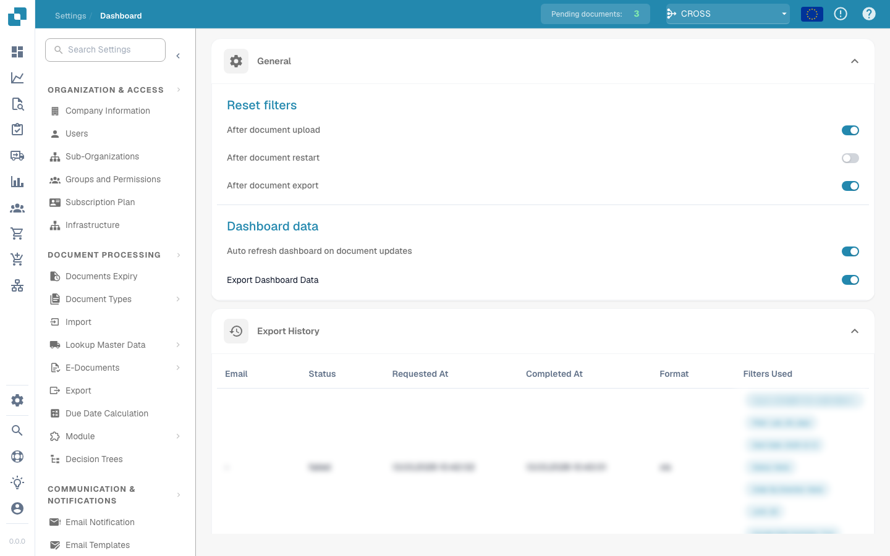
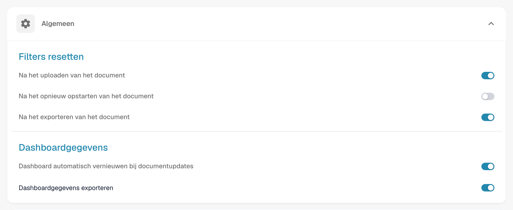
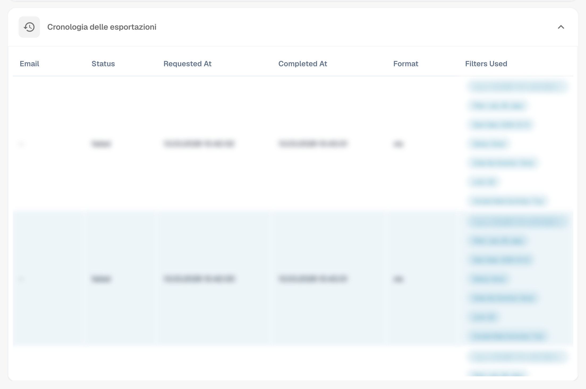
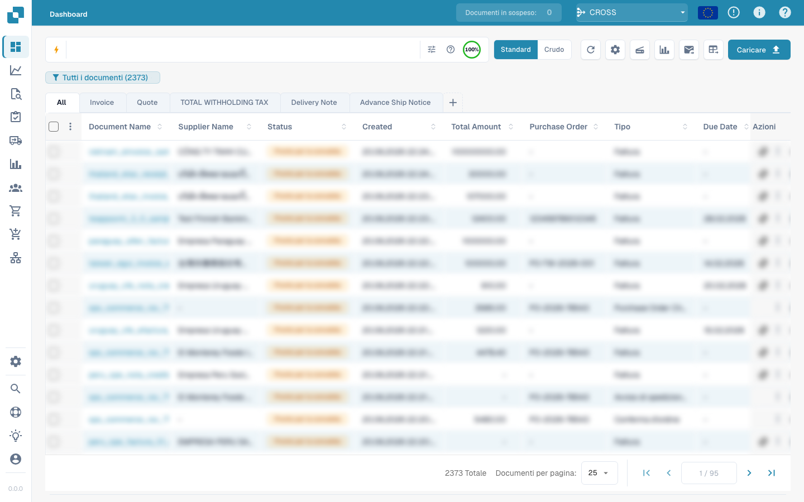

# 仪表板

## 概述

仪表板设置旨在帮助管理员控制 DocBits 仪表板中的数据显示和交互方式。这些设置决定用户登录后即可查看哪些信息，确保用户能够快速访问与其任务最相关的数据。

<figure><figcaption>
仪表板设置页面
</figcaption></figure>

## 访问仪表板设置

要访问仪表板设置，请转到：\
**设置 → 全局设置 → 仪表板**

<figure><figcaption></figcaption></figure>

## **常规** 

* **重置筛选器**：可配置仪表板筛选器在何时重置，例如在文档上传、文档重启或文档导出后重置。这有助于在工作流的特定阶段清除筛选条件，便于查看数据。
* **仪表板数据**：
  * **自动加载仪表板数据**：控制用户访问时仪表板是否自动加载数据。仅在需要时加载数据，有助于缩短加载时间并改善用户体验。
  *   **导出仪表板数据**：此功能会在仪表板工具栏中添加一个新的 **导出** 按钮，允许您将当前仪表板视图导出为 **.csv** 或 **.xlsx** 文件。

      <figure><figcaption></figcaption></figure>

## **导出历史记录**

在 **导出历史记录** 中，您会看到一张表格，其中列出了以往的所有导出记录及每个请求的关键信息。

<figure><figcaption></figcaption></figure>

其中包含以下详细信息：

* **电子邮件**：发起导出请求的电子邮件地址。
* **状态**：导出的当前状态（待处理、已完成）。
* **请求时间**：发起导出的日期和时间。
* **完成时间**：导出完成的日期和时间。
* **格式**：导出使用的文件格式（CSV、XLSX）。
* **已用筛选器**：导出时应用于仪表板的所有筛选器。

<mark style="color:red;">**注意**</mark>：要导出表格，必须在[常规](./#general)部分启用“导出仪表板数据”选项。

## **操作**

* **分配给**：此功能允许用户定义文档分配权限。
  * **仅限管理员**：无论授予非管理员用户何种权限，只有管理员用户可以分配文档。
  * **所有用户**：所有已获得必要[权限](../groups-users-and-permissions/groups-and-permissions/activating-permissions.md)的用户都可以分配文档。
* **重启**：此功能允许用户定义文档重启权限。
  * **仅限管理员**：无论授予非管理员用户何种权限，只有拥有管理员权限的用户可以重启文档。
  * **仅限管理员和受分配者**：只有拥有管理员权限的用户和已分配的用户可以重启文档。
  * **所有用户**：所有已获得必要[权限](../groups-users-and-permissions/groups-and-permissions/activating-permissions.md)的用户都可以重启文档。

<figure><figcaption></figcaption></figure>

## **筛选器**

* **状态筛选器样式**：决定状态筛选器的显示样式，可设为默认样式，也可根据用户的运营重点进行自定义。
* **自定义状态筛选器**：启用自定义筛选器的创建和应用，可针对“新建”、“验证中”或“导出中”等特定文档状态进行筛选。这样，用户可以快速访问处于特定处理阶段的文档。

<figure><figcaption></figcaption></figure>

## 高级装运仪表板

* **已交付订单可见性**：此功能允许用户指定已交付订单的可见时长。

<figure><figcaption></figcaption></figure>

这些仪表板设置对于确保 DocBits 平台尽可能灵敏且实用至关重要，可为用户提供强大的工具，直接从仪表板监控和管理文档处理活动。
