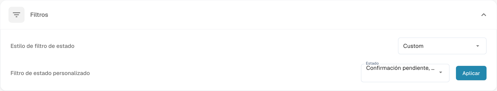

# Personalizando Filtros

Si estás buscando uno o más documentos específicos, las siguientes opciones están disponibles para ti. Dentro de la barra de búsqueda, te hemos proporcionado varias herramientas para ayudarte a encontrar el documento que buscas. Para acceder a ellas, selecciona el siguiente ícono.

Usar filtros permite a los usuarios encontrar rápidamente información relevante y reducir la cantidad de datos a lo esencial.

## Cómo personalizar y aplicar filtros en DocBits

### Accediendo a la configuración de filtros Abriendo el PANEL:

* Inicia sesión en DocBits y abre el PANEL que contiene los datos que deseas filtrar.

**Accediendo al menú de filtros:**

* Haz clic en el ícono de filtro o en el campo de búsqueda.

### Personalizando filtros

#### **Usando filtros predefinidos**

* Abre el menú de filtros.
* Elige entre las opciones de filtro predefinidas (por ejemplo, Fecha, Tipo de Documento, Persona Asignada).
* Ajusta los criterios del filtro seleccionando o ingresando los valores apropiados (por ejemplo, rango de fechas, tipo de documento específico).

#### **Crea tus propios filtros**

* Abre el menú de filtros en la configuración bajo PANEL y haz clic en "Filtros".

<figure><figcaption>
Estilo de filtro de estado y filtro personalizado del panel.
</figcaption></figure>

* Selecciona el campo a filtrar (por ejemplo, Estado).

* Define los criterios del filtro, por ejemplo: estilo de filtro de Estado.

* Menús desplegables: Elige entre opciones predefinidas.

* Guarda el filtro personalizado haciendo clic en "Aplicar".

#### **Usar filtros combinados**

* Abre el menú de filtros y selecciona múltiples criterios de filtro a la vez.
* Combina criterios de filtro.
* **Ejemplo:** Documentos que fueron creados por el autor "Max Mustermann" Y que fueron creados en el último mes.
* Una vez que hayas seleccionado un filtro, se aplicará automáticamente.

#### **Aplicando y Gestionando Filtros**

**Aplicando Filtros**

* Después de seleccionar y ajustar los filtros deseados, los filtros se aplican automáticamente.

**Eliminando Filtros**

* Abre el menú de Filtros.
* Paso 2: Limpia o elimina los filtros aplicados haciendo clic en "Filtros claros", el ícono de X junto al filtro seleccionado ya sea en el menú de Filtros o debajo de la barra de Filtros.

* Los datos se muestran nuevamente sin los criterios de filtro anteriores.
