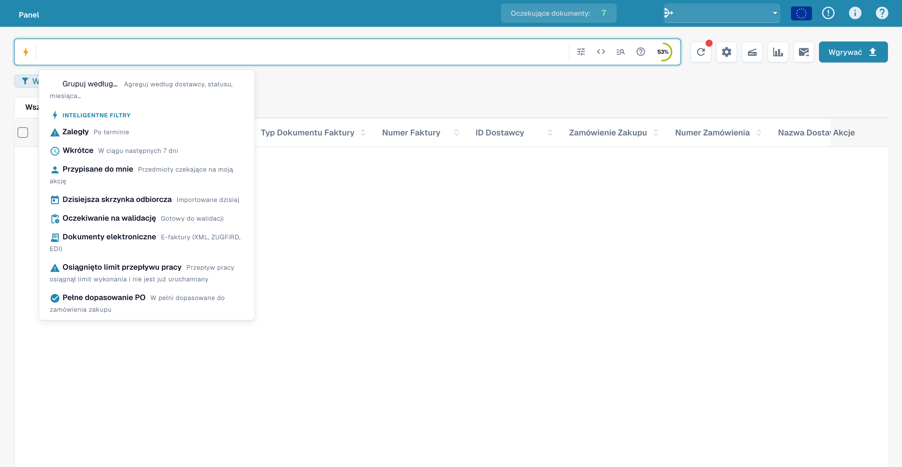
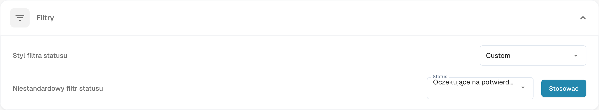

# Dostosowywanie filtrów

Jeśli szukasz jednego lub więcej konkretnych dokumentów, masz do dyspozycji następujące opcje. W obrębie paska wyszukiwania udostępniliśmy różne narzędzia, które pomogą Ci znaleźć poszukiwany dokument. Aby uzyskać do nich dostęp, wybierz następujący ikonę.

Korzystanie z filtrów pozwala użytkownikom szybko znaleźć istotne informacje i ograniczyć ilość danych do niezbędnych.

## Jak dostosować i stosować filtry w DocBits

### Uzyskiwanie dostępu do ustawień filtrów Otwieranie panelu:

* Zaloguj się do DocBits i otwórz panel, który zawiera dane, które chcesz filtrować.

**Uzyskiwanie dostępu do menu filtrów:**

* Kliknij ikonę filtra lub pole wyszukiwania.

<figure><figcaption>
Wyszukiwanie dokumentów i szybkie filtry z ukrytymi danymi dokumentów.
</figcaption></figure>

### Dostosowywanie filtrów

#### **Korzystanie z predefiniowanych filtrów**

* Otwórz menu filtrów.
* Wybierz z predefiniowanych opcji filtrów (np. Data, Typ dokumentu, Osoba przypisana).
* Dostosuj kryteria filtra, wybierając lub wprowadzając odpowiednie wartości (np. zakres dat, konkretny typ dokumentu).

#### **Utwórz własne filtry**

* Otwórz menu filtrów w ustawieniach pod Panelem i kliknij "Filtry".

<figure><figcaption>
Styl filtra statusu i niestandardowy filtr panelu.
</figcaption></figure>

* Wybierz pole do filtrowania (np. Status).

* Zdefiniuj kryteria filtra, np.: styl filtra statusu.

* Menu rozwijane: Wybierz z predefiniowanych opcji.

* Zapisz niestandardowy filtr, klikając "Stosować".

#### **Korzystanie z filtrów łączonych**

* Otwórz menu filtrów i wybierz jednocześnie wiele kryteriów filtrów.
* Łącz kryteria filtrów.
* **Przykład:** Dokumenty, które zostały stworzone przez autora "Max Mustermann" ORAZ zostały stworzone w ostatnim miesiącu.
* Po wybraniu filtra zostanie on automatycznie zastosowany.

#### **Stosowanie i zarządzanie filtrami**

**Stosowanie filtrów**

* Po wybraniu i dostosowaniu pożądanych filtrów, filtry są automatycznie stosowane.

**Usuwanie filtrów**

* Otwórz menu Filtry.
* Krok 2: Wyczyść lub usuń zastosowane filtry, klikając "Wyczyść filtry", ikonę X obok wybranego filtra, zarówno w menu Filtry, jak i poniżej paska Filtrów.

* Dane są ponownie wyświetlane bez wcześniejszych kryteriów filtra.
