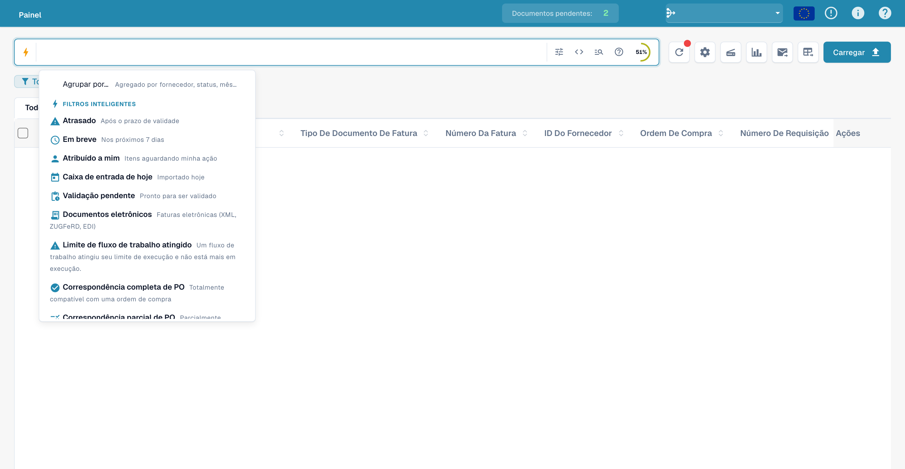

# Personalizando Filtros

Se você está procurando um ou mais documentos específicos, as seguintes opções estão disponíveis para você. Dentro da barra de pesquisa, fornecemos várias ferramentas para ajudá-lo a encontrar o documento que você está procurando. Para acessá-las, selecione o seguinte ícone.

Usar filtros permite que os usuários encontrem rapidamente informações relevantes e reduzam a quantidade de dados ao essencial.

## Como personalizar e aplicar filtros no DocBits

### Acessando as configurações de filtro Abrindo o painel:

* Faça login no DocBits e abra o painel que contém os dados que você deseja filtrar.

**Acessando o menu de filtro:**

* Clique no ícone de filtro ou no campo de pesquisa.

<figure><figcaption>
Pesquisa de documentos e filtros rápidos com os dados dos documentos ocultos.
</figcaption></figure>

### Personalizando filtros

#### **Usando filtros predefinidos**

* Abra o menu de filtro.
* Escolha entre as opções de filtro predefinidas (por exemplo, Data, Tipo de Documento, Pessoa Designada).
* Ajuste os critérios do filtro selecionando ou inserindo os valores apropriados (por exemplo, intervalo de datas, tipo de documento específico).

#### **Crie seus próprios filtros**

* Abra o menu de filtro nas configurações sob Painel e clique em "Filtros".

<figure><figcaption>
Estilo do filtro de estado e filtro personalizado do painel.
</figcaption></figure>

* Selecione o campo a ser filtrado (por exemplo, Status).

* Defina os critérios do filtro, por exemplo: estilo de filtro de Status.

* Menus suspensos: Escolha entre opções predefinidas.

* Salve o filtro personalizado clicando em "Aplicar".

#### **Use filtros combinados**

* Abra o menu de filtro e selecione múltiplos critérios de filtro ao mesmo tempo.
* Combine critérios de filtro.
* **Exemplo:** Documentos que foram criados pelo autor "Max Mustermann" E foram criados no último mês.
* Uma vez que você tenha selecionado um filtro, ele será aplicado automaticamente.

#### **Aplicando e Gerenciando Filtros**

**Aplicando Filtros**

* Depois de selecionar e ajustar os filtros desejados, os filtros são aplicados automaticamente.

**Removendo Filtros**

* Abra o menu de Filtros.
* Passo 2: Limpe ou remova os filtros aplicados clicando em "Limpar filtros", no ícone X ao lado do filtro selecionado, seja no menu de Filtros ou abaixo da barra de Filtros.

* Os dados são exibidos novamente sem os critérios de filtro anteriores.
