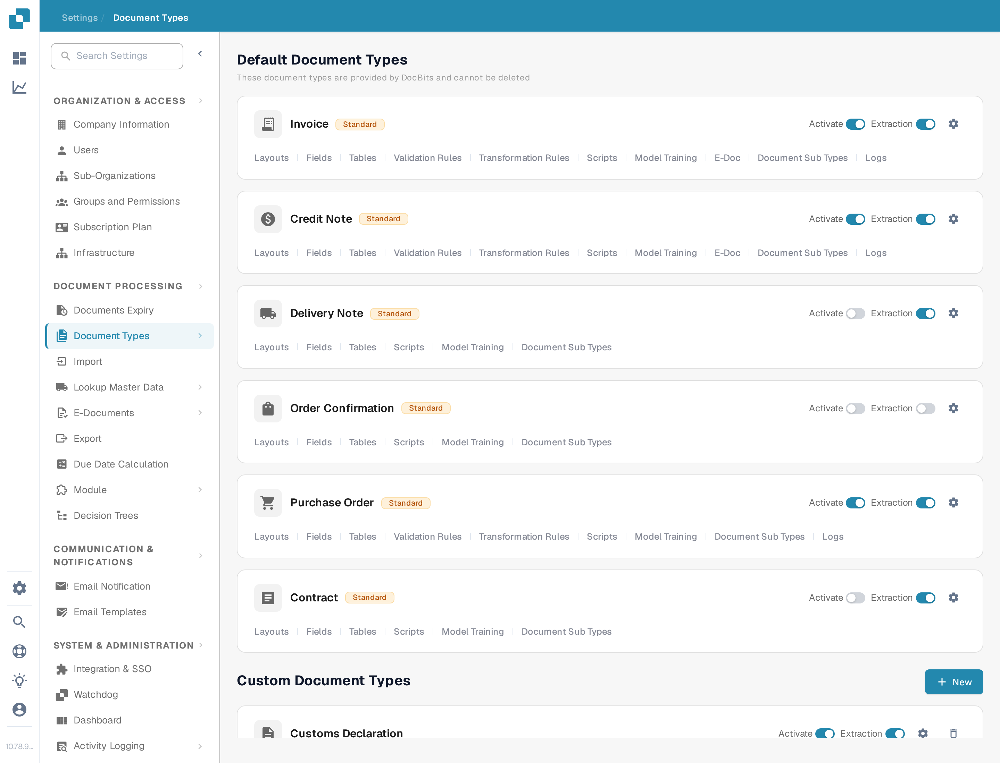

# Document Types


DocBits Document Types Explained: Create, Configure & Assign Processing Settings


<figure><figcaption>
The Document Types page. Each card carries the Activate and Extraction switches, the settings gear, and the configuration links described below.
</figcaption></figure>

## Overview

The Document Types page lists all document types recognized and processed by DocBits. It is divided into two sections:

* **Default Document Types**: Pre-configured types provided by DocBits (Invoice, Credit Note, Delivery Note, Order Confirmation, Contract, ZUGFeRD, etc.). These cannot be deleted.
* **Custom Document Types**: Types you create for your specific business needs. These can be edited and deleted.

## Controls per Document Type

Each document type card shows:

| Control | Description |
|---------|-------------|
| **Activate** | Switch that enables or disables this document type for processing. See [Activate or deactivate a document type](activation.md). |
| **Extraction** | Switch that selects the extraction mode, **Flex** or **Fix**. It does not switch extraction on or off. |
| **Settings** (gear icon) | Opens [More Settings](more-settings/README.md) for this document type, for example Custom Validation Rules, Transformation Rules and Duplicate Detection. |

## Configuration Links

Under the Activate and Extraction switches, each card carries links to the configuration areas of that document type. A link appears only when the matching feature is switched on for the type, so a card can show fewer links than the list below.

| Link | What you configure | Guide |
|------|--------------------|-------|
| **Layouts** | Where the fields sit on the document image in the validation view. | [Layout Manager](layout-manager/README.md) |
| **Fields** | The data fields DocBits extracts from this document type. | [Fields](fields/README.md) |
| **Tables** | The columns of the line-item table. | [Table Columns](table-columns/README.md) |
| **Validation Rules** | Your own rules for values that must be correct before a document can be exported. | [Custom Validation Rules](custom-validation-rules.md) |
| **Transformation Rules** | Steps that correct values after extraction and before validation. | [Transformation Rules](transformation-rules.md) |
| **Scripts** | Scripts that run while a document is processed. | [Scripts](script/README.md) |
| **Model Training** | The training data and the model for this document type. | [Model Training](model-training/README.md) |
| **E-Doc** | Electronic document standards such as XRechnung, ZUGFeRD, EDI and FatturaPA. | [E-Docs](edi/README.md) |
| **Document Sub Types** | Subcategories of this document type, for example one per supplier template. | [Document Sub Types](document-sub-types.md) |
| **Logs** | One entry per evaluation of a validation, transformation or layout selection rule, including the condition trace. | [Logs](custom-validation-rules.md#logs) |

## Custom Validation Rules

Custom validation rules are rules **you** write for a single document type. They check values that the standard field checks cannot cover, for example a supplier tax ID that is only required for German invoices above 250 EUR, or a due date that must not be earlier than the invoice date. Each rule has a condition that decides whether it applies at all, a check that must be true, and a severity that decides whether a violation blocks the document (Error) or only shows a message (Warning).

Before you use them, know two things:

* The rules are switched on **per document type**, not for the whole organisation. Open the card's settings gear, open the **Custom Validation Rules** panel and turn the toggle on. The card then shows the **Validation Rules** link.
* While the toggle is on, the built-in amount checks (total amount = net + tax, and the line amount checks) are replaced by your rules. Recreate the checks you rely on as rules before switching it on.

The link on the card opens the rule list of the document type, where you create, activate, edit, test and delete rules.


To copy a rule instead of rebuilding it, follow [Duplicate a Custom Validation Rule](duplicate-a-custom-validation-rule.md).


[Custom Validation Rules](custom-validation-rules.md) explains the whole workflow: enabling, the rule list, the three levels (header field, table line, whole table), the checks (Required, Formula, Pattern, Range, Compare fields, Allowed values, List of Values), the condition step [Rule Conditions (Applies when)](rule-conditions-applies-when.md), testing a rule against a document, the execution [Logs](custom-validation-rules.md#logs), ready-to-use recipes and troubleshooting.

## Creating a Custom Document Type

1. Scroll down to the **Custom Document Types** section.
2. Click **+ New**.
3. Enter a name for the new document type.
4. Configure the fields, layout, and extraction settings as needed.


See [Setup Document Type](../../../setup/document-types/) for detailed setup instructions.

