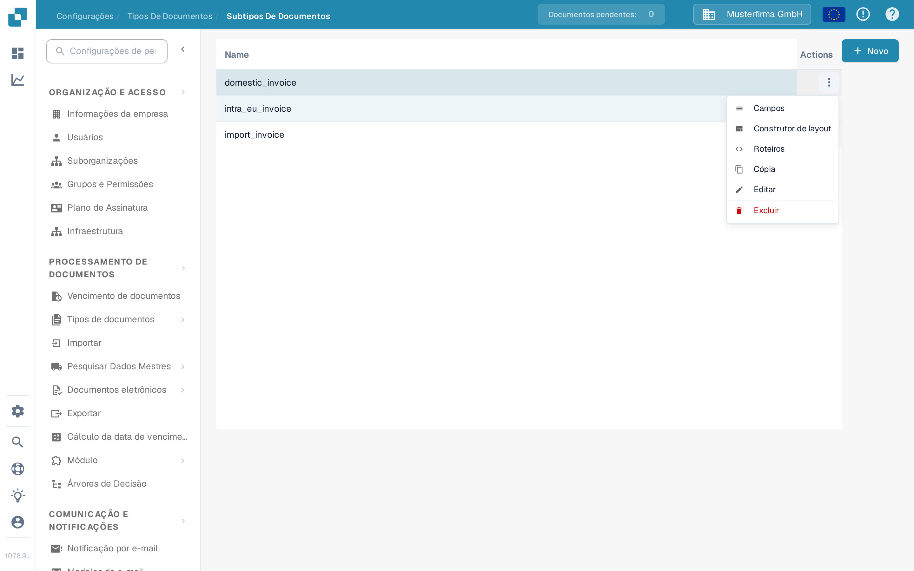
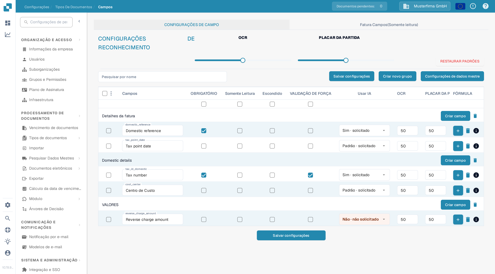
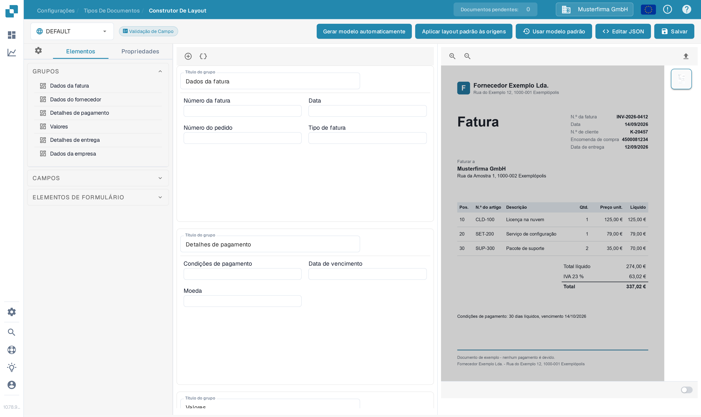
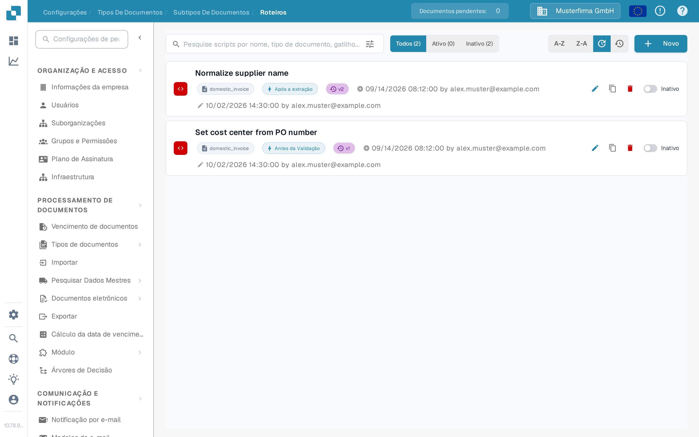

# Configurar subtipos

Use um subtipo de documento quando faturas do mesmo tipo de documento precisam de campos diferentes, um layout de validação diferente ou scripts de processamento próprios. Comece por [criar um subtipo](creating-a-new-sub-type.md), depois abra **Configurações → Tipos De Documentos**, escolha o tipo de documento e abra **Subtipos De Documentos**. Na linha do subtipo, abra **Actions** (os três pontos). O menu oferece **Campos**, **Construtor de layout** e **Roteiros**; também contém [Copiar, Editar e Excluir](using-actions.md).

<figure><figcaption>
Escolha a parte do subtipo que deseja configurar.
</figcaption></figure>

## Campos

Selecione **Campos** para decidir quais informações os usuários veem e inserem para este subtipo. Você pode criar um campo em um grupo, marcar um campo existente como obrigatório, somente leitura ou oculto, e ajustar as opções de reconhecimento. Selecione **Salvar configurações** depois de fazer alterações. Use [Adicionando e Editando Campos](fields/adding-and-editing-fields.md) para os passos, [Configurando Propriedades de Campo](fields/configuring-field-properties-1.md) para as opções de coluna, e [Configurações de dados mestre](fields/master-data-settings.md) quando um campo deve usar dados de consulta.

<figure><figcaption>
Configurações de campo na organização de teste da documentação. Nenhum dado de cliente é exibido.
</figcaption></figure>

## Construtor de layout

Selecione **Construtor de layout** para organizar grupos e campos na tela de validação do documento. A parte esquerda lista os elementos; a parte direita aceita um documento de exemplo para pré-visualização. Verifique o resultado e selecione **Salvar** quando o layout estiver pronto. O [guia do Construtor de Layout](../../../setup/document-types/layout-builder.md) explica os elementos, a pré-visualização do documento e como salvar um layout.

<figure><figcaption>
Layout do subtipo antes de adicionar um documento de exemplo.
</figcaption></figure>

## Roteiros

Selecione **Roteiros** para ver os scripts deste subtipo. Em uma lista vazia, selecione **Novo** para começar. A pesquisa e os filtros **Todos**, **Ativo** e **Inativo** ajudam a encontrar os scripts existentes. Siga [Criando e Editando Scripts](script/creating-and-editing-scripts.md) para criar um, e [Ativação e Gestão de Scripts](script/script-activation-and-management.md) antes de ativá-lo para o processamento.

<figure><figcaption>
Nenhum script foi criado no subtipo de teste da documentação.
</figcaption></figure>
