# 自定义验证规则



## 概述

自定义验证规则允许管理员为 DocBits 从文档中提取的数据定义**自己的检查规则**，无需编写脚本，也无需等待产品更新。

一条规则回答三个问题：

1. **在哪里**显示问题？在表头字段上，还是在表格行的某个单元格上。
2. **何时**应用规则？始终应用，还是仅应用于满足某个条件的文档（或行）——请参阅[规则条件（应用条件）](rule-conditions-applies-when.md)。
3. **必须满足什么条件**？字段必须填写、符合某种格式、处于某个范围内、匹配某个列表、与另一个字段正确比较，或完成加总。

检查失败时，DocBits 会在**验证界面**上标记该字段或单元格，并显示您设置的消息——与内置检查完全一样。严重级别为 **错误** 时，必须修复问题后才能验证文档；为 **警告** 时，用户只会看到提示。

规则按**文档类型**定义，并在该类型的每份文档上运行：处理期间以及每次保存文档时都会运行。

### 可解决的问题

| 业务需求 | 不使用自定义规则 | 使用自定义规则 |
| --- | --- | --- |
| 超过 250 EUR 的德国发票必须显示供应商税号 | 需要脚本，或者要求用户牢记 | 在 Supplier Tax ID 上设置 **必填**，*应用条件*为原产地是 DE 且总金额大于 250 |
| 供应商的发票编号始终采用 `INV-123456` 格式 | 错别字会进入 ERP | 为该供应商的 Invoice Number 设置 **图案** `^INV-\d{6}$` |
| 每个商品行的数量都必须大于零 | 数量为 0 的行会被导出 | 在 Quantity 列设置 **范围**（最小值为 0.01） |
| 到期日不能早于发票日期 | 可能导致错误的付款批次 | **比较字段**：Due Date 不早于 Invoice Date |
| 各行金额的总和必须等于净额 | 只能使用固定的内置检查 | **公式** `sum(row.NET_AMOUNT) == header.total_net_amount`，并设置自定义容差 |
| 只允许使用 ERP 认可的币种 | ERP 中会出现导出错误 | 在 Currency 上设置 **值列表** |
| 提醒用户注意异常值，但不阻止他们继续操作 | 无法实现 | 将任意规则的严重级别设为 **警告** |

## 启用自定义验证规则

自定义验证规则按**文档类型**启用。没有面向整个组织的开关。

1. 前往 **Settings → Global Settings → Document Types**。
2. 在文档类型卡片上，点击 **设置**（齿轮）图标。
3. 打开 **自定义验证规则** 区域并开启开关。
4. 点击 **管理验证规则** 打开规则列表。

<figure>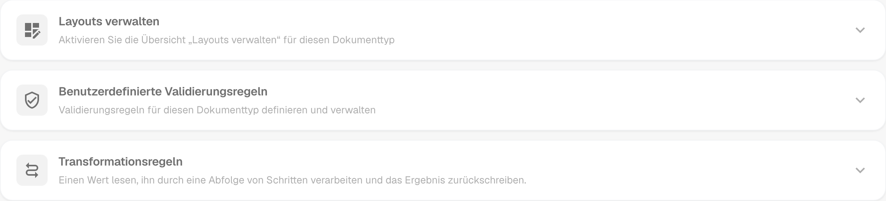<figcaption>
Manage Layouts、Custom Validation Rules 和 Transformation Rules 的开关
</figcaption></figure>

之后，文档类型卡片还会显示 **验证规则** 链接，以及用于查看执行日志的 **日志** 链接。

<figure>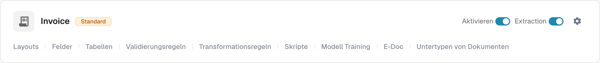<figcaption>
文档类型卡片上的链接
</figcaption></figure>


**启用此开关会替代内置金额检查。** 文档类型启用自定义验证规则后，硬编码检查“总金额 = 净额 + 税额”以及行金额/折扣检查将不再运行；这些检查由可配置规则取代。启用前，请将您依赖的检查重新创建为规则（请参阅[示例](#recipes)）。关闭此开关后会恢复内置检查。其他所有字段验证（必填字段、格式、主数据）仍会运行。


## 规则列表

**Document Types →（文档类型）→ Validation Rules**会列出该文档类型的所有规则。

<figure>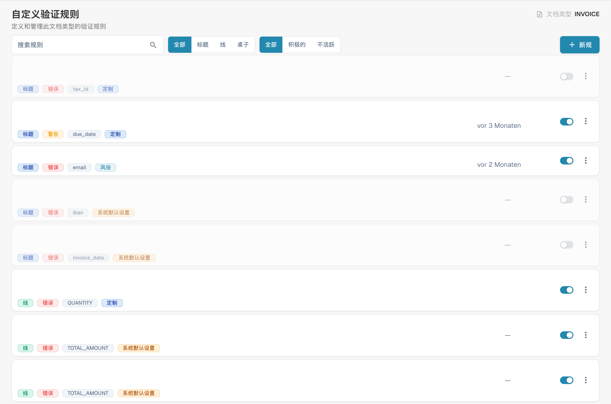<figcaption>
验证规则管理；已配置的名称已隐藏。 表格类别在界面中误译为“桌子”，部分相对时间仍为德语；实际含义是数据表格。
</figcaption></figure>

每张卡片都会显示规则名称和说明，以及表示其**级别**（Header / Line / Table）、**严重级别**（Error / Warning）、错误所关联的**字段**和**来源**的徽标。使用右侧的开关可启用或停用规则；使用 **⋮** 菜单可复制或删除规则。可按级别（**All / Header / Line / Table**）和状态（**All / Active / Inactive**）筛选列表，也可以搜索规则。

### System default、Customized 和 Custom 规则

| 来源 | 含义 | 可执行的操作 |
| --- | --- | --- |
| **系统默认设置** | DocBits 为所有组织提供的规则。 | 不能直接编辑——构建器会显示“This is a system default rule and cannot be edited.”。点击 **定制** 可创建可编辑副本，也可以关闭该规则，使其不再应用于您的组织。 |
| **定制** | 已由您的组织修改或关闭的系统默认规则。 | 可以像编辑自己的规则一样编辑。**重置为默认值** 会删除您的副本并恢复原始规则。 |
| **自定义** | 您的组织创建的规则。 | 可以编辑、**复制** 或 **删除**。 |

对系统默认规则所做的更改不会影响其他组织。

## 创建规则

点击 **新规**。构建器分为三个步骤。右上角有 **测试规则** 和 **保存**。

### 步骤 1 — 名称和范围

<figure>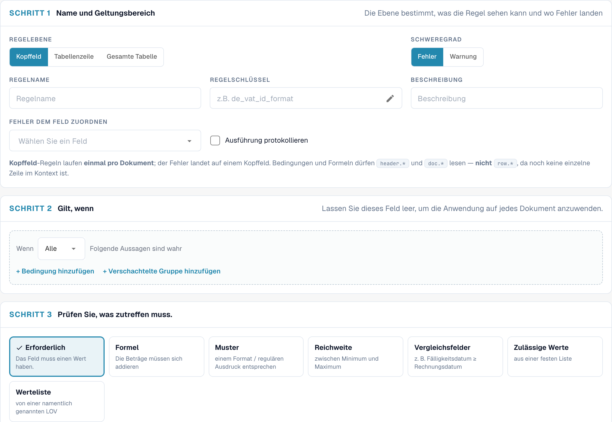<figcaption>
表头字段规则的步骤 1
</figcaption></figure>

| 设置 | 作用 |
| --- | --- |
| **规则级别** | 规则检查的内容和显示错误的位置——请参阅[规则级别](#rule-levels)。 |
| **严重程度** | **错误** 会将字段标记为无效并阻止验证。**警告** 会显示消息，但不会阻止验证。 |
| **规则名称** | 显示在列表、日志中以及供管理员查看。名称应能描述规则（例如“德国发票必须填写供应商税号”）。 |
| **规则键** | 根据名称生成的技术键。之后重命名规则时，该键会保持不变。首次保存前，点击铅笔图标可以自行选择规则键；之后规则键将固定。 |
| **描述** | 可选内容，用于向其他管理员说明规则。 |
| **表名** | *仅适用于表格行。* 要检查其行的表格，例如 `INVOICE_TABLE`。 |
| **Attach error to field / column** | 在验证界面上显示错误的字段（对于表格行规则，则是列）。 |
| **记录执行日志** | 每次评估都会写入一条日志，其中包括规则是否适用以及原因。请参阅[日志](#logs)。 |

#### 规则级别 

| 级别 | 运行方式 | 错误显示位置 | 可读取的内容 | 典型规则 |
| --- | --- | --- | --- | --- |
| **页眉字段** | 每份文档运行一次 | 表头字段 | `header.*`、`doc.*` | “德国发票必须填写供应商税号” |
| **表格行** | 对所选表格的每一行运行一次 | 检查失败行的单元格 | `row.*`（当前行）、`header.*`、`doc.*` | “数量必须大于零” |
| **整个表格** | 每份文档运行一次，同时检查所有行 | 表头字段 | 行汇总值（`sum()`、`count()`、`min()`、`max()`）、`header.*`、`doc.*` | “行净额之和必须等于净额” |

<figure>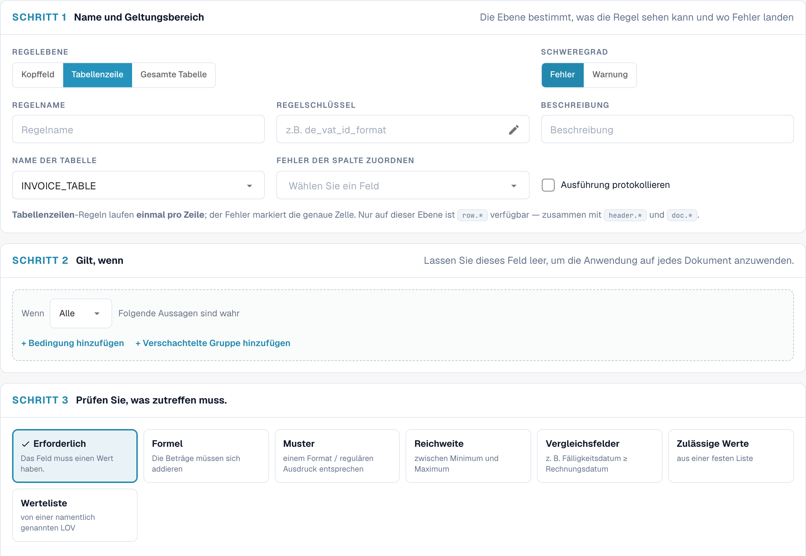<figcaption>
表格行规则：选择表格以及显示错误的列
</figcaption></figure>

### 步骤 2 — 应用条件

决定规则适用于每份文档，还是只适用于部分文档。留空表示检查每份文档。否则，请添加条件行，例如“Document Origin 是 Deutsch”和“Total Amount 大于 250”，并使用 **全部** / **ANY** 和嵌套分组组合条件。

<figure><figcaption>
仅检查金额超过 250、币种为 EUR 或未填写币种的德国文档
</figcaption></figure>

对于表格行规则，条件也可以使用当前行的列，并且会**逐行**评估：不符合条件的行不会接受检查。

<figure><figcaption>
仅检查商品行（带有商品编号的行）
</figcaption></figure>

[规则条件（应用条件）](rule-conditions-applies-when.md)页面详细介绍了条件，其中包括每个字段、运算符和比较规则，以及大量示例。

### 步骤 3 — 检查：必须满足什么条件

选择一种检查方式。选择不同检查方式时，下方的设置也会相应变化。

<figure>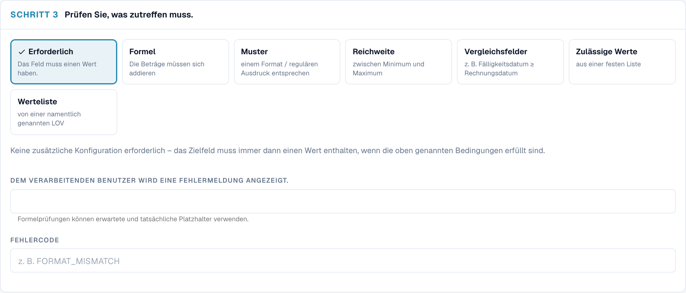<figcaption>
七种检查方式。Required 无需进一步设置
</figcaption></figure>

#### Required — 字段必须有值

字段为空时（缺失或仅包含空格）检查失败。无需进一步设置。

结合**应用条件**可使字段成为**有条件必填**字段。始终必须填写的字段，最好在字段设置中配置为必填字段。

> *Supplier Tax ID 为必填项* — 应用条件为 *Document Origin 是 Deutsch* 且 *Total Amount 大于 250*。

#### Formula — 金额必须加总一致

用于执行算术比较。表达式必须且只能包含**一个**比较运算符（`==`、`!=`、`>`、`>=`、`<`、`<=`）；比较符两侧都可以使用 `+ - * /`、数字、括号和字段引用。

<figure>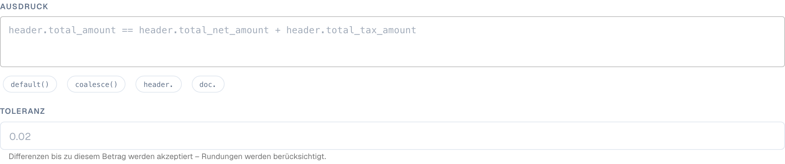<figcaption>
整表公式，可设置容差，并在消息中使用占位符
</figcaption></figure>

* 点击表达式下方的标签，可插入函数和字段前缀：`sum()`、`count()`、`min()`、`max()`、`default()`、`coalesce()`、`header.`、`doc.`。输入字段名称时，会显示匹配字段的列表。
* `sum(row.NET_AMOUNT)`、`count(row.ITEM_NUMBER)`、`min(...)`、`max(...)` 可对所有行进行计算，且仅适用于 **整个表格** 级别。`count()` 会统计该列中已填写值的行数。
* `default(header.discount, 0)` 会在字段为空时使用 `0`；`coalesce(header.a, header.b, 0)` 会使用第一个已填写的值。
* **宽容**：对于 `==` 和 `!=`，不超过此金额的差异会视为相等。可使用 `0.01` 或 `0.05` 来吸收舍入误差。此设置对 `<`、`>`、`<=` 和 `>=` 无效。
* 空金额或无法读取的金额按 `0` 计算。除以零时会跳过规则，而不会引发错误。
* 在错误消息中，`{actual}` 会替换为左侧表达式的计算结果，`{expected}` 会替换为右侧表达式的计算结果。

示例：

| 用途 | 级别 | 表达式 | 容差 |
| --- | --- | --- | --- |
| 表头金额一致 | Header field | `header.total_amount == header.total_net_amount + header.total_tax_amount` | 0.01 |
| 各行金额之和等于净额 | Whole table | `sum(row.NET_AMOUNT) == header.total_net_amount` | 0.05 |
| 行金额 = 数量 × 单价 | Table line | `row.NET_AMOUNT == row.QUANTITY * row.UNIT_PRICE` | 0.01 |
| 税额不超过净额的 19% | Header field | `header.total_tax_amount <= header.total_net_amount * 0.19` | – |
| 至少有一行 | Whole table | `count(row.ITEM_NUMBER) >= 1` | 0 |

#### Pattern — 匹配格式 / 正则表达式

字段值必须匹配**正则表达式**。表达式会在值中搜索，因此如果要求整个值都匹配，请使用 `^`（开头）和 `$`（结尾）锚定表达式。如果不区分大小写，请勾选 **不区分大小写的匹配**。

| 格式 | 正则表达式 |
| --- | --- |
| `INV-` 后跟六位数字 | `^INV-\d{6}$` |
| 德国增值税号 | `^DE\d{9}$` |
| 以 45 开头且长度为 10 位的采购订单编号 | `^45\d{8}$` |
| 仅包含数字 | `^\d+$` |
| IBAN（粗略检查） | `^[A-Z]{2}\d{2}[A-Z0-9]{11,30}$` |

#### Range — 最小值与最大值之间

字段值必须是**最小值**和**最大值**（含边界）之间的数字。可以填写其中一个，也可以两个都填写。非数字值会导致检查失败。系统可以识别 `1.234,56` 等格式化金额。

<figure>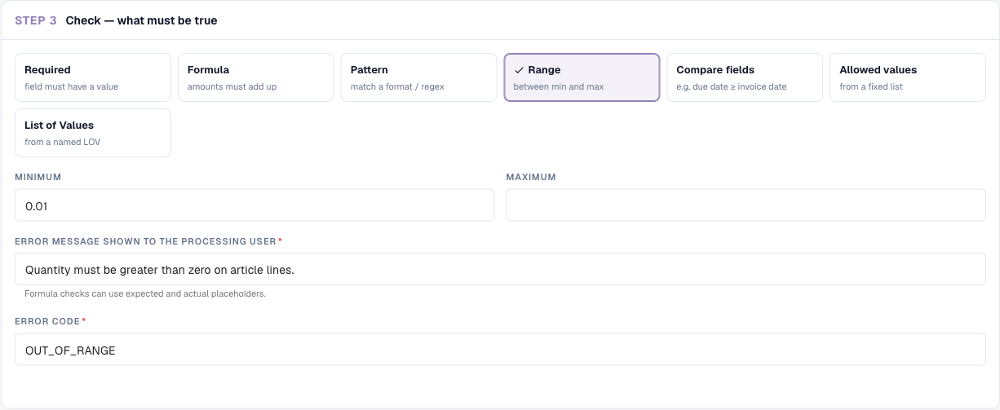<figcaption>
仅设置最小值的范围：数量必须至少为 0.01
</figcaption></figure>

#### Compare fields — 例如到期日 ≥ 发票日期

将某个字段的值与另一个字段、**今天**或固定值进行比较。可选择*等于*、*不等于*、*大于*、*小于*、*不早于（≥）*或*不晚于（≤）*。数字按数字比较，日期按日期比较。

* Due Date **不早于（≥）** Invoice Date
* Invoice Date **不晚于（≤）**今天——不允许发票日期在未来
* Discount **小于** 100

#### 允许的值 — 从固定列表中选择

字段值必须是您输入的某个值，**每行一个值**。可以选择不区分大小写。适用于简短且稳定的列表（`EUR`、`CHF`、`USD`）。

#### List of Values — 从命名 LOV 中选择

与 *Allowed values* 类似，但值来自在 **Settings › List of Values** 下管理的共享**值列表**。选择相应列表即可，无需重新输入值；列表更改后（经过短暂的缓存延迟），规则会使用新值。系统只会检查列表项的值，不会检查其标签。


除 **必填** 外，其他检查在**字段为空时均视为通过**。如果发票没有采购订单，Purchase Order 上的 Pattern 规则不会报错。如果空值也有问题，请添加 Required 规则，或通过 *Applies when … is not empty* 限定规则的适用范围。


#### 错误消息和错误代码

* **向处理用户显示的错误消息**——验证界面上显示的文本。说明哪里有问题，**以及**应该如何处理：“Supplier tax ID is missing. German invoices over 250 EUR must show it.”
* **错误代码**——简短的技术代码，例如 `REQUIRED_CONDITIONAL`、`FORMAT_MISMATCH`、`OUT_OF_RANGE`、`DATE_ORDER`、`LINES_HEADER_MISMATCH`、`VALUE_NOT_ALLOWED`。该代码会显示在导出结果和日志中，便于对错误分组。

## 测试规则 

点击 **测试规则**，即可针对某份文档运行当前版本的规则，无论该规则是否已保存。输入 **文档 ID**，或者切换到 **通过文档 JSON** 并粘贴提取的数据。**不会保存任何内容**，也不会更改文档。

测试结果分为以下三种：

| 结果 | 含义 |
| --- | --- |
| **规则失败——引发错误** | 条件匹配且检查失败。显示的消息与用户实际看到的完全一致。 |
| **规则通过** | 条件匹配且检查通过。表格行规则会逐行显示结果（“4 of 4 checked rows passed”）。 |
| **规则已跳过——范围不匹配** | 此文档不符合 *Applies when* 条件，因此未执行检查，也未引发错误。 |

<figure>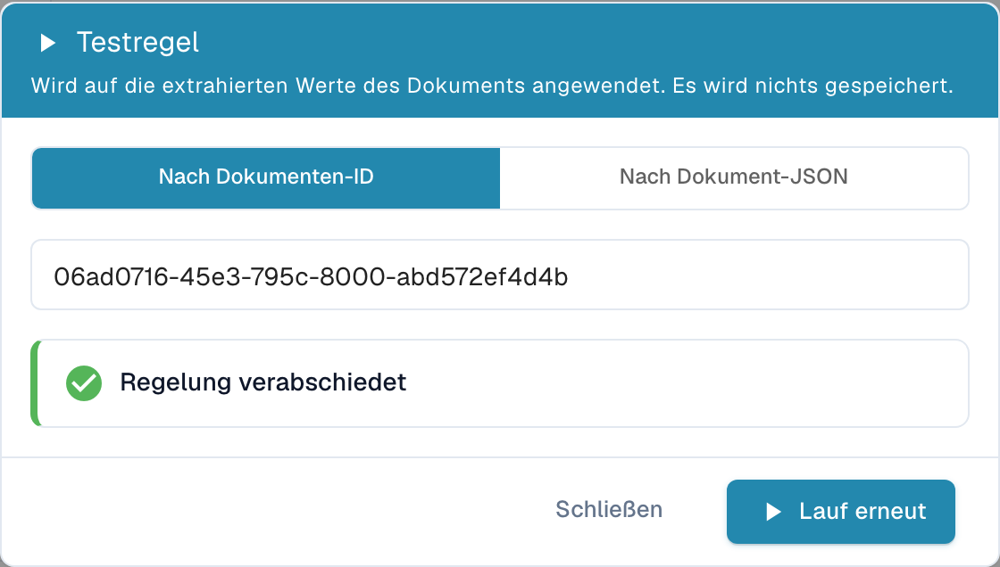<figcaption>
这张德国发票缺少供应商税号：规则按设置的消息报告失败
</figcaption></figure>

<figure>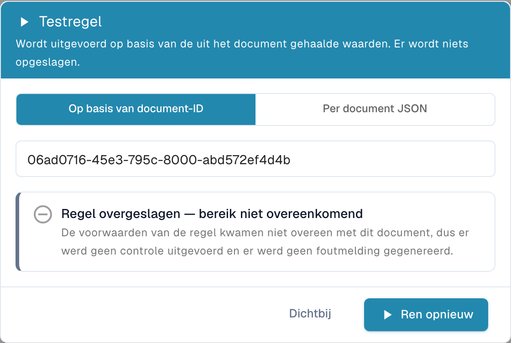<figcaption>
将同一规则的阈值提高到 1000 后：这张发票的金额（469.18）不在适用范围内，因此跳过规则
</figcaption></figure>

<figure>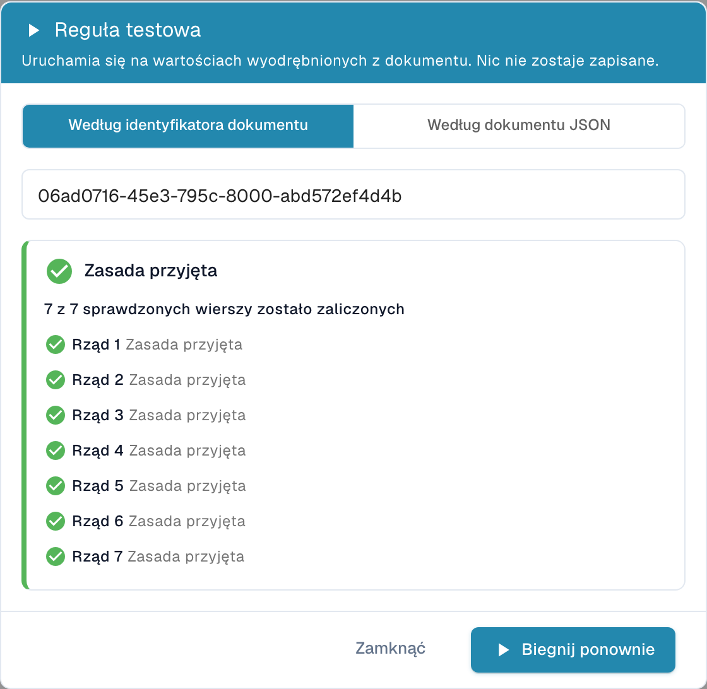<figcaption>
表格行规则会报告每一行的检查结果
</figcaption></figure>

请至少使用一份应该失败、一份应该通过和一份应该跳过的文档，测试每条新规则。

## 规则运行时机

* **处理期间**，与其他验证一起，在提取和转换规则之后运行。
* **每次保存**验证界面上的文档时运行。
* **规则更改后**，不会一次性重新检查所有现有文档。每份文档将在下次保存或重新处理时使用新规则重新检查。已经导出的文档不受影响。
* 规则按优先级顺序（然后按键）运行。一个字段只显示**一条**错误：如果针对同一字段的两条规则均失败，则优先显示先运行的规则产生的错误；后续规则不会覆盖它。
* 警告会单独收集，且不会隐藏错误。
* 如果无法评估规则（例如公式中出现除以零），系统会跳过该规则。规则出错不会导致文档被误标为无效。

## 日志 

每条规则都可以记录自己的每次评估。打开该文档类型的 **规则执行日志** 页面：页头显示文档类型，右上角的刷新图标重新加载列表。

**查找** 决定搜索依据，默认是 **规则键**，在该字段旁的输入框中填写要搜索的值。按文档搜索时，**规则类型** 为必填项。可用 **结果**、**已执行**、**起始日期** 和 **迄今为止** 缩小结果范围。

<figure>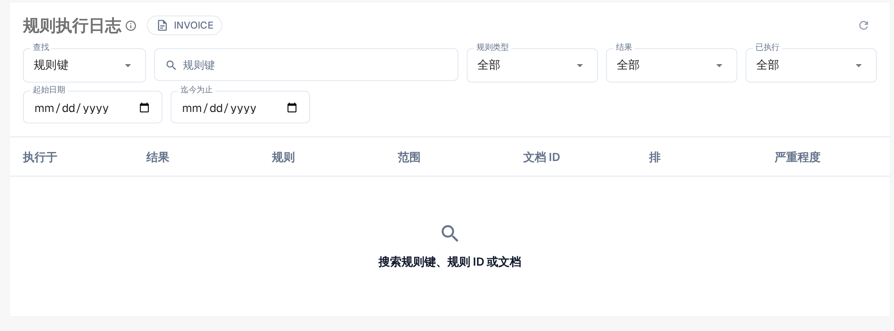<figcaption>
规则执行日志页面：上方是筛选条件，下方每次评估对应一行。在开始搜索之前，表格会提示应输入什么。
</figcaption></figure>

打开某条记录可查看详细信息，包括**条件跟踪记录**：*Applies when* 中的每个条件行、预期值、文档中的实际值以及条件是否通过。请参阅[查看日志中的条件跟踪](rule-conditions-applies-when.md#read-the-condition-trace-in-the-logs)。

同一页面也会显示转换规则和布局选择规则的日志。

## 示例 

复制以下规则并以此为起点。字段和列键对应标准 **发票** 文档类型；请根据您的文档类型进行调整。

**1. 超过 250 EUR 的德国发票必须填写供应商税号**
Header field · Error · 关联到 *Supplier Tax ID* · **全部** 应用条件：*Document Origin* 为 *Deutsch*，*Total Amount* 大于 *250* · 选择 **必填** 检查 · 消息“Supplier tax ID is missing. German invoices over 250 EUR must show it.” · 代码 `REQUIRED_CONDITIONAL`。

**2. 表头金额加总一致**（替代内置检查）
Header field · Error · 关联到 *Total Amount* · 始终适用 · **公式** `header.total_amount == header.total_net_amount + header.total_tax_amount`，容差 `0.01` · 消息“Total {actual} does not equal net plus tax ({expected}).”

**3. 各行金额之和等于净额**（替代内置检查）
Whole table · Error · 关联到 *Total Net Amount* · 始终适用 · **公式** `sum(row.NET_AMOUNT) == header.total_net_amount`，容差 `0.05` · 消息“Line net amounts add up to {actual}, but the invoice net amount is {expected}。”· 代码 `LINES_HEADER_MISMATCH`。

**4. 商品行的数量必须大于零**
Table line · Error · 表格 `INVOICE_TABLE`，列 `QUANTITY` · 应用条件为 *row.ITEM_NUMBER* 不为空 · **范围** 最小值 `0.01` · 代码 `OUT_OF_RANGE`。

**5. 行金额 = 数量 × 单价**
Table line · Warning · 列 `NET_AMOUNT` · 始终适用 · **公式** `row.NET_AMOUNT == row.QUANTITY * row.UNIT_PRICE`，容差 `0.01`。

**6. 某个供应商的发票编号格式**
Header field · Error · *Invoice Number* · 应用条件为 *Supplier ID* 是 *20723* · **图案** `^INV-\d{6}$`。

**7. 到期日不能早于发票日期**
Header field · Error · *Due Date* · 始终适用 · **比较字段**：Due Date *不早于（≥）* Invoice Date · 代码 `DATE_ORDER`。

**8. 发票日期不能在未来**
Header field · Error · *Invoice Date* · 始终适用 · **比较字段**：Invoice Date *不晚于（≤）* 今天。

**9. 仅允许使用已批准的币种（仅提示）**
Header field · **警告** · *Currency* · 始终适用 · **值列表** *approved_currencies* · 代码 `VALUE_NOT_ALLOWED`。

**10. 金额超过 5,000 时必须填写采购订单**
Header field · Error · *Purchase Order* · 应用条件为 *Total Amount* 大于 *5000* · **必填**。

## 最佳实践

* **先将规则设为警告。** 将新规则的严重级别设为 **警告**，观察几天（使用 Test rule 和日志），然后再改为 **错误**。
* **一条规则对应一条消息。** 多条简短且说明清晰的规则比一条复杂公式更容易理解。
* **使用应用条件，而不是复制规则。** 使用一条带条件的规则，比针对五个供应商复制五条规则更好。
* **金额比较应留有容差。** 公式检查金额时务必设置容差。
* **按业务规则命名**，不要按所用方法命名（使用“到期日不能早于发票日期”，而不是“比较规则 3”）。
* **规则正常工作后关闭 Log execution。** 此设置会在每次保存时写入一条日志。

## 故障排除

| 症状 | 检查项 |
| --- | --- |
| 规则从未引发错误 | 是否已为该文档类型启用此功能，且规则处于 **积极的** 状态？使用 **测试规则** 测试该文档：“skipped”表示 *Applies when* 条件不成立。 |
| 空字段未报告错误 | 只有 **必填** 会报告空值。请添加 Required 规则。 |
| 内置总额检查消失 | 启用自定义规则时这是预期行为。请将检查重新创建为 Formula 规则（示例 2 和 3）。 |
| 修改规则后，文档没有受到影响 | 文档会在下次保存时重新检查。请保存或重新处理该文档。 |
| Pattern 匹配了不应匹配的值 | Pattern 会在值中搜索。请使用 `^` 和 `$` 锚定表达式。 |
| 字段上只显示两条错误中的一条 | 字段只显示第一条失败规则的结果。请调整优先级，或将其中一条规则关联到其他字段。 |
| *Applies when* 中缺少表格列 | 表格列仅在 **表格行** 级别可用。 |
| 无法更改系统默认规则 | 点击 **定制** 创建自己的副本。 |

## 相关内容

* [规则条件（应用条件）](rule-conditions-applies-when.md) — 详细介绍条件
* [转换规则](transformation-rules.md) — 在验证前更正值
* [布局选择规则](layout-manager/layout-selection-rules.md) — 选择文档使用的布局
* [设置验证和匹配分数](fields/setting-validation-and-match-score.md) — 设置各字段的验证选项
